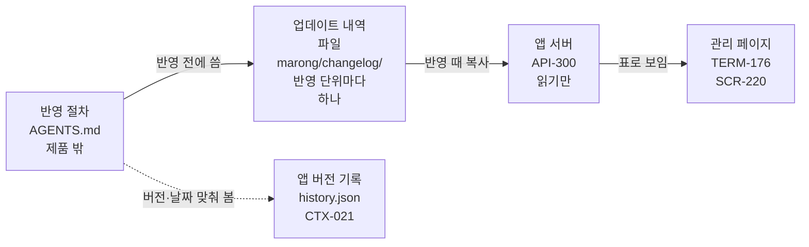

# 관리 페이지 업데이트 내역: 기능 변경 도메인 설계(바뀌는 맥락)

상태: 초안(proposed), 2026-11-24 KST, Claude. 체크포인트 전이에요. 승인된 관리 페이지(part `admin`)에 더하는 기능 변경이라 CORTHEX 기능 변경 절차대로 01부터 12까지 차례로 거쳤어요. 단계마다의 결과는 [0절](#0-기능-변경-기록)에 있어요.
범위: 관리 페이지(`/chat/admin/`, TERM-176)에 서비스 전체(앱·웹·통화·대화·관리)의 업데이트 내역(change log)을 표로 보여요. 항목마다 '변경 전'·'변경 후' 칸을 나눠 적고, 지금까지 나간 것을 근거와 함께 거슬러 채우고, 앞으로는 릴리스·운영 반영마다 내역을 쓰는 것을 반영 절차에 넣어요.
ID 번호: TERM-270\~271, REQ-620\~625, FL-215\~216, SPEC-500\~504, API-300, SCR-220, TASK-540\~545, TC-700\~713, 결정 D170\~D171(잡아 둔 범위는 TERM-270\~279, REQ-620\~629, FL-215\~219, SPEC-500\~509, API-300\~309, SCR-220\~229, TASK-540\~549, TC-700\~719, D170\~179. [ID 범위 표](../10-wbs/README.md#id-범위)). 같은 관리 문서에 관리 페이지 기능 변경 3(꾸미기 꺼짐 안내, 앱 지워짐 표시, 브랜치 `claude/admin-decor-off-app-removed`, 2026-11-24 PR 전)이 같이 설계되고 있고, 그쪽이 관리 part의 남은 번호(TERM-242, REQ-586\~587, SPEC-459\~460, TASK-502\~505, TC-653\~657)와 D160\~D169, '기능 변경 목록 3'을 써요. 그래서 이 설계는 관리 페이지 기능 변경 4(목록 4-1\~4-12)로 부르고, 2026-11-24 `origin`의 모든 브랜치와 그 작업 폴더에서 쓰이지 않은 번호를 새로 잡았어요.
표시: 근거가 사용자님 말이나 문서·코드·운영 기록이면 `[확실]`, 거기서 끌어낸 것은 `[추론]`, 근거 없는 짐작은 `[추측]`. Claude가 새로 정한 것은 '새 제안'이라고 적어요.

## 0. 기능 변경 기록

### 0.1 요청(사용자님 말)

- D170(2026-11-24 KST, 사용자님이 오랑이 Home 채팅에서 한 말을 오랑이가 마롱이에게 인계, 오랑이 인계 `msg_06937b1e9660`): "야 마롱이 관리자페이지에서 업데이트 내역 즉 change log 기록하라고 해줘. 어떤 기능이 추가되거나 개선되었는지 등등. 표로 나타내줘 전 후 나눠서"
- D171(2026-11-24 KST, 마롱이 항목 91의 답, 사용자님): 표 모양 "항목마다 '변경 전'·'변경 후' 칸", 범위 "앱·웹·통화·관리 등 서비스 전체 바뀐 것", 운영 반영 "반영까지 해"(설계와 구현이 끝난 뒤).
- 절차: 기능을 더할 때는 01 단계로 돌아가 설계해요(D107, 2026-11-21 사용자님 "야 뭐 기능 추가할땐 1단계로 회귀해서 해라"). 구현·서버 반영은 GPT가 해요(D60, AGENTS.md).

### 0.2 기준선(승인본)

| 단계 | 승인한 체크포인트 | 승인한 커밋 |
| --- | --- | --- |
| 01·03·05·06·07·09 | D135(2026-11-23, 오랑이 답 msg_9930b2c4e251) | PR #104 `7395219` |
| 02·04·08·10·12 | D135, 그 뒤 노트북 폭 D141(2026-11-23, 질문 msg_4f73974079e9) | PR #109 `f232040` |
| 구현 | TASK-490\~499 합침(PR #116·#117), TASK-500 운영 반영 2026-11-24 03:32 KST(초안 PR #121) | `main` `ad7226b` |

비교한 `main`은 `1a29477`(2026-11-24)이에요.

### 0.3 단계마다의 결과(제안)

| 단계 | 결과 | 바뀌는 것(제안) |
| --- | --- | --- |
| 01 도메인 | 바뀜 | 새 용어 TERM-270 업데이트 내역, TERM-271 반영 단위. TERM-176의 화면 목록에 SCR-220이 늘어요(기능 변경 목록 4-1). 새 맥락은 없어요(3절) |
| 02 요구사항 | 바뀜 | REQ-620\~625 더함(proposed). REQ-570과 시작 값 '탭 차례'가 바뀌어요(4-2·4-3) |
| 03 흐름 | 바뀜 | FL-215(업데이트 내역 보기), FL-216(반영 때 업데이트 내역 쓰기) 더함. FL-200·201의 칸과 화살표는 그대로이고(새 탭은 개요의 분기가 아니라 탭 줄의 한 칸이에요), FL-200 메모 줄의 탭 목록만 바뀌어요(4-4) |
| 04 명세 | 바뀜 | SPEC-500\~504 더함. SPEC-450(화면 경로 여섯과 탭 여섯 칸)과 3.1 표가 바뀌어요(4-5·4-6). SPEC-458과 1절 공통 규칙은 그대로이고, SCR-220의 넓은 배치는 새 SPEC-502가 맡아요 |
| 05 표 | 바뀜 없음 | 새 표·칸·함수가 없어요. 내역은 DB가 아니라 저장소 파일이에요(SPEC-500, 02 질문 3의 추천 B). DB 표 안을 고르면 이 단계가 바뀌어요(02 질문 3) |
| 06 API | 바뀜 | API-300 `GET /chat/admin/api/changes` 더함(proposed). API-280·281은 그대로예요 |
| 07 사이트맵 | 바뀜 | SCR-220 업데이트 내역(`/chat/admin/changes`)을 SCR-169의 자식으로 더함(proposed). 다른 화면의 경로·흐름은 그대로예요 |
| 08 화면 상태 | 바뀜 | SCR-220의 상태 정의([admin-changelog.md](../08-screens/admin-changelog.md)) 더함. 1절 공통 머리의 탭 목록과 1.1절 넓은 폭 머리 글이 바뀌어요(4-7·4-8) |
| 09 목업 | 바뀜 없음(토큰), 목업 더함 | 새 토큰이 없어요(D67로 얼린 토큰과 지금 `unified.css`·`chat.css`만). 목업 [design/admin-changelog-mockup.html](../../design/admin-changelog-mockup.html)과 폰·노트북 그림을 더했어요 |
| 10 작업 목록 | 바뀜 | TASK-540\~545 더함([admin-changelog.md](../10-wbs/admin-changelog.md)), 지난 내역 초안([admin-changelog-backfill.md](../10-wbs/admin-changelog-backfill.md)). AGENTS.md의 반영 절차 두 곳과 인계 형식의 '반영' 줄이 바뀌어요(4-10\~4-12) |
| 11 개발 | 시작 전 | GPT. 체크포인트 뒤에 시작해요 |
| 12 시험 계획 | 바뀜 | TC-700\~713 더함([admin-changelog.md](../12-qa/admin-changelog.md)). TC-620의 '탭 여섯'이 바뀌어요(4-9). TC-621·637·640·641은 그대로이고, 여덟째 경로와 SCR-220의 폭은 새 TC가 봐요 |
| 13 발표 | 건너뜀 | 이 프로젝트는 13을 쓰지 않아요(project.json `skipped`) |

지우거나 미루는 승인 항목은 없어요. 뜻이 바뀌는 승인 항목은 [요구사항의 기능 변경 목록 4](../02-prd/admin-changelog.md#기능-변경-목록-4승인된-항목이-바뀌는-곳)의 4-1\~4-12이고, 답을 받기 전에는 승인 문서를 고치지 않았어요(답을 받은 뒤 그 문서에서 고쳐요).

## 1. 서비스 개요

다시 쓰면: 사용자님(관리자)이 관리 페이지에서 마롱이에 언제 무엇이 더해지고 나아지고 고쳐졌는지를 한 표로 봐요. 항목마다 바뀌기 전과 뒤를 나란히 적어서, 무엇이 달라졌는지를 글 하나로 알 수 있어요. 앱(안드로이드)만이 아니라 웹·통화·대화·관리까지 서비스 전체가 대상이에요. `[확실]` D170·D171

지금 저장소와 운영에서 읽은 사실(2026-11-24, 운영 서버는 읽기만):

- 업데이트 내역을 한곳에 모은 기록은 없어요. 바뀐 것은 PR 설명, BUG 문서(`docs/12-qa/BUG-*.md`), WBS의 `## 11단계 진행` 표, 반영 기록 PR(#118·#121·#122·#124·#126), `docs/12-qa/runs/`에 흩어져 있어요. `[확실]`
- Git 태그와 GitHub 릴리스는 없어요(`git tag -l` 0개, `gh release list` 0개). `[확실]`
- 앱(안드로이드)은 버전이 있어요. 운영의 버전 기록(`/var/lib/marong/app-releases/history.json`, TERM-222)에 0.2.2(코드 5)\~0.3.4(코드 12)의 여덟 줄과 릴리스 노트가 있고, 0.3.3까지는 '기록에서 채움'(`backfilled`)이에요. 0.1.x·0.2.0·0.2.1은 손으로 깐 버전이라 그 기록에 없어요(앱 `build.gradle`의 Git 이력에만 있음). `[확실]`
- 서버 쪽 반영(웹, 통화, 관리, 대화)에는 버전 번호가 없어요. 대신 운영 서버의 `~/marong-deploy/`에 반영마다 폴더(`<YYYYMMDD>-<이름>`, 뒤에 임의 글자가 붙기도 함)가 있어요. 2026-11-15부터 2026-11-24까지 63개예요(2026-11-24 15시대 KST `ls -d` 수). AGENTS.md도 되돌리기 스크립트를 `~/marong-deploy/<날짜>-<이름>/`에 두라고 해요. 그 전(2026-10-25\~11-14, 카카오톡·디스코드 시기)의 반영은 PR 설명에만 드문드문 있어요. `[확실]`
- 관리 페이지는 2026-11-24 03:32 KST에 여섯 화면(개요, 회원, 초대 링크, 앱 버전, 비용, 아이템)과 탭 줄로 반영됐어요(TASK-500, PR #121). 앱 서버 코드는 운영에서 `/opt/marong-app/marong/`에 있어요. `[확실]`
- 앱 버전 화면(SCR-203)의 '버전 기록'은 API-267(앱 릴리스만)을 읽고, REQ-578로 API-267만 읽어야 해요. `[확실]`

결정과 기본값(새 제안, 체크포인트에서 물어요. 질문은 [02 문서 5절](../02-prd/admin-changelog.md#5-체크포인트-질문)):

- 한 그룹은 운영 반영 한 번(반영 단위, TERM-271)이에요. 서버는 반영 폴더 이름(임의 글자를 뺀 `<YYYYMMDD>-<이름>`), 앱은 `app-<버전 이름>`으로 불러요. 반영 단위 아래에 바뀐 항목을 한 줄씩 적어요. `[추론]` 이미 있는 반영 폴더 규칙
- 내역은 저장소 폴더 `marong/changelog/`에 반영 단위마다 JSON 파일 하나로 두고, 반영 때 그 파일만 앱 서버의 같은 폴더에 더해요. 앱 서버가 폴더의 파일을 모두 읽어 보여요. `[추론]`
- 관리 페이지에 탭 '업데이트 내역'(SCR-220)을 새로 더해요. 앱 버전 화면의 '버전 기록'은 그대로 두어요. `[추론]` REQ-578
- 지난 내역은 처음 PR(#1, 2026-10-25)부터 채워요. 근거가 없는 칸은 '기록 없음'이에요. `[추측]` 시작점

범위 밖: 친구에게 업데이트 내역 보이기(앱·웹 화면), 업데이트 내역을 푸시로 알리기, 관리 페이지에서 내역 쓰기·고치기(쓰기 화면), 개요에 '최근 업데이트' 카드, 앱 버전 화면에서 그 버전의 내역으로 가는 링크, 내역 자동 생성(PR 제목·커밋에서 뽑기).

## 2. 이벤트 스토밍

- 보드: 없음. 기존 제품에 더하는 일이라 바뀌는 맥락만 한 번에 초안(one-pass draft)으로 썼어요(관리 페이지 01과 같은 방식).
- 체크포인트: NEXUS를 쓰지 않아요(2026-11-22 사용자님 "지금 nexus 리빌딩하고 있음 넥서스 쓰지 말고 작업해"). 01\~12를 쓴 뒤 마롱이에게 질문 목록을 보내요.

### 시간 줄

| Lane | Events |
| --- | --- |
| 반영(GPT, 저장소와 운영 서버) | 구현 PR 합쳐짐 → 업데이트 내역 파일 쓰임(반영 전, PR) → 내역 검토됨(Claude 리뷰) → 운영 반영됨(파일 복사 포함) → 반영 기록과 내역이 맞춰짐 ; 반영 되돌려짐 → 그 내역 파일 빠짐 |
| 앱 릴리스(GPT, 노트북과 운영 서버) | APK 서명됨 → 업데이트 내역 파일 쓰임(`app-<버전>`) → 새 버전 올려짐(FL-146) → 버전 기록과 내역이 맞춰짐 |
| 관리자(사용자님) | 업데이트 내역 화면 열림 → 내역 읽힘 → 영역으로 걸러짐 → 근거 PR 열림 |
| 지난 내역(한 번) | 근거 모아짐(PR·BUG·반영 폴더·버전 기록) → 지난 내역 초안 쓰임(Claude) → 파일로 옮겨짐(GPT) → 반영됨 |

` ; `는 서로 다른 흐름이에요. 읽기 모델: 업데이트 내역(반영 단위와 항목의 목록).

## 3. 바운디드 컨텍스트

새 맥락은 없어요. 업데이트 내역은 제품이 도는 동안 생기는 사건이 아니라, 반영 절차가 남기는 기록을 관리 페이지가 읽는 것이에요. 규칙(무엇을 언제 쓰는지)은 반영 절차(AGENTS.md, 제품 밖)가 갖고, 제품 안에서는 관리 페이지의 읽기 모델 하나예요. 그래서 관리자 화면(TERM-176)의 CTX-026 용어 아래에 두어요. `[추론]`

업데이트 내역은 반영 절차가 쓰고 관리 페이지는 읽기만 한다는 것을 보세요. 앱 버전 기록(CTX-021)은 맞춰 보는 데만 쓰고, 관리 페이지가 그것을 다시 읽거나 바꾸지 않아요.

| 맥락 | 바뀌는 것 |
| --- | --- |
| CTX-026 가입과 로그인 | 관리자 화면(TERM-176)의 화면 목록에 업데이트 내역(SCR-220)이 늘어요(4-1). 규칙은 그대로예요 |
| CTX-021 앱 자동 업데이트 | 바뀌지 않아요. 앱 릴리스 절차에 내역 파일 쓰기 한 단계가 늘지만, 그것은 반영 절차(제품 밖)의 일이고 버전 기록·업데이트 기록의 형식은 그대로예요 |
| 그 밖의 맥락 | 바뀌지 않아요. 내역은 그 맥락들이 바뀐 것을 글로 적을 뿐이에요 |

## 4. 컨텍스트 표

| Given by | Read model | Command | Aggregate | Events |
| --- | --- | --- | --- | --- |
| 관리자 | 업데이트 내역: 반영 단위(이름, 반영일, 서버·앱, 앱 버전, 근거)와 항목(구분, 영역, 항목, 변경 전, 변경 후, 근거) | | | |
| 반영하는 쪽(GPT) | | 업데이트 내역 쓰기(저장소 PR) | 반영 단위(파일 하나, 제품 밖) | 업데이트 내역 쓰임 |
| 반영하는 쪽(GPT) | | 내역 파일 복사(운영 반영 안) | 반영 단위 | 업데이트 내역 반영됨 |
| 반영하는 쪽(GPT) | 반영 기록(재시작 시각), 앱 버전 기록 | 맞춰 보기 | 반영 단위 | 내역이 반영 기록과 맞음 / 다름 |

- Aggregate rules(새 제안): ① 반영 단위 하나는 파일 하나이고 파일 이름이 단위 이름이에요. ② 운영 반영 한 번에 반영 단위 하나. 친구나 관리자가 알아챌 수 있는 변화가 없는 반영(로그·시험·문서만)은 파일을 만들지 않고 반영 기록 PR에 '업데이트 내역 없음'이라고 적어요. ③ 새 기능(구분 '추가')의 '변경 전'은 '없음'이에요. ④ 근거를 못 찾은 칸은 '기록 없음'이고 지어내지 않아요. ⑤ 항목마다 근거(PR 번호나 커밋)가 하나 이상 있어요(항목에 없으면 단위의 근거). ⑥ 대화 내용, 실제 친구 이름, 이메일, 설치 ID, 키·토큰은 적지 않아요. 실제 사람은 '친구'처럼 일반 말로 적어요.
- Given–When–Then: Given 반영 단위 `20261124-admin`(관리 페이지 다시 만들기, 2026-11-24)와 `app-0.3.4`(2026-11-23), When 관리자가 업데이트 내역을 엶, Then 새것부터 '11월 24일 · 관리 페이지 다시 만들기' 그룹이 먼저, 그 아래 '11월 23일 · 앱 0.3.4' 그룹이 보이고, 항목마다 구분·영역·항목·변경 전·변경 후·근거가 보여요.
- Given–When–Then: Given 반영일 근거가 없는 지난 단위(PR #1), When 화면, Then 반영일 자리에 '기록 없음'이고 맨 아래쪽(근거 날짜 차례)에 있어요.
- Given–When–Then: Given 반영 때 내역 파일을 복사하지 않음, When 반영 뒤 맞춰 보기, Then 운영 폴더에 그 단위 파일이 없어서 확인이 실패하고, 반영 기록 PR에 적고 파일을 복사해요(FL-216).
- External systems: GitHub(근거 PR 링크, 저장소는 공개), 운영 서버의 반영 폴더와 앱 버전 기록(맞춰 보기만).

## 5. 컨텍스트 사이 의존

| From | To | Kind | Pattern | Why | Data |
| --- | --- | --- | --- | --- | --- |
| 관리 페이지(SCR-220) | 업데이트 내역 파일 | call(sync, 읽기만) | 순응자 | 표 그리기 | API-300 → 반영 단위와 항목 |
| 반영 절차 | CTX-021 앱 버전 기록 | 읽기(맞춰 보기) | 순응자 | 앱 내역의 버전·날짜 확인 | `history.json`의 `versionName`·`versionCode`·`at` |

동기 호출이 원을 이루는 곳은 없어요.

## 6. 핫스팟

| Hotspot | Context | State | Answer or next step |
| --- | --- | --- | --- |
| 무엇을 한 줄로 묶을지(반영일, 반영 단위, 새 서버 버전 번호) | 관리 페이지 | open | 02 질문 2. 추천: 반영 단위 |
| 내역을 어디에 둘지(파일 하나, 단위마다 파일, DB 표) | 관리 페이지 | open | 02 질문 3. 추천: 단위마다 파일. DB를 고르면 05·06·10이 바뀌어요 |
| 화면: 새 탭인지, 앱 버전 화면의 '버전 기록'을 넓힐지 | 관리 페이지, CTX-021 | open | 02 질문 4. 추천: 새 탭(REQ-578을 지킴) |
| 반영 기록 PR이 여럿 열려 있을 때 같은 파일을 서로 덮어씀 | 반영 절차 | answered(새 제안) | 단위마다 파일을 따로 두고 반영 때 자기 파일만 더해서 덮어쓰지 않아요(SPEC-503). 2026-11-24에 반영 기록 PR 넷(#121·#122·#124·#126)이 함께 열려 있었어요 |
| 반영 폴더 이름의 날짜와 실제 반영 날짜가 다름(예: `20261119-app-release-code7`은 2026-11-18 23:53 KST에 만듦) | 반영 절차 | answered(새 제안) | 단위 이름은 폴더 이름 그대로, 반영일은 반영 기록의 재시작·게시 시각(한국 시각 날짜)으로 따로 적어요(SPEC-500) |
| 2026-11-15 전의 반영은 시각 기록이 드묾 | 지난 내역 | answered(새 제안) | 반영일 '기록 없음', 근거는 PR. 단위 이름은 PR을 합친 날(한국 시각)과 `pr<번호>`(SPEC-504) |
| 근거를 못 찾은 반영 폴더(무엇을 바꿨는지 PR이 없음) | 지난 내역 | open | 지어내지 않고 [지난 내역 초안](../10-wbs/admin-changelog-backfill.md)의 '근거 없는 반영 폴더' 표에 남겨요. 체크포인트 뒤 반영 기록이 나오면 채워요 |
| '업데이트 내역'과 '업데이트 기록'(TERM-223, 폰마다의 업데이트 상태)의 이름이 비슷함 | CTX-021 | answered(새 제안) | 사용자님 말 그대로 '업데이트 내역'을 쓰고, 용어집 Avoid 칸과 화면 머리에서 구분해요(7절) |

## 7. 용어집

기존 용어 관리자 화면(TERM-176), 릴리스(TERM-093), 릴리스 노트(TERM-221), 버전 기록(TERM-222), 업데이트 기록(TERM-223)은 그대로 써요. TERM-176은 화면 목록이 늘어나는 제안이 있어요(기능 변경 목록 4-1).

| ID | Term | Definition | Context | Code name | Avoid |
| --- | --- | --- | --- | --- | --- |
| TERM-270 | 업데이트 내역 | 마롱이 서비스 전체(앱·웹·통화·대화·관리)에서 운영에 나간 변화를 반영 단위마다 모은 기록(change log). 항목마다 구분(추가·개선·수정·제거), 영역, 변경 전, 변경 후, 근거가 있어요. 관리 페이지의 SCR-220에서 읽기만 해요 | CTX-026 | `changelog`, API-300 | 버전 기록(TERM-222, 앱 릴리스만), 릴리스 노트(TERM-221, 앱 버전 하나의 글), 업데이트 기록(TERM-223, 폰마다의 업데이트 상태) |
| TERM-271 | 반영 단위 | 업데이트 내역을 묶는 단위. 운영 반영 한 번이에요. 서버는 반영 폴더 이름(`<YYYYMMDD>-<이름>`), 앱은 `app-<버전 이름>`으로 불러요. 반영일은 그 반영의 재시작·게시 시각의 한국 시각 날짜예요 | CTX-026 | `unit`, `marong/changelog/<이름>.json` | 배포판, 릴리스(TERM-093은 앱 APK 한 벌) |

## 8. 체크포인트 노트

1. 사용자님 말에서 바로 온 것: 관리 페이지에 업데이트 내역(change log)을 표로, 전·후를 나눠(D170), 항목마다 '변경 전'·'변경 후' 칸, 서비스 전체, 반영까지(D171).
2. Claude가 정한 것(새 제안, 체크포인트에서 질문): 반영 단위로 묶기, 저장소 폴더에 단위마다 파일, 새 탭 SCR-220, 구분 넷(추가·개선·수정·제거)과 영역 여섯, 지난 내역 시작점(PR #1), 반영 절차에 넣는 글.
3. 열린 질문: [02 문서 5절](../02-prd/admin-changelog.md#5-체크포인트-질문)의 질문 0\~7과 기능 변경 목록 4-1\~4-12(항목마다 따로).
