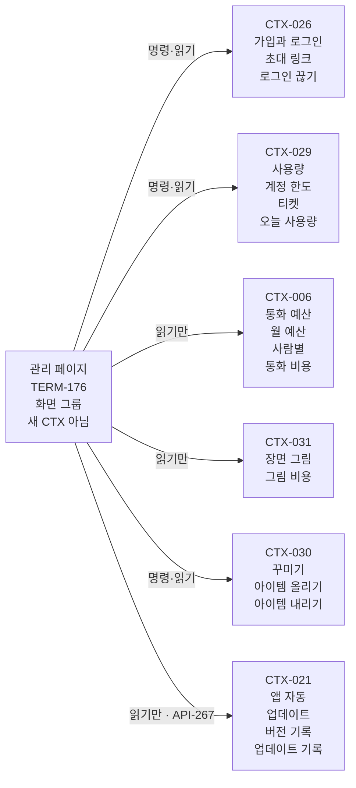

# 마롱이 관리 페이지 다시 만들기: 도메인 설계(바뀌는 맥락)

상태: 한 번에 초안(2026-11-23 새벽 KST, Claude 마롱이 봇). 새 맥락은 없어요. 관리 페이지는 기존 맥락 여섯(CTX-026 가입과 로그인, CTX-029 사용량, CTX-006 통화 예산, CTX-030 꾸미기, CTX-031 장면 그림, CTX-021 앱 자동 업데이트)의 읽기 모델과 관리자 명령을 한 화면 그룹에 모은 것이에요.
범위: 관리 페이지(`/chat/admin/`, TERM-176)를 화면 여러 개로 다시 짜요. 지금 기능(초대 링크, 회원과 한도·티켓·로그인 끊기, 그림 비용, 아이템)을 옮기고, 앱 버전 화면과 개요(주의 항목)를 더해요. 화면 뒤의 규칙(초대 링크 7일, 한도 계산, 티켓, 아이템 검사, 업데이트 기록)은 그 맥락의 문서가 그대로 맡아요.
ID 번호: TERM-240\~241, REQ-570\~584, FL-200\~201, SPEC-450\~457, API-280\~281, SCR-200\~204, TASK-490\~501, TC-620\~639, 결정 D132\~D133([인계 목록](../10-wbs/README.md#id-범위), 잡아 둔 범위는 TERM-240\~259, REQ-570\~599, FL-200\~209, SPEC-450\~479, API-280\~299, SCR-200\~219, TASK-490\~519, TC-620\~669, D132\~133·D135\~149. D134는 앱 업데이트 기능 변경 PR #101이 2026-11-23에 썼어요). 새 CTX·TBL 번호는 없어요.
표시: 근거가 동희님 말이나 문서·코드면 `[확실]`, 거기서 끌어낸 것은 `[추론]`, 근거 없는 짐작은 `[추측]`. Claude가 새로 정한 것은 '새 제안'이라고 적어요.

## 1. 서비스 개요

동희님 말(오랑이 봇이 마롱이 봇에게 전함):

- D132(2026-11-22 23시대 KST): "야 어드민 페이지 처음부터 다시만들자고 해 아예 /corthex로"
- D133(2026-11-23 00시대 KST): "ㅇㅇ 너가 잘 판단해서 새벽동안 작업 이어가줘 / 자러간다". 새벽 동안 되돌릴 수 있는 기본 결정은 Claude가 하고 무엇을 왜 정했는지 적어요. 체크포인트, 승인된 항목을 빼거나 뜻을 바꾸는 일, 지우기, 반영은 동희님께 물어요.
- 함께 받은 조건(오랑이 인계, 2026-11-22): 관리 페이지에 '앱 버전' 화면을 둬요(버전 기록과 릴리스 노트, 멈춤 상태, 폰마다 지금 버전과 마지막 보고, 보냄·받아 감·상태·설치 시각). 이 화면은 앱 업데이트 기능 변경(PR #101)이 정한 형식(API-267, `history.json`, `app_update_events`)을 읽기만 해요(PR #101의 REQ-559, 오랑이 `msg_013bfd28376b`).

다시 쓰면: 관리 페이지를 지금 코드를 고쳐 붙이지 않고 CORTHEX 01 단계부터 다시 설계해요(D132, D107 "기능 추가할땐 1단계로 회귀"). 관리자는 동희님 한 사람이고, 열었을 때 손볼 일이 먼저 보이고, 폰들이 새 버전을 받았는지 볼 수 있어야 해요. `[확실]` D132, 인계 조건 · `[추론]` "손볼 일이 먼저"

지금 코드에서 읽은 사실(`main` `7b0c6e1`):

- 관리 페이지는 한 장(`marong/app_chat_static/admin.html`·`admin.js`)이에요. 위에서부터 이번 달 그림 비용 카드, '초대 링크'(새 링크 만들기 칸과 목록), '가입한 사람'(사람마다 '한도 바꾸기', '로그인 끊기', '티켓 넣기')이 이어져요. 아이템은 따로 한 장(`/chat/admin/items`, SCR-186)이고 첫 장에 링크 한 줄이 있어요. `[확실]`
- 서버는 `marong/app_admin.py` 하나예요. 경로: 그림 비용 API-266, 아이템 API-263\~265, 초대 링크 목록 API-240과 만들기 API-235, 회원 목록 API-236, 로그인 끊기 API-241, 티켓 넣기 API-237, 한도 바꾸기 API-243. `[확실]`
- 관리자 확인: Cloudflare Access JWT(`Cf-Access-Jwt-Assertion`)를 서버가 다시 확인하고, 그 이메일의 해시가 `MARONG_ADMIN_EMAIL_SHA256`과 같아야 해요. 쓰기는 같은 주소에서 온 요청만 받아요(`Origin`, 다르면 403 `cross_site`). 로그인 쿠키는 보지 않아요. `[확실]`
- 초대 링크 목록에는 '거둠(`revoked`)' 상태가 있지만 거두는 API는 없어요. `[확실]`
- 회원 목록 응답에는 사람마다 이번 달 통화 비용(`callMonthUsd`)이 있지만 통화 전체 월 예산(150달러, TERM-014) 대비 사용률은 관리 페이지에 없어요. 통화 서버만 `call.settings`의 `monthly_budget_usd`와 이번 달 합을 계산하고, 앱 서버 역할은 통화 비용 표를 읽을 수 없어요(`call.friend_month_usd` 함수로 한 사람의 합만 읽음). `[확실]`
- 서버 셸 명령으로만 하는 관리 일이 있어요: 새 버전 올리기·멈추기·다시 켜기(`app-release`), 통화 예산·단가(`cost_admin.py`), 선톡·일기 켜고 끄기. 이번 범위에서는 화면에 옮기지 않아요(아래 '범위 밖'). `[확실]`

결정과 기본값(모두 새 제안, D133에 따라 Claude가 정함):

- 관리 페이지를 여섯 화면으로 나눠요: 개요(첫 화면), 회원(목록과 한 사람), 초대 링크, 앱 버전, 비용, 아이템. 화면 위의 탭 줄로 오가요. 한 장에 모두 늘어놓으면 폰 폭에서 손볼 일을 찾기 어려워서예요. `[추론]`
- 첫 화면은 개요(TERM-240)예요. 맨 위에 주의 항목(TERM-241)을 한 줄씩, 그 아래 숫자 카드(회원, 오늘 사용, 통화 월 예산, 그림 비용, 앱 버전)를 둬요. `[추측]` 새 제안
- 앱 버전 화면은 API-267 하나만 읽어요. 버전 기록·업데이트 기록의 형식을 이 part에서 다시 정하지 않아요. `[확실]` 인계 조건
- 쓰기 기능은 지금 것 그대로예요(초대 링크 만들기, 로그인 끊기, 티켓 넣기, 한도 바꾸기, 아이템 올리기·내리기). 새 쓰기는 초대 링크 거두기 하나만 제안하고 동희님께 물어요(REQ-581). `[추론]`
- 통화 월 예산 사용률은 새 DB 함수 하나로 읽어요. 통화 서버와 같은 식이고 앱 서버는 합과 예산 숫자만 받아요(SPEC-457). 표는 새로 만들지 않아요. `[추론]` usage-limit의 `call.friend_month_usd`와 같은 방식
- 관리자 확인과 같은 주소 확인은 지금 그대로예요. 새 화면과 새 API도 같은 확인을 지나요. `[확실]` 기존 SPEC-395

범위 밖: 서버 셸 명령(앱 릴리스 멈추기·다시 켜기, 통화 예산·단가, 선톡·일기 켜고 끄기, 선 전화·그림 화두 설정)을 화면으로 옮기기(동희님께 질문, 추천은 다음 단계), 대화 글·기억·사진 보기, 관리자 여러 명, 화면에서 아이템 그림 올리기(지금처럼 저장소의 아이템 목록 폴더로), 푸시로 주의 항목 알리기.

## 2. 이벤트 스토밍

- 보드: 없음. 기존 제품에 더하는 일이라 바뀌는 맥락만 한 번에 초안(one-pass draft)으로 썼어요(project.json의 01-domain `note`와 같은 방식).
- 체크포인트: NEXUS를 쓰지 않아요(동희님 2026-11-22 "지금 nexus 리빌딩하고 있음 넥서스 쓰지 말고 작업해"). 01\~12를 쓴 뒤 Orca 항목 3과 이 PR에서 한 번에 요청해요.

### 시간 줄(관리자가 보는 줄만)

| Lane | Events |
| --- | --- |
| 개요 | 관리 페이지 열림 → 개요 읽힘 → 주의 항목 0개 or 주의 항목 n개 → 주의 항목 눌림 → 그 화면 열림 |
| 가입과 로그인(CTX-026) | 초대 링크 만들어짐 ; 초대 링크 거둬짐(제안) ; 로그인 끊김(관리자) |
| 사용량(CTX-029) | 계정 한도 바뀜 ; 티켓 넣어짐 |
| 통화 예산(CTX-006)·그림(CTX-031) | 이번 달 통화 비용 읽힘 ; 이번 달 그림 비용 읽힘 |
| 꾸미기(CTX-030) | 아이템 올려짐 ; 아이템 내려짐 |
| 앱 자동 업데이트(CTX-021, 읽기만) | 새 버전 올려짐(셸) → 업데이트 데이터 메시지 보냄 → 받아 감 → 업데이트 상태 보고됨 → 설치됨. 관리자는 앱 버전 화면에서 이 기록을 읽기만 해요 |

` ; `는 서로 다른 흐름이에요. 읽기 모델(데이터를 바꾸지 않음): 개요, 회원 목록과 한 사람, 초대 링크 목록, 앱 버전(API-267), 이번 달 비용.

## 3. 바운디드 컨텍스트

새 맥락은 없어요. 관리 페이지는 규칙을 가진 맥락이 아니라 여러 맥락의 읽기 모델과 관리자 명령을 모은 화면 그룹(UI 조합)이에요. 주의 항목은 각 맥락의 읽기 값에 문턱을 대어 고른 목록이라 새 규칙을 만들지 않아요. 그래서 관리자 화면(TERM-176)은 지금처럼 CTX-026의 용어로 두고, 뜻만 넓혀요. `[추론]`

지금 맥락 지도(관리 페이지에 닿는 곳만):

관리 페이지는 규칙을 가진 맥락이 아니라 여섯 맥락을 부르는 쪽이라는 것을 보세요. 앱 자동 업데이트(CTX-021)·통화 예산·장면 그림은 읽기만 하고, 명령은 가입과 로그인·사용량·꾸미기의 기존 명령뿐이에요.

| 맥락 | 바뀌는 것 |
| --- | --- |
| CTX-026 가입과 로그인 | 관리자 화면(TERM-176)의 뜻이 '한 장'에서 '화면 여섯 개의 그룹'으로 넓어져요. 초대 링크 거두기 명령이 늘 수 있어요(제안, REQ-581). 나머지 규칙은 그대로예요 |
| CTX-029 사용량 | 규칙은 그대로예요. 계정 한도 바꾸기·티켓 넣기의 자리가 회원 한 사람 화면(SCR-201)으로 옮겨요 |
| CTX-006 통화 예산 | 규칙은 그대로예요. 관리자가 읽는 값에 이번 달 통화 합과 월 예산(TERM-014)이 늘어요. 앱 서버는 새 DB 함수로 숫자 둘만 받아요 |
| CTX-031 장면 그림 | 규칙은 그대로예요. 그림 비용 표시가 개요와 비용 화면으로 옮겨요 |
| CTX-030 꾸미기 | 규칙은 그대로예요. 아이템 화면(SCR-186)이 관리 페이지 탭 줄의 한 칸이 돼요 |
| CTX-021 앱 자동 업데이트 | 이 part에서는 바꾸지 않아요. 관리 페이지는 PR #101이 정한 API-267을 읽기만 해요 |

## 4. 컨텍스트 표

### 관리 페이지에 모이는 명령과 읽기(바뀐 뒤 전체)

| Given by | Read model | Command | Aggregate | Events |
| --- | --- | --- | --- | --- |
| 관리자 | 개요: 주의 항목, 회원 수, 오늘 사용 합, 이번 달 통화 합과 월 예산, 이번 달 그림 비용, 최신 앱 버전과 뒤처진 폰 수 | | | |
| 관리자 | 초대 링크 목록(상태, 만든 때·쓴 때·만료) | 초대 링크 만들기(종류, 사람, 메모) | 초대 링크(CTX-026) | 초대 링크 만들어짐 |
| 관리자 | 초대 링크 목록 | 초대 링크 거두기(제안) | 초대 링크(CTX-026) | 초대 링크 거둬짐 |
| 관리자 | 회원 한 사람(계정 한도, 유효 한도, 오늘 사용량, 티켓, 세션 수, 이번 달 통화 비용) | 계정 한도 바꾸기 | 계정 한도(CTX-029) | 계정 한도 바뀜 |
| 관리자 | 회원 한 사람 | 티켓 넣기(1\~1000) | 티켓(CTX-029) | 티켓 넣어짐 |
| 관리자 | 회원 한 사람 | 로그인 끊기(그 사람의 모든 기기) | 기기 로그인(CTX-026) | 로그인 끊김 |
| 관리자 | 아이템 목록(올린 것·내린 것·아직 안 올린 것) | 아이템 올리기, 내리기 | 아이템(CTX-030) | 아이템 올려짐, 내려짐 |
| 관리자 | 이번 달 비용: 통화 합과 월 예산, 사람마다 통화 비용, 그림 비용 종류별 합과 예산 | | | |
| 관리자 | 앱 버전(API-267): 최신 릴리스와 멈춤, 버전 기록과 릴리스 노트, 폰마다 버전·뒤처짐·마지막 보고·업데이트 기록, 친구마다 받아 감 | | | |

- Aggregate rules: 새 집합체는 없어요. 명령은 모두 기존 집합체의 기존 명령이에요(거두기만 새로 제안). `[확실]` 기존 SPEC-395·398·417
- 주의 항목 규칙(읽기 모델의 문턱, 새 제안): ① 이번 달 통화 합이 월 예산의 80% 이상 ② 이번 달 그림 비용이 예산이 있는 종류의 80% 이상 ③ 업데이트 멈춤 중 ④ 뒤처진 폰 가운데 마지막 업데이트 상태가 확인 창 기다림이나 실패인 폰, 또는 최신 릴리스를 올린 지 24시간이 지났는데도 뒤처진 폰 ⑤ 24시간 안에 만료되는 열린 초대 링크 ⑥ 프로필이 없는 기존 친구. 문턱 80%는 기존 규칙(D9, SPEC-380)과 같아요. `[추측]` 나머지 문턱
- 관리 페이지는 대화 글, 기억, 사진, 설치 ID, FCM 설치 ID(FID), 로그인 토큰, 이메일을 보이지 않아요. `[확실]` 기존 SPEC-395, PR #101 REQ-559
- Given–When–Then: Given 이번 달 통화 합 122달러, 월 예산 150달러, When 관리자가 관리 페이지를 엶, Then 개요 맨 위에 '통화 월 예산 81% 썼어요' 한 줄이 보이고 누르면 비용 화면이 열려요.
- Given–When–Then: Given 최신 릴리스 0.3.3을 올린 지 30시간, 시험친구 가의 폰 1이 0.3.2이고 마지막 상태가 '조용할 때 기다림', When 개요를 엶, Then 주의 항목 '0.3.2에 머문 폰 1대'가 보이고 누르면 앱 버전 화면의 그 폰 줄로 가요.
- Given–When–Then: Given 손볼 일이 없음, When 개요를 엶, Then '지금 손볼 일 없어요' 한 줄과 숫자 카드만 보여요.
- External systems: Cloudflare Access(관리자 확인. 순응자: Access가 준 확인 값을 서버가 다시 검증하고 이메일 해시를 비교해요).

## 5. 컨텍스트 사이 의존(관리 페이지가 읽는 줄)

| From | To | Kind | Pattern | Why | Data |
| --- | --- | --- | --- | --- | --- |
| 관리 페이지 | CTX-026, CTX-029 | call (sync) | 고객-공급자 | 회원과 초대 링크 읽기·쓰기 | API-235·236·237·240·241·243 그대로 |
| 관리 페이지 | CTX-006 | call (sync, 읽기만) | 고객-공급자 | 이번 달 통화 합과 월 예산 | 새 DB 함수(SPEC-457) → 합, 예산 |
| 관리 페이지 | CTX-031 | call (sync, 읽기만) | 고객-공급자 | 그림 비용 | API-266 그대로 |
| 관리 페이지 | CTX-030 | call (sync) | 고객-공급자 | 아이템 올리기·내리기 | API-263\~265 그대로 |
| 관리 페이지 | CTX-021 | call (sync, 읽기만) | 순응자 | 앱 버전과 업데이트 기록 | API-267(PR #101이 정함, 이 part는 바꾸지 않음) |

동기 호출이 원을 이루는 곳은 없어요. 관리 페이지는 다른 맥락이 부르지 않아요.

## 6. 핫스팟

| Hotspot | Context | State | Answer or next step |
| --- | --- | --- | --- |
| API-267은 PR #101에서 아직 바뀌는 중이었음(열린 PR, 체크포인트 전) | CTX-021 | answered | PR #101이 체크포인트를 지나 2026-11-23 `main`에 합쳐졌어요(`15889ff`). 형식의 기준은 `main`의 `api/app-update.openapi.yaml`이고, 이 part는 옮겨 적지 않고 API-267 번호로만 가리켜요. 구현(PR #101의 TASK-480)이 반영된 뒤 SCR-203과 TC를 그 형식에 맞춰 한 번 다시 봐요 |
| API-267의 폰 줄에 친구 ID가 없고 친구 이름만 있었음 | CTX-021 | answered | PR #101 커밋 `b54547d`(2026-11-23 보안 검토 반영)가 폰 줄과 받아 감 칸에 `friendId`(회원 API와 같은 번호)를 더했어요. 관리 페이지는 사람을 `friendId`로만 맞추고, 이름으로 맞추던 규칙과 같은 이름 안내를 뺐어요(기능 명세 3.5) |
| API-267의 상한: 폰은 친구마다 최근 20대, 모두 200대, 받아 감은 100명까지(PR #101 SPEC-438) | CTX-021 | answered | 앱 버전 화면과 회원 한 사람 화면이 상한에 닿은 것을 안내 글로 알려요(기능 명세 3.5, SCR-203#cap, SCR-201#phones-cap). 숫자는 PR #101이 정해요 |
| 기기 등록(API-105)의 새 폰 상한(409 `too_many_devices`, PR #101 기능 명세 8.9) | CTX-021 | open | PR #101 체크포인트에서 승인됐어요(D134, 2026-11-23). 이 part는 가리키기만 하고 정하지 않아요. 거절된 폰은 줄이 없어 관리 화면에 나오지 않아요. 거절을 관리자에게 보일지(예: 거절 횟수)는 써 본 뒤에 볼 일이에요 `[추론]` |
| API-267 예시 `empty`에 필수 칸 `fetches`가 빠져 있었음(PR #101 `api/app-update.openapi.yaml`) | CTX-021 | answered | `main`의 계약(PR #101 합친 뒤)에는 `fetches: []`가 있어요(2026-11-23 확인) |
| 통화 월 합을 계산하는 식이 통화 서버(`call_cost.MONTH`)와 새 함수 두 곳에 생김 | CTX-006 | open | 시험(TC)으로 같은 자료에서 두 값이 같은지 봐요. 통화 서버가 이 함수를 쓰게 바꾸는 일은 범위 밖 `[추론]` |
| 주의 항목 문턱(24시간, 80%) | 관리 페이지 | open | 새 제안으로 시작. 써 보고 동희님 말에 따라 고쳐요 |
| 서버 셸 명령을 화면으로 옮길지 | CTX-021, CTX-006, CTX-009 | open | 동희님께 질문(추천: 이번에는 빼고 다음 단계) |
| 초대 링크 거두기를 더할지 | CTX-026 | open | 동희님께 질문(추천: 더함, Could) |

## 7. 용어집

기존 용어 관리자 화면(TERM-176), 초대 링크(TERM-173), 티켓(TERM-192), 계정 한도(TERM-199), 기본 한도(TERM-200), 월 예산(TERM-014), 그림 월 예산(TERM-032), 릴리스(TERM-093), 업데이트 멈춤(TERM-100), 릴리스 노트(TERM-221)·버전 기록(TERM-222)·업데이트 기록(TERM-223, 모두 PR #101), 아이템 받기(TERM-212)는 그대로 써요. TERM-176은 뜻이 넓어지는 제안이 있어요(아래 표의 '바뀜 제안').

| ID | Term | Definition | Context | Code name | Avoid |
| --- | --- | --- | --- | --- | --- |
| TERM-240 | 개요 | 관리 페이지의 첫 화면(SCR-169). 맨 위의 주의 항목과 숫자 카드(회원, 오늘 사용, 통화 월 예산, 그림 비용, 앱 버전)를 한 번에 보여요. 읽기만 해요 | CTX-026, CTX-029, CTX-006, CTX-031, CTX-021 | `/chat/admin/`, API-280 | 홈(통화 홈 SCR-001과 헷갈림), 대시보드(화면 이름으로는 쓰지 않음) |
| TERM-241 | 주의 항목 | 관리자가 손을 써야 할 수 있는 일을 정해 둔 문턱으로 골라 개요 맨 위에 한 줄씩 보이는 것. 누르면 그 일을 다루는 화면으로 가요. 서버가 API-280에서 계산하고 푸시로 보내지 않아요 | CTX-026, CTX-029, CTX-006, CTX-031, CTX-021 | `attention` | 알림(푸시 알림과 헷갈림), 경고 |

바뀜 제안(체크포인트 전이라 [unified.md](unified.md)의 줄은 고치지 않았어요):

| ID | 승인된 정의 | 제안하는 정의 |
| --- | --- | --- |
| TERM-176 관리자 화면 | "동희님만 쓰는 화면(SCR-169). 초대 링크 만들기, 회원 목록, 로그인 끊기, 티켓 넣기. Cloudflare Access 뒤에 있어요" | 동희님만 쓰는 관리 페이지(`/chat/admin/` 아래 화면 그룹): 개요(SCR-169), 회원(SCR-200·201), 초대 링크(SCR-202), 앱 버전(SCR-203), 비용(SCR-204), 아이템(SCR-186). 모두 Cloudflare Access와 관리자 확인 뒤에 있어요 |

## 8. 체크포인트 노트(한 번에 초안)

1. 체크포인트: 아직 없어요. 01\~12를 쓴 뒤 Orca 항목 3과 이 PR에서 한 번에 요청해요(NEXUS는 쓰지 않음).
2. 동희님 말에서 바로 온 것: 관리 페이지를 /corthex로 처음부터(D132), 앱 버전 화면과 그 내용, API-267을 읽기만(인계 조건), 새벽 동안 기본 결정은 Claude가(D133).
3. Claude가 정한 것(새 제안, 바꿀 수 있음): 여섯 화면과 탭 줄, 개요와 주의 항목 여섯 가지와 문턱, 회원 한 사람 화면, 통화 월 예산 사용률을 새 DB 함수로 읽기, 새 맥락을 만들지 않음.
4. 열린 질문(동희님께): 승인된 항목이 바뀌는 곳 각각(02의 '기존 요구사항이 바뀌는 곳' 표), 초대 링크 거두기를 더할지, 서버 셸 명령을 이번에 화면으로 옮길지.
