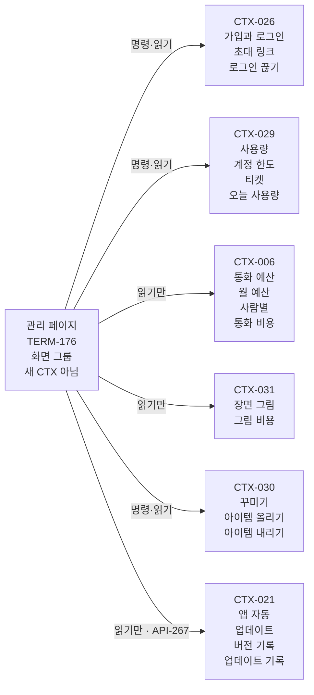

# 마롱이 관리 페이지 다시 만들기: 도메인 설계(바뀌는 맥락)

상태: 2026-11-23 체크포인트 통과(D135, 승인한 사람 동희님, [9절](#9-결정과-체크포인트2026-11-23)). 같은 날 노트북 폭 기능 변경(D140)도 체크포인트를 통과했어요(D141\~D144, [9.3절](#93-노트북-폭-기능-변경)). 이 문서의 맥락·용어·규칙은 그 변경으로 바뀌지 않았어요. 2026-11-24 기능 변경 3(꾸미기 꺼짐 안내 D145, 앱 지워진 폰 D146)은 용어 TERM-242를 더하고 주의 항목 규칙 ④와 5절 의존 표의 API-267 줄을 바꿨어요. 같은 날 체크포인트를 통과했어요(D147\~D149·D160\~D163, [9.4절](#94-기능-변경-3-꾸미기-꺼짐-안내와-앱-지워진-폰)). 같은 날 기능 변경 4(업데이트 내역 D170·D171)는 TERM-176의 화면 목록에 업데이트 내역(SCR-220)을 더했어요(D173 4-1, 체크포인트 통과 D172\~D179, [업데이트 내역 도메인 0.4절](admin-changelog.md#04-체크포인트-답2026-11-24)). 처음 초안은 같은 날 새벽 KST, Claude 마롱이 봇이 한 번에 썼어요. 새 맥락은 없어요. 관리 페이지는 기존 맥락 여섯(CTX-026 가입과 로그인, CTX-029 사용량, CTX-006 통화 예산, CTX-030 꾸미기, CTX-031 장면 그림, CTX-021 앱 자동 업데이트)의 읽기 모델과 관리자 명령을 한 화면 그룹에 모은 것이에요.
FCM 등록 해제 판단 기능 변경(2026-11-24, D180)이 같은 날 체크포인트를 지나(D182, 승인한 사람 사용자님) TERM-242의 뜻(G-1)과 핫스팟 줄(G-2)을 고쳤어요. 기능 변경 3(PR #127)이 같은 날 정한 글을 PR #130이 다시 바꾼 거예요. 바뀌기 전 글은 [FCM 등록 해제 판단 도메인 7절](fcm-unregistered.md#7-바뀌는-승인-항목항목마다-따로-여쭤요)에 따옴표로 남아 있어요.
범위: 관리 페이지(`/chat/admin/`, TERM-176)를 화면 여러 개로 다시 짜요. 지금 기능(초대 링크, 회원과 한도·티켓·로그인 끊기, 그림 비용, 아이템)을 옮기고, 앱 버전 화면과 개요(주의 항목)를 더해요. 화면 뒤의 규칙(초대 링크 7일, 한도 계산, 티켓, 아이템 검사, 업데이트 기록)은 그 맥락의 문서가 그대로 맡아요.
ID 번호: TERM-240\~242, REQ-570\~587, FL-200\~201, SPEC-450\~460, API-280\~281, SCR-200\~204, TASK-490\~505, TC-620\~641·653\~659, 결정 D132\~D133·D135\~D149·D160\~D163(D147\~D149·D160\~D163은 기능 변경 3의 체크포인트 답. [인계 목록](../10-wbs/README.md#id-범위), 잡아 둔 범위는 TERM-240\~259, REQ-570\~599, FL-200\~209, SPEC-450\~479, API-280\~299, SCR-200\~219, TASK-490\~519, TC-620\~669(TC-643\~652는 다른 고장 기록이 씀), D132\~133·D135\~149·D160\~169(D160\~169는 2026-11-24 기능 변경 3이 더 잡음). D134는 앱 업데이트 기능 변경 PR #101이 2026-11-23에 썼어요). 새 CTX·TBL 번호는 없어요.
표시: 근거가 동희님 말이나 문서·코드면 `[확실]`, 거기서 끌어낸 것은 `[추론]`, 근거 없는 짐작은 `[추측]`. Claude가 새로 정한 것은 '새 제안'이라고 적어요.

## 1. 서비스 개요

동희님 말(오랑이 봇이 마롱이 봇에게 전함):

- D132(2026-11-22 23시대 KST): "야 어드민 페이지 처음부터 다시만들자고 해 아예 /corthex로"
- D133(2026-11-23 00시대 KST): "ㅇㅇ 너가 잘 판단해서 새벽동안 작업 이어가줘 / 자러간다". 새벽 동안 되돌릴 수 있는 기본 결정은 Claude가 하고 무엇을 왜 정했는지 적어요. 체크포인트, 승인된 항목을 빼거나 뜻을 바꾸는 일, 지우기, 반영은 동희님께 물어요.
- D135\~D139(2026-11-23 체크포인트, 동희님. 오랑이 답 msg_9930b2c4e251): 01\~10·12 단계 통과, 기능 변경 목록 1\~12 항목마다 '바꿈', 초대 링크 거두기 더함, 셸 명령은 미룸, API-267 예시의 실제 이름은 합성 이름으로. [9절](#9-결정과-체크포인트2026-11-23)
- 함께 받은 조건(오랑이 인계, 2026-11-22): 관리 페이지에 '앱 버전' 화면을 둬요(버전 기록과 릴리스 노트, 멈춤 상태, 폰마다 지금 버전과 마지막 보고, 보냄·받아 감·상태·설치 시각). 이 화면은 앱 업데이트 기능 변경(PR #101)이 정한 형식(API-267, `history.json`, `app_update_events`)을 읽기만 해요(PR #101의 REQ-559, 오랑이 `msg_013bfd28376b`).

다시 쓰면: 관리 페이지를 지금 코드를 고쳐 붙이지 않고 CORTHEX 01 단계부터 다시 설계해요(D132, D107 "기능 추가할땐 1단계로 회귀"). 관리자는 동희님 한 사람이고, 열었을 때 손볼 일이 먼저 보이고, 폰들이 새 버전을 받았는지 볼 수 있어야 해요. `[확실]` D132, 인계 조건 · `[추론]` "손볼 일이 먼저"

지금 코드에서 읽은 사실(`main` `7b0c6e1`):

- 관리 페이지는 한 장(`marong/app_chat_static/admin.html`·`admin.js`)이에요. 위에서부터 이번 달 그림 비용 카드, '초대 링크'(새 링크 만들기 칸과 목록), '가입한 사람'(사람마다 '한도 바꾸기', '로그인 끊기', '티켓 넣기')이 이어져요. 아이템은 따로 한 장(`/chat/admin/items`, SCR-186)이고 첫 장에 링크 한 줄이 있어요. `[확실]`
- 서버는 `marong/app_admin.py` 하나예요. 경로: 그림 비용 API-266, 아이템 API-263\~265, 초대 링크 목록 API-240과 만들기 API-235, 회원 목록 API-236, 로그인 끊기 API-241, 티켓 넣기 API-237, 한도 바꾸기 API-243. `[확실]`
- 관리자 확인: Cloudflare Access JWT(`Cf-Access-Jwt-Assertion`)를 서버가 다시 확인하고, 그 이메일의 해시가 `MARONG_ADMIN_EMAIL_SHA256`과 같아야 해요. 쓰기는 같은 주소에서 온 요청만 받아요(`Origin`, 다르면 403 `cross_site`). 로그인 쿠키는 보지 않아요. `[확실]`
- 초대 링크 목록에는 '거둠(`revoked`)' 상태가 있지만 거두는 API는 없어요. `[확실]`
- 회원 목록 응답에는 사람마다 이번 달 통화 비용(`callMonthUsd`)이 있지만 통화 전체 월 예산(150달러, TERM-014) 대비 사용률은 관리 페이지에 없어요. 통화 서버만 `call.settings`의 `monthly_budget_usd`와 이번 달 합을 계산하고, 앱 서버 역할은 통화 비용 표를 읽을 수 없어요(`call.friend_month_usd` 함수로 한 사람의 합만 읽음). `[확실]`
- 서버 셸 명령으로만 하는 관리 일이 있어요: 새 버전 올리기·멈추기·다시 켜기(`app-release`), 통화 예산·단가(`cost_admin.py`), 선톡·일기 켜고 끄기. 이번 범위에서는 화면에 옮기지 않아요(아래 '범위 밖'). `[확실]`

결정과 기본값(D133에 따라 Claude가 정하고 2026-11-23 체크포인트에서 그대로 승인, D135):

- 관리 페이지를 여섯 화면으로 나눠요: 개요(첫 화면), 회원(목록과 한 사람), 초대 링크, 앱 버전, 비용, 아이템. 화면 위의 탭 줄로 오가요. 한 장에 모두 늘어놓으면 폰 폭에서 손볼 일을 찾기 어려워서예요. `[추론]`
- 첫 화면은 개요(TERM-240)예요. 맨 위에 주의 항목(TERM-241)을 한 줄씩, 그 아래 숫자 카드(회원, 오늘 사용, 통화 월 예산, 그림 비용, 앱 버전)를 둬요. `[추측]` 새 제안
- 앱 버전 화면은 API-267 하나만 읽어요. 버전 기록·업데이트 기록의 형식을 이 part에서 다시 정하지 않아요. `[확실]` 인계 조건
- 쓰기 기능은 지금 것 그대로예요(초대 링크 만들기, 로그인 끊기, 티켓 넣기, 한도 바꾸기, 아이템 올리기·내리기). 새 쓰기는 초대 링크 거두기 하나예요(REQ-583, 질문 2의 답 '더함' D137). `[추론]`
- 통화 월 예산 사용률은 새 DB 함수 하나로 읽어요. 통화 서버와 같은 식이고 앱 서버는 합과 예산 숫자만 받아요(SPEC-457). 표는 새로 만들지 않아요. `[추론]` usage-limit의 `call.friend_month_usd`와 같은 방식
- 관리자 확인과 같은 주소 확인은 지금 그대로예요. 새 화면과 새 API도 같은 확인을 지나요. `[확실]` 기존 SPEC-395

범위 밖: 서버 셸 명령(앱 릴리스 멈추기·다시 켜기, 통화 예산·단가, 선톡·일기 켜고 끄기, 선 전화·그림 화두 설정)을 화면으로 옮기기(미룸, D138. 2026-12-23에 마롱이가 다시 봐요), 대화 글·기억·사진 보기, 관리자 여러 명, 화면에서 아이템 그림 올리기(지금처럼 저장소의 아이템 목록 폴더로), 푸시로 주의 항목 알리기.

## 2. 이벤트 스토밍

- 보드: 없음. 기존 제품에 더하는 일이라 바뀌는 맥락만 한 번에 초안(one-pass draft)으로 썼어요(project.json의 01-domain `note`와 같은 방식).
- 체크포인트: NEXUS를 쓰지 않아요(동희님 2026-11-22 "지금 nexus 리빌딩하고 있음 넥서스 쓰지 말고 작업해"). 01\~12를 쓴 뒤 Orca 항목 3과 이 PR에서 한 번에 요청해요.

### 시간 줄(관리자가 보는 줄만)

| Lane | Events |
| --- | --- |
| 개요 | 관리 페이지 열림 → 개요 읽힘 → 주의 항목 0개 or 주의 항목 n개 → 주의 항목 눌림 → 그 화면 열림 |
| 가입과 로그인(CTX-026) | 초대 링크 만들어짐 ; 초대 링크 거둬짐(D137) ; 로그인 끊김(관리자) |
| 사용량(CTX-029) | 계정 한도 바뀜 ; 티켓 넣어짐 |
| 통화 예산(CTX-006)·그림(CTX-031) | 이번 달 통화 비용 읽힘 ; 이번 달 그림 비용 읽힘 |
| 꾸미기(CTX-030) | 아이템 올려짐 ; 아이템 내려짐 |
| 앱 자동 업데이트(CTX-021, 읽기만) | 새 버전 올려짐(셸) → 업데이트 데이터 메시지 보냄 → 받아 감 → 업데이트 상태 보고됨 → 설치됨. 관리자는 앱 버전 화면에서 이 기록을 읽기만 해요 |

` ; `는 서로 다른 흐름이에요. 읽기 모델(데이터를 바꾸지 않음): 개요, 회원 목록과 한 사람, 초대 링크 목록, 앱 버전(API-267), 이번 달 비용.

## 3. 바운디드 컨텍스트

새 맥락은 없어요. 관리 페이지는 규칙을 가진 맥락이 아니라 여러 맥락의 읽기 모델과 관리자 명령을 모은 화면 그룹(UI 조합)이에요. 주의 항목은 각 맥락의 읽기 값에 문턱을 대어 고른 목록이라 새 규칙을 만들지 않아요. 그래서 관리자 화면(TERM-176)은 지금처럼 CTX-026의 용어로 두고, 뜻만 넓혀요. `[추론]`

지금 맥락 지도(관리 페이지에 닿는 곳만):

관리 페이지는 규칙을 가진 맥락이 아니라 여섯 맥락을 부르는 쪽이라는 것을 보세요. 앱 자동 업데이트(CTX-021)·통화 예산·장면 그림은 읽기만 하고, 명령은 가입과 로그인·사용량·꾸미기의 기존 명령뿐이에요.

| 맥락 | 바뀌는 것 |
| --- | --- |
| CTX-026 가입과 로그인 | 관리자 화면(TERM-176)의 뜻이 '한 장'에서 '화면 여섯 개의 그룹'으로 넓어져요(D136 1-1). 초대 링크 거두기 명령이 늘어요(D137, REQ-583). 나머지 규칙은 그대로예요 |
| CTX-029 사용량 | 규칙은 그대로예요. 계정 한도 바꾸기·티켓 넣기의 자리가 회원 한 사람 화면(SCR-201)으로 옮겨요 |
| CTX-006 통화 예산 | 규칙은 그대로예요. 관리자가 읽는 값에 이번 달 통화 합과 월 예산(TERM-014)이 늘어요. 앱 서버는 새 DB 함수로 숫자 둘만 받아요 |
| CTX-031 장면 그림 | 규칙은 그대로예요. 그림 비용 표시가 개요와 비용 화면으로 옮겨요 |
| CTX-030 꾸미기 | 규칙은 그대로예요. 아이템 화면(SCR-186)이 관리 페이지 탭 줄의 한 칸이 돼요 |
| CTX-021 앱 자동 업데이트 | 이 part에서는 바꾸지 않아요. 관리 페이지는 PR #101이 정한 API-267을 읽기만 해요 |

## 4. 컨텍스트 표

### 관리 페이지에 모이는 명령과 읽기(바뀐 뒤 전체)

| Given by | Read model | Command | Aggregate | Events |
| --- | --- | --- | --- | --- |
| 관리자 | 개요: 주의 항목, 회원 수, 오늘 사용 합, 이번 달 통화 합과 월 예산, 이번 달 그림 비용, 최신 앱 버전과 뒤처진 폰 수 | | | |
| 관리자 | 초대 링크 목록(상태, 만든 때·쓴 때·만료) | 초대 링크 만들기(종류, 사람, 메모) | 초대 링크(CTX-026) | 초대 링크 만들어짐 |
| 관리자 | 초대 링크 목록 | 초대 링크 거두기(D137) | 초대 링크(CTX-026) | 초대 링크 거둬짐 |
| 관리자 | 회원 한 사람(계정 한도, 유효 한도, 오늘 사용량, 티켓, 세션 수, 이번 달 통화 비용) | 계정 한도 바꾸기 | 계정 한도(CTX-029) | 계정 한도 바뀜 |
| 관리자 | 회원 한 사람 | 티켓 넣기(1\~1000) | 티켓(CTX-029) | 티켓 넣어짐 |
| 관리자 | 회원 한 사람 | 로그인 끊기(그 사람의 모든 기기) | 기기 로그인(CTX-026) | 로그인 끊김 |
| 관리자 | 아이템 목록(올린 것·내린 것·아직 안 올린 것) | 아이템 올리기, 내리기 | 아이템(CTX-030) | 아이템 올려짐, 내려짐 |
| 관리자 | 이번 달 비용: 통화 합과 월 예산, 사람마다 통화 비용, 그림 비용 종류별 합과 예산 | | | |
| 관리자 | 앱 버전(API-267): 최신 릴리스와 멈춤, 버전 기록과 릴리스 노트, 폰마다 버전·뒤처짐·앱 지워짐(TERM-242, D148 3-11)·마지막 보고·업데이트 기록, 친구마다 받아 감 | | | |

- Aggregate rules: 새 집합체는 없어요. 명령은 모두 기존 집합체의 기존 명령이에요(거두기만 새로 더함, D137). `[확실]` 기존 SPEC-395·398·417
- 주의 항목 규칙(읽기 모델의 문턱, 새 제안): ① 이번 달 통화 합이 월 예산의 80% 이상 ② 이번 달 그림 비용이 예산이 있는 종류의 80% 이상 ③ 업데이트 멈춤 중 ④ 뒤처진 폰 가운데 마지막 업데이트 상태가 확인 창 기다림이나 실패인 폰, 또는 최신 릴리스를 올린 지 24시간이 지났는데도 뒤처진 폰(앱 지워진 폰 TERM-242는 뒤처진 폰이 아니에요, D148 3-9) ⑤ 24시간 안에 만료되는 열린 초대 링크 ⑥ 프로필이 없는 기존 친구. 문턱 80%는 기존 규칙(D9, SPEC-380)과 같아요. `[추측]` 나머지 문턱
- 관리 페이지는 대화 글, 기억, 사진, 설치 ID, FCM 설치 ID(FID), 로그인 토큰, 이메일을 보이지 않아요. `[확실]` 기존 SPEC-395, PR #101 REQ-559
- Given–When–Then: Given 이번 달 통화 합 122달러, 월 예산 150달러, When 관리자가 관리 페이지를 엶, Then 개요 맨 위에 '통화 월 예산 81% 썼어요' 한 줄이 보이고 누르면 비용 화면이 열려요.
- Given–When–Then: Given 최신 릴리스 0.3.3을 올린 지 30시간, 시험친구 가의 폰 1이 0.3.2이고 마지막 상태가 '조용할 때 기다림', When 개요를 엶, Then 주의 항목 '0.3.2에 머문 폰 1대'가 보이고 누르면 앱 버전 화면의 그 폰 줄로 가요.
- Given–When–Then: Given 손볼 일이 없음, When 개요를 엶, Then '지금 손볼 일 없어요' 한 줄과 숫자 카드만 보여요.
- External systems: Cloudflare Access(관리자 확인. 순응자: Access가 준 확인 값을 서버가 다시 검증하고 이메일 해시를 비교해요).

## 5. 컨텍스트 사이 의존(관리 페이지가 읽는 줄)

| From | To | Kind | Pattern | Why | Data |
| --- | --- | --- | --- | --- | --- |
| 관리 페이지 | CTX-026, CTX-029 | call (sync) | 고객-공급자 | 회원과 초대 링크 읽기·쓰기 | API-235·236·237·240·241·243 그대로 |
| 관리 페이지 | CTX-006 | call (sync, 읽기만) | 고객-공급자 | 이번 달 통화 합과 월 예산 | 새 DB 함수(SPEC-457) → 합, 예산 |
| 관리 페이지 | CTX-031 | call (sync, 읽기만) | 고객-공급자 | 그림 비용 | API-266 그대로 |
| 관리 페이지 | CTX-030 | call (sync) | 고객-공급자 | 아이템 올리기·내리기 | API-263\~265 그대로 |
| 관리 페이지 | CTX-021 | call (sync, 읽기만) | 순응자 | 앱 버전과 업데이트 기록 | API-267(PR #101이 정함. 기능 변경 3이 폰 줄의 `removedAt` 한 칸과 `behind`의 뜻만 바꿈, D148 3-8·D160) |

동기 호출이 원을 이루는 곳은 없어요. 관리 페이지는 다른 맥락이 부르지 않아요.

## 6. 핫스팟

| Hotspot | Context | State | Answer or next step |
| --- | --- | --- | --- |
| API-267은 PR #101에서 아직 바뀌는 중이었음(열린 PR, 체크포인트 전) | CTX-021 | answered | PR #101이 체크포인트를 지나 2026-11-23 `main`에 합쳐졌어요(`15889ff`). 형식의 기준은 `main`의 `api/app-update.openapi.yaml`이고, 이 part는 옮겨 적지 않고 API-267 번호로만 가리켜요. 구현(PR #101의 TASK-480)이 반영된 뒤 SCR-203과 TC를 그 형식에 맞춰 한 번 다시 봐요 |
| API-267의 폰 줄에 친구 ID가 없고 친구 이름만 있었음 | CTX-021 | answered | PR #101 커밋 `b54547d`(2026-11-23 보안 검토 반영)가 폰 줄과 받아 감 칸에 `friendId`(회원 API와 같은 번호)를 더했어요. 관리 페이지는 사람을 `friendId`로만 맞추고, 이름으로 맞추던 규칙과 같은 이름 안내를 뺐어요(기능 명세 3.5) |
| API-267의 상한: 폰은 친구마다 최근 20대, 모두 200대, 받아 감은 100명까지(PR #101 SPEC-438) | CTX-021 | answered | 앱 버전 화면과 회원 한 사람 화면이 상한에 닿은 것을 안내 글로 알려요(기능 명세 3.5, SCR-203#cap, SCR-201#phones-cap). 숫자는 PR #101이 정해요 |
| 기기 등록(API-105)의 새 폰 상한(409 `too_many_devices`, PR #101 기능 명세 8.9) | CTX-021 | open | PR #101 체크포인트에서 승인됐어요(D134, 2026-11-23). 이 part는 가리키기만 하고 정하지 않아요. 거절된 폰은 줄이 없어 관리 화면에 나오지 않아요. 거절을 관리자에게 보일지(예: 거절 횟수)는 써 본 뒤에 볼 일이에요 `[추론]` |
| API-267 예시 `empty`에 필수 칸 `fetches`가 빠져 있었음(PR #101 `api/app-update.openapi.yaml`) | CTX-021 | answered | `main`의 계약(PR #101 합친 뒤)에는 `fetches: []`가 있어요(2026-11-23 확인) |
| 통화 월 합을 계산하는 식이 통화 서버(`call_cost.MONTH`)와 새 함수 두 곳에 생김 | CTX-006 | open | 시험(TC)으로 같은 자료에서 두 값이 같은지 봐요. 통화 서버가 이 함수를 쓰게 바꾸는 일은 범위 밖 `[추론]` |
| '앱 지워짐'의 근거는 등록 해제 답(TERM-280) 하나예요(2026-11-24 FCM 등록 해제 판단 기능 변경, D180). 앱을 지운 것과 FCM 등록이 만료된 것은 가르지 못해요. 메시지 형식 오류(400)는 '앱 지워짐'을 만들지 않아요 | CTX-021 | answered(D160·D180, D182 G-2) | 앱이 남아 있으면 다음에 앱을 열 때 기기 보고(API-105)가 `dropped_at`을 비워서 다음 읽기부터 보통 줄이에요(지금 `app_device_put`). 그래서 동희님 말 '앱 지워짐'(D146)을 그대로 쓰고 TERM-242에 이 뜻을 적어요(문구 그대로는 D185). 400과 상세 없는 404는 `failed`라 FID를 지우지 않고 펼친 기록에는 '보내기 실패(500)'가 남아요(FCM 등록 해제 판단 SPEC-510, D183, 구현은 TASK-550). 등록 만료로 앱이 남은 폰이 잠시 '앱 지워짐'으로 보이는 드문 경우는 TC-728로 지켜봐요. `[확실]` `marong/app_store.py`·`marong/app_update_push.py`, FCM 답 나누기는 [FCM 등록 해제 판단 명세](../04-functional-spec/fcm-unregistered.md) |
| 주의 항목 문턱(24시간, 80%) | 관리 페이지 | answered | D133 기본값 그대로(D135, 2026-11-23). 써 보고 동희님 말에 따라 고쳐요 |
| 서버 셸 명령을 화면으로 옮길지 | CTX-021, CTX-006, CTX-009 | deferred | 미룸(D138, 2026-11-23). REQ-584를 2026-12-23에 마롱이가 다시 봐요 |
| 초대 링크 거두기를 더할지 | CTX-026 | answered | 더함(D137, 2026-11-23). REQ-583 Could |

## 7. 용어집

기존 용어 관리자 화면(TERM-176), 초대 링크(TERM-173), 티켓(TERM-192), 계정 한도(TERM-199), 기본 한도(TERM-200), 월 예산(TERM-014), 그림 월 예산(TERM-032), 릴리스(TERM-093), 업데이트 멈춤(TERM-100), 릴리스 노트(TERM-221)·버전 기록(TERM-222)·업데이트 기록(TERM-223, 모두 PR #101), 아이템 받기(TERM-212)는 그대로 써요. TERM-176은 뜻이 넓어지는 제안이 있어요(아래 표의 '바뀜 제안').

| ID | Term | Definition | Context | Code name | Avoid |
| --- | --- | --- | --- | --- | --- |
| TERM-240 | 개요 | 관리 페이지의 첫 화면(SCR-169). 맨 위의 주의 항목과 숫자 카드(회원, 오늘 사용, 통화 월 예산, 그림 비용, 앱 버전)를 한 번에 보여요. 읽기만 해요 | CTX-026, CTX-029, CTX-006, CTX-031, CTX-021 | `/chat/admin/`, API-280 | 홈(통화 홈 SCR-001과 헷갈림), 대시보드(화면 이름으로는 쓰지 않음) |
| TERM-241 | 주의 항목 | 관리자가 손을 써야 할 수 있는 일을 정해 둔 문턱으로 골라 개요 맨 위에 한 줄씩 보이는 것. 누르면 그 일을 다루는 화면으로 가요. 서버가 API-280에서 계산하고 푸시로 보내지 않아요 | CTX-026, CTX-029, CTX-006, CTX-031, CTX-021 | `attention` | 알림(푸시 알림과 헷갈림), 경고 |
| TERM-242 | 앱 지워진 폰 | FCM이 그 설치에 등록 해제 답(TERM-280: HTTP 404와 `UNREGISTERED`)을 줘서 서버가 FID를 지운 뒤 다시 기기 보고를 하지 않은 폰(TBL-101 `dropped_at`이 있음). 대개 앱을 지웠거나 앱 데이터를 지운 폰이고, 드물게 FCM 등록이 만료된 폰이에요. 앱이 남아 있으면 다음 기기 보고(API-105)에서 풀려요. 관리 페이지에 '앱 지워짐'으로 보이고 뒤처진 폰에 세지 않아요(D146, 기능 변경 3. 뜻은 2026-11-24 D182 G-1) | CTX-021 | `dropped_at`, API-267 `removedAt` | 탈퇴(계정은 그대로), 지운 폰(폰 줄은 90일 동안 남음) |

바뀜(D136 1-1, 2026-11-23 동희님 '바꿈'. [unified.md](unified.md)의 TERM-176 행도 이 PR에서 고쳤어요):

| ID | 옛 정의 | 바뀐 정의 |
| --- | --- | --- |
| TERM-176 관리자 화면 | "동희님만 쓰는 화면(SCR-169). 초대 링크 만들기, 회원 목록, 로그인 끊기, 티켓 넣기. Cloudflare Access 뒤에 있어요" | 동희님만 쓰는 관리 페이지(`/chat/admin/` 아래 화면 그룹): 개요(SCR-169), 회원(SCR-200·201), 초대 링크(SCR-202), 앱 버전(SCR-203), 비용(SCR-204), 아이템(SCR-186). 모두 Cloudflare Access와 관리자 확인 뒤에 있어요 |

바뀜(D173 4-1, 2026-11-24 기능 변경 4 '업데이트 내역'. 승인한 사람 사용자님, [업데이트 내역 도메인 0.4절](admin-changelog.md#04-체크포인트-답2026-11-24). [unified.md](unified.md)의 TERM-176 행도 같은 PR #129에서 고쳤어요):

| ID | 옛 정의 | 바뀐 정의 |
| --- | --- | --- |
| TERM-176 관리자 화면 | "동희님만 쓰는 관리 페이지(`/chat/admin/` 아래 화면 그룹): 개요(SCR-169), 회원(SCR-200·201), 초대 링크(SCR-202), 앱 버전(SCR-203), 비용(SCR-204), 아이템(SCR-186). 모두 Cloudflare Access와 관리자 확인 뒤에 있어요" | 동희님만 쓰는 관리 페이지(`/chat/admin/` 아래 화면 그룹): 개요(SCR-169), 회원(SCR-200·201), 초대 링크(SCR-202), 앱 버전(SCR-203), 비용(SCR-204), 아이템(SCR-186), 업데이트 내역(SCR-220). 모두 Cloudflare Access와 관리자 확인 뒤에 있어요 |

## 8. 체크포인트 노트(한 번에 초안)

1. 체크포인트: 2026-11-23에 01\~10·12 단계를 통과했어요(D135). 승인한 사람은 동희님이고 질문과 답은 [9절](#9-결정과-체크포인트2026-11-23)에 있어요(NEXUS는 쓰지 않음).
2. 동희님 말에서 바로 온 것: 관리 페이지를 /corthex로 처음부터(D132), 앱 버전 화면과 그 내용, API-267을 읽기만(인계 조건), 새벽 동안 기본 결정은 Claude가(D133).
3. Claude가 정한 것(D133, 체크포인트에서 그대로 승인 D135. 써 본 뒤 바꿀 수 있음): 여섯 화면과 탭 줄, 개요와 주의 항목 여섯 가지와 문턱, 회원 한 사람 화면, 통화 월 예산 사용률을 새 DB 함수로 읽기, 새 맥락을 만들지 않음.
4. 열린 질문: 없어요. 승인된 항목이 바뀌는 열두 곳은 항목마다 '바꿈'(D136), 초대 링크 거두기는 '더함'(D137), 서버 셸 명령은 '미룸'(D138), API-267 예시의 실제 이름은 '바꿈'(D139)이에요.

## 9. 결정과 체크포인트(2026-11-23)

### 9.1 결정

D135\~D139는 2026-11-23 체크포인트 때 이 part의 질문 0\~4에 받은 답이에요. 질문은 msg_15c917ae3a3e로 여쭸고, 답은 오랑이의 msg_9930b2c4e251이에요(2026-11-23). 승인한 사람은 사용자님(동희님)이에요. 근거는 동희님이 오랑이 채팅에서 한 말 "야 누가 너한테 체크포인트때 뭐 물어보면 추천 모두 승인이라고 해"(2026-11-23 01시대 KST)이고, 오랑이가 질문마다 추천안을 답으로 전했어요. 질문마다 따로 답을 받은 것으로 적어요.

| 결정 | 질문 | 동희님 답 | 바꾸는 승인 항목 |
| --- | --- | --- | --- |
| D135 | 질문 0: 01\~10·12 단계를 통과시킬까요?(승인할 커밋 `7395219`) | '통과'(추천안, msg_9930b2c4e251) | 없음. D133으로 Claude가 정한 기본값(주의 항목 문턱 24시간·80%, 탭 순서, 화면 사이에서 페이지를 새로 받기, 회원 한 사람 화면은 새 API 없이 API-236·267을 읽기, 통화 월 합은 새 함수 `call.month_budget`, 같은 이름의 친구는 번호를 붙여 구분)도 그대로 |
| D136 | 질문 1: 승인된 항목이 바뀌는 열두 곳([기능 변경 목록](../02-prd/admin.md#승인된-항목이-바뀌는-곳기능-변경-목록) 1\~12)을 바꿀까요? | 항목마다 '바꿈'(추천안, msg_9930b2c4e251). 아래 표 | 아래 표의 열두 곳 |
| D137 | 질문 2: 초대 링크 거두기(REQ-583, SPEC-455, API-281)를 더할까요?(추천: 더함, Could) | '더함'(추천안, msg_9930b2c4e251) | 없음(새 쓰기 하나). REQ-583(Could)·SPEC-455·API-281이 active가 되고 TASK-498, TC-635·636의 조건이 빠져요 |
| D138 | 질문 3: 서버 셸 명령(앱 업데이트 멈추기·다시 켜기, 선톡·일기 켜고 끄기, 통화 예산 바꾸기)을 이번에 화면으로 옮길까요?(REQ-584, 추천: 미룸) | '미룸'(추천안, msg_9930b2c4e251) | 없음. REQ-584는 deferred, 2026-12-23에 마롱이가 다시 봐요 |
| D139 | 질문 4: 앱 업데이트 계약(api/app-update.openapi.yaml)의 API-267 응답 예시에 있는 실제 친구 이름을 합성 이름으로 바꿀까요?(추천: 바꿈) | '바꿈'(추천안, msg_9930b2c4e251) | API-267 응답 예시 `behind`의 `devices`·`fetches` 이름 두 곳만 '시험친구 가'로. 칸 이름·형식·상한은 그대로예요. Git 이력은 다시 쓰지 않았어요(지난 커밋에 남은 이름은 따로 여쭤요) |

D136의 항목별 답(모두 2026-11-23, msg_9930b2c4e251, 승인한 사람 동희님):

| 항목 | 승인된 곳 | 답 | 이 PR에서 고친 곳(줄마다 'D136 1-x' 표시) |
| --- | --- | --- | --- |
| 1-1 | TERM-176 관리자 화면(unified 01) | 바꿈 | docs/01-domain/unified.md TERM-176 행 |
| 1-2 | REQ-438(unified 02) | 바꿈 | docs/02-prd/unified.md REQ-438 행 |
| 1-3 | SPEC-380의 표시 부분(unified 04). REQ-451은 그대로 | 바꿈 | docs/04-functional-spec/unified.md SPEC-380 행과 '그림 예산 80% 알림' 줄 |
| 1-4 | SPEC-395 관리자 화면(unified 04) | 바꿈 | docs/04-functional-spec/unified.md SPEC-395 행 |
| 1-5 | SCR-169의 상태 14개(unified 08) | 바꿈 | docs/08-screens/unified.md 화면 목록·공통 규칙 두 줄·SCR-169 절 머리와 상태 14줄 |
| 1-6 | SCR-169의 사용 한도 상태(usage-limit 08) | 바꿈 | docs/08-screens/usage-limit.md 화면 목록·2절 머리·상태 17줄·와이어프레임 목록 2·3 |
| 1-7 | SPEC-398(usage-limit 04) | 바꿈 | docs/04-functional-spec/usage-limit.md SPEC-398 행·3.4·3.5·추적 줄 |
| 1-8 | FL-179(usage-limit 03) | 바꿈 | docs/03-user-flow/FL-179-usage-limit.md 화면 줄·시작 칸·메모 |
| 1-9 | FL-169·170·171·177(unified 03)의 관리자 칸 | 바꿈 | 네 파일의 화면 줄·그림 칸·메모 |
| 1-10 | FL-192(pet-app 03)와 SCR-186으로 들어가는 경로 | 바꿈 | docs/03-user-flow/FL-192-admin-items.md, docs/08-screens/pet-app.md 세 줄 |
| 1-11 | SPEC-427 그림 비용 보기(pet-app 04) | 바꿈 | docs/04-functional-spec/pet-app.md SPEC-427 행 |
| 1-12 | 사이트맵 SCR-169(unified 07, usage-limit 07) | 바꿈 | docs/07-sitemap/sitemap.yaml(이름 '관리자 개요', 흐름 FL-200, 설명), docs/07-sitemap/sitemap.md(그림 두 개의 이름표, 표 두 줄, 여정 1, 관리 페이지 절) |

- D133의 기본값은 바꾸지 않았어요(D135). 써 본 뒤 동희님 말에 따라 고쳐요.
- 지운 승인 항목은 없어요. 미룬 것은 이 part의 새 요구사항 REQ-584 하나예요(D138).

### 9.2 체크포인트(2026-11-23)

- 질문(msg_15c917ae3a3e): 질문 0 01\~10·12 단계 통과, 질문 1 기능 변경 목록 1-1\~1-12(하나씩), 질문 2 초대 링크 거두기, 질문 3 셸 명령을 화면으로, 질문 4 API-267 예시의 실제 이름. 각 질문에 추천안이 있었어요.
- 답: 오랑이의 msg_9930b2c4e251(2026-11-23). 질문 0 통과, 1-1\~1-12 항목마다 바꿈, 질문 2 더함, 질문 3 미룸(2026-12-23에 마롱이가 다시 봄), 질문 4 바꿈, D133 기본값은 그대로. 근거는 동희님이 오랑이 채팅에서 한 말 "야 누가 너한테 체크포인트때 뭐 물어보면 추천 모두 승인이라고 해"(2026-11-23 01시대 KST)예요. 동희님이 미리 맡긴 답을 오랑이가 전한 것이라, 승인한 사람은 동희님이에요.
- 결과: 01\~10·12 단계 통과(`.corthex/stages/admin.json`). 승인한 커밋은 이 PR의 `7395219`이고, 그 뒤 D136을 승인된 문서 열두 곳에, D137·D138을 이 part의 문서에, D139를 api/app-update.openapi.yaml에 옮기고 제안 표시를 지웠어요. 11 개발은 아직(GPT), 13 발표는 이 part에 없어요.
- 다음: 이 PR이 `main`에 합쳐지면 [10 WBS의 GPT 인계](../10-wbs/admin.md#gpt-인계)대로 TASK-490부터 구현해요. 언제 시작할지는 동희님이 정해요. 앱 버전 화면(TASK-496)은 앱 업데이트 TASK-480(구현 PR #105) 반영 뒤예요.

### 9.3 노트북 폭 기능 변경

2026-11-23 노트북 폭 기능 변경(D140, 설계 PR #109)의 체크포인트예요. 질문은 마롱이가 오랑이에게 msg_4f73974079e9로 보냈고, 오랑이가 질문마다 추천안을 답으로 전했어요(2026-11-23). 승인한 사람은 사용자님(동희님)이에요. 근거는 동희님이 오랑이 채팅에서 한 말 "야 누가 너한테 체크포인트때 뭐 물어보면 추천 모두 승인이라고 해"(2026-11-23 01시대 KST)와, 이 말에 따라 질문마다 추천안을 답으로 전한 오랑이의 답(질문 msg_4f73974079e9)이에요. 질문마다 따로 답을 받은 것으로 적어요.

| 결정 | 질문 | 동희님 답 | 바꾸는 승인 항목 |
| --- | --- | --- | --- |
| D141 | 질문 0: 노트북 폭 기능 변경분으로 02·04·08·10·12 단계를 통과시킬까요?(승인할 커밋 `f232040`) | '통과'(추천안) | 없음. 01·03·05·06·07·09는 바뀜 없음(이유는 `.corthex/stages/admin.json`의 단계 기록). REQ-585·SPEC-458·08 1.1절·TC-640·641이 active가 돼요 |
| D142 | 질문 1: 승인된 글 열두 곳([기능 변경 목록 2](../02-prd/admin.md#노트북-폭-기능-변경-목록-2) 2-1\~2-12)을 줄마다 바꿀까요? | 2-1\~2-12 줄마다 '바꿈'(추천안) | 08 1절 '폭'(2-1)과 9절 SCR-186(2-2), TASK-492\~498·501의 끝 조건과 크기(2-3\~2-10), 10 인계 절의 시험 환경·끝 조건·명령 주석(2-11), 12의 e2e 폭과 TC-639(2-12). PR #109에서 고친 글 그대로예요 |
| D143 | 질문 2: REQ-585(넓은 배치)의 우선순위를 무엇으로 할까요?(추천: Should) | 'Should'(추천안) | 없음(새 요구사항). 넓은 배치가 늦어지면 마롱이가 동희님께 여쭤 그 부분만 새 TASK로 떼어 내고 반영(TASK-499·500)을 이어 갈 수 있어요(10 인계 절 끝 조건) |
| D144 | 질문 3: SCR-201(회원 한 사람)의 넓은 폭에 왼쪽 회원 줄을 넣을까요?(추천: 넣음) | '넣음'(추천안) | 없음(SPEC-458 안의 새 화면 부분). 같은 API-236 응답으로 그려 요청은 늘지 않아요. TASK-494 크기 1.25일 그대로 |

- 지우거나 미룬 승인 항목은 없어요. 폰 폭(360·430px)의 배치·문구·동작은 그대로예요.
- 결과: 02·04·08·10·12 단계 통과(`.corthex/stages/admin.json`). 승인한 커밋은 PR #109의 `f232040`이고, 그 뒤 이 기록(제안 표시를 지우고 답을 적음)을 같은 PR에 더했어요.
- 다음: 구현은 0.3.4 뒤 [10 작업 목록의 인계 절](../10-wbs/admin.md#gpt-인계)대로 TASK-490부터예요(넓은 배치 포함). 언제 시작할지는 동희님이 정해요.

### 9.4 기능 변경 3: 꾸미기 꺼짐 안내와 앱 지워진 폰

2026-11-24 기능 변경이에요(설계 PR #127 `claude/admin-decor-off-app-removed`, `main` `1a29477`에서 시작). 같은 날 체크포인트를 통과해서 아래 '바꾸는 승인 항목'은 모두 바뀐 글이에요(D147\~D149·D160\~D163, 이 절 끝의 표).

동희님 말(사용자님 답, Orca 마롱이 항목 3, 2026-11-24 KST):

| 결정 | 질문 | 동희님 답 | 이 변경이 하는 일 |
| --- | --- | --- | --- |
| D145 | "꾸미기가 꺼져 있을 때 아이템 화면은 어떻게 보일까요?" | "'꾸미기가 꺼져 있어요' 안내로 바꾸기" | 꾸미기가 꺼진 서버(`MARONG_DECOR=0`, 지금 운영)에서 아이템 화면(SCR-186)이 오류 줄 '아이템을 불러오지 못했어요 · 추적 id'와 '다시 보기' 대신 '꾸미기가 꺼져 있어요'를 보여요(REQ-586, SPEC-459) |
| D146 | "앱이 지워진 폰은 관리 페이지의 앱 버전 목록에서 어떻게 보일까요?" | "'앱 지워짐'으로 표시하고 뒤처짐에서 빼기" | 앱 지워진 폰(TERM-242)을 앱 버전 화면(SCR-203)과 회원 한 사람의 폰(SCR-201)에 '앱 지워짐'으로 보이고, 뒤처진 폰 수·주의 항목에서 빼요(REQ-587, SPEC-460) |

- 기준(baseline): 이 part의 01\~10·12는 2026-11-23 체크포인트(D135, 커밋 `7395219`)와 노트북 폭 체크포인트(D141, 02·04·08·10·12, 커밋 `f232040`). 바뀌는 다른 part는 앱 업데이트(2026-11-23 체크포인트, PR #101 `b54547d`, [app-update 9.6](app-update.md#96-체크포인트2026-11-23))와 반려동물 앱 안(결정 D110\~D121, 단계 체크포인트 없음)이에요.
- 배경 사실: 운영은 꾸미기가 꺼져 있어요. BUG-124 고침(PR #125, `def10ad`) 뒤 아이템 화면은 열리지만 API-263이 404라서 오류 줄이 보이고, 다시 눌러도 같아요. 앱 지워진 폰은 `drop_fid`가 `dropped_at`을 채워도 API-267(`admin_app_devices`)이 그것을 보지 않아요. 업데이트 메시지 대상(`app_update_targets`, SPEC-430)은 이미 `dropped_at`이 있는 폰을 빼요. `[확실]` `marong/app_store.py`, `marong/app_chat_static/admin-items.js`. 그래서 11-22에 지워진 설치가 '0.2.4 · 뒤처짐'으로 남아 있다는 것은 마롱이 항목 3의 관찰이에요(이 설계에서는 운영 DB를 읽지 않아 대수는 확인하지 않음).
- 단계마다 바뀐 것과 '바뀜 없음'의 이유는 `.corthex/stages/admin.json`과 설계 PR 설명에 있어요. 승인된 글이 바뀌는 곳은 [요구사항의 기능 변경 목록 3](../02-prd/admin.md#꾸미기-꺼짐-안내와-앱-지워진-폰-기능-변경-목록-3)이에요(3-1\~3-14, 줄마다 '바꿈', D148).
- 체크포인트 질문(설계 PR #127 설명, 마롱이가 오랑이에게 보냄): 질문 0 단계 통과, 질문 1 목록 3-1\~3-14 줄마다, 질문 2 아이템 화면이 꺼짐을 아는 방법, 질문 3 앱 지워짐을 정하는 곳, 질문 4 개요의 폰 수, 질문 5 앱 지워진 폰 줄의 자리, 질문 6 켜고 끄는 설정.

체크포인트 답(2026-11-24): 오랑이가 질문마다 추천안을 답으로 전했어요(오랑이 답 `msg_2d55f701abb0`(2026-11-24 KST)). 승인한 사람은 사용자님(동희님)이에요. 근거는 사용자님이 오랑이 채팅에서 한 말 "야 누가 너한테 체크포인트때 뭐 물어보면 추천 모두 승인이라고 해"(2026-11-23 01시대 KST)예요. 승인한 커밋은 PR #127의 `23f1691`이에요. 병합과 운영 반영은 이 위임에 들지 않아요(오랑이 같은 답): 이 설계 PR은 저장소 규칙대로 검사가 통과한 뒤 Claude가 합치고, 구현 PR 병합과 운영 반영(TASK-505)은 마롱이가 사용자님께 여쭤요.

| 결정 | 질문 | 답 | 바꾸는 승인 항목과 덧붙임 |
| --- | --- | --- | --- |
| D147 | 질문 0: 기능 변경 3으로 01\~04·06\~08·10·12 단계를 통과시킬까요?(승인할 커밋 `23f1691`) | '통과'(추천안) | 05·09는 '바뀜 없음'으로 기록해요(오랑이 덧붙임, 이유는 `.corthex/stages/admin.json`의 단계 기록). REQ-586·587과 SPEC-459·460이 active가 돼요 |
| D148 | 질문 1: 승인된 글 열네 곳([기능 변경 목록 3](../02-prd/admin.md#꾸미기-꺼짐-안내와-앱-지워진-폰-기능-변경-목록-3) 3-1\~3-14)을 줄마다 바꿀까요? | 3-1\~3-14 줄마다 '바꿈'(추천안) | 목록 3의 열네 곳. 다른 part(app-update 04·06의 3-6·3-7, pet-app 03·04·08의 3-1·3-3·3-4)의 줄도 이 승인에 들어가요(오랑이 덧붙임). 바뀌기 전 글은 목록 3의 '승인된 글' 칸에 따옴표로 남고, 각 문서 머리의 '기능 변경 3' 줄과 단계 기록(`.corthex/stages/app-update.json`·`pet-app.json`)에 변경 기록을 남겼어요. 3-5(BUG-124 기록 한 줄)는 TASK-505 때 더해요 |
| D149 | 질문 2: 아이템 화면은 꾸미기가 꺼진 것을 무엇으로 알까요?(추천: API-263의 404) | 'API-263의 404'(추천안) | 없음(SPEC-459 안). 다른 이유의 404(앱에 경로가 없음, 프록시·Access의 잘못된 라우팅, 나중에 `decor_items`에 생기는 다른 404)가 '꺼짐'으로 보일 수 있는 경우를 12 시험 계획에 올렸어요(TC-658, TC-657의 API-263 본문 확인, 오랑이 덧붙임) |
| D160 | 질문 3: '앱 지워짐'과 뒤처짐 빼기를 어디서 정할까요?(추천: 서버가 API-267에서) | '서버가 API-267에서 한 번에'(추천안) | 3-6·3-7. app-update 계약 0.3.0(`removedAt` 필수 칸, `behind`의 뜻 좁힘)도 승인이에요. 뒤처짐을 세는 네 곳(개요의 수, 주의 항목, SCR-203, SCR-201)이 같은 값을 쓰는지 TC-659로 확인해요(둘 다 오랑이 덧붙임) |
| D161 | 질문 4: 개요 카드 '폰 n대 중 m대 뒤처짐'의 n에 앱 지워진 폰을 셀까요?(추천: 뺌) | '뺌'(추천안) | 3-10 |
| D162 | 질문 5: 앱 버전 화면에서 앱 지워진 폰 줄은 어디에 놓을까요?(추천: 폰 그룹 맨 끝) | '폰 그룹 맨 끝'(추천안) | 3-12. 회원 한 사람 화면(SCR-201)은 API 차례 그대로 |
| D163 | 질문 6: 이 변경을 켜고 끄는 설정(drop-in의 `Environment=`)으로 넣을까요?(추천: 두지 않음) | '두지 않음'(추천안) | 없음. AGENTS.md '새 기능은 끄고 켜는 설정으로'와 다른 선택이에요(오랑이 덧붙임). 이유: 관리자만 보는 읽기 화면의 글과 수만 바뀌고 친구 쪽 동작은 그대로이며, 되돌리기는 파일을 되돌리고 앱 서버를 재시작하는 것이에요(관리 페이지 다시 만들기 TASK-500, D135와 같은 판단) |

- 지우거나 미룬 승인 항목은 없어요.
- 결과: 01\~04·06\~08·10·12 단계 통과, 05·09는 바뀜 없음(`.corthex/stages/admin.json`). app-update 04·06과 pet-app 03·04·08의 바뀐 글도 이 답으로 승인됐어요(`.corthex/stages/app-update.json`·`pet-app.json`). 승인한 커밋은 PR #127의 `23f1691`이고, 그 뒤 이 기록(제안 표시를 지우고 답을 적음)과 TC-658·659를 같은 PR에 더했어요.
- 다음: 이 PR이 `main`에 합쳐지면 [10 작업 목록의 인계 절](../10-wbs/admin-decor-off-app-removed.md#gpt-인계)대로 TASK-502부터예요. 언제 시작할지는 마롱이가 정해 GPT에게 지시하고, 구현 PR 병합과 운영 반영(TASK-505)은 마롱이가 사용자님께 여쭤요.

