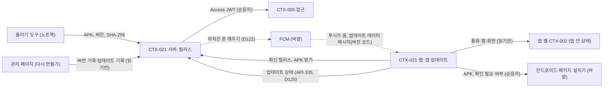

# 마롱이 앱 자동 업데이트: 도메인 설계(바뀌는 맥락)

상태: 한 번에 초안(2026-11-17 12시대 KST, Claude, corthex 0.12.1). 체크포인트 1\~3은 아직이에요. 답을 기다리는 동안 8절의 추천안으로 02 단계부터 이어 가요.
범위: 안드로이드 앱([docs/android-app.md](../android-app.md), 직접 설치 APK)과 봇의 글 대화 서버(`marong/app_chat.py`)에 '자동 업데이트'를 더하는 일이에요. 새 맥락은 CTX-021 하나이고, 바뀌지 않는 맥락은 ID로만 가리켜요(전체 맥락 지도는 [domain.md](domain.md), 앞 작업은 [call-first.md](call-first.md)).
ID 번호: CTX는 021, TERM은 092, REQ는 306, FL은 146, SPEC은 284, TBL은 127, API는 141, SCR은 130, TASK는 179, TC는 200부터 써요(CTX-020의 다음 번호이고, TC-180\~199는 CTX-020의 12 단계 몫으로 비워 둬요). 결정 번호는 D40부터예요. '성향 맞춤·선톡' 스레드가 D24부터 쓰기로 해서 떨어뜨렸고, 2026-11-17 12:3x KST에 그쪽에 알렸어요.
표시: 근거가 동희님 말이나 문서·코드면 `[확실]`, 거기서 끌어낸 것은 `[추론]`, 근거 없는 짐작은 `[추측]`(6절 핫스팟에도 있음).
기능 변경(2026-11-22): 게시 즉시 업데이트, 업데이트 상태 보고, 릴리스 노트와 버전 기록, 업데이트 UX를 더해요. 요청·기준선·결정(D122\~D131)과 바뀐 항목은 [9절](#9-기능-변경2026-11-22-게시-즉시-업데이트와-업데이트-상태)에 있고, 아래 2\~7절의 바뀐 곳에는 결정 번호를 붙였어요. 새 번호는 TERM-219, 결정 D122부터예요(D121은 반려동물 추억 모드 답에 비워 둠).

## 1. 서비스 개요

동희님 말(2026-11-17 12:18 KST, '앱 백그라운드 전화·표정·먼저 걸기' 작업 스레드, 'APK를 노트북에서 서명해 깔기'를 인용하며): "이건 뭐 어케하는데? 현경이 apk 다시 설치해야해? 좀 자동 업데이트 되게 못하나". 이 말을 D40으로 적어요.

다시 쓰면: 앱의 안쪽 코드(벨 화면, 알림 같은 자바 코드)가 바뀔 때마다 현경님이 새 APK 파일을 받아 손으로 다시 까는 일을 없애요. 동희님이 서버에 새 버전을 올리면 앱이 알아서 받아 설치하고, 현경님은 처음에 한 번 허용만 해요. 통화와 벨을 방해하지 않아요.

지금 앱이 업데이트되는 방식: 앱(Capacitor)은 화면 파일을 품지 않고 서버 주소를 그대로 열어서, 글 대화·통화 화면을 고치면 앱을 다시 깔지 않아도 바로 바뀌어요(android-app.md '새 제안', `capacitor.config.json`의 `server.url`). 새 APK가 필요한 것은 자바 코드와 앱 설정이 바뀔 때뿐이에요. 0.1.0부터 0.2.1까지 네 번 그랬고, 0.2.2(선 전화 벨)가 다섯 번째예요. `[확실]`

- 현경님(친구, 앱 0.2.1이 있음, 안드로이드 갤럭시): 0.2.2를 손으로 한 번 더 깔고, 마롱이에 '출처를 알 수 없는 앱 설치'를 한 번 허용해요. 그 뒤로는 하는 일이 없고, 안드로이드가 확인을 꼭 물을 때만 알림을 한 번 눌러요. `[추론]`
- 동희님(관리자, 아이폰이라 앱 없음): 노트북에서 서명한 APK를 서버에 올리고, 문제가 있으면 업데이트를 멈춰요. `[추론]`
- 마롱이 앱: 새 버전을 확인하고, 받고, 확인한 뒤 설치해요. `[추론]`
- 바깥 시스템: 안드로이드 패키지 설치기(`PackageInstaller`), Cloudflare Access(서버 앞의 로그인), FCM(앱을 깨우는 계기로만). `[확실]` 앱 코드

재료:

- 안드로이드 문서 `PackageInstaller.SessionParams.setRequireUserAction`(API 31부터, 2026-11-17 developer.android.com에서 읽음): `REQUEST_INSTALL_PACKAGES` 권한을 받은 설치기는 다음이 모두 맞으면 사용자 확인 없이 설치해요. `USER_ACTION_NOT_REQUIRED`로 요청, 설치하는 앱의 대상 SDK가 기준 이상(안드로이드 12는 29, 13은 30, 14는 31, 15는 33, 16은 34, 그다음은 35), 설치기가 그 앱의 업데이트 담당자·설치 기록 앱이거나 **스스로를 업데이트하는 경우**, 설치기가 `UPDATE_PACKAGES_WITHOUT_USER_ACTION` 권한을 선언. 아니면 `STATUS_PENDING_USER_ACTION`으로 사용자 확인 창을 띄워야 해요. 우리 앱의 대상 SDK는 36이에요. `[확실]`
- 구글 '안드로이드 개발자 인증' 안내(support.google.com/android-developer-console 16561738, 2026-11-17 읽음): 2026-09-30부터 인도네시아·싱가포르·태국, 2027년에 전 세계. 직접 설치(사이드로딩)는 남지만 인증한 개발자의 앱이어야 하고, 무료 '제한 배포' 계정은 신분증 없이 기기 20대까지예요. adb 설치는 계속 돼요. 한국은 아직 목록에 없어요. `[확실]`
- 코드: `apps/android`(`MarongPushPlugin.state()`가 앱 버전을 웹 화면에 주고, 웹 화면이 `PUT /chat/api/devices/{installId}`(API-105)로 서버에 보고), `MarongMessagingService`(FCM 받기), `build.gradle`(서명 키는 Git 밖), `marong/app_chat.py`(Access 뒤에서 친구를 확인하는 `_who`, 그림 파일을 내보내는 API-140). 저장소 PR #27 머리 `dbc5359`에서 읽음.
- 앞 기록: android-app.md REQ-110 "Git 밖에 둔 서명 키 하나로 서명한 APK로 직접 설치해야 하고, 업데이트도 같은 키로 서명해야 한다", "하지 않는 것: Play 스토어 배포"(2026-11-15 범위).

견준 방법(D40의 근거, 동희님 답에 적어 보냄 2026-11-17 12:2x KST):

| 방법 | 업데이트 | 드는 것 | 판단 |
| --- | --- | --- | --- |
| 앱이 서버에서 받아 스스로 설치(추천) | 처음 허용 한 번 뒤 묻지 않음(안드로이드 12 이상) | 무료, 앱·서버 코드, 0.2.2를 한 번 더 손으로 | 이번에 해요 |
| Play 스토어 내부 테스트 | 스토어가 자동으로 | 개발자 등록 25달러, 본인 확인, 현경님 구글 계정 초대 | 결제라 동희님이 원할 때만 |
| Firebase App Distribution | 새 버전 알림 뒤 테스터 앱에서 누름 | 현경님 이메일 초대, 테스터 앱 설치 | 자동이 아니라 뺌 |

## 2. 이벤트 스토밍

- 보드: 없음. 01 단계의 사람 보기는 GitHub PR이에요(`.corthex/project.json`, 2026-11-12 결정). 일하는 방식은 한 번에 초안(one-pass draft)이에요.
- 체크포인트 기록: 아직 없음. 검토 때 아래 시간 줄, 4절 규칙, 8절 질문을 먼저 봐 주세요.

### 시간 줄

| Lane | Events |
| --- | --- |
| 새 버전 올리기 | 새 버전 올려짐(릴리스 노트와 함께, 버전 기록에 쌓임) → 업데이트 데이터 메시지 보냄 → 업데이트 멈춤 or 더 새 버전 올려짐(D122, D127) |
| 앱 업데이트 | 새 버전 받음 or 받기 실패 → 업데이트 설치됨 or 사용자 확인 기다림 or 설치 실패. 상태가 바뀔 때마다 업데이트 상태 보고됨(D125) |
| 사용자 확인 | 사용자 확인 기다림 → 업데이트 설치됨 or 업데이트 거절됨 |
| 지금 설치 | 업데이트 배너를 봄 → 지금 설치 요청됨 → 업데이트 설치됨 or 사용자 확인 기다림 or 설치 실패(D128) |

새 버전이 있는지 보는 일, 지금 앱 버전, 통화 중이거나 벨이 울리는지, 앱이 화면에 떠 있는지, '출처를 알 수 없는 앱 설치'를 허용했는지는 데이터를 바꾸지 않아서 이벤트가 아니라 읽기 모델로 적었어요. 관리자가 버전 기록과 업데이트 기록을 보는 일(관리 페이지 다시 만들기)도 읽기 모델이에요. 현경님이 안드로이드 설정에서 허용을 켜는 일도 앱 밖의 설정이라 읽기 모델이에요.

## 3. 바운디드 컨텍스트와 패키지

| Context | Type | Aggregates | Package |
| --- | --- | --- | --- |
| CTX-021 앱 자동 업데이트 | supporting | 릴리스(TERM-093), 앱 업데이트(TERM-092) | 서버 `marong/app_release.py` 후보와 `app_chat.py`의 주소 두 개, 앱 `AppUpdate*.java` 후보, 올리기 도구 `deploy/ovh.sh app-release` 후보 |

지원 맥락으로 둔 이유: 업데이트 자체는 마롱이만의 것이 아니고 흔한 기능이지만(스토어가 하는 일), 스토어를 쓰지 않아서 직접 만들어야 해요. `[추론]`

바뀌는 기존 맥락: 없음. CTX-005 접근(Access로 친구 확인)은 그대로 읽기만 하고, 앱 벨·CTX-002 통화 연결은 '지금 통화 중인지'를 앱 안에서 읽기만 해요.

## 4. 컨텍스트 표

### CTX-021 앱 자동 업데이트

목적: 동희님이 올린 새 APK를 앱이 받아, 같은 앱·더 높은 버전·같은 서명·같은 해시인지 확인하고, 통화와 벨을 방해하지 않는 때에 설치해요. 안드로이드가 허락하면 묻지 않고, 아니면 알림 한 번으로 확인받아요.

| Given by | Read model | Command | Aggregate | Events |
| --- | --- | --- | --- | --- |
| 동희님(노트북에서) | 서명한 APK(TERM-170), 버전 코드(TERM-094), 버전 이름(TERM-095), 릴리스 노트(TERM-221, D127) | 새 버전 올리기 | 릴리스 | 새 버전 올려짐(버전 기록 TERM-222에 쌓임) |
| 정책: 새 릴리스가 최신이 됨(새 버전 올려짐, 업데이트 다시 켬, D122·D124) | 지금 올린 버전(TERM-093), 기기마다 보고된 앱 버전(TERM-169), 업데이트 기록(TERM-223) | 뒤처진 폰 깨우기 | 릴리스 | 업데이트 데이터 메시지(TERM-219) 보냄 |
| 동희님 | 지금 올린 버전(TERM-093) | 업데이트 멈추기 | 릴리스 | 업데이트 멈춤 |
| 정책: 앱이 열릴 때, 푸시를 받았을 때, 하루 한 번(마지막 확인 뒤 6시간이 지났을 때만). 업데이트 데이터 메시지가 지금보다 높은 버전을 알리면 6시간 규칙 없이(10분에 한 번까지, D123) | 서버의 최신 릴리스(TERM-093), 지금 앱 버전(TERM-094) | 새 버전 받기 | 앱 업데이트 | 새 버전 받음, 또는 받기 실패(새 버전이 없으면 아무 일도 없음) |
| 정책: 새 버전 받음이고 조용할 때(통화·벨 없음, 앱이 화면에 없음) | 통화 중인지(TERM-001), 벨 상태(TERM-168), 앱 화면 상태(TERM-171), 설치 허용 여부(TERM-097) | 업데이트 설치하기 | 앱 업데이트 | 업데이트 설치됨, 또는 사용자 확인 기다림, 또는 설치 실패 |
| 현경님 | 업데이트 알림(TERM-172) | 업데이트 확인하기(알림을 누르고 '업데이트') | 앱 업데이트 | 업데이트 설치됨, 또는 업데이트 거절됨 |
| 현경님 | 업데이트 배너(TERM-224), 통화 중인지(TERM-001), 벨 상태(TERM-168) | 지금 설치하기('지금 설치'를 누름, D128·D129) | 앱 업데이트 | 업데이트 설치됨, 또는 사용자 확인 기다림, 또는 설치 실패 |
| 정책: 앱 업데이트의 상태가 바뀜(받음, 조용할 때 기다림, 확인 창 기다림, 실패, 설치됨, D125) | 업데이트 상태(TERM-220) | 업데이트 상태 보고하기 | 앱 업데이트 | 업데이트 상태 보고됨(서버의 업데이트 기록 TERM-223에 남음) |

- Aggregate rules: 릴리스: 새로 올리는 버전 코드는 지금 올린 것보다 커야 해요(사실: 안드로이드는 더 낮은 버전 코드로 업데이트 설치를 하지 않아서, 되돌리기는 옛 코드로 더 높은 버전을 만들어 올리는 일이에요). 릴리스에는 APK와 버전 코드·버전 이름·크기·SHA-256 해시를 함께 적고, 최신은 하나뿐이에요(추론). 업데이트를 멈추면 서버가 '새 버전 없음'으로 답해서 앱이 받지 않아요(추론). 앱 업데이트: 받은 파일은 서버가 적은 크기·SHA-256과 같고, 패키지 이름이 같고, 버전 코드가 지금보다 크고, 서명 인증서가 지금 앱과 같을 때만 설치해요(추론, 서명은 안드로이드도 따로 막음: 사실). 통화 중, 벨이 울리는 중, 앱 창이 화면에 떠 있을 때는 설치하지 않아요(추론: 설치하면 앱 프로세스가 끝나 통화가 끊기고 보던 화면이 닫힘). 같은 버전이 세 번 실패하면 더 새 버전이 올라올 때까지 그 버전을 다시 받지 않아요(추측). 확인은 6시간에 한 번까지예요(추측: 하루 한두 번이면 충분하고 데이터를 아낌). 처음 0.2.1 → 0.2.2는 0.2.1에 이 기능이 없어 손으로 깔아요(사실).
- Aggregate rules(2026-11-22 기능 변경): 릴리스: 새 버전을 올릴 때 릴리스 노트가 꼭 있어야 하고, 올린 릴리스는 버전 기록에 쌓여 지워지지 않아요. APK 파일만 지금처럼 최근 3개예요(D127, 사실: 동희님 결정). 새 릴리스가 최신이 되면 서버가 보고된 앱 버전이 더 낮은 폰에 업데이트 데이터 메시지를 보내고, 한 폰에 같은 버전으로는 한 번만 보내요(D122·D124, 한 번만은 추론). 앱 업데이트: 업데이트 데이터 메시지가 지금보다 높은 버전을 알리면 6시간 규칙 없이 바로 확인하되, 이런 확인은 10분에 한 번까지예요(D123, 10분은 추측: 서버가 잘못 보내도 폰이 서버를 계속 부르지 않게). 업데이트 상태가 바뀔 때마다 앱 화면을 열지 않아도 서버에 버전 코드와 상태만 알려요(D125). 친구가 '지금 설치'를 누르면 앱 창이 떠 있어도 설치를 요청하지만, 통화 중이거나 벨이 울리는 중에는 누를 수 없어요(D128, 통화·벨 쪽은 추론: 설치하면 앱 프로세스가 끝나 통화가 끊김).
- 왜 바꾸나(사실, 2026-11-22 운영 기록과 Firebase 문서): 0.3.2(코드 10)는 07:21 UTC에 올라갔는데, 현경님 폰은 20:00:44 KST에 앱을 열어 확인하고 20:00:45에 APK를 받아 간 뒤 설치하지 않았고, 그 뒤 확인 요청이 없었어요. 선톡은 알림과 데이터가 같이 든 FCM 메시지라 앱이 백그라운드면 시스템이 알림을 직접 띄우고 앱의 `onMessageReceived`를 부르지 않아요(Firebase 'Receive messages in Android apps', 2026-11-22 읽음). 그래서 '푸시를 받았을 때 확인'은 벨(데이터만 든 메시지)에만 맞았고, 설치는 미룬 작업(TC-222 '15분 기준 미충족')에 기대고 있었어요. 미룬 작업이 왜 돌지 않았는지는 버그 수정(Orca 마롱이 항목 4)이 따로 봐요.
- Given–When–Then: Given 현경님 폰에 0.2.2, '출처를 알 수 없는 앱 설치' 허용, 안드로이드 12 이상, 서버에 0.2.3, When 앱을 닫은 뒤 하루 확인 차례, Then 앱이 0.2.3을 받아 묻지 않고 설치하고 다음에 열면 0.2.3이에요.
- Given–When–Then: Given 같은 상황에서 현경님이 마롱이와 통화 중, When 새 버전 받음, Then 설치하지 않고 통화가 끝나고 앱이 화면에서 내려간 뒤에 설치해요.
- Given–When–Then: Given 설치 허용이 꺼져 있음, When 업데이트 설치하기, Then '마롱이 앱 새 버전이 있어요' 알림이 한 번 뜨고, 누르면 안드로이드의 확인 창(처음엔 허용 설정)이 열려요.
- Given–When–Then: Given 받은 파일의 SHA-256이 서버 값과 다름, When 업데이트 설치하기 전 확인, Then 파일을 지우고 설치하지 않으며 다음 확인 때 다시 받아요.
- Given–When–Then(D122·D123·D125): Given 현경님 폰에 이 기능이 든 앱, 화면이 꺼져 있음, 동희님이 새 버전을 올림, When 서버가 업데이트 데이터 메시지를 보냄, Then 몇 분 안에 앱이 6시간 규칙 없이 확인하고 받아 검사한 뒤 조용하면 설치하고, 서버의 업데이트 기록에 '보냄', '받아 감', '받음', '설치됨'이 차례로 남아요.
- Given–When–Then(D128·D129): Given 받아 두고 검사한 새 버전이 설치를 기다림, 현경님이 통화 홈을 보고 있음, When 배너의 '지금 설치'를 누름, Then 앱이 바로 설치를 요청하고 설치하는 동안 앱이 닫혀요. 다시 열면 새 버전이에요.
- Given–When–Then(D131): Given 받아 두고 검사한 새 버전이 설치를 기다림, When 현경님이 선톡 알림을 눌러 글 대화(SCR-107)가 열림, Then 글 대화 머리 아래에도 같은 배너 '새 버전 준비됨 · 지금 설치'가 보이고, 누르면 통화 홈의 배너와 똑같이 설치해요.
- Given–When–Then(사실: `MarongMessagingService.java`, main `74d6451`): Given 0.3.2 이하 앱, When 업데이트 데이터 메시지를 받음, Then 화면에 아무것도 뜨지 않고, 마지막 확인에서 6시간이 지났을 때만 확인해요.
- External systems: 안드로이드 패키지 설치기(순응자: 안드로이드가 정한 규칙을 그대로 따름), Cloudflare Access(순응자: 앱 웹뷰가 가진 로그인 쿠키로 받음, CTX-005와 같은 확인), FCM(앱을 깨우는 계기. 업데이트 데이터 메시지에는 버전 코드만 싣고 업데이트 내용은 싣지 않음, D122).
- Links: 앱 벨(TBL-102의 앱 쪽)과 CTX-002 통화 연결의 '지금 통화·벨 중인지'를 앱 안에서 읽어요. 서버 쪽은 CTX-005로 친구를 확인한 뒤에만 릴리스를 줘요. 업데이트 상태는 기존 기기 보고(API-105, TERM-169의 앱 기기)에 실어 보내요(D125). 버전 기록과 업데이트 기록의 형식과 읽기 API는 이 맥락이 정하고, 다시 만드는 관리 페이지는 읽기만 해요(오랑이 2026-11-22 msg_013bfd28376b, Orca 마롱이 항목 3).
- Hotspots: 처음 허용을 어떻게 안내할지, 현경님 폰의 안드로이드 버전, 업데이트 뒤 서버의 앱 버전 기록, 개발자 인증(6절).

## 5. 컨텍스트 사이 의존

| From | To | Kind | Pattern | Why | Data |
| --- | --- | --- | --- | --- | --- |
| CTX-021(서버) | CTX-005 | call (sync) | conformist | 친구에게만 릴리스와 APK를 줌 | Access JWT → 통화하는 친구 |
| CTX-021(앱) | 안드로이드 패키지 설치기 | call (sync) | conformist | 설치, 사용자 확인 | APK, 사용자 확인 필요 여부, 결과 |
| CTX-021(앱) | 앱 벨·CTX-002(앱 안 상태) | call (sync, 읽기만) | | 지금 설치해도 되는지 | 통화 중, 벨 화면, 창이 화면에 있음 |
| FCM | CTX-021(앱) | event (async) | conformist | 푸시를 받으면 확인 차례. 업데이트 데이터 메시지면 6시간 규칙 없이(D123) | 업데이트 데이터 메시지는 버전 코드만(D122). 다른 푸시는 왔다는 것만 |
| CTX-021(서버) | FCM | call (async) | conformist | 새 릴리스가 최신이 되면 뒤처진 폰 깨우기(D122·D124) | FID, 버전 코드 |
| CTX-021(앱) | CTX-021(서버) 기기 보고(API-105) | call (sync) | | 업데이트 상태 보고(D125) | 버전 코드, 업데이트 상태 |
| 관리 페이지(다시 만들기, 항목 3) | CTX-021(서버) | call (sync, 읽기만) | customer–supplier | 버전 기록·업데이트 기록 보기 | 관리자 확인, 버전 기록, 폰별 버전·업데이트 기록 |
| 올리기 도구(노트북) | CTX-021(서버) | call (sync) | | 새 버전 올리기·멈추기 | APK, 버전 코드·이름, 크기, SHA-256 |

동기 호출이 원을 이루는 곳은 없어요. 앱 → 서버(업데이트 상태)와 서버 → FCM → 앱(데이터 메시지)은 한쪽이 비동기라 원이 아니에요.

## 6. 핫스팟

| Hotspot | Context | State | Answer or next step |
| --- | --- | --- | --- |
| 처음 허용: '출처를 알 수 없는 앱 설치'를 마롱이에 허용해야 묻지 않고 설치돼요. 언제 어떻게 안내할지 | CTX-021 | open | 8절 질문 2. 추천안은 글 대화 메뉴(SCR-109)에 '자동 업데이트' 줄과 '켜기' 단추, 0.2.2 설치 안내에 한 줄. 허용을 안 하면 업데이트마다 알림 한 번 |
| 현경님 폰의 안드로이드 버전을 몰라요(기기 보고에 없음). 11 이하면 업데이트마다 확인 한 번 | CTX-021 | open | 갤럭시 최근 기종이면 12 이상일 가능성이 큼 `[추측]`. 실제 폰 시험(12 단계)에서 확인. 사용 정보를 보내지 않는 원칙(app-chat.md REQ-118, 앱 매니페스트의 분석 끔) 때문에 기기 보고에 더하지 않음(추천) |
| 삼성 '자동 차단(Auto Blocker)'이 켜져 있으면 직접 설치가 막혀요 | CTX-021 | open | 0.2.1을 직접 깔았으니 꺼져 있을 거예요 `[추측]`. 막히면 12 단계에서 안내 |
| 업데이트 뒤 서버의 앱 버전 기록은 앱 화면을 열어 기기 보고가 갈 때 바뀌어요. 그 사이 서버는 옛 버전으로 봐요 | CTX-021 | resolved | 2026-11-22 현경님 폰 사례(받아 갔는데 서버는 설치 여부를 모름)로 바뀜: 앱이 업데이트 상태와 설치됨을 화면 없이 보고해요(D125) |
| 알림 없는 HIGH 데이터 메시지가 잦으면 FCM이 우선순위를 낮출 수 있어요(앱 인스턴스마다 7일 기록으로 판단) | CTX-021 | open | Firebase 'Set and manage Android message priority'(2026-11-22 읽음)에 있는 규칙 `[확실]`. 업데이트 데이터 메시지는 릴리스마다 폰 하나에 한 번이라 영향이 작다고 봄 `[추론]`. 실제 폰에서 받는 시간을 12 단계에서 봄 `[확인 필요]` |
| 삼성 '잠자는 앱'·대기 버킷 rare·restricted에서 확인 작업이 늦어지거나 네트워크가 막힐 수 있어요 | CTX-021 | open | Android 'Power management resource limits'(2026-11-22 읽음): rare 버킷은 작업 실행 시간이 24시간에 10분, restricted는 하루 한 번 배치(batch) `[확실]`. 업데이트 데이터 메시지로 깨운 확인은 빠른 작업(expedited job)으로 잡음(SPEC-432). 실제 삼성 폰 확인 `[확인 필요]` |
| 선톡(알림+데이터)은 백그라운드 앱의 확인을 깨우지 않아요 | CTX-021 | resolved | Firebase 문서의 동작 `[확실]`. 업데이트 데이터 메시지는 데이터만 든 메시지라 백그라운드에서도 `onMessageReceived`가 불려요(D122) |
| 잘못된 APK를 올리면 낮은 버전으로 되돌릴 수 없어요 | CTX-021 | resolved | 사실(안드로이드 버전 코드 규칙). 올리기 전 에뮬레이터 확인, 문제면 '업데이트 멈춤' 뒤 옛 코드로 더 높은 버전을 올림 |
| 구글 개발자 인증(2027 전 세계) | CTX-021 | open | 한국 적용 전에 다시 확인. 필요하면 무료 제한 배포 계정(기기 20대) 등록. 직접 설치와 이 기능은 그대로 씀 |
| Access 로그인이 끝난 폰(한 달마다)은 새 버전을 받지 못해요 | CTX-021 | open | 앱을 열어 다시 로그인하면 그 뒤 확인에서 받음. 받기 실패로만 남기고 알리지 않음(추천) `[추론]` |

## 7. 용어집

| ID | Term | Definition | Context | Code name | Avoid |
| --- | --- | --- | --- | --- | --- |
| TERM-092 | 자동 업데이트 | 서버에 올린 새 버전을 앱이 스스로 받아 설치하는 일. 사람은 처음 허용만 해요 | CTX-021 | `AppUpdate` | 자동 설치, 재설치 |
| TERM-093 | 릴리스 | 서버에 올린 앱 버전 하나. APK와 버전 코드·버전 이름·크기·SHA-256 해시 | CTX-021 | `release` | 배포판 |
| TERM-094 | 버전 코드 | 안드로이드가 업데이트 순서를 가르는 정수(`versionCode`). 지금보다 커야 업데이트 설치가 돼요 | CTX-021 | `versionCode` | 빌드 번호 |
| TERM-095 | 버전 이름 | 사람이 보는 버전(`versionName`, 예: 0.2.2) | CTX-021 | `versionName` | 판 |
| TERM-096 | 업데이트 설치 | 앱을 지우지 않고 같은 키로 서명한 더 높은 버전을 까는 일. 데이터와 로그인이 그대로예요 | CTX-021 | | 재설치(지웠다 다시 깔기라 로그인이 사라짐) |
| TERM-097 | 출처를 알 수 없는 앱 설치 | 앱이 다른 APK를 설치해도 되는지 사용자가 앱마다 허용하는 안드로이드 설정(`REQUEST_INSTALL_PACKAGES`) | CTX-021 | `canRequestPackageInstalls` | 외부 앱 권한 |
| TERM-098 | 사용자 확인 | 안드로이드가 설치 전에 띄우는 확인 창. 조건이 맞으면 생략돼요(`USER_ACTION_NOT_REQUIRED`) | CTX-021 | `STATUS_PENDING_USER_ACTION` | 팝업 |
| TERM-099 | 서명 인증서 | APK에 서명한 키의 인증서. 다르면 안드로이드가 업데이트 설치를 거절해요 | CTX-021 | signing certificate | 서명 파일 |
| TERM-100 | 업데이트 멈춤 | 서버에서 최신 릴리스를 내려 앱이 새로 받지 않게 하는 일. 이미 설치된 것은 그대로예요 | CTX-021 | `paused` | 롤백(되돌리기와 다름) |
| TERM-170 | 서명한 APK | 동희님 노트북의 서명 키로 서명한 안드로이드 설치 파일. 릴리스로 올리는 것은 이것뿐이에요 | CTX-021 | | 설치 파일 |
| TERM-171 | 앱 화면 상태 | 마롱이 앱 창이 지금 화면에 떠 있는지. 떠 있으면 설치를 미뤄요 | CTX-021 | | |
| TERM-172 | 업데이트 알림 | 사용자 확인이 꼭 필요할 때 한 번 뜨는 안드로이드 알림 '마롱이 앱 새 버전이 있어요'(SCR-130) | CTX-021 | | 팝업 |
| TERM-219 | 업데이트 데이터 메시지 | 새 릴리스가 최신이 되면 서버가 앱 버전이 뒤처진 폰에 보내는, 화면에 아무것도 띄우지 않는 FCM 데이터 메시지. 버전 코드만 실어요(D122) | CTX-021 | `kind=app_update` | 업데이트 알림(TERM-172와 다름), 푸시 알림 |
| TERM-220 | 업데이트 상태 | 앱이 받은 새 버전이 어디까지 왔는지: 받음, 조용할 때 기다림, 확인 창 기다림, 실패, 설치됨(D125) | CTX-021 | `update.state` | 설치 결과(설치 세션의 답만 가리킴) |
| TERM-221 | 릴리스 노트 | 버전마다 무엇이 바뀌었는지 사람이 읽는 한두 줄. 새 버전을 올릴 때 꼭 적어요(D127) | CTX-021 | `notes` | 변경 내역, 패치 노트 |
| TERM-222 | 버전 기록 | 올린 릴리스를 차례로 쌓은 기록: 버전 코드·이름, 올린 때, 릴리스 노트, 크기, SHA-256. 지우지 않아요(D127) | CTX-021 | `history.json` | 릴리스 목록(최신 하나만 뜻할 때와 헷갈림) |
| TERM-223 | 업데이트 기록 | 서버가 남기는 업데이트 이벤트: 폰마다 업데이트 데이터 메시지 보냄·업데이트 상태·설치됨, 친구마다 APK 받아 감(D126) | CTX-021 | `app_update_events` | 로그(서버 로그와 다름) |
| TERM-224 | 업데이트 배너 | 앱에서 연 통화 홈(SCR-001)과 글 대화(SCR-107) 위쪽의 안내 줄. 받아 둔 새 버전이 있으면 '새 버전 준비됨 · 지금 설치', 자동 업데이트가 꺼져 있으면 '자동 업데이트 켜기'(D129·D130, 글 대화는 D131) | CTX-021 | | 팝업 |

## 8. 체크포인트 노트(한 번에 초안, 1\~3 합침)

1. 추측으로 둔 것: 같은 버전 세 번 실패면 쉼, 6시간에 한 번 확인, 현경님 폰이 안드로이드 12 이상, 삼성 자동 차단이 꺼져 있음.
2. 질문(번호와 추천안, "추천대로" 또는 바꿀 번호만 말하면 돼요):
   1. 언제 설치할지: ① 통화·벨이 없고 앱 창이 화면에 없을 때만(추천: 통화가 끊기지 않음, 대신 앱을 계속 띄워 두면 늦어짐) ② 받는 즉시(빠르지만 보던 화면이 닫힐 수 있음)
   2. 처음 허용 안내: ① 글 대화 메뉴(SCR-109)에 '자동 업데이트' 줄과 '켜기' 단추 + 0.2.2 설치 안내에 한 줄(추천) ② 0.2.2를 처음 열 때 바로 설정 화면으로 보냄(빠르지만 놀랄 수 있음)
   3. 빠진 것: 스토어(구글 플레이)와 F-Droid 같은 앱 업데이트와 견주면 '바뀐 점 안내'와 '업데이트됨' 알림이 없어요. ① 이번엔 둘 다 빼고 조용히 설치, 확인이 꼭 필요할 때만 알림(추천: 현경님이 할 일이 없음) ② 설치 뒤 '새 버전으로 바뀌었어요' 알림을 한 번
3. 지원 맥락이라 핵심 규칙은 4절 Aggregate rules로 갈음해요.

## 9. 기능 변경(2026-11-22): 게시 즉시 업데이트와 업데이트 상태

CORTHEX 기능 변경 절차(corthex `references/changes.md`)로 01\~12단계를 다시 지나요. 한 번에 초안(Claude, 마롱이 봇)이고, 체크포인트는 아직이에요. 이 변경의 체크포인트는 Orca 마롱이 항목 2와 설계 PR #101에서 요청하고 받아요(9.3 끝).

### 9.1 요청(동희님 말)

| 때(KST) | 어디서 | 말 |
| --- | --- | --- |
| 2026-11-22 22시대 | 오랑이 채팅(오랑이가 마롱이 봇에 넘긴 인계 msg_397f90d091b4에 옮겨 적음) | "우리가 서버에 배포하면 앱 업데이트를 하면 마롱이가 선톡을 하던 해서 폰에서도 업데이트 되게 하자" |
| 2026-11-22 23시대 | 오랑이 채팅(인계 msg_b2fa078ef4bb, msg_e64e9edc383f) | 오랑이 항목 1에서 "관리 페이지에 '앱 버전' 화면 추가"를 고름. 이어서 "야 어드민 페이지 처음부터 다시만들자고 해 아예 /corthex로" |
| 2026-11-22 23시대 | 오랑이 채팅(인계 msg_93f811d54b84) | "대화를 들어가서 알림창을 들어가는거 uxui 자체가 존나 불편해", "'마롱이 앱 새 버전이 있어요' 이런거는 어디서 떠? 안보인대 이런거" |

- 관리 페이지 화면은 이 변경에 넣지 않아요. 관리 페이지 다시 만들기(Orca 마롱이 항목 3, 01단계부터 따로)가 이 변경이 정한 기록과 읽기 API를 읽기만 해요(오랑이 msg_013bfd28376b "이 기록 형식은 app-update 설계에서 한 번만 정하고, 새 관리 페이지는 그 기록을 읽기만 하게").
- 미룬 설치 작업이 돌지 않는 고장(TC-222)은 버그 수정 절차로 따로 고쳐요(Orca 마롱이 항목 4, Codex worker). 이 변경은 그 고침을 기다리지 않고, 겹치는 문서 자리는 PR에 적어요.

### 9.2 기준선

app-update의 마지막 체크포인트: 01\~04·06\~08·10·12는 2026-11-17 17:18:41 KST 프로젝트 채팅 '모두 승인'(NEXUS nc_wd1v9ekggyeq), 09는 17:27:13 KST D67. 05는 건너뜀(DB 표 없음), 13은 프로젝트에서 건너뜀. 체크포인트 기록에 커밋이 없어서, 견준 버전은 이 변경을 시작한 `main` `74d6451`(2026-11-22)이에요.

### 9.3 결정

D122\~D130은 2026-11-22 밤(KST) Orca 마롱이 항목 2에서 동희님이 답했어요(이벤트 e17·e32, 시각은 Orca 항목 기록에 있음). D131은 같은 날 그 뒤 Orca 마롱이 Home 채팅에서 답했어요. 질문과 근거는 같은 항목에 붙인 제안서 '앱 업데이트 푸시와 설치 보고: 설계 제안'이에요.

| 결정 | 질문 | 동희님 답 | 바꾸는 승인 항목(승인 2026-11-17) |
| --- | --- | --- | --- |
| D122 | 게시 뒤 폰을 깨우는 방식은 무엇으로 할까요?(조용한 데이터 메시지 / 보이는 선톡) | '조용한 데이터 메시지'(e17) | 없음(새 방식). TERM-219 |
| D123 | 1) REQ-313 6시간 규칙에 '서버 업데이트 메시지는 예외, 10분에 한 번까지'를 더할까요? | "1\~5 모두 바꿈"(e17) | REQ-313, SPEC-289 |
| D124 | 2) 범위 밖이던 '서버가 푸시로 새 버전 알리기'를 범위 안으로 옮길까요? | "1\~5 모두 바꿈"(e17) | 요구사항 '겹침·모순·열린 질문'의 범위 밖 줄 |
| D125 | 3) REQ-316·SPEC-301을 바꿔 앱이 업데이트 상태(버전 코드, 상태)를 기기 보고로 보내게 할까요? | "1\~5 모두 바꿈"(e17) | REQ-316, SPEC-301, API-105, 6절 핫스팟 '업데이트 뒤 서버의 앱 버전 기록' |
| D126 | 4) app-update의 05 ERD(건너뜀)에 새 표 app_update_events를 더할까요? | "1\~5 모두 바꿈"(e17) | 05 단계 '건너뜀(DB 표 없음)' |
| D127 | 5) 게시 도구(SPEC-287)에서 릴리스 노트를 필수로 하고 버전 기록을 쌓을까요? | "1\~5 모두 바꿈"(e17) | SPEC-287, FL-146, TASK-181·182의 명령 |
| D128 | 6) REQ-319 '앱 창이 화면에 떠 있으면 설치를 미룸' → 사용자가 '지금 설치'를 누르면 바로 설치 | "6\~8 모두 바꿈"(e32) | REQ-319, SPEC-294(누른 설치만 예외) |
| D129 | 7) REQ-321 '사용자 확인이 필요하면 알림을 버전마다 한 번' → 받아 둔 새 버전이 있으면 앱 첫 화면에 '새 버전 준비됨 · 지금 설치' 배너도 늘 보임 | "6\~8 모두 바꿈"(e32) | REQ-321, SPEC-296, D63 확인 질문 1과 3의 범위(알림만) |
| D130 | 8) REQ-325 '자동 업데이트 줄은 글 대화 메뉴에' → 꺼져 있으면 앱 첫 화면 배너에 '자동 업데이트 켜기'도 보임(메뉴 줄은 남김) | "6\~8 모두 바꿈"(e32) | REQ-325, D63 확인 질문 2 |
| D131 | 9.5의 열린 질문 1: '새 버전 준비됨 · 지금 설치' 배너를 통화 홈뿐 아니라 글 대화 화면에도 둘까요?(마롱이 추천: 선톡 알림을 누르면 글 대화 `/chat/`이 바로 열려서) | "둔다 ㄱㄱ"(Orca 마롱이 Home 채팅, 2026-11-22) | 08 '바뀌지 않는 화면'의 글 대화 줄(승인 2026-11-17). 이 PR의 초안 REQ-321·325(바뀐 글)·560·561과 SPEC-296·439도 글 대화를 가리키게 고침 |

- 같은 때 설계 PR을 열어도 되는지 물었고 '열어도 됨'(e17)이라고 답했어요. 이것은 제품 결정이 아니라 일하는 허락이라 번호를 주지 않았어요.
- 체크포인트를 받는 곳: 동희님이 같은 날 Orca 마롱이 Home 채팅에서 "지금 nexus 리빌딩하고 있음 넥서스 쓰지 말고 작업해"라고 했어요. 그래서 이 변경의 체크포인트는 Orca 마롱이 항목 2와 설계 PR #101에서 요청하고 받아요. 이것도 일하는 방식이라 번호를 주지 않았어요. 9.2의 지난 통과(2026-11-17) 기록은 있었던 일이라 그대로 둬요.
- D63(2026-11-17)의 세 답 가운데 바뀌는 곳은 D128\~D130이 가리켜요. D63 자체는 그대로 두고, 바뀐 범위만 새 결정이 정해요.
- '앱 첫 화면'은 로그인한 앱이 여는 통화 홈(SCR-001)이에요(사실: `capacitor.config.json`의 `server.url`이 `/`, [SCR-001.md](../08-screens/SCR-001.md) "앱을 열자마자"). 글 대화(SCR-107)에도 같은 배너를 둬요(D131). 글 대화는 앱의 글 대화 창(SCR-112) 안에서 열리고, 그 창에도 같은 페이지 스크립트(`assets/marong_page.js`)가 앱 연결 `window.__marongApp`을 넣어서 같은 상태를 읽어요(사실: `MarongWindowPlugin.java`, 두 창 모두 넣음).

### 9.4 단계별 결과(제안한 차이)

| 단계 | 결과 |
| --- | --- |
| 01 도메인 | 바뀜: CTX-021의 시간 줄·명령·규칙·의존·핫스팟, 새 용어 TERM-219\~224, 결정 D122\~D131(이 문서) |
| 02 요구사항 | 바뀜: REQ-313·316·319·321·325, 범위 밖 줄. 새 REQ-553\~561. REQ-321·325·560·561은 글 대화(SCR-107)도 가리킴(D131) |
| 03 사용자 흐름 | 바뀜: FL-146·147·148(FL-148에 선톡 알림 → 글 대화 입구, D131). 새 FL-193(뒤처진 폰 깨우기), FL-194(업데이트 상태 보고) |
| 04 기능 명세 | 바뀜: SPEC-287·296·298·301·302와 3·7절. SPEC-289·294와 4·6절은 버그 수정 PR #100이 같은 줄을 고치는 중이라 바뀐 것을 8절에 적음(합친 뒤 옮김, TASK-488). 새 SPEC-430\~443(443은 글 대화 배너, D131) |
| 05 ERD | 건너뜀 → 새 표 TBL-182 `marong.app_update_events`(마이그레이션 `023_app_update_events.sql`, 파일만) |
| 06 API | 바뀜: API-105 요청에 선택 칸 `update`. 새 API-267(관리자 읽기). FCM 메시지 형식은 API가 아니라 SPEC-431. 2026-11-23 보안 검토로 API-105에 새 폰 상한 409 `too_many_devices`를 제안(승인된 SPEC-115를 바꿈, 9.5 질문 3) |
| 07 사이트맵 | 바뀜: SCR-001과 SCR-107에 업데이트 배너 상태(새 화면 없음, SCR-107은 D131) |
| 08 화면 상태 | 바뀜: 새 상태 SCR-001#update-ready·#update-installing·#update-busy·#update-failed·#update-off·#update-none과 같은 여섯 상태의 SCR-107#update-*(D131), 공통 규칙 두 줄과 '바뀌지 않는 화면'의 통화 홈·글 대화 줄. SCR-109·SCR-130은 그대로 |
| 09 목업 | 토큰은 바뀌지 않음: 배너는 기존 토큰과 부품(카드, 단추)만 써요. 배너 대지는 아직 없어서 웹 구현 전에 공통 캔버스에 통화 홈과 글 대화 둘 다 그려요(TASK-484) |
| 10 WBS | 바뀜: 새 TASK-475\~489(489는 글 대화 배너)와 Codex 인계 절(반영 순서, 실제 삼성 폰 시험 전에는 게시하지 않음) |
| 11 개발 | Codex가 TASK대로(이 PR에는 코드 없음) |
| 12 QA | 바뀜: 새 TC-599\~619(618·619는 글 대화 배너), 실제 삼성 폰 시험을 게시 조건으로 |
| 13 발표 | 프로젝트에서 건너뜀 |

### 9.5 열린 질문(체크포인트 때 여쭤요)

1. (답함, D131) 업데이트 배너를 글 대화(SCR-107)에도 둘까요? → "둔다 ㄱㄱ"(2026-11-22). 글 대화에도 둬요.
2. 10분, 24시간 TTL, 30초 감시 주기, 다시 보내기 3번·15분·24시간 같은 숫자는 추측이에요. 실제 삼성 폰 시험(TC-614\~616) 뒤에 고쳐요.
3. (보안 검토, 2026-11-23) 승인된 기기 등록(SPEC-115, API-105)에 새 폰 상한을 넣을까요? 그 친구에게 30일 안에 보고한 폰이 이미 20대이고 새 installId면 409 `too_many_devices`로 거절해요. 로그인한 친구가 가짜 폰 줄을 끝없이 만드는 입구를 막으려는 거예요. 지금 폰은 친구마다 1\~2대라 보통은 보이는 것이 없어요. 마롱이 추천: 넣음. 자세한 것은 [기능 명세 8.9](../04-functional-spec/app-update.md)예요.
