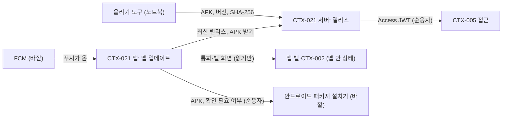

# 마롱이 앱 자동 업데이트: 도메인 설계(바뀌는 맥락)

상태: 한 번에 초안(2026-11-17 12시대 KST, Claude, corthex 0.12.1). 체크포인트 1\~3은 아직이에요. 답을 기다리는 동안 8절의 추천안으로 02 단계부터 이어 가요.
범위: 안드로이드 앱([docs/android-app.md](../android-app.md), 직접 설치 APK)과 봇의 글 대화 서버(`marong/app_chat.py`)에 '자동 업데이트'를 더하는 일이에요. 새 맥락은 CTX-021 하나이고, 바뀌지 않는 맥락은 ID로만 가리켜요(전체 맥락 지도는 [domain.md](domain.md), 앞 작업은 [call-first.md](call-first.md)).
ID 번호: CTX는 021, TERM은 092, REQ는 306, FL은 146, SPEC은 284, TBL은 127, API는 141, SCR은 130, TASK는 179, TC는 200부터 써요(CTX-020의 다음 번호이고, TC-180\~199는 CTX-020의 12 단계 몫으로 비워 둬요). 결정 번호는 D40부터예요. '성향 맞춤·선톡' 스레드가 D24부터 쓰기로 해서 떨어뜨렸고, 2026-11-17 12:3x KST에 그쪽에 알렸어요.
표시: 근거가 동희님 말이나 문서·코드면 `[확실]`, 거기서 끌어낸 것은 `[추론]`, 근거 없는 짐작은 `[추측]`(6절 핫스팟에도 있음).

## 1. 서비스 개요

동희님 말(2026-11-17 12:18 KST, '앱 백그라운드 전화·표정·먼저 걸기' 작업 스레드, 'APK를 노트북에서 서명해 깔기'를 인용하며): "이건 뭐 어케하는데? 현경이 apk 다시 설치해야해? 좀 자동 업데이트 되게 못하나". 이 말을 D40으로 적어요.

다시 쓰면: 앱의 안쪽 코드(벨 화면, 알림 같은 자바 코드)가 바뀔 때마다 현경님이 새 APK 파일을 받아 손으로 다시 까는 일을 없애요. 동희님이 서버에 새 버전을 올리면 앱이 알아서 받아 설치하고, 현경님은 처음에 한 번 허용만 해요. 통화와 벨을 방해하지 않아요.

지금 앱이 업데이트되는 방식: 앱(Capacitor)은 화면 파일을 품지 않고 서버 주소를 그대로 열어서, 글 대화·통화 화면을 고치면 앱을 다시 깔지 않아도 바로 바뀌어요(android-app.md '새 제안', `capacitor.config.json`의 `server.url`). 새 APK가 필요한 것은 자바 코드와 앱 설정이 바뀔 때뿐이에요. 0.1.0부터 0.2.1까지 네 번 그랬고, 0.2.2(선 전화 벨)가 다섯 번째예요. `[확실]`

- 현경님(친구, 앱 0.2.1이 있음, 안드로이드 갤럭시): 0.2.2를 손으로 한 번 더 깔고, 마롱이에 '출처를 알 수 없는 앱 설치'를 한 번 허용해요. 그 뒤로는 하는 일이 없고, 안드로이드가 확인을 꼭 물을 때만 알림을 한 번 눌러요. `[추론]`
- 동희님(관리자, 아이폰이라 앱 없음): 노트북에서 서명한 APK를 서버에 올리고, 문제가 있으면 업데이트를 멈춰요. `[추론]`
- 마롱이 앱: 새 버전을 확인하고, 받고, 확인한 뒤 설치해요. `[추론]`
- 바깥 시스템: 안드로이드 패키지 설치기(`PackageInstaller`), Cloudflare Access(서버 앞의 로그인), FCM(앱을 깨우는 계기로만). `[확실]` 앱 코드

재료:

- 안드로이드 문서 `PackageInstaller.SessionParams.setRequireUserAction`(API 31부터, 2026-11-17 developer.android.com에서 읽음): `REQUEST_INSTALL_PACKAGES` 권한을 받은 설치기는 다음이 모두 맞으면 사용자 확인 없이 설치해요. `USER_ACTION_NOT_REQUIRED`로 요청, 설치하는 앱의 대상 SDK가 기준 이상(안드로이드 12는 29, 13은 30, 14는 31, 15는 33, 16은 34, 그다음은 35), 설치기가 그 앱의 업데이트 담당자·설치 기록 앱이거나 **스스로를 업데이트하는 경우**, 설치기가 `UPDATE_PACKAGES_WITHOUT_USER_ACTION` 권한을 선언. 아니면 `STATUS_PENDING_USER_ACTION`으로 사용자 확인 창을 띄워야 해요. 우리 앱의 대상 SDK는 36이에요. `[확실]`
- 구글 '안드로이드 개발자 인증' 안내(support.google.com/android-developer-console 16561738, 2026-11-17 읽음): 2026-09-30부터 인도네시아·싱가포르·태국, 2027년에 전 세계. 직접 설치(사이드로딩)는 남지만 인증한 개발자의 앱이어야 하고, 무료 '제한 배포' 계정은 신분증 없이 기기 20대까지예요. adb 설치는 계속 돼요. 한국은 아직 목록에 없어요. `[확실]`
- 코드: `apps/android`(`MarongPushPlugin.state()`가 앱 버전을 웹 화면에 주고, 웹 화면이 `PUT /chat/api/devices/{installId}`(API-105)로 서버에 보고), `MarongMessagingService`(FCM 받기), `build.gradle`(서명 키는 Git 밖), `marong/app_chat.py`(Access 뒤에서 친구를 확인하는 `_who`, 그림 파일을 내보내는 API-140). 저장소 PR #27 머리 `dbc5359`에서 읽음.
- 앞 기록: android-app.md REQ-110 "Git 밖에 둔 서명 키 하나로 서명한 APK로 직접 설치해야 하고, 업데이트도 같은 키로 서명해야 한다", "하지 않는 것: Play 스토어 배포"(2026-11-15 범위).

견준 방법(D40의 근거, 동희님 답에 적어 보냄 2026-11-17 12:2x KST):

| 방법 | 업데이트 | 드는 것 | 판단 |
| --- | --- | --- | --- |
| 앱이 서버에서 받아 스스로 설치(추천) | 처음 허용 한 번 뒤 묻지 않음(안드로이드 12 이상) | 무료, 앱·서버 코드, 0.2.2를 한 번 더 손으로 | 이번에 해요 |
| Play 스토어 내부 테스트 | 스토어가 자동으로 | 개발자 등록 25달러, 본인 확인, 현경님 구글 계정 초대 | 결제라 동희님이 원할 때만 |
| Firebase App Distribution | 새 버전 알림 뒤 테스터 앱에서 누름 | 현경님 이메일 초대, 테스터 앱 설치 | 자동이 아니라 뺌 |

## 2. 이벤트 스토밍

- 보드: 없음. 01 단계의 사람 보기는 GitHub PR이에요(`.corthex/project.json`, 2026-11-12 결정). 일하는 방식은 한 번에 초안(one-pass draft)이에요.
- 체크포인트 기록: 아직 없음. 검토 때 아래 시간 줄, 4절 규칙, 8절 질문을 먼저 봐 주세요.

### 시간 줄

| Lane | Events |
| --- | --- |
| 새 버전 올리기 | 새 버전 올려짐 → 업데이트 멈춤 or 더 새 버전 올려짐 |
| 앱 업데이트 | 새 버전 받음 or 받기 실패 → 업데이트 설치됨 or 사용자 확인 기다림 or 설치 실패 |
| 사용자 확인 | 사용자 확인 기다림 → 업데이트 설치됨 or 업데이트 거절됨 |

새 버전이 있는지 보는 일, 지금 앱 버전, 통화 중이거나 벨이 울리는지, 앱이 화면에 떠 있는지, '출처를 알 수 없는 앱 설치'를 허용했는지는 데이터를 바꾸지 않아서 이벤트가 아니라 읽기 모델로 적었어요. 현경님이 안드로이드 설정에서 허용을 켜는 일도 앱 밖의 설정이라 읽기 모델이에요.

## 3. 바운디드 컨텍스트와 패키지

| Context | Type | Aggregates | Package |
| --- | --- | --- | --- |
| CTX-021 앱 자동 업데이트 | supporting | 릴리스(TERM-093), 앱 업데이트(TERM-092) | 서버 `marong/app_release.py` 후보와 `app_chat.py`의 주소 두 개, 앱 `AppUpdate*.java` 후보, 올리기 도구 `deploy/ovh.sh app-release` 후보 |

지원 맥락으로 둔 이유: 업데이트 자체는 마롱이만의 것이 아니고 흔한 기능이지만(스토어가 하는 일), 스토어를 쓰지 않아서 직접 만들어야 해요. `[추론]`

바뀌는 기존 맥락: 없음. CTX-005 접근(Access로 친구 확인)은 그대로 읽기만 하고, 앱 벨·CTX-002 통화 연결은 '지금 통화 중인지'를 앱 안에서 읽기만 해요.

## 4. 컨텍스트 표

### CTX-021 앱 자동 업데이트

목적: 동희님이 올린 새 APK를 앱이 받아, 같은 앱·더 높은 버전·같은 서명·같은 해시인지 확인하고, 통화와 벨을 방해하지 않는 때에 설치해요. 안드로이드가 허락하면 묻지 않고, 아니면 알림 한 번으로 확인받아요.

| Given by | Read model | Command | Aggregate | Events |
| --- | --- | --- | --- | --- |
| 동희님(노트북에서) | 서명한 APK(TERM-170), 버전 코드(TERM-094), 버전 이름(TERM-095) | 새 버전 올리기 | 릴리스 | 새 버전 올려짐 |
| 동희님 | 지금 올린 버전(TERM-093) | 업데이트 멈추기 | 릴리스 | 업데이트 멈춤 |
| 정책: 앱이 열릴 때, 푸시를 받았을 때, 하루 한 번(마지막 확인 뒤 6시간이 지났을 때만) | 서버의 최신 릴리스(TERM-093), 지금 앱 버전(TERM-094) | 새 버전 받기 | 앱 업데이트 | 새 버전 받음, 또는 받기 실패(새 버전이 없으면 아무 일도 없음) |
| 정책: 새 버전 받음이고 조용할 때(통화·벨 없음, 앱이 화면에 없음) | 통화 중인지(TERM-001), 벨 상태(TERM-168), 앱 화면 상태(TERM-171), 설치 허용 여부(TERM-097) | 업데이트 설치하기 | 앱 업데이트 | 업데이트 설치됨, 또는 사용자 확인 기다림, 또는 설치 실패 |
| 현경님 | 업데이트 알림(TERM-172) | 업데이트 확인하기(알림을 누르고 '업데이트') | 앱 업데이트 | 업데이트 설치됨, 또는 업데이트 거절됨 |

- Aggregate rules: 릴리스: 새로 올리는 버전 코드는 지금 올린 것보다 커야 해요(사실: 안드로이드는 더 낮은 버전 코드로 업데이트 설치를 하지 않아서, 되돌리기는 옛 코드로 더 높은 버전을 만들어 올리는 일이에요). 릴리스에는 APK와 버전 코드·버전 이름·크기·SHA-256 해시를 함께 적고, 최신은 하나뿐이에요(추론). 업데이트를 멈추면 서버가 '새 버전 없음'으로 답해서 앱이 받지 않아요(추론). 앱 업데이트: 받은 파일은 서버가 적은 크기·SHA-256과 같고, 패키지 이름이 같고, 버전 코드가 지금보다 크고, 서명 인증서가 지금 앱과 같을 때만 설치해요(추론, 서명은 안드로이드도 따로 막음: 사실). 통화 중, 벨이 울리는 중, 앱 창이 화면에 떠 있을 때는 설치하지 않아요(추론: 설치하면 앱 프로세스가 끝나 통화가 끊기고 보던 화면이 닫힘). 같은 버전이 세 번 실패하면 더 새 버전이 올라올 때까지 그 버전을 다시 받지 않아요(추측). 확인은 6시간에 한 번까지예요(추측: 하루 한두 번이면 충분하고 데이터를 아낌). 처음 0.2.1 → 0.2.2는 0.2.1에 이 기능이 없어 손으로 깔아요(사실).
- Given–When–Then: Given 현경님 폰에 0.2.2, '출처를 알 수 없는 앱 설치' 허용, 안드로이드 12 이상, 서버에 0.2.3, When 앱을 닫은 뒤 하루 확인 차례, Then 앱이 0.2.3을 받아 묻지 않고 설치하고 다음에 열면 0.2.3이에요.
- Given–When–Then: Given 같은 상황에서 현경님이 마롱이와 통화 중, When 새 버전 받음, Then 설치하지 않고 통화가 끝나고 앱이 화면에서 내려간 뒤에 설치해요.
- Given–When–Then: Given 설치 허용이 꺼져 있음, When 업데이트 설치하기, Then '마롱이 앱 새 버전이 있어요' 알림이 한 번 뜨고, 누르면 안드로이드의 확인 창(처음엔 허용 설정)이 열려요.
- Given–When–Then: Given 받은 파일의 SHA-256이 서버 값과 다름, When 업데이트 설치하기 전 확인, Then 파일을 지우고 설치하지 않으며 다음 확인 때 다시 받아요.
- External systems: 안드로이드 패키지 설치기(순응자: 안드로이드가 정한 규칙을 그대로 따름), Cloudflare Access(순응자: 앱 웹뷰가 가진 로그인 쿠키로 받음, CTX-005와 같은 확인), FCM(앱을 깨우는 계기로만, 업데이트 내용은 싣지 않음).
- Links: 앱 벨(TBL-102의 앱 쪽)과 CTX-002 통화 연결의 '지금 통화·벨 중인지'를 앱 안에서 읽어요. 서버 쪽은 CTX-005로 친구를 확인한 뒤에만 릴리스를 줘요.
- Hotspots: 처음 허용을 어떻게 안내할지, 현경님 폰의 안드로이드 버전, 업데이트 뒤 서버의 앱 버전 기록, 개발자 인증(6절).

## 5. 컨텍스트 사이 의존

| From | To | Kind | Pattern | Why | Data |
| --- | --- | --- | --- | --- | --- |
| CTX-021(서버) | CTX-005 | call (sync) | conformist | 친구에게만 릴리스와 APK를 줌 | Access JWT → 통화하는 친구 |
| CTX-021(앱) | 안드로이드 패키지 설치기 | call (sync) | conformist | 설치, 사용자 확인 | APK, 사용자 확인 필요 여부, 결과 |
| CTX-021(앱) | 앱 벨·CTX-002(앱 안 상태) | call (sync, 읽기만) | | 지금 설치해도 되는지 | 통화 중, 벨 화면, 창이 화면에 있음 |
| FCM | CTX-021(앱) | event (async) | conformist | 푸시를 받으면 확인 차례 | 없음(푸시가 왔다는 것만) |
| 올리기 도구(노트북) | CTX-021(서버) | call (sync) | | 새 버전 올리기·멈추기 | APK, 버전 코드·이름, 크기, SHA-256 |

동기 호출이 원을 이루는 곳은 없어요.

## 6. 핫스팟

| Hotspot | Context | State | Answer or next step |
| --- | --- | --- | --- |
| 처음 허용: '출처를 알 수 없는 앱 설치'를 마롱이에 허용해야 묻지 않고 설치돼요. 언제 어떻게 안내할지 | CTX-021 | open | 8절 질문 2. 추천안은 글 대화 메뉴(SCR-109)에 '자동 업데이트' 줄과 '켜기' 단추, 0.2.2 설치 안내에 한 줄. 허용을 안 하면 업데이트마다 알림 한 번 |
| 현경님 폰의 안드로이드 버전을 몰라요(기기 보고에 없음). 11 이하면 업데이트마다 확인 한 번 | CTX-021 | open | 갤럭시 최근 기종이면 12 이상일 가능성이 큼 `[추측]`. 실제 폰 시험(12 단계)에서 확인. 사용 정보를 보내지 않는 원칙(app-chat.md REQ-118, 앱 매니페스트의 분석 끔) 때문에 기기 보고에 더하지 않음(추천) |
| 삼성 '자동 차단(Auto Blocker)'이 켜져 있으면 직접 설치가 막혀요 | CTX-021 | open | 0.2.1을 직접 깔았으니 꺼져 있을 거예요 `[추측]`. 막히면 12 단계에서 안내 |
| 업데이트 뒤 서버의 앱 버전 기록은 앱 화면을 열어 기기 보고가 갈 때 바뀌어요. 그 사이 서버는 옛 버전으로 봐요 | CTX-021 | open | 옛 버전으로 보는 쪽이 안전해서(새 기능을 늦게 켤 뿐) 그대로 둠(추천) `[추론]` |
| 잘못된 APK를 올리면 낮은 버전으로 되돌릴 수 없어요 | CTX-021 | resolved | 사실(안드로이드 버전 코드 규칙). 올리기 전 에뮬레이터 확인, 문제면 '업데이트 멈춤' 뒤 옛 코드로 더 높은 버전을 올림 |
| 구글 개발자 인증(2027 전 세계) | CTX-021 | open | 한국 적용 전에 다시 확인. 필요하면 무료 제한 배포 계정(기기 20대) 등록. 직접 설치와 이 기능은 그대로 씀 |
| Access 로그인이 끝난 폰(한 달마다)은 새 버전을 받지 못해요 | CTX-021 | open | 앱을 열어 다시 로그인하면 그 뒤 확인에서 받음. 받기 실패로만 남기고 알리지 않음(추천) `[추론]` |

## 7. 용어집

| ID | Term | Definition | Context | Code name | Avoid |
| --- | --- | --- | --- | --- | --- |
| TERM-092 | 자동 업데이트 | 서버에 올린 새 버전을 앱이 스스로 받아 설치하는 일. 사람은 처음 허용만 해요 | CTX-021 | `AppUpdate` | 자동 설치, 재설치 |
| TERM-093 | 릴리스 | 서버에 올린 앱 버전 하나. APK와 버전 코드·버전 이름·크기·SHA-256 해시 | CTX-021 | `release` | 배포판 |
| TERM-094 | 버전 코드 | 안드로이드가 업데이트 순서를 가르는 정수(`versionCode`). 지금보다 커야 업데이트 설치가 돼요 | CTX-021 | `versionCode` | 빌드 번호 |
| TERM-095 | 버전 이름 | 사람이 보는 버전(`versionName`, 예: 0.2.2) | CTX-021 | `versionName` | 판 |
| TERM-096 | 업데이트 설치 | 앱을 지우지 않고 같은 키로 서명한 더 높은 버전을 까는 일. 데이터와 로그인이 그대로예요 | CTX-021 | | 재설치(지웠다 다시 깔기라 로그인이 사라짐) |
| TERM-097 | 출처를 알 수 없는 앱 설치 | 앱이 다른 APK를 설치해도 되는지 사용자가 앱마다 허용하는 안드로이드 설정(`REQUEST_INSTALL_PACKAGES`) | CTX-021 | `canRequestPackageInstalls` | 외부 앱 권한 |
| TERM-098 | 사용자 확인 | 안드로이드가 설치 전에 띄우는 확인 창. 조건이 맞으면 생략돼요(`USER_ACTION_NOT_REQUIRED`) | CTX-021 | `STATUS_PENDING_USER_ACTION` | 팝업 |
| TERM-099 | 서명 인증서 | APK에 서명한 키의 인증서. 다르면 안드로이드가 업데이트 설치를 거절해요 | CTX-021 | signing certificate | 서명 파일 |
| TERM-100 | 업데이트 멈춤 | 서버에서 최신 릴리스를 내려 앱이 새로 받지 않게 하는 일. 이미 설치된 것은 그대로예요 | CTX-021 | `paused` | 롤백(되돌리기와 다름) |
| TERM-170 | 서명한 APK | 동희님 노트북의 서명 키로 서명한 안드로이드 설치 파일. 릴리스로 올리는 것은 이것뿐이에요 | CTX-021 | | 설치 파일 |
| TERM-171 | 앱 화면 상태 | 마롱이 앱 창이 지금 화면에 떠 있는지. 떠 있으면 설치를 미뤄요 | CTX-021 | | |
| TERM-172 | 업데이트 알림 | 사용자 확인이 꼭 필요할 때 한 번 뜨는 안드로이드 알림 '마롱이 앱 새 버전이 있어요'(SCR-130) | CTX-021 | | 팝업 |

## 8. 체크포인트 노트(한 번에 초안, 1\~3 합침)

1. 추측으로 둔 것: 같은 버전 세 번 실패면 쉼, 6시간에 한 번 확인, 현경님 폰이 안드로이드 12 이상, 삼성 자동 차단이 꺼져 있음.
2. 질문(번호와 추천안, "추천대로" 또는 바꿀 번호만 말하면 돼요):
   1. 언제 설치할지: ① 통화·벨이 없고 앱 창이 화면에 없을 때만(추천: 통화가 끊기지 않음, 대신 앱을 계속 띄워 두면 늦어짐) ② 받는 즉시(빠르지만 보던 화면이 닫힐 수 있음)
   2. 처음 허용 안내: ① 글 대화 메뉴(SCR-109)에 '자동 업데이트' 줄과 '켜기' 단추 + 0.2.2 설치 안내에 한 줄(추천) ② 0.2.2를 처음 열 때 바로 설정 화면으로 보냄(빠르지만 놀랄 수 있음)
   3. 빠진 것: 스토어(구글 플레이)와 F-Droid 같은 앱 업데이트와 견주면 '바뀐 점 안내'와 '업데이트됨' 알림이 없어요. ① 이번엔 둘 다 빼고 조용히 설치, 확인이 꼭 필요할 때만 알림(추천: 현경님이 할 일이 없음) ② 설치 뒤 '새 버전으로 바뀌었어요' 알림을 한 번
3. 지원 맥락이라 핵심 규칙은 4절 Aggregate rules로 갈음해요.
