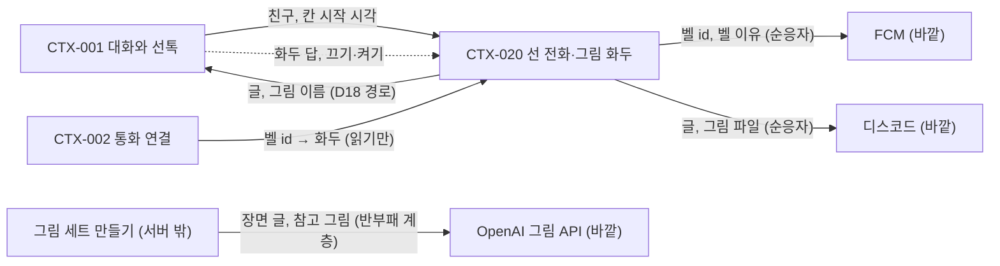

# 마롱이 선 전화와 그림 화두: 도메인 설계(바뀌는 맥락)

상태: 한 번에 초안(2026-11-16 23시대 KST, Claude, corthex 0.12.1). 체크포인트 1\~3은 아직이에요. 답을 기다리는 동안 8절의 추천안으로 02 단계부터 이어 가요.
범위: 지금 있는 맥락(CTX-001 대화와 선톡, CTX-002 통화 연결)과 앱 벨([docs/app-ring.md](../app-ring.md))에 '선 전화'와 '그림 화두'를 더하는 일이에요. 새 맥락은 CTX-020 하나이고, 바뀌지 않는 맥락은 ID로만 가리켜요(전체 맥락 지도는 [domain.md](domain.md)).
ID 번호: 이 설계는 CTX는 020, TERM은 080, REQ는 260, FL은 140, SPEC은 260, AI는 20, TBL은 125, API는 140, SCR은 130, TASK는 160, TC는 180부터 써요. 같은 날 '마롱이 성향 맞춤·선톡 연구' 스레드가 PR #25 다음 번호(CTX는 008, TERM은 040, REQ는 202부터 …)를 쓰기로 해서, 겹치지 않게 번호를 떨어뜨렸어요(2026-11-16 23:08 KST 그쪽과 합의). 결정 번호는 이 설계가 D23, 그쪽이 D24부터예요.
표시: 근거가 동희님 말이나 문서·코드면 `[확실]`, 거기서 끌어낸 것은 `[추론]`, 근거 없는 짐작은 `[추측]`(6절 핫스팟에도 있음).

## 1. 서비스 개요

동희님 말(2026-11-16 21:47 KST, 프로젝트 채팅): "왜 선 전화도 하라고". 21:56 KST: "모자 같은거 쓰고 안녕! 내 모자 어때! 뭐 이런식으로 혹은 닭꼬치 먹는 모습 보여주고 나는 닭꼬치먹고 있어 넌 뭐 먹었어? 이런식으로 이벤트성으로 먼저 화두를 던져도 좋고". 이 두 말을 D23으로 적어요.

다시 쓰면: 마롱이가 약속이 없어도 가끔 먼저 전화를 걸고(선 전화), 먼저 말을 걸 때 모자 쓴 마롱이, 닭꼬치 먹는 마롱이 같은 그림을 보여 주며 "넌 뭐 먹었어?"처럼 되묻는 화두를 던져요. 현경님이 귀찮거나 놀라지 않게 횟수와 시간대를 지키고, 말로 끌 수 있어요.

D19와의 관계: 2026-11-15의 D19는 '전화 시간은 현경님이 말로 정하기'였고, 좋은 점으로 '갑자기 울릴 일이 없어요'를 적었어요. D23은 약속 없는 전화를 더하라는 말이라, 약속 전화(D19)는 그대로 두고 선 전화를 따로 더해요. `[확실]`

- 현경님(친구, 앱 0.2.1이 있음): 선 전화를 받거나 못 받고, 그림 화두에 답하고, "먼저 전화하지 마", "그림 그만 보내"처럼 말로 끄고 켜요. `[확실]` D23, 끄기·켜기는 `[추론]`
- 동희님(친구이자 관리자, 앱 없음): 디스코드 DM으로 그림 화두를 받아요. 울릴 앱이 없어서 선 전화는 받지 않아요. 그림 세트에 그림을 더하거나 빼는 일은 PR 검토로 해요. `[추론]`
- 마롱이(선톡 정책): 이틀에 한 번, 한 주에 세 번까지 화두를 고르고, 선 전화 조건이 맞으면 전화를 걸고, 아니면 그림 화두를 글로 보내요. `[추론]`
- 바깥 시스템: FCM(벨 신호), 디스코드(그림이 붙은 DM), Google Vertex Gemini Live(통화, CTX-002 그대로), OpenAI 그림 API(그림 세트를 만들 때만, 서버 밖). `[확실]` 앱 벨 문서, 그림 시제품

재료:

- 이 스레드의 그림 시제품(2026-11-16, 프로젝트 파일 `marong-topic-pictures-20261116/`): `gpt-image-2.5-flare` low, 마롱이 얼굴 01·05를 참고 그림으로 넣어 모자 쓴 마롱이, 닭꼬치 먹는 마롱이를 그림. 장당 약 10초, 약 0.024달러. 두 장 모두 두 눈 높이가 같았어요.
- 연구 스레드 노트 `proactive_memory_messaging.md`(2026-11-16): 이벤트형 그림 화두는 피로와 비용 때문에 주 1\~3회 이하를 권함, 문장 끝에 되묻는 질문을 붙임, 매번 새로 그리지 말고 미리 그려 검수한 그림 세트에서 고르는 방법, 캐릭터가 자기 일상을 나누는 말("내 새 모자 어때?")은 기억 없이도 대화를 여는 위험이 낮은 오프너(Lee et al., CHI 2020), 업계 사례는 '최근 쓰는 사람에게만, 답이 없으면 멈춤, 하루 1회'처럼 상한을 둠.
- 코드: `marong/proactive.py`·`marong/discord_dm.py`(선톡 칸, D18 경로), `marong/app_delivery.py`(약속 전화 벨), `apps/android`의 `Ring.java`·`strings.xml`(벨 글 '약속한 전화예요' 고정), `tools/vertex_live/server.py`·`live_session.py`(받은 벨의 첫마디). 저장소 main `2a473ae`와 PR #27 머리 `6d91f25`에서 읽음.
- 서버 읽기(2026-11-16 22:22 KST, 읽기만): 앱 기기는 현경님 폰 하나(0.2.1, 알림 켜짐, '마롱이 전화' 채널 켜짐, 잠금 화면 전체 화면 꺼짐). 선톡 설정은 현경님 하루 36번 7\~24시, 동희님 하루 2번 12\~21시. 벨은 22:41:59에 켬(PR #27).

## 2. 이벤트 스토밍

- 보드: 없음. 01 단계의 사람 보기는 GitHub PR이에요(`.corthex/project.json`, 2026-11-12 결정). 일하는 방식은 한 번에 초안(one-pass draft)이에요.
- 체크포인트 기록: 아직 없음. 검토 때 아래 시간 줄, 4절 규칙, 8절 질문을 먼저 봐 주세요.

### 시간 줄

| Lane | Events |
| --- | --- |
| 선 전화 | 화두 골라짐 → 선 전화 울림 → 선 전화 받음 or 선 전화 못 받음 → 그림 화두 남겨짐 |
| 그림 화두 글 | 화두 골라짐 → 그림 화두 보내짐 or 그림 화두 보내지 못함 |
| 화두 답 | 화두 답 받음 or 화두 답 없음 |
| 설정 | 선 전화 꺼짐 or 선 전화 켜짐 or 그림 화두 꺼짐 or 그림 화두 켜짐 |
| 그림 세트 | 그림 후보 그려짐 → 그림 검수됨 → 그림 세트에 더해짐 or 그림 빠짐 |

화두를 고를 때 보는 최근 화두 기록, 벨 받을 기기와 앱 버전, 지금 통화 중인지는 데이터를 바꾸지 않아서 이벤트가 아니라 읽기 모델로 적었어요. '간격 늘리기'도 화두 답 기록에서 계산하는 값이라 이벤트로 두지 않았어요.

## 3. 바운디드 컨텍스트와 패키지

| Context | Type | Aggregates | Package |
| --- | --- | --- | --- |
| CTX-020 선 전화·그림 화두 | supporting | 화두 보냄, 그림 세트, 선 전화 설정. 벨은 앱 벨의 표(TBL-102)를 같이 써요 | `marong/topics.py` 후보(화두 고르기·보내기·답 적기), `marong/app_delivery.py`(벨 걸기·못 받음), 그림 파일 `marong/topics/v1/` 후보와 통화 서버의 같은 사본 |

바뀌는 기존 맥락: CTX-001(선톡 칸 하나를 그림 화두로 쓰고, 그림이 붙은 글을 D18 경로로 보내고, 친구 말에서 끄기·켜기와 화두 답을 알아챔), CTX-002(받은 선 전화의 첫마디와 그림 보여 주기). 그 밖의 맥락(CTX-003\~006)은 바뀌지 않아요.

## 4. 컨텍스트 표

### CTX-020 선 전화·그림 화두

목적: 마롱이가 이틀에 한 번, 한 주에 세 번까지 그림이 붙은 화두를 골라, 조건이 맞으면 선 전화로, 아니면 글로 먼저 말을 걸어요. 친구가 답했는지 적어 두고, 답이 없으면 간격을 늘려요.

| Given by | Read model | Command | Aggregate | Events |
| --- | --- | --- | --- | --- |
| 정책: 그날의 화두 시각이 든 선톡 칸이나 그 뒤 칸에서 선톡 차례가 오고, 오늘 화두가 아직이며 화두 간격(이틀, 한 주 세 번)이 허락할 때(CTX-001) | 최근 화두 기록, 그림 세트, 선 전화 설정 | 화두 고르기 | 화두 보냄 | 화두 골라짐, 또는 건너뜀 |
| 정책: 화두 골라짐이고 선 전화 조건이 맞을 때 | 벨 받을 기기와 앱 버전, 통화 중인지, 최근 벨 | 선 전화 걸기 | 벨(TBL-102) | 선 전화 울림 |
| 정책: 화두 골라짐이고 선 전화 조건이 맞지 않을 때 | 친구 방(D18 경로) | 그림 화두 보내기 | 화두 보냄 | 그림 화두 보내짐, 또는 그림 화두 보내지 못함 |
| 현경님 | 벨 화면, 전화 알림 | 받기 | 벨 | 선 전화 받음 |
| 정책: 울린 지 5분 안에 통화가 시작되지 않을 때 | | 못 받음 처리 | 벨 | 선 전화 못 받음 |
| 정책: 선 전화 못 받음일 때 | 친구 방(D18 경로) | 그림 화두 남기기 | 화두 보냄 | 그림 화두 남겨짐 |
| 정책: 화두를 보낸 뒤 3시간 안에 친구가 마롱이에게 말했을 때(CTX-001) | | 화두 답 적기 | 화두 보냄 | 화두 답 받음 |
| 정책: 화두를 보낸 뒤 3시간이 지나도 말이 없을 때 | | 화두 답 적기 | 화두 보냄 | 화두 답 없음 |
| 현경님, 동희님(말로) | 선 전화 설정 | 선 전화 끄기·켜기, 그림 화두 끄기·켜기 | 선 전화 설정 | 선 전화 꺼짐, 선 전화 켜짐, 그림 화두 꺼짐, 그림 화두 켜짐 |
| 동희님(PR 검토) | 그림 후보, 검수 기록 | 그림 더하기, 그림 빼기 | 그림 세트 | 그림 세트에 더해짐, 그림 빠짐 |

- Aggregate rules: 화두 보냄: 친구 한 명에게 하루(한국 시각 0시 경계)에 많아야 하나이고, 마지막 화두 날에서 2일이 지나야 다음 화두이며, 오늘까지 7일 안에 세 번까지예요(추론: 연구 노트와 연구 스레드 기본값이 이벤트 그림 주 1\~3회이고, 동희님 말이 '이벤트성'. 그림 20장 이상에 30일 되풀이 금지라 날마다면 3주 안에 그림이 바닥나요. 2026-11-16 06 단계 뒤 '하루 한 번까지'에서 고침). 같은 그림은 같은 친구에게 30일 안에 다시 쓰지 않아요(추론: 선톡 되풀이 분석에서 같은 소재가 15일에 17번). 그림 화두와 선 전화는 따로 더해지지 않고 그날 선톡 칸 하나를 대신 써서, 하루 먼저 연락 횟수(선톡 기록)에 그대로 들어가요(연구 스레드와 맞춤, 2026-11-16 23:08 KST). 화두 답은 보낸 뒤 3시간 안의 친구 말이거나 선 전화를 받은 것이고, 화두마다 적어 둬요(추론). 간격 늘리기는 화두만 따로 세지 않고, 친구가 마지막으로 마롱이에게 말한 뒤 먼저 연락(선톡·그림 화두·선 전화)이 나간 날 수로 세요. 이틀이면 화두 간격을 4일로, 나흘이면 7일로 늘리고, 14일이면 멈추고, 친구가 말하면 바로 돌아와요(추론: 연구 노트 '최근 쓰는 사람에게만, 답이 없으면 멈춤'과 연구 스레드 요청). 그림 세트: 검수를 거친 그림만 들어가요. 두 눈 높이가 같고 입이 얼굴 가운데에 있으며, 그림 안에 글자가 없고, 마롱이 모습(흰 몸, 귀 쪽 베이지 무늬, 볼 터치)이 얼굴 그림과 같아요(확실: 동희님 말 2026-11-16 21:47 "얼굴 삐뚤어진 표정 없애", 나머지는 추론). 그림은 버전 폴더(`v1`)로 두고, 이미 나간 이름의 그림은 바꾸지 않고 새 이름으로 더해요(추론: 얼굴 그림 `face/v1`과 같은 규칙, D14). 그림마다 장면 설명, 첫마디 예시, 되묻는 질문, 알림 미리보기 한 줄, 어울리는 달과 시간대가 있어요(추론, 미리보기 한 줄은 연구 스레드 요청). 벨: 앱 벨 규칙(통화 중이면 안 울림, 한 친구에 벨은 하나, 마지막 벨 뒤 10분)은 그대로이고(문서: 앱 벨 요구 129·132번), 선 전화는 선 전화 시간대(기본 19:00\~21:30 한국 시각) 안에서만 걸고, 마지막 선 전화 뒤 3일(못 받았으면 7일)이 지나야 다시 걸며, 최근 6시간 안에 통화나 벨이 있었으면 걸지 않아요(추론: 약속 없는 전화는 글보다 끼어드는 정도가 커서 그림 화두보다 드물게. 2026-11-16 02 단계에서 '하루 한 번까지'를 고침). 벨 화면과 잠금 화면에는 화두의 알림 미리보기 한 줄이나 '마롱이가 먼저 걸었어요' 같은 가벼운 글만 보여요(문서: 앱 벨 요구 130번, DM 지시문 '잠금 화면에 보여도 괜찮은 가벼운 이야기만'). 선 전화는 앱 0.2.2 이상에서만 울려요. 0.2.1은 벨 글이 '약속한 전화예요'로 정해져 있어요(사실: `strings.xml`). 선 전화 설정: 선톡을 켠 친구는 처음에 둘 다 켜져 있고, 친구가 말로 끄고 켜요(추론: D23과 연구 노트 '끄기 가능'). 선 전화를 끄면 그 뒤로 걸지 않고, 그림 화두를 끄면 그림이 붙은 글을 보내지 않으며 선 전화 통화 화면에도 그림을 띄우지 않아요(추론).
- Given–When–Then: Given 현경님 앱 0.2.2, 선 전화 켜짐, 마지막 화두가 이틀 넘게 전, 최근 3일 선 전화 없음, 20:10에 통화 없음, When 화두 시각 뒤의 선톡 차례, Then 털모자 그림 화두가 골라지고 앱이 울리며, 받으면 통화 화면에 털모자 마롱이 그림이 뜨고 마롱이가 "안녕! 나 모자 어때?"처럼 먼저 말해요.
- Given–When–Then: Given 선 전화가 울렸는데 5분 안에 받지 않음, When 못 받음 처리, Then "전화했는데 바빴나 봐!"로 시작하는 그림 화두 글이 앱 알림·글 대화나 DM으로 한 번 남아요.
- Given–When–Then: Given 현경님 앱이 0.2.1, When 화두 시각 뒤의 선톡 차례, Then 벨 없이 그림 화두 글이 가요.
- Given–When–Then: Given 친구가 마지막으로 말한 뒤 먼저 연락만 나간 날이 이틀이고 마지막 화두가 3일 전, When 화두 시각 뒤의 선톡 차례, Then 화두를 고르지 않고 그 칸은 보통 선톡으로 가요.
- Given–When–Then: Given 현경님이 "먼저 전화하지 마"라고 함, When 마롱이가 그 말을 받음, Then 선 전화가 꺼지고 그림 화두는 글로만 와요.
- External systems: FCM(벨 신호, 순응자: 앱 벨과 같은 보내기 코드), 디스코드(그림 파일이 붙은 DM, 순응자), OpenAI 그림 API(그림 세트 후보를 그릴 때만, 서버 밖 스크립트 한 곳: 반부패 계층). 서버는 그림을 그리지 않아요.
- Links: CTX-001의 선톡 차례가 화두를 꺼낼 때를 알려 주고, 그림 화두 글은 CTX-001의 D18 경로로 보내 방 기록에 남겨요. CTX-001은 친구 말에서 끄기·켜기와 화두 답을 알려 줘요. CTX-002는 받은 선 전화의 화두(첫마디, 그림 이름)를 읽어 첫마디를 정하고 통화 화면에 그림을 띄워요.
- Hotspots: 주 세 번이 맞는지, 선 전화 시간대, 앱 0.2.2 설치 전까지는 선 전화가 없음, 그림 세트가 얼마나 버티는지, 연구 스레드의 선톡 설계와 합치기(6절).

### 바뀌는 기존 맥락: 대화와 선톡(CTX-001)

- 선톡 칸: 그날 화두 시각이 든 선톡 칸이나 그 뒤 칸의 첫 선톡 차례는 보통 선톡 대신 CTX-020에 화두를 맡겨요. 화두를 건너뛰면 그 칸은 보통 선톡을 그대로 보내요. `[추론]`
- 그림이 붙은 글: 앱 글 대화에는 그림이 말풍선 안에 보이고, 앱 알림에는 글만 가요(알림 그림은 Access 뒤 주소라 폰이 받아 오지 못함). 디스코드 DM에는 그림 파일을 붙여요. `[추론]`
- 친구 말 알아채기: 정해진 짧은 말("먼저 전화하지 마", "그림 그만 보내" 등)로 끄고 켜요. 지금 선톡 켜기·끄기(`proactive_preference`)와 같은 방식이에요. `[추론]`

### 바뀌는 기존 맥락: 통화 연결(CTX-002)

- 선 전화를 받은 통화: 약속 전화처럼 '(전화 연결됨)' 글로 마롱이가 먼저 말하되, 지시문에는 약속 대신 화두(장면, 첫마디 예시, 되묻는 질문)를 넣어요. 통화 화면은 연결된 뒤 그림을 몇 초 보여 줘요. `[추론]`

## 5. 컨텍스트 사이 의존

| From | To | Kind | Pattern | Why | Data |
| --- | --- | --- | --- | --- | --- |
| CTX-001 | CTX-020 | call (sync) | | 화두 시각 뒤의 선톡 차례에서 화두 고르기 | 친구, 칸 시작 시각 |
| CTX-020 | CTX-001 | call (sync) | | 그림 화두 글을 D18 경로로 보내고 방에 남기기 | 친구, 글, 그림 이름 |
| CTX-001 | CTX-020 | event (async) | | 친구가 말함(화두 답), 끄기·켜기 말 | 친구, 말한 때, 설정 |
| CTX-020 | FCM | call (sync) | conformist | 선 전화 벨 | FID, 벨 id, 벨 이유 |
| CTX-020 | 디스코드 | call (sync) | conformist | 그림이 붙은 DM | 채널, 글, 그림 파일 |
| CTX-002 | CTX-020 | call (sync, 읽기만) | | 받은 선 전화의 화두 | 벨 id → 장면, 첫마디, 그림 이름 |
| 그림 세트 만들기(서버 밖) | OpenAI 그림 API | call (sync) | anticorruption layer | 그림 후보 그리기 | 영어 장면 글, 마롱이 얼굴 참고 그림 |

동기 호출이 원을 이루는 곳: CTX-001 → CTX-020 → CTX-001(화두 고르기 안에서 그림 화두 글 보내기)이 같은 요청 안의 원이에요. 선톡 칸 처리 하나가 화두를 고르고 바로 보내는 흐름이라 지금은 한 모듈 안에 두고, CTX-020이 보내는 일은 CTX-001의 보내기 함수를 그대로 부르는 것으로 둬요. 8절 질문 4로 확인해요.

## 6. 핫스팟

| Hotspot | Context | State | Answer or next step |
| --- | --- | --- | --- |
| 그림 화두 횟수. 연구 노트와 연구 스레드 기본값은 이벤트 그림 주 1\~3회 | CTX-020 | open | 8절 질문 1. 추천안은 이틀에 한 번·주 세 번까지 + 답이 없으면 간격 늘리기, 선 전화는 3일에 한 번까지. 일주일 쓰고 답 비율을 보고 조정 |
| 선 전화 시간대 19:00\~21:30이 현경님에게 맞는지 | CTX-020 | open | 8절 질문 2. 지난 통화 시각(11/13\~16: 오후·저녁·새벽이 섞임)만으로는 정할 근거가 약함. 현경님 말로 바꿀 수 있게 |
| 앱 0.2.1은 벨 글이 '약속한 전화예요'로 고정이라 선 전화에 맞지 않음 | CTX-020 | resolved | 0.2.2 이상에서만 선 전화(4절 규칙). 그전에는 그림 화두 글만 감. 0.2.2 빌드·서명·설치는 10단계 작업 |
| 그림 세트가 얼마나 버티는지(30일 안 되풀이 금지) | CTX-020 | open | 세트를 30장 넘게 두면 계절 거르기 뒤에도 한 달은 되풀이 없음(계산상 추론). 모자라면 세트에 더함 |
| 그림 얼굴이 삐뚤어 보일 위험(현경님이 싫어함) | CTX-020 | open | 세트에 넣기 전 검수(두 눈 높이, 입 위치, 글자 없음). 의심되면 넣지 않음 |
| 연구 스레드의 '이유 있는 선톡' 설계와 합치기 | CTX-020, CTX-001 | open | 장치(그림 세트, 벨, 그림이 붙은 글)는 이 설계, 언제·무엇을 말할지는 연구 스레드(2026-11-16 23:08 KST 그쪽 답으로 합의). 주고받는 것: 화두 종류, 짧은 글, 그림 이름, 알림 미리보기 한 줄. 친구 카드에 '먼저 전화해도 되는지·시간대'가 생기면 선 전화는 그 값을 읽음 |
| 동희님에게도 그림 화두를 보낼지 | CTX-020 | open | 8절 질문 3. 추천안은 선톡을 켠 친구 누구나(말로 끔) |
| 화두 고르기 → 그림 화두 글 보내기의 동기 호출 원(CTX-001 ⇄ CTX-020) | CTX-020, CTX-001 | open | 8절 질문 4 |
| 생성 그림 표시(인공지능기본법) | CTX-020 | open | 연구 노트: 가족끼리 쓰는 일이라 해당하지 않을 가능성이 크고, 캐릭터 그림이라 사람으로 오인할 위험이 낮음(추론). 상업화하면 다시 봄 |

## 7. 용어집

| ID | Term | Definition | Context | Code name | Avoid |
| --- | --- | --- | --- | --- | --- |
| TERM-080 | 선 전화 | 약속 없이 마롱이가 먼저 거는 전화. 화두 하나를 들고 걸어요 | CTX-020 | `reason = 'hello'` | 깜짝 전화, 랜덤 전화 |
| TERM-081 | 약속 전화 | 친구가 정한 때 마롱이가 거는 전화(앱 벨 3단계, D19) | CTX-020 | `reason = 'promise'` | 알람 전화 |
| TERM-082 | 화두 | 마롱이가 먼저 꺼내는 이야깃거리 하나. 장면, 첫마디 예시, 되묻는 질문이 있음 | CTX-020 | `Topic` | 떡밥 |
| TERM-083 | 그림 화두 | 마롱이 그림 한 장이 붙은 화두. 이틀에 한 번, 한 주에 세 번까지 | CTX-020 | `topic picture` | 짤, 셀카 |
| TERM-084 | 그림 세트 | 미리 그려 검수한 그림 화두 그림의 모음. 버전 폴더(`v1`)로 나눔 | CTX-020 | `topics/v1` | 그림 묶음 |
| TERM-085 | 검수 | 그림을 그림 세트에 넣기 전에 얼굴(두 눈 높이, 입 위치), 글자 없음, 마롱이 모습을 사람이 확인하는 일 | CTX-020 | `reviewed` | 검사(자동 시험과 헷갈림) |
| TERM-086 | 화두 시각 | 친구마다 날마다 하나 정하는 때. 이 때가 든 선톡 칸이나 그 뒤 칸의 선톡 차례에 화두를 꺼내요. 선 전화를 걸 수 있는 날은 선 전화 시간대 안, 아니면 12:00\~21:00 사이에서 골라요(2026-11-16 02 단계에서 '화두 시간'을 고침) | CTX-020 | `topic_at` | 골든 타임 |
| TERM-087 | 선 전화 시간대 | 선 전화를 걸 수 있는 시간. 기본 19:00\~21:30 한국 시각 | CTX-020 | `call_from`, `call_until` | 통화 가능 시간 |
| TERM-088 | 화두 답 | 화두를 보낸 뒤 3시간 안에 친구가 마롱이에게 한 말, 또는 선 전화를 받은 것 | CTX-020 | `answered` | 반응률 |
| TERM-091 | 알림 미리보기 한 줄 | 앱 알림과 벨 화면처럼 잠금 화면에 보일 수 있는 곳에 쓰는 가볍고 짧은 글. 개인적인 내용을 넣지 않음 | CTX-020 | `preview` | 요약 |
| TERM-089 | 간격 늘리기 | 친구가 마지막으로 말한 뒤 먼저 연락만 나간 날이 이어질 때 다음 화두까지 쉬는 날을 늘리는 것(백오프). 친구가 말하면 돌아옴 | CTX-020 | `backoff` | 벌점 |
| TERM-090 | 선 전화 설정 | 친구마다 선 전화와 그림 화두를 켜고 끄는 값과 선 전화 시간대 | CTX-020 | `TopicPrefs` | 알림 설정(앱 알림 권한과 헷갈림) |

## 8. 체크포인트 노트(한 번에 초안, 1\~3 합침)

1. 추측으로 둔 것: 없음. 추론으로 둔 숫자(이틀 간격·주 세 번, 선 전화 3일·7일, 30일, 3시간, 6시간, 19:00\~21:30, 화두 시각 12:00\~21:00, 간격 늘리기의 이틀·나흘·14일과 4일·7일)는 4절 규칙에 근거와 함께 있어요.
2. 질문(번호와 추천안, "추천대로" 또는 바꿀 번호만 말하면 돼요):
   1. 그림 화두 횟수: ① 이틀에 한 번·주 세 번까지 + 답이 없으면 간격 늘리기, 그중 선 전화는 3일에 한 번까지(못 받으면 7일)(추천, 연구 스레드 기본값 '주 1\~3번'과 같음) ② 하루 한 번까지 + 간격 늘리기
   2. 선 전화 시간대: ① 19:00\~21:30(추천, 현경님 말로 바꿈) ② 그 친구의 선톡 시간 전체(현경님 7\~24시)
   3. 그림 화두를 받는 친구: ① 선톡을 켠 친구 누구나(추천, 동희님은 DM으로 그림만) ② 현경님만
   4. 빠진 것과 경계: 비슷한 서비스(연구 노트의 Replika, Nomi, Kindroid, Meta AI Studio, ChatGPT Pulse)와 견주면 '사용자가 원하는 화두 종류 고르기'가 없어요. ① 이번엔 빼고 화두 답 기록만 남김(추천) ② 이번에 더함. 그리고 CTX-001 ⇄ CTX-020 동기 호출 원은 ① 선톡 칸 처리 안에서 바로 보냄(추천, 지금 구조 그대로) ② 화두를 표에 남기고 선톡 루프가 따로 보냄
3. 지원 맥락이라 핵심 규칙은 4절 Aggregate rules로 갈음해요.
