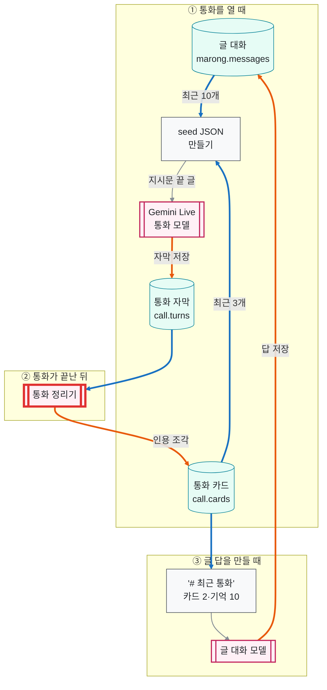
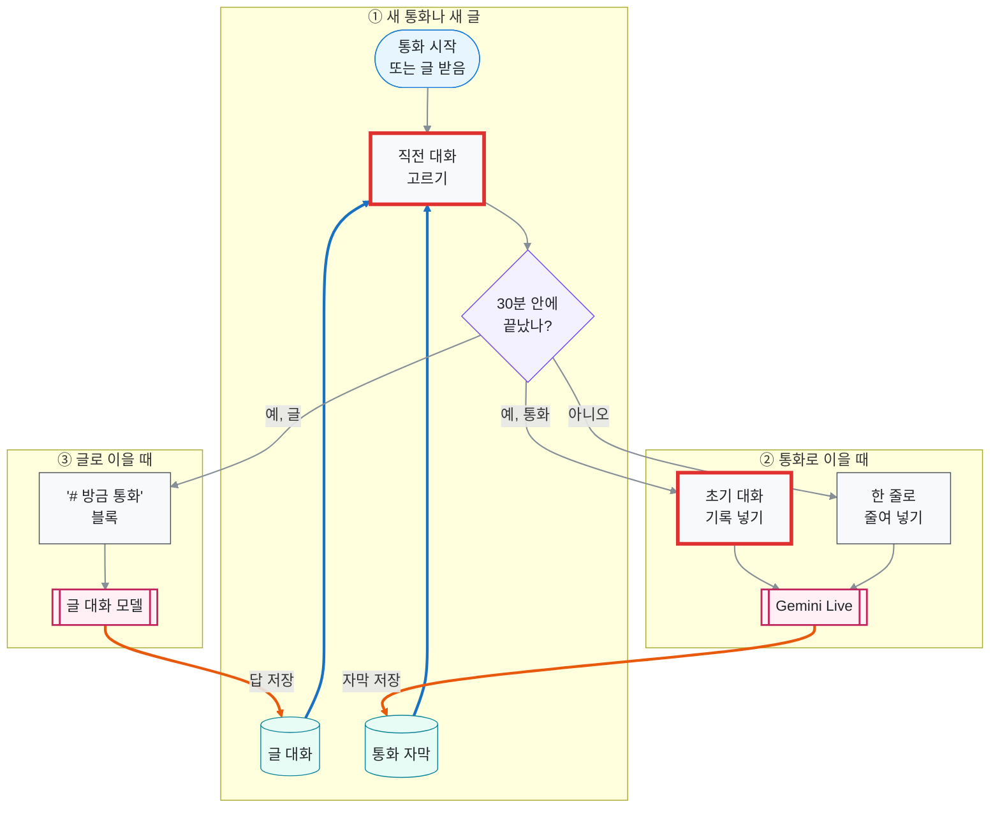

# 대화 이어 주기: 도메인 설계와 기능 변경 기록

상태: 초안(2026-11-24, Claude, 마롱이 봇 항목 74). CORTHEX 기능 변경 절차(corthex `references/changes.md`)로 01\~12단계를 차례로 지나요. 체크포인트는 아직이에요. 이 문서의 새 항목은 모두 `proposed`이고, 7절의 승인 항목은 동희님이 항목마다 답하기 전까지 승인본 그대로예요.
범위: 글 대화와 통화 사이를 양쪽으로 이어요. 통화 → 통화, 글 → 통화, 통화 → 글이에요. 글 → 글은 지금 동작 그대로예요(5.5). 마롱이 항목 77의 결정으로 통화 구간의 맥락 창 압축 값(BUG-117)도 이 설계에서 정해요(5.4, 8절 질문 9).
기준 코드: `main` `a39fef4`(2026-11-24, PR #118 병합 뒤). 줄 번호는 이 커밋에서 읽었어요. 운영 통화 서버의 `server.py`·`live_session.py`는 이 커밋과 해시가 같아요(2026-11-24 확인). 그 뒤 PR #119(`5f89fd5`, BUG-117\~122)가 `main`에 합쳐졌고, 바뀐 동작은 그 자리에 적었어요.
근거 조사: 마롱이 봇 조사 보고서 '통화 기억 조사와 최근 3일 대화 분석'(2026-11-24 03시대 KST, 저장소 밖). 보고서에 든 친구 대화 원문은 이 문서에 옮기지 않았어요. 아래 예시는 모두 합성 이름 '시험친구 가'와 지어낸 대화예요.
표시: [사실] 코드·문서·공식 문서에서 확인, [추정] 근거 있는 짐작, [새 제안] 이 설계에서 Claude가 새로 정한 숫자·문구, [확인 안 함] 아직 보지 않은 것.

## 1. 요청(동희님 말)

| 때(KST) | 어디서 | 말 |
| --- | --- | --- |
| 2026-11-24 03시대 | 마롱이 봇 채팅 | "통화할때에, 전에 대화했던 내용들이 안 들어가?" |
| 2026-11-24 03시대 이후 | 마롱이 봇 항목 74의 답 | "버그·운영 먼저 + 직전 통화 이어 주기 설계 시작" |
| 같은 날, 그 뒤 | 마롱이 봇 채팅 | "직전 통화 뿐 아니라 대화도 이어줘야하는거 아님?" |
| 2026-11-24 03시대 | 마롱이 항목 77 사용자님 결정(마롱이 봇이 이 설계에 넘김) | BUG-117(구간 설정 적용)은 "이어 주기 설계(항목 78)에서 압축 값 정한 뒤 반영" |

- 그래서 범위는 '직전 통화'가 아니라 '직전 대화'(TERM-260)예요. 통화인지 글인지 가리지 않아요.
- '버그·운영 먼저'는 다른 작업이 맡았고 PR #119로 `main`에 합쳐졌어요(9절). 승인 문서(spec.md·call-cost.md·requirements.md)는 그 PR에서 바뀌지 않아 7절의 승인 원문은 그대로예요.

## 2. 기준선

| 문서 패키지 | 이 변경이 닿는 항목 | 승인 상태 | 견준 버전 |
| --- | --- | --- | --- |
| 통화(처음 설계) | REQ-022·036·045([requirements.md](../02-prd/requirements.md)), SPEC-004·017·024와 3.1·5.4([spec.md](../04-functional-spec/spec.md)), TERM-005·006·007([domain.md](domain.md#7-용어집)) | 행 상태가 `active`예요. 머리말은 "초안(2026-11-12), 명세 동결 전"이고, 이 패키지에는 `.corthex/stages/` 단계 기록이 없어 체크포인트 날짜를 찾지 못했어요. 행 상태대로 승인본으로 봐요 | `main` `a39fef4` |
| 통화 비용(call-cost) | SPEC-182([call-cost.md](../04-functional-spec/call-cost.md)) | 단계 기록 `call-cost.json`: 01\~10 통과(2026-11-17 17:18:41 KST 프로젝트 채팅 '모두 승인'), 12는 진행 중 | `main` `a39fef4` |
| 성향 맞춤(persona) | SPEC-233·235·240([persona.md](../04-functional-spec/persona.md)) | 행 상태 `proposed`. 단계는 D63(2026-11-17 15:15:23 KST)으로 통과 | 바꾸지 않음(5.5) |
| 통합 앱(unified) | SPEC-382([unified.md](../04-functional-spec/unified.md)), REQ-459 | 행 상태 `proposed`. 설계 제안은 D104(2026-11-19 10:15 KST)로 승인. 단계 체크포인트 기록은 없음 | `main` `a39fef4` |

## 3. 풀 문제(친구 쪽에서 본 것)

예시는 지어낸 거예요. 시각은 모두 한국 시각이에요.

1. **통화 → 통화.** 시험친구 가가 14:00에 "다음 주 토요일에 부산 가"라고 말하고 14:04에 끊었어요. 14:05에 다시 걸어 "우리 아까 무슨 얘기 했지?"라고 물으면 마롱이는 모른다고 해요. 지금은 직전 통화가 '친구 말 인용 세 조각'짜리 카드로만 넘어가요(4절).
2. **글 → 통화.** 마롱이가 13:30에 글로 "면접 준비는 잘 돼?"라고 물었고 답이 없었어요. 14:00 통화에서 마롱이가 "네가 면접 준비한다고 했잖아"라고 해요. 최근 글 10개가 지시문 끝 JSON으로만 들어가서 '방금 하던 얘기'로 읽히지 않고, 누가 언제 한 말인지 흐려요.
3. **통화 → 글.** 14:04에 통화를 끊고 14:10에 글로 "아까 말한 거 기억나?"라고 쓰면, 글 마롱이에게는 카드 2개와 통화 기억 10개만 가요. 그 카드가 문맥 없는 인용 조각이에요.
4. **시간.** 지난 대화마다 언제였는지가 없어요. 그래서 이틀 전 "내일 면접이야"를 오늘 "어제 면접"으로 말하거나, 오후 4시에 "잘 잤어?"라고 해요.

## 4. 지금 동작 [사실]

그림: 직전 통화의 실제 대화(자막)는 다음 통화로 바로 가지 않고, 정리기가 만든 인용 조각 카드를 거쳐야만 가요(빨간 테두리). 범례: 원통은 저장소, 두 줄 테두리 상자는 모델 호출, 네모는 코드, 주황 굵은 선은 쓰기, 파랑 굵은 선은 읽기, 회색 선은 저장 없이 넘김이에요.

| 무엇 | 지금 | 근거 |
| --- | --- | --- |
| 통화 seed | 메모 1개(1,000자), 글 요약 3개(1,500자), 최근 글 10개(1,500자), 친구들(1,500자), 통화 기억 30개(1,500자), 통화 카드 3개(1,500자), 이번 통화 자막 40줄(다시 이을 때만, 4,000자)을 JSON 하나로 지시문 끝에 붙여요. 항목에 `created_at`은 있지만 '몇 분 전'은 없고, 최근 글에는 `role`만 있어요 | `tools/vertex_live/call_memory.py:222-284`, `tools/vertex_live/server.py:324` |
| 새 통화의 이번 통화 자막 | 없어요(`call_id`의 줄만 읽음). 끊은 뒤 다시 건 통화는 새 통화예요 | `call_memory.py:273-279` |
| 다시 잇기 핸들 | 같은 화면·같은 통화·10분 안일 때만 써요. 서버 메모리에만 있어요 | `tools/vertex_live/live_session.py:373-374`, `server.py:117-122` |
| 통화 카드 | 정리기(Gemini 3.8 Flash)가 고른 인용을 ' · '로 이은 글이에요. 인용이 없으면 친구의 마지막 말 셋을 이어요. 정한 것·다음에 물어볼 것 칸은 비어 있어요 | `tools/vertex_live/organizer.py:157-158` |
| 글 대화의 '# 최근 통화' | 카드 2개와 통화 기억 10개, 1,200자. 때는 없어요 | `marong/store.py:682-729`, `marong/agent.py:846` |
| 통화 지시문의 지금 시각 | 운영에는 없어요. 모델이 `current_time` 도구를 불러야 알아요. `main`에는 PR #119(BUG-119)로 '통화 시작 시각(한국 시각)' 줄이 생겼고 아직 운영 반영 전이에요 | 조사 보고서 2.2, `5f89fd5`의 `server.py` setup |
| 글 대화의 지금 시각 | `# 지금 상황`에 한국 시각이 있어요 | `marong/agent.py:1062` |

- [사실] SPEC-024는 카드를 '30일 안 정리된 카드'로 정했는데 `store.py:708`에는 30일 조건이 없어요. 이 변경의 범위 밖이라 그대로 두고 적기만 해요.
- [사실] `marong` DB 계정은 통화 자막을 `call.transcript_report` 보기(view)로 읽을 수 있어요(`marong/call/migrations/004_transcript_reporting.sql:18`). SPEC-024의 "call 표 셋에 SELECT만"보다 넓어요. 통화 서버 계정 `marong_call`은 이 보기 권한이 없고 `call.turns`를 직접 읽어요(2026-11-24 운영 `has_table_privilege` 확인).
- [사실] 지금 계정의 기억 범위(`SCOPE`)는 그 친구의 1:1 방에 묶인 방(`memory_room`, 기억을 함께 쓰는 단체방)까지 넣어요(`call_memory.py:41-48`). 그 방의 글에는 다른 사람 말이 섞여요.
- [사실] 끊긴 통화는 다음 통화를 걸 때까지 `resting`으로 남아요(`call_memory.py:518`). 웹 통화는 끝나지 않은 통화가 있으면 그것이 몇 시간·며칠 전 것이어도 같은 통화로 이어 열어요(`start_call`, `call_memory.py:347-356`). 그때 PR #119의 '통화 시작 시각'도 처음 통화의 시각이에요. 이 변경 범위 밖의 고장 후보라 마롱이 봇에 따로 알려요.

## 5. 도메인 차이

### 5.1 바뀌는 맥락

새 맥락은 없어요. 세 맥락의 규칙과 정책이 바뀌어요.

| 맥락 | 바뀌는 것 |
| --- | --- |
| CTX-004 통화 기억 | 새 읽기 모델 '직전 대화'(TERM-260): 글 대화(`marong.messages`)와 이 통화가 아닌 그 친구 통화(끝났거나 끊긴 채 쉬는 통화)의 자막(`call.turns`)을 한 시간 줄로 합쳐 읽어요. 새 저장소는 없어요. 규칙: 턴 사이가 30분 넘게 비면 다른 대화예요. 범위는 지금 통화 기억 범위 가운데 그 친구의 1:1 방(묶인 단체방 빼고)과 그 친구의 통화이고, 잊기 표시·지운 통화·뺀 자료는 늘 빠져요. 통화 카드는 SPEC-017 모양(요약·정한 것·안 정한 것·할 일·다음에 물어볼 것)으로 채우고 항목마다 근거 턴을 확인해요(8절 질문 3에 따라) |
| CTX-002 통화 연결 | 새 정책 '통화를 열면 직전 대화를 잇는다': 직전 대화가 30분 안에 끝났으면, 구간을 열고 실시간 소리를 보내기 전에 그 대화의 턴을 초기 대화 기록(TERM-262)으로 넣어요. 지시문의 기억 블록은 항목마다 상대 시각 표기(TERM-263)와 말한 사람을 붙여요. 구간 설정의 압축 값은 이렇게 넣는 맥락과 함께 셈해서 정해요(SPEC-489) |
| CTX-001 글 대화(기존) | 새 정책 '방금 끝난 통화를 글로 잇는다': 통화의 마지막 말이 30분 안일 때 친구가 1:1 글을 쓰면, 글 답의 `# 지금 상황`에 '# 방금 통화' 블록(양쪽 말, 때 붙임)을 넣어요 |

### 5.2 새 용어

| ID | 용어 | 뜻 | 맥락 | 코드 이름 | 피할 말 |
| --- | --- | --- | --- | --- | --- |
| TERM-260 | 직전 대화 | 지금 시작하는 통화나 글 바로 앞의 대화 한 번. 글과 통화를 가리지 않고, 턴 사이가 30분 넘게 비지 않은 턴 전체. 마지막 턴이 30분 안이면 '방금 대화'로 실제 턴을 넘기고, 그보다 오래면 한 줄로 줄여 넘겨요 | CTX-004 | `PreviousConversation` | 지난 통화(통화만 뜻함), 세션(TERM-002 구간과 헷갈림) |
| TERM-261 | 대화 이어 주기 | 직전 대화를 다음 통화나 글 대화의 모델에 넣어 주는 일 | CTX-004, CTX-002, CTX-001 | `continuity`, 설정 `MARONG_CONTINUITY` | 기억(오래 남는 통화 기억 TERM-007과 다름) |
| TERM-262 | 초기 대화 기록 | 통화 구간을 열고 실시간 소리를 보내기 전에 Gemini Live에 넣는 user·model 역할의 턴들. 공식 이름은 initial history(`historyConfig.initialHistoryInClientContent`) | CTX-002 | `initial_history` | seed(지시문 끝 JSON과 다름) |
| TERM-263 | 상대 시각 표기 | "방금", "12분 전", "어제 오후 9시"처럼 지금을 기준으로 적은 때. 어제부터는 뒤에 한국 날짜와 요일을 붙여요. 예: "어제 오후 9시(11/23 월)" | CTX-004, CTX-001 | `relative_time` | 타임스탬프(숫자만 적은 시각) |

### 5.3 바뀐 뒤 흐름

그림: 글과 통화 자막을 한 시간 줄로 읽어 직전 대화를 고르고(빨간 테두리), 30분 안이면 통화에는 실제 턴으로, 글에는 '# 방금 통화' 블록으로 넘겨요. 30분이 지났으면 한 줄로 줄여 통화 지시문에 넣어요. 범례: 둥근 상자는 시작, 원통은 저장소, 네모는 코드, 마름모는 판단, 두 줄 테두리 상자는 모델 호출, 주황 굵은 선은 쓰기, 파랑 굵은 선은 읽기, 회색 선은 저장 없이 넘김이에요.

### 5.4 핫스팟

| 핫스팟 | 왜 위험한가 | 다루는 곳 |
| --- | --- | --- |
| Vertex에서 초기 대화 기록 | [사실] Gemini API 참조는 `initialHistoryInClientContent`가 참이면 처음 `clientContent`를 `turnComplete`까지 모델 호출 없이 받고, 그 뒤 `realtimeInput`을 시작한다고 해요. Gemini 3.8 Live로 옮기는 Google Cloud 안내도 이 설정을 요구해요. 우리 서버는 Vertex 경로(`server.py:299`)라 같은 동작인지, 이어서 보내는 인사 신호(`CALL_GREETING_TEXT`)가 평소처럼 첫마디를 부르는지는 [확인 안 함] | TASK-520 스파이크(진짜 호출)에서 먼저 봐요. 안 되면 지시문 글로 넣는 안(8절 질문 2의 A)으로 내려가요 |
| 맥락 창 압축 | [사실] 운영은 지금도 구간마다 압축 8,192 → 4,096을 넣어요(`server.py:300-303`, 구간 설정과 상관없이). 압축은 가장 오래된 턴부터 잘라서 초기 대화 기록이 먼저 빠져요(Vertex 문서). [확인 안 함] 시스템 지시문이 압축 셈에 드는지. 든다면 지시문과 seed(약 1만 토큰 [추정])만으로 8,192를 넘어 통화 내내 압축이 걸리고, 이번 통화의 말과 초기 대화 기록이 매번 잘릴 수 있어요 [추정] | TASK-520에서 첫 턴 토큰과 압축 시점을 재고, 구간 설정 행 둘을 TC-687로 비교해 골라요(SPEC-489, 8절 질문 9) |
| 인사 신호 순서 | [사실] 화면은 `ready`를 받자마자 인사 신호를 보내요(`static/app.js:405`). 초기 대화 기록보다 먼저 가면 인사 신호가 기록의 끝으로 먹혀 통화가 조용히 시작될 수 있어요 [추정] | 기록을 보낸 뒤에 `ready`를 보내요(SPEC-481) |
| 소리로 나가는 기억 | 통화 마롱이 말은 옆 사람이 들어요. 지금 seed의 메모·요약에는 다른 친구가 얽힌 사적인 얘기가 들어갈 수 있어요 | REQ-606, SPEC-485, 8절 질문 4·5 |
| 모양 따라 하기 | 넣은 턴에 붙인 때 표시를 모델이 소리로 읽거나 따라 할 수 있어요 [추정] | 때 표시는 각 턴이 아니라 앞뒤 `[알림]` 턴에만 둬요(SPEC-481) |
| 글 대화 모델로 가는 통화 자막 | 지금 글 대화 모델(Anthropic)에는 통화에서 나온 카드·기억만 가요. 이 변경으로 통화 자막 원문 20턴이 가요 | 8절 질문 6 |
| 측정 기록이 빔 | 조사 때 최근 통화 셋에 `call.live_usage` 줄이 없었어요(보고서 3.3). 토큰·비용을 운영 기록으로 못 잴 수 있어요 | 받아들임 조건은 기억 시험의 사용량으로 재요(TC-678) |

### 5.5 범위 밖

- 글 → 글: 글 대화는 이미 최근 턴을 실제 대화로 넣어요. 요청은 글과 통화 사이라 바꾸지 않아요.
- 통화 중에 들어온 글을 그 통화에 넣기, `recall`을 뜻으로 찾기, 첫마디 재료를 코드가 고르기(SPEC-240), 먼저 말 걸기 빈도, 두 키가 함께 실패할 때 알림: 보고서 6·7절의 다른 개선안이에요. 따로 정해요. 압축 값은 항목 77 결정으로 이 설계에 들어왔어요(SPEC-489).
- 끊긴 웹 통화를 시간과 상관없이 이어 여는 것(4절 [사실]): 고장 후보라 따로 정해요.
- PR #119로 고친 것(9절): 통화 지시문의 '통화 시작 시각'(BUG-119), 인사 신호를 자막에 저장하지 않기(BUG-120), 짧은 통화 정리 건너뛰기(BUG-121), 운영 `call_instruction.md`·정리기 반영 절차(BUG-118·122).
- SPEC-233·235·240(성향 맞춤, `proposed`)은 바꾸지 않아요. 새 친구 기억 항목(`marong.memory_items`)은 운영에 0건이라 이 변경은 지금 쓰는 표(`call.cards`, `call.memories`, `marong.messages`, `call.turns`)만 읽어요.

## 6. 단계별 결과(제안한 차이)

| 단계 | 결과 |
| --- | --- |
| 01 도메인 | 바뀜: CTX-004·002·001의 규칙과 정책(5.1), 새 용어 TERM-260\~263(5.2). 새 맥락 없음 |
| 02 요구사항 | 바뀜: 새 REQ-600\~612([continuity.md](../02-prd/continuity.md), 모두 `proposed`). 승인된 REQ-022는 질문 4의 답에 따라 뜻이 바뀌어요(7절 C-4). REQ-036·045는 바뀌지 않아요(REQ-036은 카드 모양 그대로, REQ-045는 REQ-601이 더함) |
| 03 사용자 흐름 | 바뀜: 새 FL-210(통화를 열 때 직전 대화 잇기), FL-211(통화 뒤 글 대화). FL-002·007·010은 고치지 않고 새 흐름이 그 뒤를 이어요 |
| 04 기능 명세 | 바뀜: 새 SPEC-480\~489([continuity.md](../04-functional-spec/continuity.md), 모두 `proposed`). 승인된 SPEC-004(3.1 포함)·017·024·182와 SPEC-382(`proposed`)의 바뀔 곳은 7절 C-1\~C-8, 항목 77 결정의 반영 순서는 C-9. SPEC-169\~177과 `base-20261116`은 바뀌지 않아요(새 행은 SPEC-177의 범위와 규칙 안). 답 전에는 승인본 파일을 고치지 않아요 |
| 05 ERD | 바뀜 없음: 새 표·칸·마이그레이션이 없어요. 읽는 표는 지금 있는 `marong.messages`, `call.turns`, `call.calls`, `call.cards`, `call.memories`와 보기 `call.transcript_report`예요. 카드의 `decided`·`undecided`·`todos`·`ask_next` 칸은 이미 있어요(`marong/call/schema.sql:129-132`). 찾기는 지금 색인(`call.turns`의 `UNIQUE (call_id, seq)`, `calls_list_idx`)으로 돼요. 다시 잇기 핸들을 DB에 두는 안(질문 2의 C)을 고르면 새 표가 생겨요. 구간 설정 행 둘(SPEC-489)은 표 바뀜이 아니라 지금 표 `call.live_tunings`의 데이터이고 관리 명령 `call-tuning add`로 넣어요. 통화 서버는 `call.transcript_report` 권한이 없어 `call.turns`를 같은 조건으로 읽어서, 새 권한도 없어요 |
| 06 API | 바뀜 없음: 브라우저·앱과 주고받는 메시지(API-107의 `ready` 등)와 글 대화 API가 그대로예요. 초기 대화 기록은 통화 서버와 Google 사이의 메시지라 우리 계약이 아니에요 |
| 07 사이트맵 | 바뀜 없음: 새 화면·경로가 없어요 |
| 08 화면 상태 | 바뀜 없음: 친구가 보는 화면 상태가 그대로예요. 통화 상세(SCR-004#normal)는 이미 카드의 다섯 칸을 보여 주도록 정의돼 있어요(질문 3에서 SPEC-017 모양을 고르면 그 정의와 맞아짐) |
| 09 목업 | 바뀜 없음: 화면이 없어서 토큰(`design/base.tokens.json`)도 그대로예요 |
| 10 WBS | 바뀜: 새 패키지 [continuity.md](../10-wbs/continuity.md), TASK-520\~535. 체크포인트 전이라 GPT 시작 조건은 '시작 불가' |
| 11 개발 | GPT가 TASK대로 해요. 이 PR에는 코드가 없어요 |
| 12 QA | 바뀜: 새 TC-670\~688([continuity.md](../12-qa/continuity.md)). 기억 시험(SPEC-182)에 '직전 대화를 묻는 대본'과 '날짜를 묻는 대본'을 더해요 |
| 13 발표 | 프로젝트에서 건너뜀 |

## 7. 바뀌는 승인 항목(항목마다 따로 여쭤요)

각 항목은 유지·바꿈·미룸·지움 가운데 하나로 답해 주세요(C-9는 결정의 순서라 유지·바꿈 가운데 하나). 미룸이면 다시 볼 날짜와 맡을 쪽도 필요해요. 답이 없는 항목은 승인본 그대로예요. 지우거나 닫을 열린 PR은 없어요(2026-11-24 열린 PR은 이 설계 PR #120뿐이에요). C-1\~C-8의 승인 원문은 PR #119가 합쳐진 `main` `5f89fd5`에서 다시 대조했어요.

| 번호 | 항목 | 승인 원문(따옴) | 바꿀 글 | 이유 |
| --- | --- | --- | --- | --- |
| C-1 | SPEC-004 주 동작의 seed([spec.md:25](../04-functional-spec/spec.md)) | "seed = 이 통화의 최근 자막(새 통화면 없음) + 연결 종류별 개발자 메모" | "seed = 이 통화의 최근 자막 + 연결 종류별 개발자 메모. 새 통화라도 직전 대화(TERM-260)가 30분 안에 끝났으면 그 턴을 초기 대화 기록으로 넣어요(SPEC-481)" | 문제 1·2. '새 통화면 없음'이 곧 "방금 끊은 통화를 모름"이에요 |
| C-2 | SPEC-004 3.1 기억 블록 모양([spec.md:57-68](../04-functional-spec/spec.md)) | "블록 이름과 '데이터' 감싸기는 카톡 `agent.py`의 `_memory_lines`·`_situation` 모양을 따르고, 가능하면 그 함수를 그대로 불러요" | 그 뒤에 "항목마다 말한 사람(친구 이름·마롱이)과 상대 시각 표기(TERM-263)를 붙여요. 메모·요약은 말한 사람 대신 정리한 때를 붙여요(SPEC-482)"를 더함 | 문제 2·4. 지금 JSON에는 `created_at` 숫자만 있어요 |
| C-3 | SPEC-004 3.1 '최근 카톡' 줄 | "최근 카톡 \| 같은 범위의 최근 메시지 10개 \| 1,500자" | "최근 대화 \| 같은 범위의 글과 이 친구의 끝난 통화를 시간 순으로, 30분이 지나고 7일 안인 대화 3개까지 한 줄씩(통화는 카드 요약과 다음에 물어볼 것, 글은 마지막 주고받은 말 2쌍까지). 30분 안 대화는 초기 대화 기록으로 넣고 여기서 빼요 \| 1,500자" | 문제 2. 글만 보던 자리를 글과 통화를 함께 보는 자리로 바꾸고 글자 수는 그대로 둬요 |
| C-4 | 통화의 다른 친구 자료: SPEC-004 3.1 '마롱이가 아는 다른 친구들' 줄, REQ-022의 '아는 친구 얘기', SPEC-382의 통화 부분 | 3.1: "마롱이가 아는 다른 친구들 \| 카톡 1:1 답과 같은 함수로 만듦(공유 메모의 공유 범위 그대로) \| 1,500자". REQ-022: "통화를 시작하면, 시스템은 마롱이가 카톡에서 현경님과 나눈 기억(메모·요약·최근 대화·아는 친구 얘기)과 지난 통화 카드·통화 기억을 알고 시작하게 해야 한다." SPEC-382: "글 답의 사전 조회(SPEC-392)와 통화를 시작할 때 넣는 기억에 '이 사람의 친구 목록'을 넣어요" | 통화에서는 친구 이름과 관계만 넣고 공유 메모 내용은 넣지 않아요(REQ-611, SPEC-485). 글 답은 그대로예요 | 소리로 나가는 통화에서 다른 친구 얘기가 먼저 나오는 위험(5.4). 8절 질문 4의 답이 '이름·관계만'일 때만 바꿔요 |
| C-5 | SPEC-004 3.1 연결 종류별 메모의 `start` | "`start` "전화가 연결됐어. 친구가 전화 받듯 짧게 먼저 말해"" | 초기 대화 기록이 있으면 뒤에 "방금 하던 얘기가 있으면 인사하면서 자연스럽게 이어 가"를 더해요(SPEC-481의 끝 `[알림]` 턴) | 문제 1. 첫마디가 늘 새 인사로 시작해요 |
| C-6 | SPEC-024 주 동작([spec.md:45](../04-functional-spec/spec.md)) | "카톡 답을 만들 때 그 친구의 카톡 기억 범위 방이면 지금 상황에 '# 최근 통화' 블록을 더해요: 30일 안 정리된 카드 2개(요약·다음에 물어볼 것, 잊기 표시 카드 빼고)와 활성 통화 기억 10개, 합쳐 1,200자, '데이터' 표시. `marong` DB 계정은 call 표 셋에 SELECT만 받아요" | 그대로 두고 더해요: "통화가 끝난 지 30분 안이면 그 앞에 '# 방금 통화'(마지막 20턴, 2,000자, 양쪽 말)를 넣고, 카드·기억 항목마다 상대 시각 표기를 붙여요. 통화 자막은 `call.transcript_report` 보기로 읽어요(SPEC-483)" | 문제 3. 마지막 문장(SELECT 범위)이 바뀌어서 따로 여쭤요 |
| C-7 | SPEC-017 정리 확인과 AI-4 'Checked by the server'([spec.md:38](../04-functional-spec/spec.md), [5.4](../04-functional-spec/spec.md)) | "인용이 그 `turn_id` 줄(현경님 줄)에 있음, 그 줄에 잊기 표시가 없음, 잊기 범위(3.7)에 맞는 카드 항목은 버림, …" | 더함: "카드의 요약·정한 것·안 정한 것·할 일·다음에 물어볼 것은 항목마다 그 통화의 근거 턴 id를 내야 하고, 서버는 id가 그 통화의 잊기 표시 없는 줄인지 확인해서 아니면 그 항목을 버려요(SPEC-486)" | 8절 질문 3. 지금 구현은 '카드는 인용만'(`tools/vertex_live/README.md:37`, 결정 번호 없음)이라 승인 문서와 달라요. SPEC-017 모양으로 채우되 지어낸 요약을 막는 확인을 더해요. 질문 3의 답이 'SPEC-017 모양'일 때만 바꿔요 |
| C-8 | SPEC-182 기억 자동 시험([call-cost.md:34](../04-functional-spec/call-cost.md)) | "seed는 빈 기억이에요" | "seed는 빈 기억이에요. 다만 '직전 대화' 대본과 '날짜' 대본은 합성 직전 대화와 합성 기억을 넣고 가짜 시계로 때를 적어요(SPEC-488)" | 요청한 두 대본은 기억이 있어야 잴 수 있어요 |
| C-9 | 마롱이 항목 77 사용자님 결정(2026-11-24 03시대 KST, 마롱이 봇이 이 작업에 넘김) | BUG-117(구간 설정 적용)은 "이어 주기 설계(항목 78)에서 압축 값 정한 뒤 반영" | 새 행 둘을 먼저 넣고(`call-tuning add`, 쓰지는 않음), BUG-117 코드는 압축 값을 고르기 전에 반영해요. 반영 전후 Gemini에 가는 setup이 같은지 한 통화로 확인해요(TC-688). 새 압축 값은 TC-687로 고른 뒤 이어 주기 `on`과 같은 때 `call-tuning use`로 써요([SPEC-489 반영 순서](../04-functional-spec/continuity.md#311-압축-값과-구간-설정spec-489)) | [사실] 운영의 `live_tuning`은 `base-20261116` 한 행이고, 그 값은 지금 코드가 구간 설정 없이도 늘 setup에 넣는 값(압축 8,192 → 4,096, 답 상한 1,024, VAD 700·100, `server.py:300-303`)과 같아요(2026-11-24 운영 읽기). 그래서 BUG-117을 반영해도 Gemini에 가는 설정은 바뀌지 않고, 구간에 설정 이름이 남고 그 뒤로 `call-tuning use`가 듣게 될 뿐이에요. 결정의 배경이던 "반영하면 압축이 켜진다"(PR #119 리뷰 댓글)는 이 확인과 달라요. BUG-117만 떼어 두면 합쳐진 PR #119를 나눠 반영해야 해요. 그대로 두기로 하면 BUG-117은 TC-687 뒤, 이어 주기 `on`과 같은 날 반영해요 |

## 8. 체크포인트 질문

7절 항목과 별도로, 설계에서 고를 것을 여쭤요. 숫자는 모두 [새 제안]이에요. 자세한 근거는 [기능 명세 3절](../04-functional-spec/continuity.md#3-자세한-규칙)이에요.

1. **얼마나 넣을까요?** 추천: 직전 대화의 마지막 말이 30분 안이면 실제 턴을 최근 20턴·2,000자까지, 30분\~7일이면 대화 3개까지 한 줄씩, 7일이 넘으면 지금 기억 블록만. 이유: 턴이 짧은 통화(한 턴 60\~100자 [추정])에서 20턴은 약 2\~3분 분량이라 "방금 하던 얘기"를 덮고, 30분은 '끊었다 다시 건 통화'와 '글 쓰다 건 통화'를 모두 잡아요. 반대 논거: 30분 뒤에 다시 걸면 실제 말은 못 넘어가요. Google 다시 잇기 토큰의 유효 시간(2시간)에 맞춰 2시간으로 늘리는 안도 있지만, 오래된 얘기를 '방금 얘기'로 이어 엉뚱해질 위험이 커져요. 볼 곳: [SPEC-480](../04-functional-spec/continuity.md), [3.1](../04-functional-spec/continuity.md#31-무엇을-얼마나-넣나spec-480)
2. **통화에 어떻게 넣을까요?** 추천: 30분 안 대화는 초기 대화 기록(B, user·model 역할 턴), 그보다 오래된 것은 지금처럼 지시문 글(A)에 때를 붙여. 다시 잇기 핸들을 DB에 두는 안(C)은 하지 않음. 이유: 공식 문서가 처음 대화 기록을 이 방법으로 넣으라고 하고, 역할이 붙어 "누가 한 말인지"가 분명해져요. C는 통화 → 통화만 되고(글은 못 이음), 지시문·도구·기억이 옛것으로 묶이고, 잊기 뒤 무효화가 어려워요. 반대 논거: B는 미리 보기(preview) API 설정이라 Vertex에서 다르게 동작할 수 있어요. 그래서 TASK-520 스파이크가 통과해야 B를 켜고, 안 되면 A로만 가요. 볼 곳: [3.2](../04-functional-spec/continuity.md#32-통화에-넣는-방법spec-481), [3.7](../04-functional-spec/continuity.md#37-고르지-않은-안)
3. **통화 카드 모양은 어느 쪽인가요?** 추천: SPEC-017 모양(요약·정한 것·안 정한 것·할 일·다음에 물어볼 것)으로 채우고 항목마다 근거 턴을 확인(C-7). 이유: '다음에 물어볼 것'이 다음 통화 첫마디와 글 답의 재료가 되고, 승인된 REQ-036·SPEC-017·SCR-004와 맞아요. 반대 논거: `tools/vertex_live/README.md:37`은 "카드는 인용만이라 지어낸 요약이 사실이 되지 않는다"를 의도로 적었어요. 근거 턴 확인은 '그 턴이 있다'만 보고 '요약이 맞다'는 못 봐요. 인용만으로 두면 REQ-036·SPEC-017에서 네 칸을 지우는 변경이 돼요. 볼 곳: [3.5](../04-functional-spec/continuity.md#35-통화-카드spec-486)
4. **통화에 다른 친구 자료를 얼마나 넣을까요?** 추천: 통화에는 친구 이름과 관계만 넣음(공유 메모 내용은 빼고, 글 답은 그대로). 통합 계정 읽기를 설정과 상관없이 늘 이름·관계만으로 고친 코드가 반영된 뒤에 통화 서버에 `MARONG_FRIENDS=1`을 켬. 이유: 지금은 통화 서버에 이 설정이 없어서 마롱이가 "나는 너하고만 얘기해" 같은 틀린 말을 할 수 있고(보고서 5.2), 반대로 공유 메모를 다 넣으면 소리로 다른 친구 얘기가 나갈 수 있어요. 이 순서면 이어 주기를 `off`로 되돌려도 공유 메모가 통화에 들어가지 않아요. 반대 논거: 친구가 통화에서 "B 요즘 어때?"라고 물으면 답을 못 해요. 그때는 "글로 물어봐 줘"라고 해요. 볼 곳: C-4, [3.6](../04-functional-spec/continuity.md#36-프라이버시spec-485)
5. **통화에서 먼저 꺼내지 않을 것을 어떻게 막을까요?** 추천: 통화 지시문에 "기억 자료에 있는 다른 사람 얘기와 건강·마음·성·돈·연애 얘기는 친구가 먼저 꺼내기 전에는 먼저 말하지 마" 한 줄(REQ-606). 자료는 빼지 않음. 이유: 자료를 빼면 친구가 물어도 몰라요. 분류기를 따로 두는 건 비용과 오판이 커요. 반대 논거: 지시문 줄은 지켜지는 비율을 보장하지 못해요. TC-680에서 합성 대본 5번으로 재고, 한 번이라도 먼저 꺼내면 자료 빼기로 바꿔요. 볼 곳: [3.6](../04-functional-spec/continuity.md#36-프라이버시spec-485)
6. **통화 자막 원문을 글 대화 모델로 보내도 될까요?** 추천: 보냄. 통화의 마지막 말이 30분 안, 그 친구의 1:1 글 대화에만, 마지막 20턴까지. 이유: 문제 3은 원문 없이 풀기 어려워요. 지금도 글 대화 모델은 그 친구의 글 전부와 통화에서 나온 카드·기억을 받아요. 반대 논거: 글 대화 모델 쪽 회사(Anthropic)에 통화 원문이 새로 가요. 보존 조건은 2026-11-12에 확인한 기록(입력을 학습에 쓰지 않고 30일 안에 지움, [pet.md 199줄](../02-prd/pet.md))뿐이고 이번에 다시 보지 않았어요. 볼 곳: [4.2 글 대화 모델 입력 바뀜](../04-functional-spec/continuity.md#42-글-대화-모델-입력-바뀜claude-haiku-5-5-spec-483)
7. **진짜 모델로 재도 될까요?** 추천: 합성 대화만, 합쳐 180분 안, 한도 5달러. 내역: TASK-520 확인 20분, TC-674 직전 대화 30분, TC-675 날짜 10분, TC-678 지연·토큰(1분 대본 `on`·`off` 10번씩) 20분과 비용(5분 대본 `on`·`off` 2번씩) 20분, TC-680 5분, TC-687 압축 값(8분 대본 × 행 셋 × 3번) 72분, 합쳐 177분. 비용 추정: 분당 0.0192달러(D62 측정) × 177분 ≈ 3.4달러. 압축 시작을 키운 행은 턴마다 맥락을 다시 센다면 분당 단가가 커질 수 있어 한도를 5달러로 둬요. 이유: 초기 대화 기록이 Vertex에서 되는지, 맞힌 비율, 압축 값은 가짜 연결로 잴 수 없어요. 반대 논거: 운영 키로 부르면 이번 달 통화 비용과 섞여요. SPEC-182처럼 보고에 따로 적어요. 한도에 닿으면 TC-687을 행마다 2번으로 줄여요. 볼 곳: [10 WBS 인계](../10-wbs/continuity.md#gpt-인계)
8. **글로 물은 말에만 '답 없음'을 붙일까요?** 추천: 마롱이가 글로 보낸, 물음표로 끝나는 마지막 말에만 붙이고 통화의 마지막 말에는 붙이지 않음(REQ-604). 이유: 통화는 거의 늘 마롱이의 작별 인사로 끝나서, 붙이면 다음 통화마다 "아까 물었잖아"를 되풀이해요. 반대 논거: 통화 끝에 마롱이가 물었는데 친구가 끊은 경우는 놓쳐요. 그 통화의 마지막 턴은 30분 안이면 초기 대화 기록에 그대로 들어가서 모델이 스스로 볼 수 있어요. 볼 곳: [SPEC-480](../04-functional-spec/continuity.md), [REQ-604](../02-prd/continuity.md)
9. **통화 압축 값은 무엇으로 할까요?** 추천: 구간 설정에 `ctx32k-20261124`(압축 시작 32,768, 남길 토큰 16,384)와 `ctx16k-20261124`(16,384, 8,192)를 더하고, 이어 주기를 켠 8분 기억 시험(TC-687)에서 지금 `base-20261116`(8,192, 4,096)보다 덜 맞히지 않고 1분당 비용 1.25배·첫 소리 P95 +150ms 안인 행 가운데 압축 시작이 큰 쪽을 골라 이어 주기 `on`과 같은 때 써요. 나머지 칸(답 상한 1,024, VAD 700·100, `seed_call_memories` 30)은 그대로. 이유: 통화를 열 때 지시문과 seed가 약 1만 토큰이라 [추정], 지시문이 압축 셈에 든다면 지금 8,192는 통화 내내 압축을 걸어 이번 통화의 말과 초기 대화 기록을 매번 잘라요 [추정]. 32,768이면 첫 압축까지 약 15분이라 대부분의 통화에 압축이 없고, 잘린 뒤에도 약 4분 분량이 남아요. 32,768은 승인된 범위(SPEC-177)의 끝이라 승인 문서를 바꾸지 않아요. 공식 근거는 Vertex 문서의 맥락 창 128k, 소리 초당 25토큰, 압축 없는 소리 세션 15분, `trigger_tokens` 5,000\~128,000과 Gemini API 참조의 '시스템 지시문은 늘 남음, 남길 토큰 기본은 시작의 절반'이에요. 반대 논거: 턴마다 맥락 전체를 다시 세는 요금이면 맥락이 커지는 만큼 비용이 늘고, 압축을 늦추면 잘릴 때 지연이 한 번에 커질 수 있어요. 운영 사용량 표(`call.live_usage`)가 비어 있어 지금 데이터로는 판단할 수 없어요. 그래서 비용과 지연을 조건으로 재고, 둘 다 못 넘으면 지금 값을 그대로 둬요. 볼 곳: [3.11](../04-functional-spec/continuity.md#311-압축-값과-구간-설정spec-489), C-9
10. **단계 통과:** 위 1\~9와 7절(C-1\~C-9)의 답을 반영한 뒤 01\~10·12 단계를 통과시킬까요? 05\~09는 6절의 이유로 바뀜 없음이에요. 추천: 통과. 이유: 답이 바꾸는 것은 숫자·문장이라 단계 구조는 그대로예요. 반대 논거: 질문 2의 B가 TASK-520에서 안 되면 SPEC-481이 A로 바뀌어요. 그 경우는 이미 예외로 적어 두어 다시 여쭙지 않고 PR에 알려요.

## 9. 다른 작업과 겹침

| 다른 작업 | 겹치는 자리 | 맞추는 법 |
| --- | --- | --- |
| PR #119(BUG-117\~122, 2026-11-24 `main`에 합침, `5f89fd5`) | `tools/vertex_live/server.py`·`live_session.py`·`call_memory.py`·`organizer.py`·`memory_tools.py` | 이 설계 브랜치를 `5f89fd5` 위로 옮겼어요. 그 PR은 승인 문서(`spec.md`·`requirements.md`·`call-cost.md`)를 바꾸지 않아 C-1\~C-8의 원문이 그대로예요. 통화 시작 시각 줄(BUG-119)은 그대로 두고 seed에 `as_of`를 더해요(SPEC-482). 인사 신호는 `memory_tools.CALL_GREETING_TEXT`와 `queue_greeting`을 그대로 써요(SPEC-481). 짧은 통화는 카드가 없으니 한 줄 대화를 마지막 턴 2쌍으로 만들어요(3.1) |
| BUG-117 운영 반영(마롱이 항목 77) | 구간 설정 읽기, `call.live_tunings` | C-9와 SPEC-489 반영 순서를 따라요. 운영 반영 절차는 PR #119의 것을 쓰고, 이 패키지는 행 넣기와 고르기(TASK-534·535)만 해요 |
| 운영: `call_instruction.md`를 `main`과 맞추기, 정리기를 지금 코드로 올리기(BUG-118·122) | 같은 파일 | 이 변경의 지시문 줄(SPEC-481·485)은 운영 반영이 끝난 `main` 위에서 더해요(TASK-525) |
| 통화 '이어 듣기' 절(TASK-398\~401) | `call_instruction.md` | 바꾸지 않아요. 새 줄은 그 절 뒤에 둬요 |

## 10. 확인한 것과 못 한 것

확인했어요.

- 코드: `main` `a39fef4`의 `call_memory.py`, `server.py`, `live_session.py`, `organizer.py`, `store.py`, `agent.py`, `memory_bench.py`, `static/app.js`, `marong/call/schema.sql`, 마이그레이션 002·004·005·007을 직접 읽었어요. 그 뒤 `main` `5f89fd5`(PR #117·#119 합침)에서 바뀐 곳(`live_session.py`의 인사 신호와 구간 설정 읽기, `call_memory.py`의 `start_call`, `memory_tools.py`)과 `call_tuning.py`를 읽었어요.
- 승인 문서: SPEC-004·017·024·177·182·233·235·240·382, REQ-021\~024·035\~039·044·045, TERM-001\~020, SCR-004를 읽었어요. PR #119가 이 문서들을 바꾸지 않았음을 `git diff`로 봤어요.
- 운영(읽기만, 2026-11-24): 통화 서버 작업 폴더의 `server.py`·`live_session.py` 해시가 `a39fef4`와 같음, setup의 압축·답 상한·VAD 값, `call.settings`의 `live_tuning`과 `call.live_tunings` 행(SELECT), 두 DB 계정의 `call.transcript_report`·`call.turns`·`marong.messages` 권한(`has_table_privilege`), 통화 지시문과 `/opt/marong/prompt.md`의 글자 수. 대화·자막 내용은 읽지 않았어요.
- 공식 문서(2026-11-24 읽음, 고친 날짜 표시 없음): Gemini API Live 참조(`aistudio.google.com/api-reference/live`)의 `historyConfig.initialHistoryInClientContent`·`turnComplete`·`triggerTokens`·`SlidingWindow`, Gemini API 세션 관리 안내(`aistudio.google.com/docs/live-api/session-management`), Vertex AI Live API 세션 안내(`docs.cloud.google.com/vertex-ai/generative-ai/docs/live-api/start-manage-session`), Google Cloud 'Gemini 2.5 Flash Live에서 Gemini 3.8 Live로 옮기기' 안내의 `initial_history_in_client_content`.
- 단가: `call.live_prices`의 `gemini-3.8-live`·`gemini-3.8-flash` 값(2026-11-16 확인, `marong/call/migrations/007_call_cost.sql:74-81`), `claude-haiku-5-5`는 claude-api 스킬 표(2026-11-03 캐시).
- 새 번호가 `origin`의 모든 브랜치에서 쓰이지 않았음(REQ-600, SPEC-480, FL-210, TASK-520, TC-670, TERM-260).

못 했어요.

- 운영 DB의 대화·자막·기억 내용은 읽지 않았어요. 운영의 친구 쪽 상태는 조사 보고서(2026-11-24 03시대)를 따랐어요.
- Vertex에서 초기 대화 기록이 되는지, 시스템 지시문이 압축 셈에 드는지, 통화 요금이 턴마다 맥락 전체를 세는지는 확인하지 못했어요(TASK-520에서 봄).
- 한국어 한 글자가 Gemini·Claude에서 몇 토큰인지 재지 않았어요. 토큰 숫자는 모두 [추정]이에요.
- 글 대화 모델의 운영 설정(`ANTHROPIC_MODEL`)이 기본값 `claude-haiku-5-5`인지 [확인 안 함].
