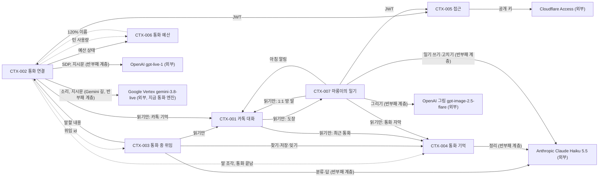

# 마롱이 통화 기능: 도메인 설계

상태: 한 번에 초안(2026-11-12, Claude). 체크포인트 1\~3은 아직이에요. Fable 5.2 독립 검토를 반영했어요(동희님 2026-11-12 15:45 KST 결정 카드 '검토 추천대로 반영', 무엇을 어디에 반영했는지는 `docs/call-design.md` 11절). 갤럭시 시험(기능 명세 7.1) 뒤 동희님이 한 번에 봐요.
범위: 지금의 카톡 마롱이(CTX-001)에 통화 입구를 더하는 일이에요. 바뀌는 맥락(CTX-002\~006)만 새로 그렸고, 카톡 쪽은 `docs/design.md`를 그대로 따라요.
표시: 근거가 동희님 말이나 문서면 `[확실]`, 거기서 끌어낸 것은 `[추론]`, 근거 없는 짐작은 `[추측]`(6절 핫스팟에도 있음).
2026-11-16 더함(Claude, 한 번에 초안, 체크포인트 3 전): 마롱이의 일기(CTX-007, 새 맥락), 지금 통화 엔진(Gemini 길)의 통화 사용량과 예산(CTX-006 변경), 설정 실험과 글로 갈아타기(CTX-002 변경), CTX-001의 아침 알림과 도장 한 줄, TERM-021\~039. 1절 '2026-11-16 더한 기능'부터 읽어 주세요. 1\~6절의 OpenAI 문장은 처음 설계(2026-11-12) 그대로 두었고, 지금 만든 통화는 Google Vertex `gemini-3.8-live`(목소리 Sulafat)예요(저장소 main `2a473ae`에서 읽음, 6절 핫스팟).

## 1. 서비스 개요

동희님 말(2026-11-12 10:31 KST, 프로젝트 채팅): "야 여자친구가 마롱이 전화기능 만들어달래." 그리고 11:55 KST: "마롱이가 정말 친구인것처럼 되어주었으면 좋겠어. 막 이런 기계같은 절차 많다기보다."

다시 쓰면: 현경님이 카톡 친구 마롱이에게 전화를 걸어 진짜 친구랑 통화하듯 목소리로 얘기하고, 마롱이는 카톡에서 나눈 얘기와 지난 통화를 기억해요. 코드 입력·호출어·안내·시간 한도처럼 기계 같은 절차는 두지 않아요(원칙 P1).

- 현경님(통화하는 친구): 통화 앱을 열어 마롱이에게 전화하고, 지난 통화와 마롱이가 기억하는 것을 보고 지워요. `[확실]` D4·D5
- 동희님(관리자): 통화 계정을 친구에 묶고, 월 예산을 정하고, 서버를 운영해요. 통화 내용은 기본 화면에서 보지 않아요. `[추론]`
- 마롱이(통화): OpenAI `gpt-live-1`이 마롱이 성격 지시문으로 말해요. 카톡 마롱이(Claude)와 같은 친구로 느껴져야 해요. `[확실]` D2. 목소리는 성인의 어른스러운 여성이에요. `[확실]` D16
- 바깥 시스템: OpenAI(gpt-live-1 음성 세션, sideband), Anthropic(Claude Haiku 5.5: 통화 중 위임 판단, 통화 뒤 정리), Cloudflare(Access 로그인, Tunnel, DNS), Google(로그인 계정), 카카오(지금의 카톡 마롱이 입구).

### 2026-11-16 더한 기능: 마롱이의 일기와 통화 비용

동희님 말(2026-11-16 15:57 KST, 처음 작업 스레드): "통화 모델은 가장 가성비 있는 방법을 최신 정확한 공신력있는 정보로 리서치하고 상세히 분석해서 아이디어를 풍부히 내어볼래?", "뭐 간단한 그림도 남겨서 그림일기처럼 그림 하나 만들어줘도 될거같고. 이것도 마찬가지로 모델 찾아봐바. 미국 모델 중국모델 다 상관없어.", "둘 다 성능과 비용에 대해 심층 연구해서 기록으로 남기고, 설계까지 해보자." 일기를 누구 목소리로 쓸지는 같은 날 17:08 KST 결정 카드에서 '마롱이의 일기'를 골랐어요(D22).

다시 쓰면: 현경님이 하루 동안 마롱이에게 털어놓은 얘기(통화와 글)가 밤사이 마롱이가 쓴 짧은 일기와 크레용 그림 한 장으로 남고, 현경님은 아침에 받아 보고 고치거나 도장을 찍어요. 통화는 지금 목소리와 느낌을 지키면서 실제로 드는 돈을 재고, 예산을 넘지 않게 막고, 더 싼 방법은 재 본 뒤에 정해요.

- 범위 안: CTX-007 마롱이의 일기(새 맥락), 지금 통화(Gemini 길: 웹 `tools/vertex_live/server.py`, 디스코드 음성 `tools/vertex_live/discord_relay.py`)에 통화 사용량 기록과 월 예산 다시 걸기(CTX-006), 설정 실험과 글로 갈아타기(CTX-002), CTX-001에서 바뀌는 세 곳(하루 모음 내주기, 아침 알림, 도장 한 줄).
- 범위 밖: 통화 엔진·목소리를 실제로 바꾸기(듣기 시험 뒤 새 결정), 단체방·서버 채널 얘기를 일기에 넣기, 월말 일기책·인쇄, 사진을 그림으로 바꾸기, 다른 회사 그림 모델로 바꾸기, 다른 스레드에서 하는 모델 시험.
- 재료: Notion 연구 행 '마롱이 가성비 통화 모델·그림일기 그림 모델 연구'(2026-11-16)와 처음 스레드의 설계 초안. 초안은 단계 순서(01→09)를 지키지 않고 쓴 것이라 재료로만 썼어요.

- 현경님(일기를 받는 친구, 일기가 켜진 친구 누구나): 아침에 마롱이의 일기를 받아 보고, 말로 고치고, 그림을 다시 그리게 하고, 도장을 찍고, 숨겨요. `[확실]` 요청·D22, 고치기·도장·숨기기는 `[추론]`(연구 9절 아이디어)
- 동희님(관리자): 친구마다 일기를 켜고 끄고, 이번 달 통화·그림 비용을 보고, 단가표와 설정 실험을 바꿔요. `[추론]` README '설정은 관리자(동희)만 정해요'
- 마롱이(일기): 밤에 그날 친구와 1:1로 나눈 말을 모아 마롱이 1인칭으로 일기를 쓰고 그림을 그려요. `[확실]` D22
- 바깥 시스템: Google Vertex(지금 통화 엔진 `gemini-3.8-live`, 통화 정리 `gemini-3.8-flash`, 지출 상한 예산), Anthropic(일기 쓰기·고치기 `[추론]`), OpenAI 그림 API(`gpt-image-2.5-flare`, 그리기 `[추론]`, 연구 8절).

## 2. 이벤트 스토밍

- 보드: 없음. 기존 제품에 기능을 더하는 일이고, 방향은 Notion 분석 문서(D1\~D7, P1)에서 맞췄어요. 일하는 방식은 한 번에 초안(one-pass draft)이에요.
- 체크포인트 기록: 아직 없음. 검토 때 아래 시간 줄과 6절 핫스팟을 먼저 봐 주세요.

| Lane | Events |
| --- | --- |
| 통화 시작 | 통화 버튼 눌림 → 통화 시작됨 or 예산 때문에 거절됨 → 구간 열림 → 마롱이가 받음 |
| 통화 중 | 말 기록됨 → 위임 요청됨(또는 서버가 분명한 부탁을 알아챔) → 기억 찾음 or 기억 저장됨 or 기억 잊음 or 시각 알려 줌 or 못 함 → 위임 결과 전해짐 |
| 끊김 | 구간 닫힘(만료·연결 끊김·안전 필터) → 구간 다시 열림 or 자동 재연결 멈춤 |
| 미리 넘기기 | 구간 만료가 다가옴 → 말이 멈춘 틈에 새 구간 열림 → 이전 구간 닫힘 |
| 쉬기 | 마롱이가 10분 동안 말하지 않음 → 쉬기 시작됨 → 말소리 감지됨 or 깨우기 눌림 → 구간 다시 열림 |
| 넘겨받기 | 다른 화면에서 통화 걸림 → 이전 구간 닫힘 → 구간 열림 |
| 통화 끝 | 통화 끝남(현경님이 끊음 or 신호 끊김 or 예산 안전장치) → 정리 시작됨 → 통화 카드 만들어짐 and 기억 항목 저장됨 or 정리 실패함 |
| 지우기 | 통화 지워짐 or 통화 기억 지워짐 or 자막 보관 기간 지나 지워짐 |
| 예산 | 사용량 기록됨 → 예산 80% 넘음 → 예산 다 씀 → 예산 120% 이름 |
| 통화 사용량(Gemini 길) | 턴 사용량 받음 → 사용량 저장됨 or 연결 시간으로 추정됨 → 예산 80% 넘음 → 예산 다 씀 → 예산 120% 이름 → 통화 끝남 |
| 설정 실험 | 설정 실험 바뀜 → 구간 열림 → 글로 갈아탐 |
| 일기 밤 | 일기 써짐 or 건너뜀 or 쓰지 못함 → 그림 그려짐 or 기본 그림으로 바뀜 → 일기 준비됨 → 아침 알림 보내짐 |
| 일기 고치기 | 고쳐짐 or 그림 그려짐 or 기본 그림으로 바뀜 or 날씨 바뀜 → 도장 찍힘 → 도장 빠짐 |
| 일기 숨기기 | 숨겨짐 → 다시 보임 |
| 일기 설정 | 일기 켜짐 → 모습 바뀜 → 일기 꺼짐 |

통화 홈을 열거나 카톡 마롱이가 최근 통화 카드를 읽는 일은 데이터를 바꾸지 않아서 이벤트가 아니라 읽기 모델로 적었어요. 2026-11-16에 더한 것 중 일기장을 열고 달력을 넘기는 일, 동희님이 이번 달 비용을 보는 일, 일기를 쓰려고 하루를 모으는 일(하루 모음)도 읽기 모델이에요. 마지막 여섯 줄(통화 사용량\~일기 설정)이 2026-11-16에 더한 줄이에요.

## 3. 바운디드 컨텍스트와 패키지

| Context | Type | Aggregates | Package |
| --- | --- | --- | --- |
| CTX-001 카톡 대화(기존) | core | 방, 친구, 메시지, 요약, 메모, 공유 메모 | `marong` (바뀌는 곳: '지금 상황'에 '# 최근 통화' 읽기, `prompt.md` 31줄) |
| CTX-002 통화 연결 | core | 통화, 구간, 설정 실험 | `marong.call` (`session.py`, `live.py`, `prompt.py`). 지금 통화(Gemini 길)는 `tools/vertex_live/`(`server.py`, `live_session.py`, `discord_relay.py`). 설정 실험은 2026-11-16 더함 |
| CTX-003 통화 중 위임 | supporting | 위임 | `marong.call.delegate` |
| CTX-004 통화 기억 | core | 자막, 통화 카드, 통화 기억 | `marong.call.organize`, `marong.call.store` |
| CTX-005 접근 | generic | 통화하는 친구, 로그인 이메일 | `marong.call.auth` |
| CTX-006 통화 예산 | supporting | 월 예산, 통화 사용량, 단가표 | `marong.call.budget`(처음 설계). Gemini 길은 `tools/vertex_live/`의 새 모듈 후보 `call_budget.py`(2026-11-16 더함) |
| CTX-007 마롱이의 일기 | core | 일기, 그림, 일기 설정 | `marong.diary` 후보(`collect.py`, `write.py`, `draw.py`, `job.py`), 일기장은 글 대화(`marong/app_chat.py`) 옆 `marong/app_diary.py` 후보(2026-11-16 더함) |

## 4. 컨텍스트 표

### CTX-002 통화 연결

목적: 현경님이 누르면 바로 마롱이와 이어지고, 현경님이 끊을 때까지 끊기지 않은 것처럼 이어 가요.

| Given by | Read model | Command | Aggregate | Events |
| --- | --- | --- | --- | --- |
| 현경님 | 통화 홈(진행 중 통화, 예산 상태) | 통화 걸기 | 통화 | 통화 시작됨, 구간 열림, 또는 예산 때문에 거절됨 |
| 현경님(다른 화면) | 진행 중 통화 | 여기서 받기 | 통화 | 이전 구간 닫힘, 구간 열림 |
| 정책: 구간 닫힘(만료·연결 끊김·안전 필터)일 때 | 최근 자막 | 구간 다시 열기 | 통화 | 구간 열림, 또는 자동 재연결 멈춤 |
| 정책: 마롱이가 10분 동안 말하지 않았고 맡긴 일이 없을 때 | 마롱이 소리 시각 | 쉬기 | 통화 | 쉬기 시작됨, 구간 닫힘 |
| 정책: 구간 만료 2분 전이고 맡긴 일이 없을 때 | 구간 만료 시각 | 미리 넘기기 | 통화 | 구간 열림, 이전 구간 닫힘 |
| 현경님(말소리 또는 깨우기 버튼) | 최근 자막 | 깨우기 | 통화 | 구간 열림 |
| 현경님 | | 통화 끊기 | 통화 | 통화 끝남 |
| 정책: 신호가 2분 끊겼을 때 | | 통화 정리 종료 | 통화 | 통화 끝남 |
| OpenAI(sideband) | | 사용량 기록 | 구간 | 사용량 기록됨 |

- Aggregate rules: 통화: 통화하는 친구 한 명에게 진행 중 통화는 하나이고, 진행 중 통화에 열린 구간은 많아야 하나예요(두 구간이 같이 과금되지 않게, 추론). 끝난 통화는 다시 열지 않아요(추론). 마롱이(모델)는 통화를 끝낼 수 없고, 통화는 현경님이 끊을 때·화면 신호가 끊길 때·예산 안전장치가 걸릴 때만 끝나요(동희님 말 D6, P1). 구간: 구간 하나가 OpenAI 세션 하나이고 닫힌 이유를 남겨요(추론).
- Given–When–Then: Given 진행 중 통화가 없고 예산이 남음, When 현경님이 통화 걸기, Then 통화 시작됨과 구간 열림이 생기고 마롱이가 먼저 받아요.
- Given–When–Then: Given 열린 구간이 있는 통화, When 구간이 만료로 닫힘, Then 같은 통화에 새 구간이 열리고 마롱이는 인사 없이 하던 얘기를 이어 가요.
- Given–When–Then: Given 진행 중 통화, When 마롱이가 10분 동안 말하지 않음(TV·옆 사람 말소리가 있어도), Then 구간 닫힘, 통화는 쉬는 중이 되고 화면은 그대로예요.
- Given–When–Then: Given 만료가 2분 남은 구간, When 말이 멈춘 틈, Then 같은 통화의 새 구간으로 넘어가고 마롱이는 인사 없이 이어 가요(현경님에게는 보이지 않음).
- External systems: OpenAI gpt-live-1(세션 만들기, sideband, 끊기). 관계는 반부패 계층(anticorruption layer, `live.py` 한 곳에서만 OpenAI 모양을 다룸).
- Links: CTX-005에 누구인지 묻고, CTX-006에 예산을 묻고, CTX-004에 자막을 넘기고, CTX-003에 위임을 넘겨요.
- Hotspots: 화면이 꺼져도 말소리를 들을 수 있는지(갤럭시 실기기, 10단계 전), OpenAI 세션 최대 길이(숫자는 문서에 없고 세션 정보의 만료 시각을 읽어 미리 넘김), 무음 처리 방식은 D8로 정함(쉬었다가 이어 받기), 마롱이 얼굴의 입 움직임이 실기기에서 되는지(TERM-018).

2026-11-16 더함(Gemini 길): 지금 통화의 구간 하나는 Vertex `gemini-3.8-live` 연결 하나예요. 구글은 턴마다 그때까지 문맥에 있는 토큰 전체를 다시 과금하고 캐시 할인이 없으며, 소리 1초는 25토큰이에요(구글 Live API 모범 사례·가격 문서, 2026-11-16 확인). 그래서 같은 통화 시간이라도 문맥이 길수록 비싸져요.

| Given by | Read model | Command | Aggregate | Events |
| --- | --- | --- | --- | --- |
| 구글(턴마다 사용량 알림) | | 사용량 받기 | 구간 | 턴 사용량 받음 |
| 동희님(관리 명령) | 설정 실험 | 설정 실험 바꾸기 | 설정 실험 | 설정 실험 바뀜 |
| 정책: 글로 갈아타기가 켜져 있고 한 턴 입력이 기준을 넘었을 때 | 통화 사용량, 자막 | 글로 갈아타기 | 통화 | 글로 갈아탐, 구간 열림, 이전 구간 닫힘 |
| 정책: 예산 120% 이름일 때(CTX-006) | | 인사 뒤 통화 끝내기 | 통화 | 통화 끝남 |

- Aggregate rules: 설정 실험: 이름 하나에 값 묶음 하나이고, 같은 이름에 다른 값을 넣지 않아요(구간과 통화 사용량에 이름을 남겨 비교하려고, 추론). 바꾸면 다음 구간부터 쓰고 열린 구간은 그대로예요(추론). 목소리(Sulafat, D16)와 지시문의 성격은 설정 실험으로 바꾸지 않아요(엔진·목소리는 듣기 시험 뒤 새 결정, 추론). 통화: 구간이 열릴 때 그때의 설정 실험 이름을 남겨요(추론). 글로 갈아타기는 마롱이 말이 끝나고 아무도 말하지 않는 틈에만 하고, 옮기는 동안 현경님 말을 잃지 않으며, 마롱이는 인사 없이 이어 가요(미리 넘기기와 같은 약속, 추론). 120%로 끝낼 때는 마롱이가 한 문장으로 인사할 틈을 줘요(D9에 더한 것, 친구 먼저 규칙, 추론). 웹 통화 화면이 조용할 때 소리를 보내지 않는 것도 설정 실험 값 하나예요. 디스코드는 이미 말소리가 있을 때만 보내고 말이 멈추면 1초까지만 무음을 채워요(사실, `tools/discord_voice/index.mjs`).
- Given–When–Then: Given 글로 갈아타기가 켜진 통화에서 한 턴 입력이 기준을 넘음, When 마롱이 말이 끝나고 조용한 틈, Then 같은 통화에 새 구간이 열리고 이번 통화 자막이 글로 들어가며 마롱이는 인사 없이 이어 가요.
- Given–When–Then: Given 동희님이 설정 실험을 'B'로 바꿈, When 현경님이 다음 통화를 걸기, Then 새 구간과 그 구간의 통화 사용량에 'B'가 남아요.
- Given–When–Then: Given 이번 달 비용이 예산 120%를 넘음, When 통화 중, Then 마롱이가 한 문장으로 인사한 뒤 통화가 끝나요.
- External systems: Google Vertex `gemini-3.8-live`(지금 통화 엔진). 관계는 반부패 계층으로 둬요: 구글 연결 설정은 `server.py`, 주고받기는 `live_session.py`에서만 다뤄요(사실, main `2a473ae`).
- Hotspots: Gemini 길에는 쉬기(D8)가 없어요(사실). 더 싼 엔진(조합형·Qwen)으로 바꿀지는 듣기 시험 뒤에 정해요.

### CTX-003 통화 중 위임

목적: 음성 모델이 맡긴 일(기억 찾기, 기억해 두기, 잊어 주기, 지금 시각)을 서버가 확인된 사실로만 처리해요.

| Given by | Read model | Command | Aggregate | Events |
| --- | --- | --- | --- | --- |
| OpenAI(위임 이벤트) | 최근 자막 | 위임 처리 | 위임 | 기억 찾음, 기억 저장됨, 기억 잊음, 시각 알려 줌, 못 함 |
| 정책: 자막에 '기억해 줘'·'잊어 줘'가 분명한데 2초 안에 위임이 없을 때 | 최근 자막 | 서버가 위임 처리 | 위임 | 기억 저장됨, 기억 잊음, 못 함 |

- Aggregate rules: 위임: "저장했어"는 저장이 끝난 뒤에만 전해요(필받음 교훈, 확실). 같은 위임의 쓰기는 한 번만 해요(멱등 키, 추론). 위임을 처리하는 동안 현경님 말이 더 오면 쓰기를 미뤄요(필받음 방식, 추론). 모델 호출 하나는 '자막·개인 기억·쓰기' 셋 중 둘까지만 다뤄요(분석 문서 6절, 확실). 결과는 모두 말할 내용(commentary)으로 전하고, 지시(instructions)는 행동을 바꿀 때만 써요(독립 검토 F8, OpenAI 문서).
- External systems: Anthropic Claude Haiku 5.5(분류·답 만들기). 관계는 반부패 계층(`llm.py` 한 곳).
- Links: CTX-002가 위임을 넘기고, CTX-004의 통화 기억을 읽고 쓰고, CTX-001의 카톡 기억을 읽기만 해요.
- Hotspots: 위임 이벤트에 현경님 말이 없어서 자막으로 다시 만들어야 해요(OpenAI 문서, 확실).

### CTX-004 통화 기억

목적: 통화를 자막으로 남기고, 끝나면 카드와 기억으로 정리하고, 현경님이 보고 지울 수 있게 해요.

| Given by | Read model | Command | Aggregate | Events |
| --- | --- | --- | --- | --- |
| 정책: 자막 조각이 올 때 | | 자막 쌓기 | 자막 | 말 기록됨 |
| 정책: 통화 끝남일 때 | 통화 자막, 지금 통화 기억 | 통화 정리 | 통화 카드, 통화 기억 | 통화 카드 만들어짐, 기억 항목 저장됨, 이전 기억 대체됨, 또는 정리 실패함 |
| 현경님 | 지난 통화, 통화 상세 | 통화 지우기 | 통화 | 통화 지워짐 |
| 현경님 | 기억 목록 | 통화 기억 지우기 | 통화 기억 | 통화 기억 지워짐 |
| 정책: 매일 새벽 | | 오래된 자막 지우기 | 자막 | 자막 지워짐 |

- Aggregate rules: 원음은 저장하지 않아요(동희님 D5). sideband로 오는 원음 사본도 풀지 않고 바로 버려요(독립 검토 F3). 잊어 달라고 한 얘기는 통화 기억(대체 사슬까지)과 카드 항목을 지우고, 카드 요약과 자막 줄에는 잊기 표시를 해서 다음 통화·카톡·기억 찾기에 쓰지 않아요(독립 검토 F6, 동희님 15:45 결정 카드 '기억과 통화 카드까지', 자막 줄 표시는 설계에서 더함). 통화 기억은 근거 인용이 그 통화 자막에 있어야 저장돼요(분석 문서 10절 교훈 2, 확실). 통화를 지우면 그 통화의 자막·카드·통화 기억·정리 기록도 같이 지워요(D5 "보고 지울 수 있게", 추론). 통화 내용은 다른 친구에게 넘어가지 않아요(Claude 제안, 추론).
- Given–When–Then: Given 끝난 통화에 현경님 말 "다음 주 화요일에 면접 있어"가 있음, When 통화 정리, Then 카드의 '다음에 물어볼 것'에 면접이 들어가고, 기억 항목의 인용이 자막에 있어요.
- Given–When–Then: Given 지난 통화 하나, When 현경님이 통화 지우기, Then 그 통화와 거기서 생긴 기억이 모두 사라지고 다음 통화 지시문에도 나오지 않아요.
- External systems: Anthropic Claude Haiku 5.5(정리).
- Links: CTX-002가 자막을 넘기고, CTX-001(카톡)이 통화 카드와 통화 기억을 읽어요.
- Hotspots: 자막 보관 기간 180일(Claude 제안, 그때 기억 인용도 비움), 백업 파일에는 지운 뒤에도 백업 보관 기간(제안 14일, `docs/call-design.md` 8절 7번 승인 때 정함)만큼 남음.

### CTX-005 접근

목적: 동희님이 정한 Google 계정 두 개만 들어오고, 한 번 로그인하면 한 달쯤 다시 묻지 않아요. Cloudflare Access가 문을 지키고, 서버는 Access가 넘긴 JWT를 다시 확인해 통화하는 친구를 찾아요. 관계는 순응자(conformist): Access JWT 모양을 그대로 따라요.

### CTX-006 통화 예산

목적: 한 달 통화 비용을 서버가 세서 넘치지 않게 해요.

| Given by | Read model | Command | Aggregate | Events |
| --- | --- | --- | --- | --- |
| 정책: 사용량 기록됨일 때 | 이번 달 사용량 | 예산 상태 다시 보기 | 월 예산 | 예산 80% 넘음, 예산 다 씀, 예산 120% 이름 |
| 동희님 | 이번 달 사용량 | 예산 바꾸기 | 월 예산 | 예산 바뀜 |

- Aggregate rules: 월 예산은 한 달(UTC) 150달러가 기본이에요(동희님 D6 질문, Claude 제안). 다 쓰면 새 통화만 막고 하던 통화는 이어 가요(Claude 제안, 동희님 다른 의견 없음). 120%에서 하던 통화도 끝내요(Claude 제안, 이번 설계에서 새로 더함. D9, 동희님 15:45 결정 카드로 추천안). OpenAI 지출 한도(429)가 먼저 막아도 같은 예산 안내로 이어요(독립 검토 F12).
- External systems: OpenAI 프로젝트 지출 알림·한도(대시보드 설정, 서버 밖).

2026-11-16 더함(Gemini 길): 지금 웹 통화와 디스코드 음성 통화에는 예산 확인과 사용량 기록이 없어요(사실, main `2a473ae`). 처음 설계의 예산 표(`call.settings`)와 기록 표(`call.budget_events`)는 남아 있지만 Gemini 길이 쓰지 않아요. 통화 정리(`gemini-3.8-flash`)만 토큰을 `call.ai_runs`에 남겨요.

| Given by | Read model | Command | Aggregate | Events |
| --- | --- | --- | --- | --- |
| 정책: 턴 사용량 받음일 때(CTX-002) | 단가표 | 사용량 저장 | 통화 사용량 | 사용량 저장됨 |
| 정책: 사용량 없이 구간이 닫혔을 때 | | 연결 시간으로 추정 | 통화 사용량 | 연결 시간으로 추정됨 |
| 정책: 사용량 저장됨 또는 연결 시간으로 추정됨일 때 | 통화 사용량, 월 예산 | 예산 상태 다시 보기 | 월 예산 | 예산 80% 넘음, 예산 다 씀, 예산 120% 이름 |
| 동희님(관리 명령) | 단가표 | 단가 바꾸기 | 단가표 | 단가 바뀜 |

- Aggregate rules: 통화 사용량: 구글이 준 토큰 수에 그때의 단가표를 곱해 값을 매기고, 매긴 값은 단가가 나중에 바뀌어도 그대로예요(추론, 구글 값은 날짜로 바뀜). 같은 사용량은 한 번만 들어가요(추론). 사용량이 안 온 구간은 연결 시간으로 넉넉하게 추정하고 추정이라고 표시해요(추론). 통화를 지워도 사용량은 남아 이번 달 비용이 줄지 않아요(처음 설계 SPEC-020과 같은 규칙, 문서). 숫자와 이름표만 두고 말 내용은 두지 않아요(REQ-046과 같은 규칙, 문서). 월 예산: 150달러와 80·100·120%는 그대로이고 웹과 디스코드 두 입구 모두에 걸려요(동희님 말 D6·D9). 이번 달 비용은 통화 엔진 사용량, 무료 건수를 넘은 검색, 통화 정리의 합이에요(추론, 지금 과금되는 것). 비용을 셀 수 없을 때도 새 통화를 막지 않아요(추측, 6절 핫스팟). 단가표: 모델마다 시작일이 있는 단가 줄이 쌓이고 지우지 않아요(추론).
- External systems: Google Cloud 지출 상한 예산(서버 밖, 동희님이 콘솔에서 걸음). 프로젝트 하나·서비스 하나에 걸리고, 추정 비용이 100%를 넘으면 그 서비스를 그 기간 끝까지 멈추고 다음 기간에 저절로 풀려요. 바로 막지는 않아서 늦은 동안의 초과분은 내야 하고, 같은 서비스를 쓰는 통화 정리도 같이 멈춰요(Cloud Billing 문서 2026-11-10 갱신, 2026-11-16 확인). 코드와 이어지지 않는 안전망이에요.
- Links: CTX-002가 턴 사용량을 넘기고, 새 통화를 열 때 예산 상태를 물어요. 120%가 되면 CTX-002가 인사 뒤 통화를 끝내요.

### CTX-007 마롱이의 일기

목적: 친구가 하루 동안 마롱이와 1:1로 나눈 얘기를 밤에 모아, 마롱이가 그날을 마롱이 1인칭 짧은 일기와 크레용 그림 한 장으로 남겨요. 친구는 아침에 받아 보고, 말로 고치고, 도장을 찍어요(2026-11-16 요청, D22).

| Given by | Read model | Command | Aggregate | Events |
| --- | --- | --- | --- | --- |
| 정책: 일기 하루가 끝났고 그 친구의 일기가 켜져 있을 때 | 하루 모음 | 일기 쓰기 | 일기 | 일기 써짐, 또는 건너뜀, 또는 쓰지 못함 |
| 정책: 쓰지 못함이고 아직 다시 해 볼 수 있을 때 | 하루 모음 | 일기 쓰기 | 일기 | 일기 써짐, 또는 쓰지 못함 |
| 정책: 일기 써짐일 때 | 장면, 마롱이 얼굴, 내 모습 카드, 그림 월 예산 | 그리기 | 그림 | 그림 그려짐, 또는 기본 그림으로 바뀜 |
| 정책: 그림 그려짐 또는 기본 그림으로 바뀜일 때 | | 일기 내놓기 | 일기 | 일기 준비됨 |
| 정책: 아침이 되었고 준비된 일기를 아직 알리지 않았을 때 | 일기 | 아침 알림 보내기 | 일기 | 아침 알림 보내짐 |
| 현경님 | 일기장 | 말로 고치기 | 일기 | 고쳐짐 |
| 현경님 | 일기장, 그림 월 예산 | 다시 그리기 | 그림 | 그림 그려짐, 또는 기본 그림으로 바뀜 |
| 현경님 | 일기장 | 마음 날씨 바꾸기 | 일기 | 날씨 바뀜 |
| 현경님 | 일기장 | 도장 찍기, 도장 빼기 | 일기 | 도장 찍힘, 도장 빠짐 |
| 현경님 | 일기장 | 숨기기, 다시 보이기 | 일기 | 숨겨짐, 다시 보임 |
| 현경님 | 내 모습 카드 | 모습 정하기 | 일기 설정 | 모습 바뀜 |
| 동희님(관리 명령) | 그림 월 예산 | 일기 켜기, 일기 끄기 | 일기 설정 | 일기 켜짐, 일기 꺼짐 |

- Aggregate rules: 일기: 친구 한 명의 일기 하루에 일기는 많아야 하나예요(추론). 일기는 마롱이 1인칭으로, 마롱이가 본 그 친구와의 하루를 써요(동희님 말 D22). 글은 판으로 쌓이고, 고치면 새 판이 더해지며 지난 판은 남아요(문서: README '기록은 지워지지 않아요'). 숨기기는 지우기가 아니어서 다시 보이게 할 수 있어요(같은 문서에서 추론). 일기에는 그 친구가 마롱이와 1:1로 나눈 말만 들어가고, 단체방·서버 채널 말, 다른 친구가 준 공유 메모, 잊기 표시가 있는 자막, 지운 통화는 넣지 않아요(문서: D11과 CTX-004 잊기 규칙, 단체방을 빼는 것은 추론). 친구가 일기에 쓰지 말라고 한 얘기는 넣지 않아요(추론, 연구 아이디어 6). 말이 너무 적은 날은 쓰지 않고 건너뛴 날로 남아요(추론). 친구는 자기 일기만 보고 고쳐요(추론, 글 대화와 같은 규칙). 아침 알림은 일기 하나에 한 번이고, 알림에는 일기 글을 넣지 않아요(추론, 잠금 화면에 보이니까). 그림: 일기 하나에 보이는 그림은 하나이고, 다시 그려도 지난 그림은 남아요(추론). 그림 모델에는 영어 장면(이름·대화 원문·연락처·숫자 없음), 마롱이 얼굴 그림, 내 모습 카드 낱말만 보내요(추론, 연구 아이디어 16). 그림에는 글자를 넣지 않고 글씨는 일기장이 써요(문서: 연구 8.1 시제품에서 그림 모델의 한글 글씨가 틀림). 그림 월 예산에 이르면 새 그림 대신 기본 그림을 쓰고 일기는 그대로 내놓아요(추론). 그리기가 실패하면 한 번 더 해 보고, 그래도 안 되면 기본 그림으로 내놓고 다시 그리기를 열어 둬요(추론). 일기 설정: 일기는 처음에 꺼져 있고, 켜고 끄기는 동희님만 해요(문서: README '설정은 관리자(동희)만 정해요', 처음에 꺼져 있는 것은 추론). 모습 카드는 친구가 정하고 목록에서만 골라요(추론, 그림 모델에 자유 글을 보내지 않으려고).
- Given–When–Then: Given 일기가 켜진 현경님이 어제 통화에서 마롱이에게 붕어빵 얘기를 함, When 일기 하루가 끝나 일기 쓰기, Then "오늘 현경이랑 전화로 붕어빵 얘기를 했다"처럼 마롱이 1인칭 일기가 써지고 그림이 그려져 일기가 준비돼요.
- Given–When–Then: Given 어제 현경님이 마롱이에게 거의 말하지 않음, When 일기 쓰기, Then 건너뛴 날로 남고 그림을 그리지 않아 돈이 들지 않아요.
- Given–When–Then: Given 이번 달 그림 비용이 그림 월 예산에 이름, When 일기 써짐, Then 기본 그림으로 일기가 준비돼요.
- Given–When–Then: Given 준비된 일기에 "붕어빵"이라고 썼는데 실제로는 호떡이었음, When 현경님이 "붕어빵 말고 호떡이었어"로 고치기, Then 새 판에 호떡이 들어가고 지난 판도 남아요.
- Given–When–Then: Given 준비된 일기, When 현경님이 도장 찍기, Then 도장이 남고 다음 하루 동안 마롱이가 1:1 방 대화에서 도장을 받은 걸 알아요.
- Given–When–Then: Given 일기 하나, When 현경님이 숨기기, Then 일기장 넘기기와 달력에서 빠지지만 지워지지 않고 다시 보이게 할 수 있어요.
- Given–When–Then: Given 준비된 일기, When 아침 알림 시각, Then 현경님에게 한 번만 알리고 알림에는 일기 글이 없어요.
- External systems: Anthropic Claude(일기 쓰기·고치기, `[추론]`: 카톡·DM 답과 같은 회사이고 처음 통화 설계에서도 자막 정리를 맡았음), OpenAI 그림 API `gpt-image-2.5-flare`(그리기, `[추론]` 연구 8절). 둘 다 반부패 계층(쓰기·그리기 모듈 한 곳씩). 로그인은 CTX-005를 그대로 따라요(순응자).
- Links: CTX-001의 1:1 방 말과 CTX-004의 통화 자막을 읽기만 해요. 아침 알림은 CTX-001에 맡기고, CTX-001은 답을 만들 때 도장 날짜를 읽어요.
- Hotspots: 일기 하루 경계(04시), 일기 글을 쓰는 회사 모델, 그림이 마롱이 얼굴을 지키는지, 인공지능기본법 표시, CTX-001과의 동기 호출 원(6절).

### CTX-001 카톡 대화(기존)

바뀌는 것만 적어요. 나머지는 `docs/design.md` 그대로예요.

- 현경님 1:1 방에서 답을 만들 때 '지금 상황'에 '# 최근 통화'(최근 통화 카드 2개와 통화 기억 몇 줄)를 읽어요. 단체방·묶인 단체방에는 넣지 않아요.
- `prompt.md` 31줄 "진짜로 만나거나 전화·선물을 주고받자는 약속은 … 장난스럽게 받아"에서 전화를 빼요. 이제 통화가 있으니까요.
- 2026-11-16 더함: 일기를 쓰려고 CTX-007이 그 친구 1:1 방(디스코드 DM·앱 글 대화·카톡 1:1)의 말을 읽기만 해요. 단체방·서버 채널 말과 다른 친구가 준 공유 메모는 내주지 않아요.
- 2026-11-16 더함: 일기가 준비되면 CTX-007이 그 친구 1:1 방(디스코드 DM 또는 앱 글 대화)에 마롱이 말 한 줄과 일기장 주소를 남기고 D18 길(앱 알림이 켜져 있으면 앱으로, 아니면 디스코드 DM)로 알려 달라고 해요. 알림 말에는 일기 글·제목·그림을 넣지 않아요.
- 2026-11-16 더함: 친구가 일기에 도장을 찍으면, 다음 하루 동안 그 친구 1:1 방 답의 '지금 상황'에 도장 한 줄(날짜만)을 읽어 넣어요. 마롱이가 "도장 고마워"처럼 말할 수 있게요. 일기 글은 넣지 않아요.

## 5. 컨텍스트 사이 의존

| From | To | Kind | Pattern | Why | Data |
| --- | --- | --- | --- | --- | --- |
| CTX-002 | CTX-005 | call (sync) | conformist | 누가 거는지 확인 | Access JWT → 통화하는 친구 id |
| CTX-002 | CTX-006 | call (sync) | | 새 통화를 열어도 되는지 | 이번 달 예산 상태 |
| CTX-002 | CTX-004 | event (async) | | 자막을 쌓고 끝나면 정리 | 말 조각, 통화 끝남 |
| CTX-002 | CTX-003 | event (async) | | 음성 모델이 맡긴 일 처리 | 위임 id, 최근 자막 |
| CTX-003 | CTX-002 | call (sync) | | 결과를 음성 모델에 전함 | 말할 내용(500토큰 안) |
| CTX-003 | CTX-004 | call (sync) | | 기억 찾기·저장·잊기 | 검색어, 기억 한 줄과 인용 |
| CTX-003 | CTX-001 | call (sync, 읽기만) | | 카톡에서 한 얘기 찾기 | 현경님 1:1 범위의 메모·요약·메시지 |
| CTX-002 | CTX-001 | call (sync, 읽기만) | | 통화 지시문에 카톡 기억 넣기 | 메모·요약·최근 대화·아는 친구 |
| CTX-001 | CTX-004 | call (sync, 읽기만) | | 카톡 답에 최근 통화 넣기 | 통화 카드, 통화 기억 |
| CTX-006 | CTX-002 | event (async) | | 120%면 하던 통화도 끝냄 | 예산 120% 이름 |
| CTX-002 | OpenAI | call (sync) | anticorruption layer | 음성 세션 만들기·끊기·sideband | SDP, 지시문, seed, 사용 초 |
| CTX-003, CTX-004 | Anthropic | call (sync) | anticorruption layer | 분류·답 만들기·정리 | 최근 자막, 찾은 조각, 통화 자막 |
| CTX-005 | Cloudflare Access | call (sync) | conformist | JWT 서명 키 | 공개 키(JWKS) |
| CTX-002 | Google Vertex | call (sync) | anticorruption layer | 지금 통화 엔진(Gemini 길, 2026-11-16) | 소리, 지시문, 기억 묶음 → 소리, 자막, 턴 사용량 |
| CTX-002 | CTX-006 | event (async) | | 턴마다 사용량 저장(Gemini 길) | 토큰 수, 검색 수, 설정 실험 이름 |
| CTX-007 | CTX-001 | call (sync, 읽기만) | | 하루 모음 | 그 친구 1:1 방(디스코드 DM·앱 글 대화·카톡 1:1)의 말 |
| CTX-007 | CTX-004 | call (sync, 읽기만) | | 하루 모음 | 잊기 표시와 지운 통화를 뺀 통화 자막 |
| CTX-007 | CTX-005 | call (sync) | conformist | 일기장에 누가 들어왔는지 | Access JWT → 통화하는 친구 id(글 대화와 같은 확인) |
| CTX-007 | CTX-001 | call (sync) | | 아침 알림 | 친구, 일기 날짜, 일기장 주소 → 1:1 방 마롱이 말, D18 알림 |
| CTX-001 | CTX-007 | call (sync, 읽기만) | | 답의 '지금 상황'에 도장 한 줄 | 도장 찍은 일기 날짜 |
| CTX-007 | Anthropic | call (sync) | anticorruption layer | 일기 쓰기·고치기 | 하루 모음, 고칠 말 → 제목, 마음 날씨, 글, 장면 |
| CTX-007 | OpenAI 그림 | call (sync) | anticorruption layer | 그리기 | 장면, 마롱이 얼굴 그림 2장, 모습 낱말 → 그림 한 장 |

동기 호출이 원을 이루는 곳: CTX-002 → CTX-003 → CTX-002는 이벤트(위임) 뒤에 결과를 돌려주는 콜백이라 같은 요청 안에서 원을 이루지 않아요. 2026-11-16에 더한 CTX-007 ⇄ CTX-001은 동기 호출이 원을 이뤄요(일기 → 1:1 방 말 읽기·아침 알림, DM 답 → 도장 읽기). 일기는 밤 작업과 일기장 요청에서만 부르고 DM 답은 도장 날짜만 읽어 같은 요청 안에서 서로 부르지는 않지만, 경계를 다시 볼지 6절 핫스팟에 남겼어요.

## 6. 핫스팟

| Hotspot | Context | State | Answer or next step |
| --- | --- | --- | --- |
| 오래 조용할 때 어떻게 할지(쉬었다가 이어 받기 / 30분 뒤 끊기 / 끊지 않기) | CTX-002 | resolved | D8: 동희님 2026-11-12 12:36 KST 결정 카드에서 '쉬었다가 말하면 이어받기'를 고름 |
| 갤럭시에서 화면이 꺼지거나 앱이 뒤로 가도 말소리를 들을 수 있는지 | CTX-002 | open | 10단계 전 갤럭시 시험(기능 명세 7.1, 독립 검토 F7, 동희님 15:45 결정 카드). 통화 화면이 보이는 동안은 화면을 켜 둠(F21). 안 되면 쉬는 중 화면에 깨우기 버튼만 |
| OpenAI 세션 최대 길이 | CTX-002 | open | 숫자는 문서에 없지만 세션 정보에 만료 시각(`expires_at`)이 있음(독립 검토 F11). 만료 2분 전 미리 넘기고(SPEC-031), 첫 실제 세션에서 값을 잼 |
| TV·옆 사람 말소리가 있을 때 쉬기 | CTX-002 | resolved | 독립 검토 F4: 마롱이 소리만으로 쉬기를 판단(SPEC-008). 첫 실제 통화(기능 명세 7.2 4번)에서 확인 |
| '잊어 줘'의 범위 | CTX-004 | resolved | 독립 검토 F6: 동희님 2026-11-12 15:45 KST 결정 카드로 '기억과 통화 카드까지'. 자막 줄 잊기 표시는 설계에서 더함(기능 명세 3.7) |
| 19금 대화가 OpenAI 정책·안전 필터에 얼마나 걸리는지 | CTX-002 | open | 통화 지시문은 수위를 낮춤(D13, 같은 결정 카드로 추천안). 걸린 뒤에는 '끊긴 말' 메모(F5). 첫 시험(기능 명세 7.2 5번)에서 확인 |
| 통화 마롱이 말투가 카톡 마롱이와 같게 느껴지는지 | CTX-002 | open | 첫 통화들에서 현경님 느낌을 듣고 지시문 고침 |
| 월 예산 120%에서 하던 통화도 끝내기 | CTX-006 | resolved | D9: 동희님 2026-11-12 15:45 KST 결정 카드 '검토 추천대로 반영'(정하실 것은 추천안으로). OpenAI 한도는 200달러로 서버 끊기보다 높게(F12) |
| 자막 보관 180일 | CTX-004 | resolved | D10: 같은 결정 카드로 추천안(Claude 제안, D5 "보관 기간을 정해"). 기억 인용도 180일에 비움(F13) |
| 통화 내용을 다른 친구에게 넘기지 않음(공유 메모 제외) | CTX-004 | resolved | D11: 같은 결정 카드로 추천안(Claude 제안) |
| 두 번째 허용 계정이 누구 것인지 `[추측]` | CTX-005 | open | 현경님의 다른 계정으로 보고 두 계정 모두 현경님에 묶음. 동희님 시험 계정이면 따로 묶음 |
| 하위 주소 이름 | CTX-005 | resolved | D12: 같은 결정 카드로 추천안 `marong.corthex-hq.com`. 홈 화면 앱·Access가 주소에 묶여 첫 설치 전에 확정 |
| 홈 화면 앱(전체 화면)에서 Access 로그인이 잘 되는지 | CTX-005 | open | manifest에 `crossorigin="use-credentials"`(독립 검토 F15). 10단계 전 갤럭시 시험(기능 명세 7.1 5번) |
| 표정 그림을 저장소에 넣는 방법(화면용만 / 원본까지 / 아직) | CTX-002 | resolved | D14: 동희님 2026-11-12 14:48 KST 결정 카드에서 '화면용 그림만 넣기'를 고름. 512px WebP 17장만 `marong/call/static/face/v1/`, 1024 원본과 지시문은 Git 밖. 15:02에 올린 GPT GIF 3개도 같은 방식으로 원본은 Git 밖, GIF에만 있던 입·눈 조합 4장만 화면용으로 더함(모두 21장) |
| 말할 때 입을 어떻게 움직일지(목소리 크기 / GPT talk GIF) | CTX-002 | resolved | D15: 동희님 2026-11-12 15:05 KST 프로젝트 채팅 "talk는 지피티에서 만들어온게 좋은듯". GIF 파일 대신 같은 칸을 GIF와 같은 순서·시간으로 돌림(기능 명세 3.5 표 4) |
| 통화 마롱이 목소리(성별·나이 느낌) | CTX-002 | resolved | D16: 동희님 2026-11-12 15:29 KST 프로젝트 채팅 "목소리는 성인 어른스러운 여성". GPT-Live 한국어 목소리 `noeul`(여성)과 지시문 '목소리' 절 |
| `noeul`이 어른스럽게 들리는지 | CTX-002 | open | OpenAI 문서에 나이 느낌이 없음. 첫 시험 통화에서 동희님이 들어 봄. 어리게 들리면 지시문을 고치고, 그래도 안 되면 다시 여쭘(설명으로 만드는 목소리는 문서에 `gpt-live-1`의 영어 억양만 적혀 있음) |
| 원격 WebRTC 소리로 마롱이가 말하는 중인지 알 수 있는지(갤럭시 Chrome) | CTX-002 | open | 필받음 참고 코드는 같은 방법으로 소리 크기를 잼. 첫 실기기 시험, 안 되면 자막 조각이 오는 동안을 말하는 중으로 봄 |
| 일기를 누구 목소리로 쓸지(마롱이의 일기 / 현경님 일기를 대신 쓰기 / 마롱이 편지) | CTX-007 | resolved | D22: 동희님 2026-11-16 17:08 KST 결정 카드 '그림일기를 누구 목소리로 쓸까요?'에서 '마롱이의 일기'를 고름(Claude 추천과 같음) |
| 일기 하루 경계를 한국 시각 04시로 둘지 `[추론]` | CTX-007 | open | 11/13\~15 통화 통계에 새벽 통화(00:02, 00:45, 02:46)가 있어 04시를 추천. 첫 주 일기를 보고 바꿀 수 있게 설정으로 둠. 체크포인트 질문 |
| 일기 글을 어느 회사 모델로 쓸지 `[추론]` | CTX-007 | open | 추천은 Anthropic Claude(카톡·DM 답과 같은 회사, 처음 통화 설계도 자막 정리를 맡김). 다른 안은 지금 통화 정리와 같은 구글 `gemini-3.8-flash`(통화 자막이 새 회사로 가지 않지만 DM 글이 구글로 감). 04단계 AI 호출에서 정함 |
| 그림이 마롱이 얼굴(점 눈, 분홍 볼, 한쪽 귀 무늬)을 계속 지키는지 | CTX-007 | open | 연구 8.1 시제품에서는 지킴. 첫 주 일기 그림을 보고 판단 |
| 인공지능기본법 생성물 표시 의무가 개인이 친구 몇 명에게 쓰는 앱에도 걸리는지 | CTX-007 | open | 넘겨받은 조사이고 다시 확인하지 않음. 걸리든 아니든 일기장에 'AI가 그린 그림' 표시를 넣는 쪽으로 02단계에 적음 |
| CTX-007 ⇄ CTX-001 동기 호출이 원을 이룸 | CTX-007 | open | 같은 요청 안에서는 서로 부르지 않음(5절). 다른 안은 도장 찍힘을 CTX-001 메모로 넘겨 원을 없애는 것. 체크포인트 질문 |
| 문서의 통화 엔진 문장(OpenAI gpt-live-1)과 지금 만든 통화(Vertex gemini-3.8-live)가 다름 | CTX-002 | open | 이번에는 바뀌는 곳(Gemini 길)만 더함. 처음 설계 문장 정리는 따로 할 일 |
| Gemini 길에는 쉬기(D8)가 없음 | CTX-002 | open | 사실(main `2a473ae`). 설정 실험과 통화 사용량에서 조용한 시간이 많다는 숫자가 나오면 다시 만들지 정함 |
| 구글 턴 사용량의 칸 이름·오는 때·턴마다인지 누적인지 | CTX-006 | open | 구글 Live API 참조에는 `usageMetadata` 칸이 있으나 Vertex 연결에서도 같은지는 문서에 없음. 구현 첫 시험에서 지어낸 소리로 확인 |
| 비용을 셀 수 없을 때 새 통화를 막을지 `[추측]` | CTX-006 | open | 추천은 막지 않음(통화가 먼저, 구글 지출 상한이 뒤를 받침). 02단계 확인 |
| 구글 지출 상한 금액, 지금 계정의 무료 크레딧 잔액·만료일 | CTX-006 | open | 동희님 몫. 추천은 서버 120%(180달러)보다 높게(예: 200달러). 2026-11-16 이후 가입·전환이면 크레딧을 Gemini에 못 씀(공식 문서) |
| 더 싼 통화 엔진(조합형·Qwen)으로 바꿀지 | CTX-002 | open | 듣기 시험(이름 가림)과 2주 통화 사용량 기록 뒤 새 결정으로 여쭘. 목소리 선택은 현경님 몫 |

## 7. 용어집

| ID | Term | Definition | Context | Code name | Avoid |
| --- | --- | --- | --- | --- | --- |
| TERM-001 | 통화 | 현경님이 통화 버튼을 눌러 끊을 때까지 하나로 느끼는 통화. 구간 여러 개로 이루어짐 | CTX-002 | `Call` | 세션 |
| TERM-002 | 구간 | 음성 엔진 연결 하나. 처음 설계는 OpenAI gpt-live-1 세션, 지금(2026-11-16)은 Vertex Gemini Live 연결. 끊겨 다시 이으면 새 구간 | CTX-002 | `Segment` | 통화(현경님에게는 한 통화) |
| TERM-003 | 통화하는 친구 | 통화 앱을 쓰는 친구. 카톡 친구(`marong.friends`) 한 명에 묶임. 지금은 현경님 한 명 | CTX-005 | `Caller` | 사용자, 회원 |
| TERM-004 | 로그인 이메일 | Access 로그인에 쓰는 Google 계정. 서버에는 해시만 둠 | CTX-005 | `CallerLogin` | 계정 |
| TERM-005 | 자막 | 통화에서 주고받은 말의 텍스트. 원음이 아님 | CTX-004 | `Turn` | 녹음, 대화 기록(카톡 `messages`와 헷갈림) |
| TERM-006 | 통화 카드 | 통화 뒤 정리한 요약, 정한 것, 안 정한 것, 할 일, 다음에 물어볼 것 | CTX-004 | `CallCard` | 요약(카톡 `summaries`와 헷갈림) |
| TERM-007 | 통화 기억 | 통화에서 나온, 다음에도 기억할 사실 한 줄과 근거 인용 | CTX-004 | `CallMemory` | 메모(카톡 `notes`) |
| TERM-008 | 위임 | 음성 모델이 통화 서버에 맡기는 일(기억 찾기, 기억해 두기, 잊어 주기, 지금 시각) | CTX-003 | `Delegation` | 도구 호출 |
| TERM-009 | 쉬기 | 마롱이가 10분 동안 말하지 않고 맡긴 일도 없을 때 통화 화면은 두고 OpenAI 구간만 닫아 과금을 멈춘 상태 | CTX-002 | `resting` | 대기, 일시정지, 보류 |
| TERM-010 | 깨우기 | 쉬는 중에 현경님 말소리나 버튼으로 새 구간을 여는 것 | CTX-002 | `wake` | 재연결(끊김 뒤 자동으로 잇는 것과 다름) |
| TERM-011 | 재연결 | OpenAI 쪽에서 구간이 닫혔을 때 같은 통화에 새 구간을 여는 것 | CTX-002 | `reconnect` | 다시 걸기(새 통화) |
| TERM-012 | 넘겨받기 | 같은 계정의 다른 화면에서 진행 중 통화를 이어 받는 것 | CTX-002 | `takeover` | 중복 통화 |
| TERM-013 | 신호 | 통화 화면이 15초마다 서버에 보내는 '아직 여기 있어' 요청 | CTX-002 | `beat` | 핑 |
| TERM-014 | 월 예산 | 한 달(UTC) 통화 비용 상한. 기본 150달러 | CTX-006 | `monthly_budget_usd` | 한도(하루·한 통화 한도는 없음) |
| TERM-015 | 통화 정리 | 통화가 끝난 뒤 카드와 통화 기억을 만드는 LangGraph 워크플로 | CTX-004 | `organize` | 요약하기 |
| TERM-016 | sideband | 통화 서버가 같은 OpenAI 세션에 붙는 WebSocket. 원음 사본도 오지만 풀지 않고 버림 | CTX-002 | `sideband` | 서버 음성 경로(음성 길은 휴대폰↔OpenAI) |
| TERM-017 | 통화 마롱이 | 통화 앱에서 말하는 마롱이. 카톡 마롱이와 같은 친구, 입구만 다름. 목소리는 성인의 어른스러운 여성(D16) | CTX-002 | `call persona` | 다른 봇 |
| TERM-018 | 마롱이 얼굴 | 통화 홈·통화 화면에 보이는 마롱이 그림 한 장. 화면 상태·말소리·느낌에 따라 그림 21장 중 하나를 고름(말할 때 입은 GPT talk 움직임, D15) | CTX-002 | `face` | 아바타, 프로필 사진 |
| TERM-019 | 느낌 | 마롱이가 말한 문장 하나에서 고른 감정 값(9가지). 얼굴을 고르는 데만 쓰고 저장하지 않음 | CTX-002 | `mood` | 감정 분석, 감정 기록 |
| TERM-020 | 미리 넘기기 | 구간이 만료되기 전에 말이 멈춘 틈에 같은 통화를 새 구간으로 옮기는 것. 현경님에게는 보이지 않음 | CTX-002 | `renew` | 재연결(끊긴 뒤 잇는 것과 다름) |
| TERM-021 | 일기 | 마롱이가 친구와 보낸 하루를 마롱이 1인칭으로 쓴 짧은 일기 한 편(마롱이의 일기, D22). 제목·마음 날씨·글·장면이 판으로 쌓이고 그림 한 장이 붙음. 친구의 일기 하루마다 많아야 하나 | CTX-007 | `Diary` | 다이어리, 하루 요약(통화 카드와 헷갈림), 친구 일기 |
| TERM-022 | 일기 하루 | 한국 시각 04:00에 시작해 다음 날 04:00에 끝나는 하루. 일기 하나의 날짜 | CTX-007 | `diary_day` | 날짜(달력 날짜와 4시간 어긋남) |
| TERM-023 | 하루 모음 | 일기 하루 동안 그 친구가 마롱이와 1:1로 나눈 말(디스코드 DM·앱 글 대화·카톡 1:1·통화 자막)을 시간순으로 모은 글. 빼야 할 것을 빼고, 일기를 쓸 때만 만들고 저장하지 않음 | CTX-007 | `day_digest` | 대화 기록, 로그 |
| TERM-024 | 그림 | 일기 하나에 붙는 크레용 그림 한 장. 글자가 없음. 다시 그리면 새 그림이 보이고 지난 그림은 남음 | CTX-007 | `Drawing` | 이미지, 사진, 마롱이 얼굴(TERM-018은 통화 화면의 얼굴) |
| TERM-025 | 장면 | 그림 모델에 보내는 영어 1\~3문장. 이름·대화 원문·연락처·숫자를 넣지 않고 친구에게 보이지 않음 | CTX-007 | `scene` | 프롬프트 |
| TERM-026 | 마음 날씨 | 그날 일기의 기분을 맑음·구름·비·눈·무지개 중 하나로 고른 값. 친구가 바꿀 수 있음 | CTX-007 | `weather` | 감정, 느낌(TERM-019는 통화 얼굴용) |
| TERM-027 | 도장 | 친구가 마롱이 일기에 찍어 주는 표시. 다시 누르면 빠짐 | CTX-007 | `stamp` | 좋아요, 읽음 |
| TERM-028 | 기본 그림 | 예산·거절·실패로 새 그림을 못 그렸을 때 대신 보이는 미리 만든 그림 | CTX-007 | `placeholder` | 빈 그림, 오류 그림 |
| TERM-029 | 일기장 | 친구가 자기 일기를 한 날씩 넘겨 보고 한 달 달력으로 보는 곳. 읽기 모델 | CTX-007 | `diary page` | 앨범, 피드 |
| TERM-030 | 내 모습 카드 | 친구가 목록에서 고른 머리 모양·안경·옷 색. 그림에 친구를 그릴 때만 씀 | CTX-007 | `look` | 프로필, 아바타 |
| TERM-031 | 일기 설정 | 친구마다 일기를 켰는지와 내 모습 카드. 켜고 끄기는 동희님만 | CTX-007 | `DiarySettings` | 환경설정 |
| TERM-032 | 그림 월 예산 | 한 달 그림 비용 상한(서버 설정). 이르면 새 그림 대신 기본 그림 | CTX-007 | `drawing_budget_usd` | 월 예산(TERM-014는 통화 비용) |
| TERM-033 | 아침 알림 | 준비된 일기를 친구에게 한 번 알리는 1:1 방 마롱이 말 한 줄과 D18 알림. 일기 글을 넣지 않음 | CTX-007 | `morning_notice` | 선톡(마롱이가 먼저 말 걸기) |
| TERM-034 | 통화 사용량 | 구글이 턴마다 알려 준 통화 엔진 토큰 수(오디오·글 입력과 출력, 생각·도구)와 그때 매긴 달러 값. 숫자와 이름표만 | CTX-006 | `live_usage` | 통화 시간(분), 대화 기록 |
| TERM-035 | 단가표 | 모델마다 시작일, 100만 토큰당 단가(오디오·글 입력과 출력), 확인한 날짜. 동희님이 관리 명령으로 바꿈 | CTX-006 | `live_prices` | 요금제 |
| TERM-036 | 지출 상한 예산 | Google Cloud 콘솔에서 프로젝트·서비스 하나에 거는 예산. 100%에서 그 서비스를 그 기간 끝까지 멈춤. 서버 밖 안전망 | CTX-006 | `spend cap` | 월 예산(TERM-014는 서버가 셈), 알림만 하는 예산 |
| TERM-037 | 설정 실험 | 압축 창·기억 묶음 크기·말 끝 감지·웹 조용할 때 소리 안 보내기·글로 갈아타기 기준을 이름 하나로 묶은 값. 구간과 통화 사용량에 이름을 남겨 비교 | CTX-002 | `live_tuning` | A/B 시험(친구를 나누지 않음) |
| TERM-038 | 글로 갈아타기 | 문맥이 기준보다 커지면 조용한 틈에 새 구글 연결로 옮기고 이번 통화 자막을 글로 넣는 것. 친구에게는 보이지 않음 | CTX-002 | `handoff` | 재연결(TERM-011), 미리 넘기기(TERM-020) |
| TERM-039 | 듣기 시험 | 후보 통화 엔진·목소리가 같은 마롱이 말투 문장을 읽은 소리를 이름을 가리고 섞어 들려주고 고르게 하는 시험. 실제 대화는 쓰지 않음 | CTX-002 | `listening test` | A/B 시험 |
