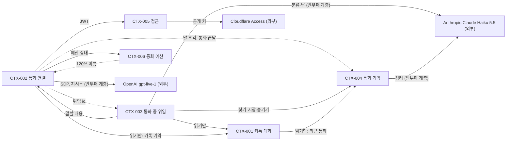

# 마롱이 통화 기능: 도메인 설계

상태: 한 번에 초안(2026-11-12, Claude). 체크포인트 1~3은 아직이에요. Fable 5.2 독립검토와 설계 개선 뒤 동희님이 한 번에 봐요.
범위: 지금의 카톡 마롱이(CTX-001)에 통화 입구를 더하는 일이에요. 바뀌는 맥락(CTX-002~006)만 새로 그렸고, 카톡 쪽은 `docs/design.md`를 그대로 따라요.
표시: 근거가 동희님 말이나 문서면 `[확실]`, 거기서 끌어낸 것은 `[추론]`, 근거 없는 짐작은 `[추측]`(6절 핫스팟에도 있음).

## 1. 서비스 개요

동희님 말(2026-11-12 10:31 KST, 프로젝트 채팅): "야 여자친구가 마롱이 전화기능 만들어달래." 그리고 11:55 KST: "마롱이가 정말 친구인것처럼 되어주었으면 좋겠어. 막 이런 기계같은 절차 많다기보다."

다시 쓰면: 현경님이 카톡 친구 마롱이에게 전화를 걸어 진짜 친구랑 통화하듯 목소리로 얘기하고, 마롱이는 카톡에서 나눈 얘기와 지난 통화를 기억해요. 코드 입력·호출어·안내·시간 한도처럼 기계 같은 절차는 두지 않아요(원칙 P1).

- 현경님(통화하는 친구): 통화 앱을 열어 마롱이에게 전화하고, 지난 통화와 마롱이가 기억하는 것을 보고 지워요. `[확실]` D4·D5
- 동희님(관리자): 통화 계정을 친구에 묶고, 월 예산을 정하고, 서버를 운영해요. 통화 내용은 기본 화면에서 보지 않아요. `[추론]`
- 마롱이(통화): OpenAI `gpt-live-1`이 마롱이 성격 지시문으로 말해요. 카톡 마롱이(Claude)와 같은 친구로 느껴져야 해요. `[확실]` D2
- 바깥 시스템: OpenAI(gpt-live-1 음성 세션, sideband), Anthropic(Claude Haiku 5.5: 통화 중 위임 판단, 통화 뒤 정리), Cloudflare(Access 로그인, Tunnel, DNS), Google(로그인 계정), 카카오(지금의 카톡 마롱이 입구).

## 2. 이벤트 스토밍

- 보드: 없음. 기존 제품에 기능을 더하는 일이고, 방향은 Notion 분석 문서(D1~D7, P1)에서 맞췄어요. 일하는 방식은 한 번에 초안(one-pass draft)이에요.
- 체크포인트 기록: 아직 없음. 검토 때 아래 시간 줄과 6절 핫스팟을 먼저 봐 주세요.

| Lane | Events |
| --- | --- |
| 통화 시작 | 통화 버튼 눌림 → 통화 시작됨 or 예산 때문에 거절됨 → 구간 열림 → 마롱이가 받음 |
| 통화 중 | 말 기록됨 → 위임 요청됨 → 기억 찾음 or 기억 저장됨 or 기억 숨김 or 시각 알려 줌 or 못 함 → 위임 결과 전해짐 |
| 끊김 | 구간 닫힘(만료·연결 끊김·안전 필터) → 구간 다시 열림 or 자동 재연결 멈춤 |
| 쉬기 | 조용함 감지됨 → 쉬기 시작됨 → 말소리 감지됨 or 깨우기 눌림 → 구간 다시 열림 |
| 넘겨받기 | 다른 화면에서 통화 걸림 → 이전 구간 닫힘 → 구간 열림 |
| 통화 끝 | 통화 끝남(현경님이 끊음 or 신호 끊김 or 예산 안전장치) → 정리 시작됨 → 통화 카드 만들어짐 and 기억 항목 저장됨 or 정리 실패함 |
| 지우기 | 통화 지워짐 or 통화 기억 지워짐 or 자막 보관 기간 지나 지워짐 |
| 예산 | 사용량 기록됨 → 예산 80% 넘음 → 예산 다 씀 → 예산 120% 이름 |

통화 홈을 열거나 카톡 마롱이가 최근 통화 카드를 읽는 일은 데이터를 바꾸지 않아서 이벤트가 아니라 읽기 모델로 적었어요.

## 3. 바운디드 컨텍스트와 패키지

| Context | Type | Aggregates | Package |
| --- | --- | --- | --- |
| CTX-001 카톡 대화(기존) | core | 방, 친구, 메시지, 요약, 메모, 공유 메모 | `marong` (바뀌는 곳: '지금 상황'에 '# 최근 통화' 읽기, `prompt.md` 31줄) |
| CTX-002 통화 연결 | core | 통화, 구간 | `marong.call` (`session.py`, `live.py`, `prompt.py`) |
| CTX-003 통화 중 위임 | supporting | 위임 | `marong.call.delegate` |
| CTX-004 통화 기억 | core | 자막, 통화 카드, 통화 기억 | `marong.call.organize`, `marong.call.store` |
| CTX-005 접근 | generic | 통화하는 친구, 로그인 이메일 | `marong.call.auth` |
| CTX-006 통화 예산 | supporting | 월 예산 | `marong.call.budget` |

## 4. 컨텍스트 표

### CTX-002 통화 연결

목적: 현경님이 누르면 바로 마롱이와 이어지고, 현경님이 끊을 때까지 끊기지 않은 것처럼 이어 가요.

| Given by | Read model | Command | Aggregate | Events |
| --- | --- | --- | --- | --- |
| 현경님 | 통화 홈(진행 중 통화, 예산 상태) | 통화 걸기 | 통화 | 통화 시작됨, 구간 열림, 또는 예산 때문에 거절됨 |
| 현경님(다른 화면) | 진행 중 통화 | 여기서 받기 | 통화 | 이전 구간 닫힘, 구간 열림 |
| 정책: 구간 닫힘(만료·연결 끊김·안전 필터)일 때 | 최근 자막 | 구간 다시 열기 | 통화 | 구간 열림, 또는 자동 재연결 멈춤 |
| 정책: 10분 조용함 감지됨일 때 | 마지막 말 시각 | 쉬기 | 통화 | 쉬기 시작됨, 구간 닫힘 |
| 현경님(말소리 또는 깨우기 버튼) | 최근 자막 | 깨우기 | 통화 | 구간 열림 |
| 현경님 | | 통화 끊기 | 통화 | 통화 끝남 |
| 정책: 신호가 2분 끊겼을 때 | | 통화 정리 종료 | 통화 | 통화 끝남 |
| OpenAI(sideband) | | 사용량 기록 | 구간 | 사용량 기록됨 |

- Aggregate rules: 통화: 통화하는 친구 한 명에게 진행 중 통화는 하나이고, 진행 중 통화에 열린 구간은 많아야 하나예요(두 구간이 같이 과금되지 않게, 추론). 끝난 통화는 다시 열지 않아요(추론). 마롱이(모델)는 통화를 끝낼 수 없고, 통화는 현경님이 끊을 때·화면 신호가 끊길 때·예산 안전장치가 걸릴 때만 끝나요(동희님 말 D6, P1). 구간: 구간 하나가 OpenAI 세션 하나이고 닫힌 이유를 남겨요(추론).
- Given–When–Then: Given 진행 중 통화가 없고 예산이 남음, When 현경님이 통화 걸기, Then 통화 시작됨과 구간 열림이 생기고 마롱이가 먼저 받아요.
- Given–When–Then: Given 열린 구간이 있는 통화, When 구간이 만료로 닫힘, Then 같은 통화에 새 구간이 열리고 마롱이는 인사 없이 하던 얘기를 이어 가요.
- Given–When–Then: Given 진행 중 통화, When 10분 동안 말소리가 없음, Then 구간 닫힘, 통화는 쉬는 중이 되고 화면은 그대로예요.
- External systems: OpenAI gpt-live-1(세션 만들기, sideband, 끊기). 관계는 반부패 계층(anticorruption layer, `live.py` 한 곳에서만 OpenAI 모양을 다룸).
- Links: CTX-005에 누구인지 묻고, CTX-006에 예산을 묻고, CTX-004에 자막을 넘기고, CTX-003에 위임을 넘겨요.
- Hotspots: 화면이 꺼져도 말소리를 들을 수 있는지(갤럭시 실기기), OpenAI 세션 최대 길이(문서에 숫자 없음), 무음 처리 방식(결정 카드).

### CTX-003 통화 중 위임

목적: 음성 모델이 맡긴 일(기억 찾기, 기억해 두기, 잊어 주기, 지금 시각)을 서버가 확인된 사실로만 처리해요.

| Given by | Read model | Command | Aggregate | Events |
| --- | --- | --- | --- | --- |
| OpenAI(위임 이벤트) | 최근 자막 | 위임 처리 | 위임 | 기억 찾음, 기억 저장됨, 기억 숨김, 시각 알려 줌, 못 함 |

- Aggregate rules: 위임: "저장했어"는 저장이 끝난 뒤에만 전해요(필받음 교훈, 확실). 같은 위임의 쓰기는 한 번만 해요(멱등 키, 추론). 위임을 처리하는 동안 현경님 말이 더 오면 쓰기를 미뤄요(필받음 방식, 추론). 모델 호출 하나는 '자막·개인 기억·쓰기' 셋 중 둘까지만 다뤄요(분석 문서 6절, 확실).
- External systems: Anthropic Claude Haiku 5.5(분류·답 만들기). 관계는 반부패 계층(`llm.py` 한 곳).
- Links: CTX-002가 위임을 넘기고, CTX-004의 통화 기억을 읽고 쓰고, CTX-001의 카톡 기억을 읽기만 해요.
- Hotspots: 위임 이벤트에 현경님 말이 없어서 자막으로 다시 만들어야 해요(OpenAI 문서, 확실).

### CTX-004 통화 기억

목적: 통화를 자막으로 남기고, 끝나면 카드와 기억으로 정리하고, 현경님이 보고 지울 수 있게 해요.

| Given by | Read model | Command | Aggregate | Events |
| --- | --- | --- | --- | --- |
| 정책: 자막 조각이 올 때 | | 자막 쌓기 | 자막 | 말 기록됨 |
| 정책: 통화 끝남일 때 | 통화 자막, 지금 통화 기억 | 통화 정리 | 통화 카드, 통화 기억 | 통화 카드 만들어짐, 기억 항목 저장됨, 이전 기억 대체됨, 또는 정리 실패함 |
| 현경님 | 지난 통화, 통화 상세 | 통화 지우기 | 통화 | 통화 지워짐 |
| 현경님 | 기억 목록 | 통화 기억 지우기 | 통화 기억 | 통화 기억 지워짐 |
| 정책: 매일 새벽 | | 오래된 자막 지우기 | 자막 | 자막 지워짐 |

- Aggregate rules: 원음은 저장하지 않아요(동희님 D5). 통화 기억은 근거 인용이 그 통화 자막에 있어야 저장돼요(분석 문서 10절 교훈 2, 확실). 통화를 지우면 그 통화의 자막·카드·통화 기억·정리 기록도 같이 지워요(D5 "보고 지울 수 있게", 추론). 통화 내용은 다른 친구에게 넘어가지 않아요(Claude 제안, 추론).
- Given–When–Then: Given 끝난 통화에 현경님 말 "다음 주 화요일에 면접 있어"가 있음, When 통화 정리, Then 카드의 '다음에 물어볼 것'에 면접이 들어가고, 기억 항목의 인용이 자막에 있어요.
- Given–When–Then: Given 지난 통화 하나, When 현경님이 통화 지우기, Then 그 통화와 거기서 생긴 기억이 모두 사라지고 다음 통화 지시문에도 나오지 않아요.
- External systems: Anthropic Claude Haiku 5.5(정리).
- Links: CTX-002가 자막을 넘기고, CTX-001(카톡)이 통화 카드와 통화 기억을 읽어요.
- Hotspots: 자막 보관 기간 180일(Claude 제안), 수동 백업 파일에는 지운 뒤에도 남음(백업 정책 밖).

### CTX-005 접근

목적: 동희님이 정한 Google 계정 두 개만 들어오고, 한 번 로그인하면 한 달쯤 다시 묻지 않아요. Cloudflare Access가 문을 지키고, 서버는 Access가 넘긴 JWT를 다시 확인해 통화하는 친구를 찾아요. 관계는 순응자(conformist): Access JWT 모양을 그대로 따라요.

### CTX-006 통화 예산

목적: 한 달 통화 비용을 서버가 세서 넘치지 않게 해요.

| Given by | Read model | Command | Aggregate | Events |
| --- | --- | --- | --- | --- |
| 정책: 사용량 기록됨일 때 | 이번 달 사용량 | 예산 상태 다시 보기 | 월 예산 | 예산 80% 넘음, 예산 다 씀, 예산 120% 이름 |
| 동희님 | 이번 달 사용량 | 예산 바꾸기 | 월 예산 | 예산 바뀜 |

- Aggregate rules: 월 예산은 한 달(UTC) 150달러가 기본이에요(동희님 D6 질문, Claude 제안). 다 쓰면 새 통화만 막고 하던 통화는 이어 가요(Claude 제안, 동희님 다른 의견 없음). 120%에서 하던 통화도 끝내요(Claude 제안, 이번 설계에서 새로 더함).
- External systems: OpenAI 프로젝트 지출 알림·한도(대시보드 설정, 서버 밖).

### CTX-001 카톡 대화(기존)

바뀌는 것만 적어요. 나머지는 `docs/design.md` 그대로예요.

- 현경님 1:1 방에서 답을 만들 때 '지금 상황'에 '# 최근 통화'(최근 통화 카드 2개와 통화 기억 몇 줄)를 읽어요. 단체방·묶인 단체방에는 넣지 않아요.
- `prompt.md` 31줄 "진짜로 만나거나 전화·선물을 주고받자는 약속은 … 장난스럽게 받아"에서 전화를 빼요. 이제 통화가 있으니까요.

## 5. 컨텍스트 사이 의존

| From | To | Kind | Pattern | Why | Data |
| --- | --- | --- | --- | --- | --- |
| CTX-002 | CTX-005 | call (sync) | conformist | 누가 거는지 확인 | Access JWT → 통화하는 친구 id |
| CTX-002 | CTX-006 | call (sync) | | 새 통화를 열어도 되는지 | 이번 달 예산 상태 |
| CTX-002 | CTX-004 | event (async) | | 자막을 쌓고 끝나면 정리 | 말 조각, 통화 끝남 |
| CTX-002 | CTX-003 | event (async) | | 음성 모델이 맡긴 일 처리 | 위임 id, 최근 자막 |
| CTX-003 | CTX-002 | call (sync) | | 결과를 음성 모델에 전함 | 말할 내용(500토큰 안) |
| CTX-003 | CTX-004 | call (sync) | | 기억 찾기·저장·숨기기 | 검색어, 기억 한 줄과 인용 |
| CTX-003 | CTX-001 | call (sync, 읽기만) | | 카톡에서 한 얘기 찾기 | 현경님 1:1 범위의 메모·요약·메시지 |
| CTX-002 | CTX-001 | call (sync, 읽기만) | | 통화 지시문에 카톡 기억 넣기 | 메모·요약·최근 대화·아는 친구 |
| CTX-001 | CTX-004 | call (sync, 읽기만) | | 카톡 답에 최근 통화 넣기 | 통화 카드, 통화 기억 |
| CTX-006 | CTX-002 | event (async) | | 120%면 하던 통화도 끝냄 | 예산 120% 이름 |
| CTX-002 | OpenAI | call (sync) | anticorruption layer | 음성 세션 만들기·끊기·sideband | SDP, 지시문, seed, 사용 초 |
| CTX-003, CTX-004 | Anthropic | call (sync) | anticorruption layer | 분류·답 만들기·정리 | 최근 자막, 찾은 조각, 통화 자막 |
| CTX-005 | Cloudflare Access | call (sync) | conformist | JWT 서명 키 | 공개 키(JWKS) |

동기 호출이 원을 이루는 곳: CTX-002 → CTX-003 → CTX-002는 이벤트(위임) 뒤에 결과를 돌려주는 콜백이라 같은 요청 안에서 원을 이루지 않아요.

## 6. 핫스팟

| Hotspot | Context | State | Answer or next step |
| --- | --- | --- | --- |
| 오래 조용할 때 어떻게 할지(쉬었다가 이어 받기 / 30분 뒤 끊기 / 끊지 않기) | CTX-002 | open | 2026-11-12 결정 카드. 답 오기 전에는 추천(쉬었다가 이어 받기)으로 설계 |
| 갤럭시에서 화면이 꺼지거나 앱이 뒤로 가도 말소리를 들을 수 있는지 | CTX-002 | open | 첫 실기기 시험. 안 되면 쉬는 중 화면에 깨우기 버튼만 |
| OpenAI 세션 최대 길이 | CTX-002 | open | 공식 문서에 숫자 없음('expired'만). 첫 긴 통화에서 잼 |
| 19금 대화가 OpenAI 정책·안전 필터에 얼마나 걸리는지 | CTX-002 | open | 통화 지시문은 수위를 낮춤. 첫 시험에서 확인 |
| 통화 마롱이 말투가 카톡 마롱이와 같게 느껴지는지 | CTX-002 | open | 첫 통화들에서 현경님 느낌을 듣고 지시문 고침 |
| 월 예산 120%에서 하던 통화도 끝내기 | CTX-006 | review in stage 02 | Claude 제안. 동희님 다른 의견 없으면 유지 |
| 자막 보관 180일 | CTX-004 | review in stage 02 | Claude 제안(D5 "보관 기간을 정해") |
| 통화 내용을 다른 친구에게 넘기지 않음(공유 메모 제외) | CTX-004 | review in stage 02 | Claude 제안 |
| 두 번째 허용 계정이 누구 것인지 `[추측]` | CTX-005 | open | 현경님의 다른 계정으로 보고 두 계정 모두 현경님에 묶음. 동희님 시험 계정이면 따로 묶음 |
| 하위 주소 이름 | CTX-005 | review in stage 02 | 제안 `marong.corthex-hq.com` |
| 홈 화면 앱(전체 화면)에서 Access 로그인이 잘 되는지 | CTX-005 | open | 첫 실기기 시험 |

## 7. 용어집

| ID | Term | Definition | Context | Code name | Avoid |
| --- | --- | --- | --- | --- | --- |
| TERM-001 | 통화 | 현경님이 통화 버튼을 눌러 끊을 때까지 하나로 느끼는 통화. 구간 여러 개로 이루어짐 | CTX-002 | `Call` | 세션 |
| TERM-002 | 구간 | OpenAI gpt-live-1 세션 하나. 끊겨 다시 이으면 새 구간 | CTX-002 | `Segment` | 통화(현경님에게는 한 통화) |
| TERM-003 | 통화하는 친구 | 통화 앱을 쓰는 친구. 카톡 친구(`marong.friends`) 한 명에 묶임. 지금은 현경님 한 명 | CTX-005 | `Caller` | 사용자, 회원 |
| TERM-004 | 로그인 이메일 | Access 로그인에 쓰는 Google 계정. 서버에는 해시만 둠 | CTX-005 | `CallerLogin` | 계정 |
| TERM-005 | 자막 | 통화에서 주고받은 말의 텍스트. 원음이 아님 | CTX-004 | `Turn` | 녹음, 대화 기록(카톡 `messages`와 헷갈림) |
| TERM-006 | 통화 카드 | 통화 뒤 정리한 요약, 정한 것, 안 정한 것, 할 일, 다음에 물어볼 것 | CTX-004 | `CallCard` | 요약(카톡 `summaries`와 헷갈림) |
| TERM-007 | 통화 기억 | 통화에서 나온, 다음에도 기억할 사실 한 줄과 근거 인용 | CTX-004 | `CallMemory` | 메모(카톡 `notes`) |
| TERM-008 | 위임 | 음성 모델이 통화 서버에 맡기는 일(기억 찾기, 기억해 두기, 잊어 주기, 지금 시각) | CTX-003 | `Delegation` | 도구 호출 |
| TERM-009 | 쉬기 | 오래 조용할 때 통화 화면은 두고 OpenAI 구간만 닫아 과금을 멈춘 상태 | CTX-002 | `resting` | 대기, 일시정지, 보류 |
| TERM-010 | 깨우기 | 쉬는 중에 현경님 말소리나 버튼으로 새 구간을 여는 것 | CTX-002 | `wake` | 재연결(끊김 뒤 자동으로 잇는 것과 다름) |
| TERM-011 | 재연결 | OpenAI 쪽에서 구간이 닫혔을 때 같은 통화에 새 구간을 여는 것 | CTX-002 | `reconnect` | 다시 걸기(새 통화) |
| TERM-012 | 넘겨받기 | 같은 계정의 다른 화면에서 진행 중 통화를 이어 받는 것 | CTX-002 | `takeover` | 중복 통화 |
| TERM-013 | 신호 | 통화 화면이 15초마다 서버에 보내는 '아직 여기 있어' 요청 | CTX-002 | `beat` | 핑 |
| TERM-014 | 월 예산 | 한 달(UTC) 통화 비용 상한. 기본 150달러 | CTX-006 | `monthly_budget_usd` | 한도(하루·한 통화 한도는 없음) |
| TERM-015 | 통화 정리 | 통화가 끝난 뒤 카드와 통화 기억을 만드는 LangGraph 워크플로 | CTX-004 | `organize` | 요약하기 |
| TERM-016 | sideband | 통화 서버가 같은 OpenAI 세션에 붙는 WebSocket | CTX-002 | `sideband` | 서버 음성 경로(음성은 서버를 지나지 않음) |
| TERM-017 | 통화 마롱이 | 통화 앱에서 말하는 마롱이. 카톡 마롱이와 같은 친구, 입구만 다름 | CTX-002 | `call persona` | 다른 봇 |
