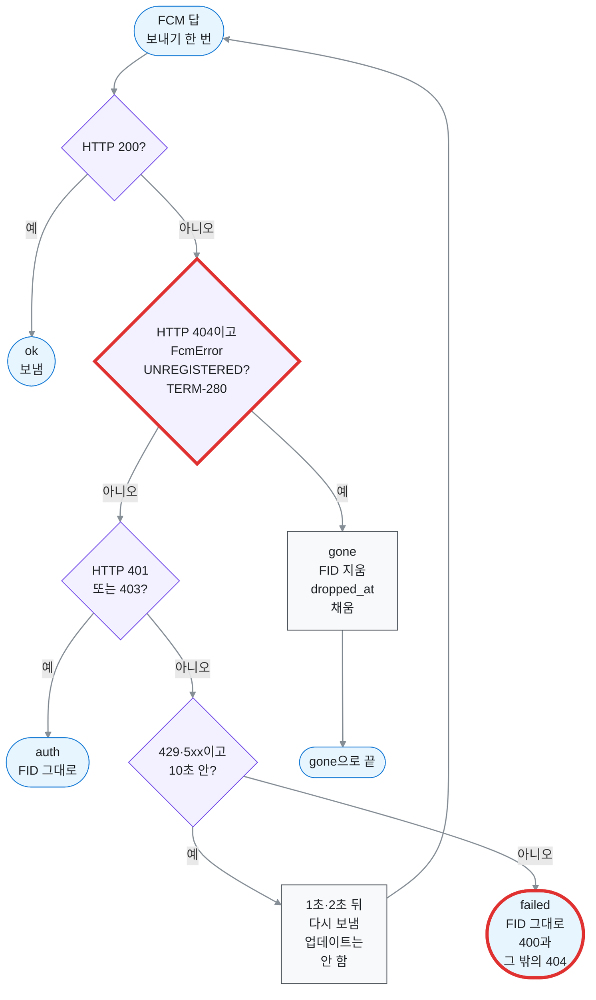

# FCM 등록 해제 판단: 도메인 설계와 기능 변경 기록

상태: 2026-11-24 초안(Claude, 마롱이 항목 96). **체크포인트 전**이에요. CORTHEX 기능 변경 절차(corthex `references/changes.md`)로 01\~12단계를 차례로 지났어요. 이 PR은 승인된 문서의 줄을 고치지 않아요. 바꿀 글은 7절에 승인 원문과 나란히 적었고, 항목마다 답을 받은 뒤에 고쳐요(TASK-555). 새 항목(TERM-280, REQ-630·631, SPEC-510\~512, TASK-550\~555, TC-720\~726)은 `proposed`예요.
범위: 서버가 FCM HTTP v1 보내기의 답을 나누는 규칙(`marong/fcm.py`)과, 그 답으로 폰의 FID를 지우는 곳 셋(글 알림·벨의 `AppPush._send`, 업데이트 보내기의 `AppUpdatePush._send`), 그리고 거절 원인 로그예요. 앱 코드, 표, API, 화면은 바뀌지 않아요.
기준 코드: `main` `1a29477`(2026-11-24). 코드 줄 번호는 이 커밋에서 읽었어요. 그 뒤 PR #127이 합쳐진 `main` `23549d6`은 코드가 같고 문서만 달라서, 7절의 승인 글 자리는 `23549d6`에서 읽었어요. 운영 `marong-app.service`(실행 파일 `/opt/marong-app/run_app.py`)의 `marong/fcm.py`·`app_push.py`·`app_update_push.py`는 sha256 앞 16자리가 이 커밋과 같아요(2026-11-24 읽기만). `fcm.py`가 있는 다른 사본 `/opt/marong-discord`는 `marong-discord.service`가 꺼져 있어 쓰이지 않고, `/opt/marong`(`marong.service`)에는 `fcm.py`가 없어요.
근거 조사: 마롱이 조사 보고서 'FCM 400 분류 조사'(2026-11-24 16시대 KST, 저장소 밖). 보고서의 운영 집계는 개수만 옮겼어요.
표시: [사실] 코드·문서·공식 문서·운영 읽기에서 확인, [추정] 근거 있는 짐작, [새 제안] 이 설계에서 Claude가 새로 정한 것, [확인 안 함] 아직 보지 않은 것.

## 1. 요청(사용자님 말)

| 때(KST) | 어디서 | 말 |
| --- | --- | --- |
| 2026-11-24 | 관리 페이지 기능 변경 3 설계 PR #127의 '관찰'(Claude) | "`marong/fcm.py`가 400 `INVALID_ARGUMENT`를 모두 `gone`으로 봐요. … 형식 오류 한 번에 대상 폰의 FID가 모두 지워질 수 있어요. … 따로 고칠지는 마롱이가 정해 주세요." 이 요청의 계기예요 |
| 2026-11-24 | 마롱이 항목 96, 사용자님 답(마롱이 봇이 이 작업에 넘김) | 질문 "구글이 '등록 해제'라고 확실히 답할 때만 폰을 지움으로 바꿀까요?"에 "바꿔 줘(기능 변경 진행)" |

- 결정 번호: D180(이 요청). 체크포인트 질문 0\~5의 답은 D181\~D186으로 적어요(8절).
- 사용자님이 고른 뜻: HTTP 404이면서 FCM 상세 코드가 `UNREGISTERED`일 때만 `gone`. HTTP 400과 등록 해제가 확인되지 않는 404는 보내기 실패로 기록하고 FID를 지켜요. 403은 지금처럼 `auth`예요(조사 보고서의 추천안 1).

## 2. 기준선

| 문서·part | 마지막 체크포인트 | 승인한 글 |
| --- | --- | --- |
| 글 대화 2단계 [app-chat.md](../app-chat.md)(SPEC-117·126, TC-126, TBL-101) | CORTHEX 체크포인트 기록이 없어요. 2026-11-15 설계, 2026-11-16 00:31\~00:38 KST 서버 반영(`64b3e99`) 뒤 쓰이는 동작이라 승인된 것으로 봐요 | `main` `1a29477`의 글 |
| 벨 3단계 [app-ring.md](../app-ring.md)(SPEC-131) | 같음(2026-11-15 설계·구현) | `main` `1a29477`의 글 |
| part `app-update`(SPEC-430, 8.5, FL-193) | 2026-11-23(D134, PR #101 `b54547d`) | `main` `1a29477`의 글 |
| part `admin` 기능 변경 3(TERM-242, SPEC-460, 02 시작 값, 01 핫스팟)과 app-update SPEC-438·8.6 `removedAt` | 2026-11-24(D147\~D149·D160\~D163, PR #127 `6468916`). 2026-11-24 16:19 KST `main`에 합쳐졌어요(`23549d6`) | `main` `23549d6`의 글 |
| 선 전화 SPEC-266, 통합 앱 SPEC-383, app-update SPEC-435·438 | 읽기만 했고 바뀌지 않아요(6절) | |

## 3. 풀 문제

- [사실] 지금 `FCM.send()`는 HTTP 404 전체, 응답 상세 어디든 `UNREGISTERED`가 있는 답, HTTP 400이면서 `INVALID_ARGUMENT`인 답을 `gone`으로 봐요([`marong/fcm.py:170-173`](https://github.com/kodonghui/marong2/blob/1a29477/marong/fcm.py#L170-L173)). `gone`이면 글 알림·벨([`app_push.py:88-95`](https://github.com/kodonghui/marong2/blob/1a29477/marong/app_push.py#L88-L95))과 업데이트 보내기([`app_update_push.py:69-79`](https://github.com/kodonghui/marong2/blob/1a29477/marong/app_update_push.py#L69-L79))가 그 폰의 FID를 지우고 `dropped_at`을 채워요([`app_store.py:138-141`](https://github.com/kodonghui/marong2/blob/1a29477/marong/app_store.py#L138-L141)).
- [사실, FCM 공식 문서 [오류 코드](https://firebase.google.com/docs/cloud-messaging/error-codes)와 [등록 관리](https://firebase.google.com/docs/cloud-messaging/manage-tokens), 2026-11-24 확인] 400 `INVALID_ARGUMENT`는 요청 인자 오류예요. 메시지 크기, 예약된 data 키, TTL, 대상 형식이 틀린 때 모두 이 답이 와요. 등록 관리 지침은 페이로드가 유효하다고 확신할 때만 400을 무효 등록의 근거로 쓰라고 해요. 404 `UNREGISTERED`는 앱 인스턴스가 FCM에서 등록 해제됐다는 뜻이고(앱 삭제, 등록 만료, 앱이 스스로 해제), 그 대상은 지우고 더 보내지 말라고 해요. 오류 답의 `details`에서 `google.rpc.BadRequest`는 틀린 칸을, `FcmError`는 FCM 상세 코드를 알려 줘요.
- 그래서 메시지를 잘못 만든 한 번(예: 업데이트 메시지의 칸 하나가 틀림)에 보낸 모든 폰의 FID가 지워질 수 있어요. 지워진 폰은 앱을 다시 열어 기기 보고를 할 때까지 알림·벨·업데이트 메시지를 받지 못하고, 관리 페이지에는 '앱 지워짐'으로 보여요(PR #127 SPEC-460).
- [사실] 상세 코드가 없는 404도 `gone`이라, 보내는 주소나 프로젝트 설정이 틀려 404가 오면 한 번에 모든 폰의 FID가 지워질 수 있어요. [확인 안 함] 그런 설정 실수에 FCM이 실제로 무엇을 답하는지.
- [사실] `gone`은 HTTP 상태를 로그에 남기지 않아요(`fcm_send_status <코드>`는 `failed`일 때만). 그래서 운영의 2026-11-22 `gone` 1건이 400인지 404인지 알 수 없었어요(조사 보고서: 2026-11-17\~24 KST 저널에 FCM 400·404 줄 0건, `gone` 1건, `dropped_at`이 있는 폰 1대, 업데이트 `push_failed` 410 0건).

## 4. 지금 동작 [사실]

| FCM 답 | `send()` 결과 | 보내기 안에서 다시 | 글 알림·벨 | 업데이트 보내기(SPEC-430) |
| --- | --- | --- | --- | --- |
| 200 | `ok` | | 보냄 | 보냄 |
| 404, 상세 `UNREGISTERED` | `gone` | 안 함 | FID 지움, `dropped_at` 채움 | FID 지움, `push_failed` 410, 다시 안 보냄 |
| 404, 상세 없음 | `gone` | 안 함 | 같음 | 같음 |
| 400, `INVALID_ARGUMENT`(상위 상태나 상세) | `gone` | 안 함 | 같음 | 같음 |
| 400, 그 밖 | `failed`, 로그 `fcm_send_status 400` | 안 함 | 실패, FID 그대로 | `push_failed` 500, 다음 차례에 다시(3번까지) |
| 401·403 | `auth`, 경고 `fcm_auth_failed` 1시간 한 번(401이면 토큰 버림) | 안 함 | 실패 | `push_failed` 401, 다음 차례에 다시 |
| 429·500·502·503·504 | 10초 안에서 1초·2초 뒤(또는 `Retry-After`) 두 번까지 다시, 그래도 안 되면 `failed` | 함(업데이트 메시지는 빼고) | 실패 | `push_failed` 500 |
| 연결 오류·시간 초과 | 위와 같이 다시, 로그 `fcm_send_error <종류>` | 함(업데이트 메시지는 빼고) | 실패 | `push_failed` 500 |

- 업데이트 메시지(`kind=app_update`)는 보내기 안에서 다시 보내지 않아요. SPEC-430이 시도를 따로 세요([`fcm.py:148-149`](https://github.com/kodonghui/marong2/blob/1a29477/marong/fcm.py#L148-L149)).
- 결과 이름 넷만 밖으로 나가요. 부르는 곳은 이름으로만 갈라요(`AppPush`는 `gone`일 때만 `drop_fid`, `AppUpdatePush`는 `FAILURE_STATUS = {"gone": 410, "auth": 401, "failed": 500}`).
- 지운 뒤: 앱은 FCM SDK의 `onRegistered(installationId)`로 FID를 받아 두고 `onUnregistered`에서 지워요([`MarongMessagingService.java:17-29`](https://github.com/kodonghui/marong2/blob/1a29477/apps/android/android/app/src/main/java/com/corthexhq/marong/MarongMessagingService.java#L17-L29)). 기기 보고(API-105)는 앱이 가진 FID를 보내고, 서버는 그 값을 쓰고 `dropped_at`을 비워요([`app_store.py:62-69`](https://github.com/kodonghui/marong2/blob/1a29477/marong/app_store.py#L62-L69)). [추정] FCM이 등록 해제한 설치를 앱이 아직 모르면 같은 FID를 다시 보고하고, 다음 보내기가 다시 404 `UNREGISTERED`라 또 지워져요. 지금도 같은 동작이고 이 변경이 바꾸지 않아요. 새 로그(SPEC-511)로 되풀이를 셀 수 있어요.
- 진단 도구 `tools/fcm_test_send.py`는 결과 이름만 보여 주고 FID를 지우지 않아요.

## 5. 도메인 차이

### 5.1 바뀌는 맥락

| 맥락 | 지금 규칙 | 바뀐 규칙(제안) |
| --- | --- | --- |
| 앱 기기(TERM-169, CTX-020)와 글 대화 앱 알림([app-chat.md](../app-chat.md) 2단계, 맥락 번호 없이 만든 설계) | FCM이 `gone`(404 전체·`UNREGISTERED`·400 `INVALID_ARGUMENT`)이면 그 폰의 FID를 잊어요 | FCM이 등록 해제 답(TERM-280)을 줄 때만 잊어요. 그 밖의 거절은 그 보내기 한 번의 실패이고 FID는 그대로예요 |
| CTX-021 앱 업데이트의 업데이트 보내기 | `gone` → 410·FID 지움, `failed` → 500·3번까지 | 410은 등록 해제 답일 때뿐이에요. 400과 확인되지 않은 404는 `failed`라 500으로 적고 3번까지 다시 보내요 |
| 관리 읽기 모델 '앱 버전'(part `admin`, TERM-242) | '앱 지워짐'의 근거가 `gone`(404·`UNREGISTERED`·400) | 근거는 등록 해제 답 하나예요. 문구 '앱 지워짐'은 그대로(질문 4) |
| 모든 FCM 보내기의 로그 | `failed`일 때만 HTTP 상태 하나 | 실패한 보내기마다 HTTP 상태·FCM 상위 상태·FCM 상세 코드·틀린 칸 이름을 한 줄(SPEC-511, 질문 3) |

### 5.2 새 용어

| ID | 용어 | 뜻 | 맥락 | 코드·표 이름 | 헷갈리기 쉬운 것 |
| --- | --- | --- | --- | --- | --- |
| TERM-280 | 등록 해제 답 | FCM HTTP v1이 보내기 하나에 HTTP 404로 답하고, 답의 `error.details`에 `@type`이 `type.googleapis.com/google.firebase.fcm.v1.FcmError`이며 `errorCode`가 `UNREGISTERED`인 항목이 있는 것. FCM이 그 설치가 더는 등록돼 있지 않다고(앱 삭제, 앱 데이터 지움, 등록 만료 등) 확실히 말한 답이에요. 서버가 폰의 FID를 지우는 유일한 근거예요 | CTX-020, CTX-021 | 결과 이름 `gone`, TBL-101 `dropped_at` | 400 `INVALID_ARGUMENT`(요청 인자 오류, 메시지 형식이 틀린 때도 옴), 상세 코드 없는 404, 403 `SENDER_ID_MISMATCH`(키와 등록의 발신자가 다름, `auth`) |

### 5.3 바뀐 뒤 흐름

FCM 답 하나가 FID를 지우는 경로는 '등록 해제 답' 분기 하나뿐이고, 400과 확인되지 않은 404는 FID를 그대로 둔 실패로 끝난다는 것을 보세요.

| Shape | Means |
| --- | --- |
| Stadium | 흐름이 시작하거나 끝나는 곳(결과 이름) |
| Rectangle | 서버가 하는 한 단계 |
| Diamond | 분기. 나가는 선마다 이름이 있어요 |
| 빨간 굵은 테 | 이 변경이 바꾸는 곳: 등록 해제 답만 `gone`, 400과 그 밖의 404는 `failed` |

읽는 법: 200이 아니면 먼저 등록 해제 답인지 보고, 맞을 때만 FID를 지워요. 401·403은 키 문제(`auth`)이고, 429와 5xx는 10초 예산 안에서 다시 보내요(업데이트 메시지는 SPEC-430이 시도를 세서 다시 보내지 않음). 나머지는 모두 FID를 지키는 `failed`예요. 결과가 `ok`가 아니면 로그 한 줄을 남기는데(SPEC-511), 그림에는 그리지 않았어요. HTTP 답이 없는 연결 오류·시간 초과는 지금처럼 다시 보내다가 `failed`이고 그림에서 뺐어요.

### 5.4 핫스팟

| 문제 | 맥락 | 상태 | 메모 |
| --- | --- | --- | --- |
| 정말로 틀린 FID에 FCM이 400(`FcmError` `INVALID_ARGUMENT`)만 답하면, 앱이 새 FID를 보고할 때까지 그 폰에 보낼 때마다 실패해요 | CTX-020, CTX-021 | open(질문 2) | 영향: 그 폰의 알림은 오지 않고 말은 방에 남아요(SPEC-383 `later`). 벨은 그 폰에서 실패해 다른 폰이나 글로 가요(SPEC-266). 업데이트 메시지는 3번 뒤 그만이고 하루 한 번 확인(SPEC-289 ③)으로 새 버전은 받아요. 몇 번인지는 새 로그로 세요(TC-726). 지금은 같은 경우에 FID를 지워 다음부터 보내지 않아요 |
| 앱이 등록 해제된 FID를 다시 보고해 지우기가 되풀이될 수 있음 [추정] | CTX-020 | open | 지금도 같아요. 로그로 세어 보고 되풀이가 보이면 앱 쪽 일로 따로 여쭤요 |
| '앱 지워짐' 문구는 등록 만료도 덮어요 | admin | open(질문 4) | 90일 안에 보고한 폰이라 앱 삭제·앱 데이터 지움이 대부분일 거예요 [추정] |
| 이미 지워진 폰(운영 `dropped_at` 1행, 2026-11-22) | CTX-020 | answered(제안) | FID 값이 남아 있지 않아 되살릴 수 없어요. 앱을 열면 기기 보고로 풀려요. 데이터는 손대지 않아요 |
| FCM 오류 답의 모양이 바뀌면(`@type` 이름 등) 등록 해제를 못 알아봐 FID를 지우지 못함 | CTX-020, CTX-021 | open(질문 2의 C) | 그때는 실패만 늘고 지우기는 줄어드는 쪽이라 폰을 잘못 빼지는 않아요. 로그의 `http=404 code=-` 줄로 알아봐요 |

### 5.5 범위 밖

- 400의 상세 코드로 '등록 자체가 틀림'을 가려 그때도 지우는 안(조사 보고서의 선택지 2). 질문 2에서 고르지 않은 안으로 적어요.
- 앱 코드(FID를 다시 받기, `onUnregistered` 처리), 관리 페이지 화면 문구, 업데이트 기록의 상태 번호 더하기(질문 2의 B를 고르면 범위 안으로 들어와요).
- `tools/fcm_test_send.py`의 출력, 끊긴 `marong-discord` 사본의 `fcm.py`.
- 이미 지워진 폰의 `fid`·`dropped_at`을 손으로 고치는 일.

## 6. 단계별 결과(제안한 차이)

| 단계 | 결과 |
| --- | --- |
| 01 도메인 | 바뀜: 5.1의 규칙 넷과 새 용어 TERM-280. 새 맥락은 없어요. 승인된 TERM-169(앱 기기)와 TERM-219(업데이트 데이터 메시지)는 글이 그대로예요. TERM-242(앱 지워진 폰, PR #127)는 G-1, admin 01 핫스팟 줄은 G-2 |
| 02 요구사항 | 바뀜: 새 REQ-630(Must)·631(Should), `proposed`([02-prd/fcm-unregistered.md](../02-prd/fcm-unregistered.md)). 승인 REQ-111·112·118(글 대화), REQ-124·130(벨), REQ-282(선 전화), REQ-553·556(업데이트), REQ-587(앱 지워진 폰)은 글이 바뀌지 않아요: 어느 것도 'FID를 언제 지우나'를 정하지 않고, 새 로그는 REQ-118의 금지 목록(메시지 글·기기 식별자·이메일)을 지켜요. admin 02의 시작 값 줄 하나는 G-4 |
| 03 사용자 흐름 | 바뀜 제안: FL-193의 선 이름 둘(F-5). FL-105('앱을 지움 → 다음 알림 때 FCM이 없는 기기')는 등록 해제 답이 바로 그 경우라 그대로예요. 벨 FL-110\~112와 선 전화 FL-142는 FID 지우기를 그리지 않아 그대로예요. 새 흐름은 없어요(서버 안의 분기라 5.3 그림으로 봐요) |
| 04 기능 명세 | 바뀜: 새 SPEC-510\~512, `proposed`([04-functional-spec/fcm-unregistered.md](../04-functional-spec/fcm-unregistered.md)). 바뀌는 승인 행 SPEC-117·126·131·430과 app-update 8.5는 7절 F-1\~F-4·F-7, PR #127로 바뀐 SPEC-460, SPEC-438, app-update 8.6은 G-3·G-6·G-5. SPEC-266(선 전화: 모든 기기가 거절되면 글로)과 SPEC-383(통합 앱: 알림 실패면 방에만, `later`)은 결과 이름이 `ok`가 아닐 때의 동작이라 그대로예요. SPEC-435(업데이트 기록 쓰기)는 그대로예요 |
| 05 ERD | 바뀜 없음: 표·칸·제약·마이그레이션이 그대로예요. TBL-101 `dropped_at`의 주석 "FCM이 '없는 기기'라고 한 때"(014 마이그레이션과 app-chat.md 5절)는 새 뜻과 맞아요. TBL-182 `push_failed`의 상태 제약 `status IN (401, 410, 500)`(023 마이그레이션) 안에서 400과 확인되지 않은 404를 500으로 적어요. 질문 2의 B를 고르면 400을 더하는 마이그레이션이 생겨요 |
| 06 API | 바뀜 없음: API-105(기기 보고)와 API-267(업데이트 기록 `status`는 1\~999 정수, PR #127의 `removedAt`)의 모양이 그대로예요. API-267 `removedAt` 설명 "FCM이 이 설치를 더는 모른다고 답해(gone)"는 좁아진 `gone`과 맞아요. FCM 메시지 형식은 우리 API가 아니에요(SPEC-431) |
| 07 사이트맵 | 바뀜 없음: 새 화면·경로가 없어요 |
| 08 화면 상태 | 바뀜 없음: SCR-203의 '보내기 실패(410)'와 '앱 지워짐', SCR-201의 '앱 지워짐'(PR #127)이 그대로예요. 400이면 펼친 기록이 '보내기 실패(500)'로 보일 뿐 새 상태가 아니에요. 질문 4에서 문구를 바꾸기로 하면 08이 바뀌어요 |
| 09 목업 | 바뀜 없음: 화면이 없어서 토큰(`design/base.tokens.json`)도 그대로예요 |
| 10 WBS | 바뀜: 새 패키지 [fcm-unregistered.md](../10-wbs/fcm-unregistered.md)(TASK-550\~555), README의 결정 D180·작업 패키지·ID 범위·겹치는 파일·추천 순서 |
| 11 개발 | 시작 안 함(체크포인트 뒤 GPT). 이 PR에는 코드가 없어요 |
| 12 QA | 바뀜: 새 TC-720\~726([12-qa/fcm-unregistered.md](../12-qa/fcm-unregistered.md)), 승인 TC-126 나누기(F-6). app-update TC-599·600과 admin TC-653은 가짜 FCM이 결과 이름을 바로 돌려주거나 `drop_fid`를 바로 불러 그대로예요 |
| 13 발표 | 이 프로젝트는 13단계를 쓰지 않아요 |

## 7. 바뀌는 승인 항목(항목마다 따로 여쭤요)

각 항목은 유지·바꿈·미룸·지움 가운데 하나로 답해 주세요. 미룸이면 다시 볼 날짜와 맡을 쪽도 필요해요. 답이 없는 항목은 승인 글 그대로예요. 지우거나 미루는 항목은 없고, 추천은 모두 '바꿈'이에요. 바꿀 글의 TERM·SPEC 번호는 이 PR의 새 번호예요.

| 번호 | 항목(자리, 승인 때) | 승인 원문(따옴) | 바꿀 글 | 이유 | 답 |
| --- | --- | --- | --- | --- | --- |
| F-1 | SPEC-117 예외([app-chat.md:175](https://github.com/kodonghui/marong2/blob/23549d6/docs/app-chat.md#L175), 2026-11-15 설계, 2026-11-16 반영) | "404 `UNREGISTERED`나 400 `INVALID_ARGUMENT`이면 그 기기의 FID를 지우고 끊긴 때를 적어요." | "FCM이 등록 해제 답(TERM-280: HTTP 404와 FcmError 상세 코드 `UNREGISTERED`)을 줄 때만 그 기기의 FID를 지우고 끊긴 때를 적어요. 400과 등록 해제가 확인되지 않은 404는 실패로 하고 FID를 지켜요(보내기 안에서 다시 보내지 않음, SPEC-510)." | D180. 400은 메시지 형식 오류에도 오고(FCM 문서), 상세 없는 404는 등록 해제를 확인해 주지 않아요 | |
| F-2 | SPEC-131 예외([app-ring.md:140](https://github.com/kodonghui/marong2/blob/23549d6/docs/app-ring.md#L140), 2026-11-15) | "404·400이면 2단계처럼 그 기기 FID를 지워요." | "등록 해제 답(TERM-280)일 때만 2단계처럼 그 기기 FID를 지워요. 400과 확인되지 않은 404는 그 기기의 벨 실패예요(SPEC-510)." | F-1과 같은 규칙을 벨에도 써요(SPEC-131은 SPEC-117을 그대로 씀) | |
| F-3 | SPEC-430 예외 두 줄([app-update.md:166](https://github.com/kodonghui/marong2/blob/23549d6/docs/04-functional-spec/app-update.md#L166), 2026-11-23 D134, PR #101) | "FCM `gone` → 그 폰의 FID를 지우고(지금 푸시와 같음) `push_failed`(`status` 410) FCM `auth`·`failed` → `push_failed`(`status` 401·500), 다음 차례에 다시(3번까지)" | "FCM `gone`(등록 해제 답, TERM-280) → 그 폰의 FID를 지우고(지금 푸시와 같음) `push_failed`(`status` 410) FCM `auth`·`failed` → `push_failed`(`status` 401·500), 다음 차례에 다시(3번까지). 400과 확인되지 않은 404는 `failed`예요(SPEC-510)" | 업데이트 메시지가 틀려도 대상 폰이 빠지지 않고, 3번 시도 규칙 안에서 끝나요(질문 2) | |
| F-4 | app-update 8.5 끝 줄([app-update.md:228](https://github.com/kodonghui/marong2/blob/23549d6/docs/04-functional-spec/app-update.md#L228), PR #101) | "업데이트 기록의 `push_failed`는 FCM 결과를 410(`gone`)·401(`auth`)·500(`failed`)으로 적어요(SPEC-430)." | 뒤에 더함: "410은 등록 해제 답(TERM-280)일 때뿐이고, 400과 확인되지 않은 404는 500이에요(SPEC-510)." | 관리 페이지의 '보내기 실패(410)'가 등록 해제만 뜻하게 해요 | |
| F-5 | FL-193 선 이름 둘([FL-193:20-21](https://github.com/kodonghui/marong2/blob/23549d6/docs/03-user-flow/FL-193-app-update-wake.md#L20-L21), PR #101) | `G -->\|"FCM 설치 ID가 없어짐"\| I`, `G -->\|"잠깐 실패"\| J` | `G -->\|"등록 해제라고 답함 404 UNREGISTERED"\| I`, `G -->\|"그 밖의 실패 잠깐 실패·형식 오류·키"\| J`. 칸과 선의 수는 그대로 | '잠깐 실패'만으로는 400이 다시 보내는 쪽으로 가는 것이 안 보여요 | |
| F-6 | TC-126([app-chat.md:311](https://github.com/kodonghui/marong2/blob/23549d6/docs/app-chat.md#L311), 2026-11-16 통과) | "FCM 응답별 처리: 200, 404 `UNREGISTERED`, 400 `INVALID_ARGUMENT`, 429(`Retry-After`), 503, 401, 시간 초과" | "FCM 응답별 처리: 200, 429(`Retry-After`), 503, 401·403, 시간 초과, 10초 예산. 404·400의 나누기는 TC-720, 로그는 TC-721, 보내는 곳마다 FID 처리는 TC-722\~724" | 지금 시험은 상세 없는 400을 `gone`으로 기대해요([tests/test_app_chat.py:205-206](https://github.com/kodonghui/marong2/blob/23549d6/tests/test_app_chat.py#L205-L206)). 바뀐 뜻으로 나눠야 해요 | |
| F-7 | SPEC-126 로그 규칙([app-chat.md:184](https://github.com/kodonghui/marong2/blob/23549d6/docs/app-chat.md#L184), 2026-11-15) | "로그에는 결과 이름과 개수만 남겨요(예: `app_chat_sent`, `fcm_send kind=proactive result=UNREGISTERED devices=1`)." | 뒤에 더함: "FCM이 거절한 보내기는 HTTP 상태, FCM 상위 상태, FCM 상세 코드, 틀린 칸 이름을 한 줄 더 남겨요(SPEC-511). 값은 정해 둔 모양만 남기고 FCM 오류 메시지는 남기지 않아요." | 원인을 알려면 결과 이름보다 많이 남겨야 해요(3절). 틀린 칸 이름을 남길지는 질문 3 | |
| G-1 | TERM-242 뜻(admin 01, [admin.md:151](https://github.com/kodonghui/marong2/blob/23549d6/docs/01-domain/admin.md#L151), 2026-11-24 D147, PR #127) | "FCM이 그 설치를 더는 모른다고 답해(`gone`) 서버가 FID를 지운 뒤 다시 기기 보고를 하지 않은 폰(TBL-101 `dropped_at`이 있음). 대개 앱을 지운 폰이고, 앱이 남아 있으면 다음 기기 보고(API-105)에서 풀려요." | "FCM이 그 설치에 등록 해제 답(TERM-280: HTTP 404와 `UNREGISTERED`)을 줘서 서버가 FID를 지운 뒤 다시 기기 보고를 하지 않은 폰(TBL-101 `dropped_at`이 있음). 대개 앱을 지웠거나 앱 데이터를 지운 폰이고, 드물게 FCM 등록이 만료된 폰이에요. 앱이 남아 있으면 다음 기기 보고(API-105)에서 풀려요." 뒤 문장은 그대로 | 문구 '앱 지워짐'(D146)은 두고 뜻을 등록 해제 답에 맞춰요(질문 4) | |
| G-2 | admin 01 핫스팟 줄([admin.md:138](https://github.com/kodonghui/marong2/blob/23549d6/docs/01-domain/admin.md#L138), D160) | "'앱 지워짐'의 근거는 FCM의 `gone` 답(404·`UNREGISTERED`·400 `INVALID_ARGUMENT`)이라 … 형식 오류를 `gone`에서 떼는 일은 이 변경 밖이에요(관찰, SPEC-460 예외)." | "'앱 지워짐'의 근거는 등록 해제 답(TERM-280) 하나예요(2026-11-24 FCM 등록 해제 판단 기능 변경, D180). 앱을 지운 것과 FCM 등록이 만료된 것은 가르지 못해요. 메시지 형식 오류(400)는 '앱 지워짐'을 만들지 않아요." 상태 `answered(D180)` | 이 변경이 그 관찰을 풀어요 | |
| G-3 | SPEC-460 예외 두 줄([admin.md:38](https://github.com/kodonghui/marong2/blob/23549d6/docs/04-functional-spec/admin.md#L38), D148) | "FCM의 일시 오류(429·500·502·503·504)나 인증 오류(401·403) → 지운 폰이 아님(지금 `drop_fid` 조건 그대로)", "업데이트 메시지의 형식이 틀려 FCM이 400 `INVALID_ARGUMENT`를 답함 → 지금 `fcm.py`가 `gone`으로 봐서 대상 폰의 `dropped_at`이 채워지고 그 폰들이 '앱 지워짐'이 돼요(뒤처진 폰 수에서도 빠짐). … 형식 오류를 `gone`에서 떼는 일은 이 변경 밖이에요" | 첫 줄: "FCM의 일시 오류(429·500·502·503·504), 인증 오류(401·403), 400, 등록 해제가 확인되지 않은 404 → 지운 폰이 아님(SPEC-510)". 둘째 줄: "업데이트 메시지의 형식이 틀려 FCM이 400을 답함 → FID를 지키고 '앱 지워짐'이 되지 않아요. 펼친 기록은 '보내기 실패(500)'이고 다음 차례에 다시 보내요(3번까지, SPEC-430·510)" | F-1·F-3과 같은 뜻 | |
| G-4 | admin 02 시작 값 '앱 지워진 폰으로 보는 때'([02-prd/admin.md:121](https://github.com/kodonghui/marong2/blob/23549d6/docs/02-prd/admin.md#L121), D147) | "FCM이 그 설치에 `gone`(404·`UNREGISTERED`·잘못된 토큰)을 답해 서버가 FID를 지운 때(`dropped_at`)부터 그 폰이 다시 기기 보고를 할 때까지." | "FCM이 그 설치에 등록 해제 답(TERM-280: HTTP 404와 `UNREGISTERED`)을 줘 서버가 FID를 지운 때(`dropped_at`)부터 그 폰이 다시 기기 보고를 할 때까지." | 같음 | |
| G-5 | app-update 8.6 `removedAt` 설명([app-update.md:251](https://github.com/kodonghui/marong2/blob/23549d6/docs/04-functional-spec/app-update.md#L251), D148 3-6) | "FCM이 그 설치에 `gone`(404·`UNREGISTERED`·400 `INVALID_ARGUMENT`)을 답하면 채워지고, 그 폰이 다시 기기 보고를 하면 비워져요." | "FCM이 그 설치에 등록 해제 답(TERM-280: HTTP 404와 `UNREGISTERED`)을 주면 채워지고, 그 폰이 다시 기기 보고를 하면 비워져요." | 같음 | |
| G-6 | SPEC-438 관리자 읽기의 `removedAt` 뜻([app-update.md:174](https://github.com/kodonghui/marong2/blob/23549d6/docs/04-functional-spec/app-update.md#L174), D148 3-6) | "D148 3-6: `removedAt`은 TBL-101의 `dropped_at`(FCM이 그 설치를 더는 모른다고 답해 서버가 FID를 지운 때, 폰이 다시 기기 보고를 하면 비워짐)이고" | 괄호 안만: "(FCM이 그 설치에 등록 해제 답(TERM-280: HTTP 404와 `UNREGISTERED`)을 줘 서버가 FID를 지운 때, 폰이 다시 기기 보고를 하면 비워짐)". 행의 나머지와 시험 글은 그대로 | 지금 글도 틀리지는 않지만, '앱 지워짐'(D146)의 근거를 G-1·G-5와 같은 말로 묶어요(질문 4). API-267 `removedAt` 설명, REQ-587, FL-201의 '더는 모른다고 답한 뒤'는 좁아진 뜻과 맞아 글을 두어요 | |

- G-1\~G-6은 PR #127이 바꾼 글이에요. 그 PR은 2026-11-24 체크포인트를 지났고(D147\~D149·D160\~D163) 같은 날 16:19 KST `main`에 합쳐졌어요(`23549d6`). 이 브랜치는 그 위로 옮겼고, 답을 받으면 그 줄을 고쳐요(TASK-555).
- 결정 가운데 뜻이 바뀌는 것은 없어요. D146('앱 지워짐'으로 표시)은 문구를 그대로 두는 것이 추천이고(질문 4), D160(서버가 API-267에서 `behind`를 정함)은 그대로예요.
- 열린 PR 가운데 닫거나 미룰 것은 없어요(9절).

## 8. 체크포인트 질문

7절 항목과 따로, 설계에서 고를 것을 여쭤요. 답은 D181(질문 0)\~D186(질문 5)으로 적어요.

0. **01\~04·10·12 단계를 이 변경으로 통과시킬까요?** 추천: 통과. 05\~09는 6절의 이유로 바뀜 없음이에요. 이유: 바뀌는 것은 FCM 답 하나를 읽는 규칙과 로그 한 줄이고, 표·API·화면이 그대로예요. 반대 논거: 다른 part(app-update 03·04·12, admin 01·02·04)의 승인 글을 건드려요. 그 줄들은 질문 1에서 하나씩 여쭤요. 볼 곳: [6절](#6-단계별-결과제안한-차이).
1. **바뀌는 승인 항목 F-1\~F-7, G-1\~G-6을 항목마다 어떻게 할까요?** 추천: 모두 '바꿈'. 볼 곳: [7절](#7-바뀌는-승인-항목항목마다-따로-여쭤요). 예: "F-1\~F-7 바꿈, G-1\~G-6 바꿈".
2. **무엇을 등록 해제로 보고, 나머지 거절은 어떤 결과로 둘까요?** 추천(A): HTTP 404이면서 `@type`이 FcmError인 상세의 `errorCode`가 `UNREGISTERED`일 때만 `gone`. 400(상세 코드와 상관없이)과 그 밖의 404는 지금 결과 이름 `failed`로 두고, 보내기 안에서 다시 보내지 않아요. 업데이트 보내기는 `failed` 규칙 그대로 `push_failed` 500을 적고 10분 뒤 다음 차례에 다시 보내 3번에서 그만이에요. 이유: 결과 이름·업데이트 기록 상태 번호·호출하는 코드가 그대로라 `marong/fcm.py` 한 파일로 끝나고 마이그레이션이 없어요. 업데이트 메시지가 틀려도 폰마다 3번(10분 간격)으로 끝나요. 다른 안 B: 새 결과 이름 `rejected`를 만들어 업데이트 기록에 400을 적고 다시 보내지 않음(TBL-182 상태 제약을 바꾸는 마이그레이션, SPEC-435·8.5·FL-193 바뀜, 관리 페이지에 '보내기 실패(400)'). 다른 안 C: `@type`을 보지 않고 상세 어디든 `errorCode` `UNREGISTERED`면 등록 해제로 봄. 반대 논거: A는 정말로 틀린 FID(400 `FcmError` `INVALID_ARGUMENT`)를 지우지 않아, 앱이 새 FID를 보고할 때까지 그 폰에 보낼 때마다 실패하고 업데이트 메시지는 쓸모없이 3번 보내요(5.4 첫 줄). 관리 페이지에서 400과 500을 가르지 못하고 로그로만 알아요(B는 화면에서 바로 보임). `@type`까지 보면(A) FCM 답의 모양이 바뀔 때 등록 해제를 놓칠 수 있어요(C는 덜 놓치지만 다른 상세의 같은 이름 코드도 믿음). 볼 곳: [SPEC-510](../04-functional-spec/fcm-unregistered.md#2-기능-표), [3.1 답 나누기 표](../04-functional-spec/fcm-unregistered.md#31-답-나누기).
3. **거절 로그에 무엇을 남길까요?** 추천: 실패한 보내기마다 한 줄 `fcm_send_status kind=<메시지 종류> http=<HTTP 상태> status=<FCM 상위 상태> code=<FCM 상세 코드> field=<틀린 칸 이름> result=<결과>`. 틀린 칸 이름은 `google.rpc.BadRequest`의 첫 `fieldViolations[].field`(예: `message.android.ttl`)예요. 값마다 정해 둔 모양(대문자 코드, 점으로 이은 칸 이름 80자까지)이 아니면 `other`로 적고, FCM 오류 메시지(`message`, `description`)·FID·토큰·알림 글은 남기지 않아요. 이유: 이번 조사는 HTTP 상태가 없어 원인을 못 찾았어요. 메시지 형식 오류는 틀린 칸 이름이 있어야 바로 고칠 수 있어요. 다른 안: `field` 없이 HTTP 상태·상위 상태·상세 코드만. 반대 논거: 칸 이름은 승인된 SPEC-126 '결과 이름과 개수만'보다 넓어요(F-7). 칸 이름은 메시지의 구조 경로라 값이 들어가지 않지만, FCM이 앞으로 어떤 글을 거기 넣을지는 우리가 정하지 못해요. 그래서 모양을 정해 두고 어긋나면 `other`로 적어요. 볼 곳: [SPEC-511](../04-functional-spec/fcm-unregistered.md#2-기능-표), [3.2 로그 줄](../04-functional-spec/fcm-unregistered.md#32-로그-줄).
4. **관리 페이지 문구 '앱 지워짐'을 그대로 둘까요?** 추천: 그대로 두고 뜻(TERM-242, SPEC-460·438, 02 시작 값, 8.6)만 등록 해제 답에 맞춰 고쳐요(G-1\~G-6). 이유: 사용자님이 고른 말이고(D146), 이 변경 뒤에는 '앱 지워짐'이 FCM이 확실히 등록 해제라고 한 폰에만 붙어요. 관리 페이지는 90일 안에 보고한 폰만 보여서, 그런 폰의 등록 해제는 대개 앱을 지웠거나 앱 데이터를 지운 때예요 [추정]. 다른 안: '알림 등록 끊김'처럼 원인을 넓게 말하는 문구(admin 08 SCR-201·203, 와이어프레임, TC-655가 바뀜). 반대 논거: FCM 문서는 `UNREGISTERED`가 등록 만료로도 온다고 해요. 앱이 남아 있는데 '앱 지워짐'으로 보이는 폰이 드물게 있을 수 있어요. 그 폰은 앱을 열면 기기 보고로 풀려요. 볼 곳: [G-1](#7-바뀌는-승인-항목항목마다-따로-여쭤요), [5.4](#54-핫스팟).
5. **이 변경을 켜고 끄는 설정(drop-in의 `Environment=`)으로 넣을까요?** 추천: 두지 않아요. 반영만으로 바뀌고, 되돌리기는 `fcm.py`를 백업으로 되돌리고 `marong-app.service`를 다시 켜는 거예요. 이유: 바뀌는 쪽이 'FID를 덜 지우는' 쪽이라 잘못돼도 폰이 빠지지 않고, 실패는 지금도 있는 처리(방에 남김, 벨은 글로, 업데이트는 3번)로 가요. 관리 페이지 기능 변경 3의 질문 6(D163)도 같은 판단이었어요. 다른 안: 설정 하나(`MARONG_FCM_STRICT_GONE`, 꺼지면 지금 분류). 반대 논거: AGENTS.md는 새 기능을 이 설정으로 넣으라고 해요. 운영에서 이상하면 설정으로 끄는 쪽이 파일 되돌리기보다 빨라요. 로그 한 줄(SPEC-511)은 설정과 상관없이 넣는 것을 추천해요. 볼 곳: [10 인계 '반영'](../10-wbs/fcm-unregistered.md#gpt-인계).

## 9. 다른 작업과 겹침

| 다른 작업 | 겹치는 자리 | 맞추는 법 |
| --- | --- | --- |
| PR #127 관리 페이지 기능 변경 3(체크포인트 통과, 2026-11-24 16:19 KST 합쳐짐 `23549d6`) | G-1\~G-6의 글(admin 01·02·04, app-update SPEC-438·8.6), `docs/10-wbs/README.md`, `api/app-update.openapi.yaml`(이 변경은 고치지 않음) | 이 브랜치를 합친 `main` 위로 옮겼어요. README는 두 패키지의 결정·작업 패키지·겹치는 파일·추천 순서 줄을 모두 두고 이 패키지를 추천 순서 14로 했어요. G 항목은 답을 받은 뒤 그 줄을 고쳐요(TASK-555). 구현은 admin TASK-503이 `tests/test_app_update_push.py`(TC-653)를 고쳐서, TC-724도 같은 파일이면 먼저 합친 쪽에 맞춰요 |
| PR #129 관리 페이지 업데이트 내역(기능 변경 4, 초안) | `docs/10-wbs/README.md`의 결정·작업 패키지·ID 범위·추천 순서 | 번호를 겹치지 않게 잡았어요(그 PR이 TASK-540\~549·TC-700\~719·D170\~179·TERM-270\~279·REQ-620\~629·SPEC-500\~509를 잡음). README 줄은 먼저 합친 쪽에 맞춰요. 그 PR의 '반영마다 내역 파일 한 단계'(4-10\~4-12)가 승인되면 TASK-553 반영 때 내역 한 줄을 더해요 |
| PR #128 대화 이어 주기 구현(`codex/continuity`) | 없음(`marong/store.py`·`agent.py`·`tools/vertex_live/`) | 그대로 |
| 기록 PR #121·#122·#124·#126 | 없음 | 그대로 |

## 10. 확인한 것과 못 한 것

확인했어요.

- 코드(`main` `1a29477`, 읽기만): `marong/fcm.py`(`send`, `_error`), `marong/app_push.py`(`_send`, `_fan_out`, `notify`, `ring`), `marong/app_update_push.py`(`_send`, `FAILURE_STATUS`), `marong/app_store.py`(`drop_fid`, `app_device_put`, `app_update_targets`), `marong/migrations/014_app_chat.sql`·`023_app_update_events.sql`의 `dropped_at` 주석과 `push_failed` 상태 제약, 앱 `MarongMessagingService.java`, 시험 `tests/test_app_chat.py`(TC-126 줄 180\~270)와 `tests/test_app_update_push.py`(TC-600의 가짜 FCM).
- 승인 문서: SPEC-117·126·131, TC-126, TBL-101(app-chat·app-ring), SPEC-266(선 전화), SPEC-383(통합 앱), SPEC-430·435·438과 8.5(app-update), FL-105·FL-193, REQ-111·112·118·124·130·282·553·556. PR #127로 바뀐 `main` `23549d6`의 TERM-242, admin 01 핫스팟, admin 02 시작 값, SPEC-460, app-update SPEC-438·8.6, API-267 `removedAt` 설명, TC-653.
- 운영(읽기만, 2026-11-24, `ko-family`): `marong`·`marong-app`·`marong-discord` 서비스의 상태와 작업 폴더, 세 사본의 `fcm.py`·`app_push.py`·`app_update_push.py` 해시(값은 sha256 앞 16자리만 봄). 설치 ID·FID·토큰·이메일은 읽거나 옮기지 않았어요.
- 공식 문서: FCM [오류 코드](https://firebase.google.com/docs/cloud-messaging/error-codes)와 [등록 관리](https://firebase.google.com/docs/cloud-messaging/manage-tokens)의 400·404 설명(2026-11-24 검색 결과와 조사 보고서).
- 새 번호가 `origin`의 모든 브랜치(PR #127, 열린 PR #129 포함)에서 쓰이지 않았음: TERM-280, REQ-630·631, SPEC-510\~512, TASK-550\~555, TC-720\~726, D180\~D186.

못 했어요.

- 진짜 FCM에 400·404를 받아 보는 일은 하지 않았어요(지시대로). 답의 모양은 공식 문서와 지금 시험의 가짜 답을 따랐어요.
- 앱이 등록 해제된 FID를 다시 보고하는지(5.4 둘째 줄)는 확인하지 않았어요 [추정].
- 2026-11-22에 지워진 폰의 원인은 로그가 없어 알 수 없어요.
- FCM 오류 답의 `fieldViolations[].field`에 실제로 어떤 글이 오는지는 공식 예시 말고는 보지 않았어요(질문 3의 반대 논거).
