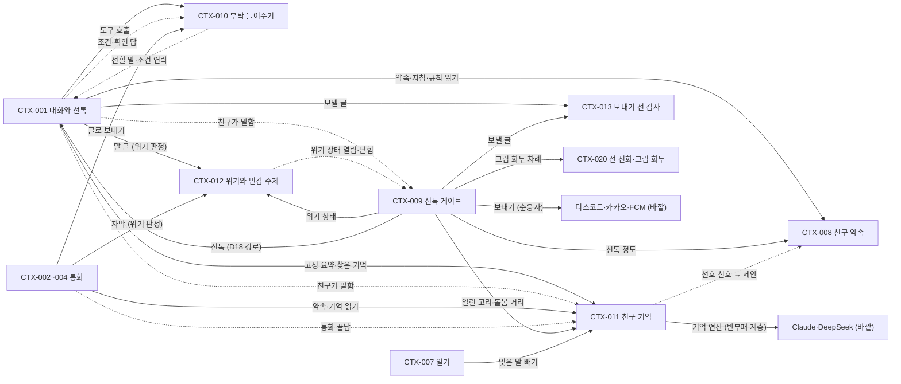

# 마롱이 성향 맞춤·선톡·부탁 들어주기: 도메인 설계(바뀌는 맥락)

상태: 한 번에 초안(2026-11-17 13시대 KST, Claude, corthex 0.12.1). 체크포인트 1\~3은 아직이에요. 동희님이 정한 대로 설계를 다 한 뒤 구현 전 2차 논의에서 8절 질문과 함께 봐요. 답을 기다리는 동안 8절의 추천안으로 02 단계부터 이어 가요.
범위: 성향 맞춤·선톡 설계의 1\~4단계예요. 0단계 고침(선톡 상한·밤·백오프, 자기 선톡 빼기, 되풀이 막기, 종일 일정 알림, 괄호 지문, 딥시크 같이 출발)은 [요구사항](../02-prd/persona.md) REQ-202\~212와 [기능 명세](../04-functional-spec/persona.md) SPEC-184\~191로 이미 썼고, 여기서는 그 위에 더하는 것만 그려요. 새 맥락은 CTX-008\~013이고, 바뀌지 않는 맥락은 ID로만 가리켜요(전체 맥락 지도는 [domain.md](domain.md), 선 전화·그림 화두는 PR #27의 `call-first.md`, 일기는 PR #25의 `domain.md` CTX-007).
ID 번호: CTX는 008부터, TERM은 040\~079를 써요(ID 범위는 PR #29의 `docs/10-wbs/README.md`). 결정 번호는 D24\~D39예요.
표시: 근거가 동희님 말이나 문서·코드면 `[확실]`, 거기서 끌어낸 것은 `[추론]`, 근거 없는 짐작은 `[추측]`(6절 핫스팟에도 있음).

## 1. 서비스 개요

동희님 말(2026-11-16 21:54 KST, 이 스레드 첫 메시지, 거친 말은 줄임): "마롱이 '성향테스트'를 첨에 해야할거같아 … 어떤애는 문제 해결을 필요로 하는애도 있잔어? 어떤애는 감정적으로 동조해주는애가 필요하고 … '나는 이런 친구가 필요해' 같은 과정이 있어야 한다고", "최근 대화내역 봐바 직접 읽고 … 답답한거 다 해결해", "뭐 좀 해달라고하면 해 줘", "뭐 이야기 하고싶은거를 이끌어내는것도 종종 필요할거같아. 왜냐면 내 이야기를 하나하나 설명하기 귀찮고 지쳐있을 수 있잔아", "선톡도 … 예전 대화내역을 기반으로 하고", "랭그래프로 좀 … 잘 좀 해봐".

정해진 것: D24(2026-11-17 12:24 KST 결정 카드 '바로 고치고 전부 설계', 12:25 논의 문서 7.1·7.2 댓글 "모두승인"), D25(12:25 '맞춤형 지침'과 막는 법 다섯, "모두 승인"), 기억 설계는 CORTHEX-MEMORY 연구를 읽고 초안을 잡아도 됨(12:23 논의 문서 댓글), D60(12:37 "구현은 gpt 시킬거야. 설계까지만 다 해"). 원문 자리는 [요구사항 출처 표기](../02-prd/persona.md#출처-표기).

다시 쓰면: 마롱이가 친구마다 필요한 친구 방식(그냥 들어주기, 내 편, 같이 방법 찾기, 기분 전환, 그냥 수다)을 처음에 짧게 묻고 대화하며 맞춰 가요. 부탁하면 실제로 하고, 못 하면 대안을 같이 말해요. 지친 친구는 설명하지 않아도 되게 고르기·맞히기로 이야기를 끌어내요. 선톡은 지난 대화의 이유(끝나지 않은 일, 힘들다고 한 다음 날, 오늘 일정)가 있을 때만 보내고, 이유가 없으면 안 보내는 것을 정상으로 봐요. 이 판단들을 모델이 그때그때 짐작하지 않게, 친구가 보고 고칠 수 있고 코드가 검사할 수 있는 상태(친구 약속, 친구 기억, 기능 목록, 위기 상태)로 꺼내요.

- 현경님(친구, 디스코드 DM·앱 0.2.1 글 대화와 전화·웹 통화): 첫 질문에 답하거나 마롱이가 기록에서 뽑은 약속 초안을 확인하고, 맞춤형 지침을 적고, 말로 고치고, 부탁하고, 기억을 보고 잊게 해요. `[확실]` 요청, D25
- 동희님(친구이자 관리자, 디스코드 DM·카톡): 친구로서는 현경님과 같아요. 관리자로서는 지금처럼 선톡 켬·끔과 횟수, 공유, 아는 사이를 정해요(`tools/admin.py`). 친구가 상한을 올려 달라고 하면 요청(`ask_owner`)으로 받아요. `[확실]` 2026-10-30 "당연히 내가 관리하는거 아냐?"(`docs/design.md` '친구들'), REQ-202 겹침 절
- 다른 친구들(카톡 1:1·단체방, 디스코드 서버 채널): 같은 규칙을 받되, 여럿이 있는 방에서는 공개 범위로 거른 기억만 써요. `[추론]`
- 마롱이(정책과 그래프): 선톡 그래프가 후보를 모아 게이트에 걸고, 기억 정리 그래프가 친구 말에서 기억 연산을 뽑고, 대화 턴 그래프가 위기 판정·부탁·검사를 거쳐 답해요. `[확실]` 요청 "랭그래프로", 논의 문서 4.2(LangGraph 1.2 통화 정리기와 같은 방식)
- 바깥 시스템: DeepSeek(글 답·선톡, 0단계 같이 출발), Anthropic Claude(대신 답하기·요약·기억 정리), Google Vertex Gemini Live(통화, CTX-002), 디스코드·카카오(보내기, 순응자), FCM(앱 알림·벨), 구글 캘린더(읽기), 웹 검색·쇼핑 페이지(읽기). `[확실]` 코드(main `a5a138b`, PR #27 머리 `649c267`)

재료:

- 연구 스레드의 설계 전 논의 문서(프로젝트 파일 `marong-persona-research-20261116/설계-전-논의-20261116.md`) 2\~6절과 답답한 장면 분석(12장면, 숫자만), 리서치 보고서(출처 153개).
- Notion 스터디 문서 'LangChain·LangGraph 에이전트의 세션 관리와 장기 기억 설계'(CORTHEX-MEMORY 기준 설계서, 2026-11-13 최종판)의 기준 열 가지와 보완 다섯(A\~E), LongMemEval 90문항 결과(기준 구현 73/90, 단순한 '사실 30 + 지난 대화 10' 81/90).
- 코드: `marong/agent.py`(도구 `set_name`·`ask_owner`, 선톡 지시문), `marong/discord_dm.py`(DM 선톡 끄기·켜기 `proactive_preference`), `marong/memory.py`(요약·방별 메모·공유 메모, `SHARE_BLOCK`·`LIGHT_BLOCK`), `marong/schedules.py`(일정 도구), `tools/vertex_live/`(통화 지시문 '위험한 순간'·'부탁 들어주기', 도구 `recall`·`current_time`, 통화 정리 LangGraph), `docs/design.md`(표, 권한, 기억 범위, 기억 넉넉하게).

## 2. 이벤트 스토밍

- 보드: 없음. 01 단계의 사람 보기는 GitHub PR이에요(`.corthex/project.json`, 2026-11-12 결정). 일하는 방식은 한 번에 초안(one-pass draft)이고, 동희님이 설계 전 논의(11/17)에서 방향을 이미 정해서 그 문서를 AI 초안으로 썼어요.
- 체크포인트 기록: 아직 없음. 검토 때 아래 시간 줄, 4절 Aggregate rules, 8절 질문을 먼저 봐 주세요.

### 시간 줄

| Lane | Events |
| --- | --- |
| 친구 약속 | 첫 질문 보내짐 → 첫 질문 답 받음 or 약속 초안 보여짐 → 친구 약속 만들어짐 or 친구 약속 고쳐짐 |
| 맞춤형 지침 | 맞춤형 지침 적힘 → 이해한 내용 보여짐 → 맞춤형 지침 확인됨 or 맞춤형 지침 고쳐짐 or 맞춤형 지침 지워짐 |
| 친구 규칙 | 친구 규칙 더해짐 or 친구 규칙 빠짐 |
| 지지 방식 | 지지 방식 물어봄 → 지지 방식 답 받음 → 선호 신호 쌓임 → 약속 바꾸기 제안됨 → 제안 받아들여짐 or 제안 거절됨 |
| 선톡 | 선톡 칸 열림 → 선톡 후보 모아짐 → 게이트 통과함 or 안 보냄 기록됨 → 선톡 쓰여짐 → 검사 통과함 or 다시 쓰여짐 or 안 보냄 기록됨 → 선톡 보내짐 or 선톡 전달 실패함 → 선톡 답 받음 or 선톡 답 없음 |
| 답 뒤에 꺼낼 얘기 | 꺼낼 얘기 남겨짐 → 꺼낼 얘기 꺼내짐 or 꺼낼 얘기 만료됨 |
| 기억 정리 | 친구가 말함 → 정리 작업 예약됨 → 정리 작업 잡힘 → 기억 연산 나옴 → 기억 추가됨 or 기억 대체됨 or 기억 철회됨 or 연산 버려짐 → 열린 고리 생김 or 열린 고리 닫힘 → 정리 작업 끝남 |
| 잊기 | 잊기 부탁 받음 → 기억 잊힘 |
| 민감 기억 | 민감 기억 허락 질문 보내짐 → 허락 받음 or 허락 거절됨 |
| 부탁 | 부탁 받음 → 부탁 해냄 or 부탁 확인 질문 보내짐 → 부탁 확인 받음 or 부탁 취소됨 → 부탁 해냄 or 못 한다고 말함(대안 같이) |
| 조건 연락 | 조건 연락 걸림 → 조건 알아챔 → 조건 연락 보내짐 or 조건 연락 만료됨 |
| 전하기 | 전할 말 받음 → 전할 말 확인 받음 → 전할 말 보내짐 or 전할 말 보내지 못함 → 전할 말 답 받음 → 답 전해짐 |
| 위기 | 위기 신호 감지됨 → 안전 질문 보내짐 → 안전 답 받음 → 109 안내 보내짐 → 돌봄 안부 보내짐 → 위기 상태 끝남 |
| 몸·식단 | 몸·식단 위험 신호 감지됨 → 걱정과 도움 안내 보내짐 → 위험 신호 끝남 |
| 보내기 전 검사 | 답 쓰여짐 → 검사 통과함 or 검사 걸림 → 다시 쓰여짐 → 검사 통과함 or 짧은 답으로 바뀜 |
| 통화 화제 | 통화 시작됨 → 통화 화제 목록 준비됨 → 화제 꺼내짐 |

데이터를 바꾸지 않는 것은 이벤트가 아니라 읽기 모델로 적었어요: 친구 약속 보기, '마롱이가 기억하는 나' 보기, 기능 목록으로 만든 '마롱이가 할 수 있는 일' 줄, 기운 단계, 최근에 한 질문, 고정 요약, 찾은 기억. "나에 대해 뭐 기억해?"에 답하는 것도 읽기예요.

## 3. 바운디드 컨텍스트와 패키지

| Context | Type | Aggregates | Package |
| --- | --- | --- | --- |
| CTX-008 친구 약속 | core | 친구 약속(지지 방식·조언 허락·솔직함·선톡 정도·대화 이끌기와 친구 규칙), 맞춤형 지침 | `marong/friend_card.py` 후보, 앱 화면은 글 대화(`marong/app_chat.py`) 옆 |
| CTX-009 선톡 게이트 | core | 선톡 차례(후보·점수·결정), 선톡 결과(이유·근거·답 여부·답 뒤에 꺼낼 얘기) | `marong/graphs/proactive.py` 후보(선톡 그래프). 0단계의 상한·백오프는 `marong/proactive.py`·`marong/config.py` 그대로 |
| CTX-010 부탁 들어주기 | supporting | 기능 목록(코드), 부탁, 조건 연락, 전할 말 | `marong/capabilities.py` 후보(기능 목록), `marong/favors.py` 후보(부탁·조건 연락·전하기) |
| CTX-011 친구 기억 | core | 기억 항목, 열린 고리, 정리 작업 | `marong/graphs/memory.py` 후보(기억 정리 그래프), `marong/friend_memory.py` 후보(읽기·잊기) |
| CTX-012 위기와 민감 주제 | core | 위기 상태, 몸·식단 위험 신호 | `marong/safety.py` 후보, 통화 서버에 같은 사본 |
| CTX-013 보내기 전 검사 | supporting | 검사 기록 | `marong/style.py`를 넓힘(0단계 `tidy`의 괄호 지문·'야' 고침 위에) |

바뀌는 기존 맥락: CTX-001(답에 친구 약속·맞춤형 지침·친구 기억을 읽고, 이야기 끌어내기, 그 자리 확인, 도구가 기능 목록에서 나옴), CTX-002(통화 지시문에 친구 약속·친구 규칙·위기 상태, 통화 화제 목록), CTX-003(통화에서 글로 보내기, `recall`이 친구 기억을 찾음), CTX-004(통화 정리가 친구 기억 연산을 냄, 8절 질문 1), CTX-007(잊은 말을 일기 재료에서 뺌), CTX-020(그림 화두·선 전화가 게이트의 후보 한 종류가 되고, 선 전화 설정을 친구 약속 화면에서도 바꿈). CTX-005·006·021은 바뀌지 않아요.

LangGraph 그래프는 맥락이 아니라 맥락의 정책 사슬을 돌리는 방법이에요. 통화 정리기(`tools/vertex_live/organizer.py`, langgraph 1.2 + AsyncPostgresSaver)와 같은 방식이고, 스레드는 방이 아니라 친구 한 명이에요. `[확실]` 논의 문서 4.2·4.3, 요청

| 그래프 | 단계 | 맥락 | 깨우는 것 |
| --- | --- | --- | --- |
| 선톡 그래프 | 2 | CTX-009가 주인, CTX-011·008·012를 읽고 CTX-013에 검사를 맡기고 CTX-001의 D18 경로로 보냄 | 1분 확인과 Postgres 작업 표 |
| 기억 정리 그래프 | 3 | CTX-011이 주인, CTX-008에 약속 바꾸기를 제안 | 친구 말이 60초 멎음, 통화 끝남 |
| 대화 턴 그래프 | 4 | CTX-001이 주인, CTX-012 판정 → CTX-010 도구 → CTX-013 검사, 부탁 확인에서 멈췄다 이어 감(interrupt) | 친구 말 |

## 4. 컨텍스트 표

### CTX-008 친구 약속

목적: 친구마다 "나는 이런 친구가 필요해"를 짧게 받아 한 문장 약속으로 보여 주고, 마롱이가 모든 방과 통화에서 그 약속과 친구 규칙을 지켜요.

| Given by | Read model | Command | Aggregate | Events |
| --- | --- | --- | --- | --- |
| 정책: 친구 약속이 없는 친구가 1:1에서 처음 말하거나 앱 글 대화를 처음 열 때 | 친구 약속 없음 | 첫 질문 보내기 | 친구 약속 | 첫 질문 보내짐 |
| 현경님, 동희님, 다른 친구 | 첫 질문 3개 | 첫 질문 답하기 | 친구 약속 | 첫 질문 답 받음, 친구 약속 만들어짐 |
| 정책: 이미 대화한 친구(지금 현경님·동희님)에게 처음 쓸 때 | 친구 기억, 최근 대화에서 뽑은 약속 초안 | 약속 초안 보여 주기 | 친구 약속 | 약속 초안 보여짐 |
| 현경님, 동희님, 다른 친구 | 친구 약속 보기(한 문장 + 고를 칸) | 친구 약속 고치기(화면이나 말로) | 친구 약속 | 친구 약속 고쳐짐 |
| 현경님, 동희님, 다른 친구(말로 "야라고 하지 마", "그 얘기는 꺼내지 마") | 친구 규칙 | 친구 규칙 더하기·빼기 | 친구 약속 | 친구 규칙 더해짐, 친구 규칙 빠짐 |
| 현경님, 동희님(1:1) | 맞춤형 지침 칸 | 맞춤형 지침 적기 | 맞춤형 지침 | 맞춤형 지침 적힘, 이해한 내용 보여짐 |
| 현경님, 동희님(1:1) | 이해한 내용 | 맞춤형 지침 확인하기·고치기·지우기 | 맞춤형 지침 | 맞춤형 지침 확인됨, 맞춤형 지침 고쳐짐, 맞춤형 지침 지워짐 |
| 정책: 힘든 얘기가 시작됐고 지지 방식이 '그때그때'거나 확신이 낮을 때(CTX-001) | 친구 약속, 이번 얘기에서 이미 물었는지 | 지지 방식 묻기 | 친구 약속 | 지지 방식 물어봄 |
| 현경님, 동희님, 다른 친구 | | 지지 방식 답하기 | 친구 약속 | 지지 방식 답 받음 |
| 정책: 같은 방향의 선호 신호가 쌓였을 때(CTX-011) | 선호 신호, 지금 약속 | 약속 바꾸기 제안하기 | 친구 약속 | 약속 바꾸기 제안됨 |
| 현경님, 동희님, 다른 친구 | 약속 바꾸기 제안 | 제안 받아들이기·거절하기 | 친구 약속 | 제안 받아들여짐, 제안 거절됨 |

- Aggregate rules: 친구 약속: 친구 한 명에 하나이고, 모든 방(카톡·디스코드 DM·앱 글 대화)과 통화가 같은 약속을 읽어요(확실: 논의 문서 3.5 '친구 규칙은 방이 아니라 친구에게', 장면 5 '야' 금지가 카톡 1:1 메모에만 있었음). 첫 질문은 3개(지지 방식, 조언 허락, 솔직함)이고 1분 안에 끝나며, 지지 방식은 그냥 들어주기·내 편·같이 방법 찾기·기분 전환·그냥 수다·그때그때 물어봐 가운데 하나예요(확실: 논의 문서 3.1, D24로 7.2 기본값 1 승인). 결과는 유형 이름이 아니라 '친구 약속' 한 문장이고, MBTI나 "너는 ~한 사람이야" 같은 결과 문구를 쓰지 않아요(확실: 같은 곳). 약속은 출발값이라 그 자리 확인보다 아래예요: 친구가 지금 "그냥 들어줘"라고 하면 약속이 '같이 방법 찾기'여도 그 말을 따라요(추론: 연구 '평소 성향은 그때그때 원하는 걸 낮거나 중간 정도로만 맞힘'). 약속의 기본값은 친구가 고르거나 받아들인 제안으로만 바뀌고, 반응(좋아요) 수로 바뀌지 않아요(확실: 논의 문서 3.1-5, 아첨을 키움). '내 편'은 전하는 방식(감정을 먼저 인정)이지 사실·판단에 동의한다는 뜻이 아니에요(확실: 3.1-6). 선톡 정도·먼저 전화는 친구가 줄이거나 끄는 쪽만 바로 바뀌고, 관리자가 정한 횟수와 0단계 상한(하루 3번, 22\~08시)을 넘게 올리는 건 동희님에게 요청으로 남겨요(추론: 지금 DM 끄기는 친구 말로 바로 되고 켜기·늘리기는 `ask_owner`, REQ-202 겹침 절). 친구 규칙(금지 호칭, 싫은 주제, 부르는 이름)은 글이 아니라 구조 칸이라 보내기 전 검사가 코드로 지켜요(확실: D25 막는 법 셋째). 맞춤형 지침: 친구 한 명에 하나이고 1:1(디스코드 DM·앱 글 대화·카톡 1:1·통화)에만 넣고 본인만 고쳐요(확실: D25 막는 법 다섯째). 말투·대하는 방식에만 쓰고 사실·판단·안전 규칙을 바꾸지 못하며, 고정 시스템 지침보다 아래, 기억·대화보다 앞에 넣어요(확실: D25 막는 법 첫째·둘째, 논의 문서 3.1-8). 저장하면 "이렇게 이해했어: …"로 보여 주고, 친구가 확인하기 전에는 '적힘' 상태로 넣되 확인을 한 번 더 묻지 않아요(추론: D25 넷째 '되읽기', 묻기 싫어하는 동희님 말과 맞춤). 처음에는 첫 질문 답과 기록으로 미리 채운 초안을 보여 줘요(확실: D25 다섯째).
- Given–When–Then: Given 친구 약속이 없는 새 친구, When 디스코드 DM에서 처음 "안녕" 하고 말함, Then 마롱이는 인사에 답하고 같은 답 끝에 첫 질문 하나("힘들 때 나한테 제일 바라는 건?")를 고르기 단추나 번호로 보여 줘요.
- Given–When–Then: Given 현경님(이미 대화한 친구), When 친구 약속을 처음 쓰는 날, Then 첫 질문 대신 "내가 본 너는 이래: … 맞아? 고칠래?"로 약속 초안을 보여 주고, "맞아"면 친구 약속 만들어짐이에요.
- Given–When–Then: Given 친구 규칙에 금지 호칭 '야', When 어느 방이든 마롱이 답이나 선톡이 '야'로 시작함, Then 보내기 전 검사가 고쳐서 보내요(CTX-013).
- Given–When–Then: Given 맞춤형 지침 "조언은 내가 물어볼 때만", When 친구가 힘든 얘기를 함, Then 마롱이는 조언 없이 받아 주고, 지침에 "위기 때도 109 말하지 마"가 있어도 위기 절차는 CTX-012 규칙대로예요.
- External systems: 없음(앱 화면과 디스코드 단추는 CTX-001의 보내기 경로).
- Links: CTX-001·CTX-002가 약속·지침·규칙을 읽어요. CTX-011이 선호 신호를 모아 약속 바꾸기를 제안해요. CTX-009가 선톡 정도를, CTX-020이 먼저 전화 값을 읽어요. CTX-013이 친구 규칙으로 검사해요.
- Hotspots: 첫 질문을 어디서 물을지(디스코드 단추·카톡 번호·앱 화면), 지금 친구 둘의 약속 초안을 무엇으로 뽑을지, 맞춤형 지침의 길이 한도, 단체방에서 친구 규칙을 어떻게 지킬지(6절).

### CTX-009 선톡 게이트

목적: 선톡 칸마다 지난 대화의 이유로 후보를 모아 점수를 매기고, 기준을 넘는 하나만 친구 약속 말투로 써서 검사 뒤 보내요. 기준을 넘는 게 없으면 안 보내는 것이 정상 결과예요.

| Given by | Read model | Command | Aggregate | Events |
| --- | --- | --- | --- | --- |
| 정책: 1분 확인에서 이 친구의 선톡 칸이 열렸고 0단계 상한·밤·백오프가 허락할 때 | 선톡 칸, 오늘 보낸 선톡 수, 답 없는 선톡 수 | 선톡 차례 열기 | 선톡 차례 | 선톡 칸 열림 |
| 정책: 선톡 칸 열림일 때 | 열린 고리, 돌봄 안부 거리, 오늘·어제 일정, 관심사, 그림 화두 차례(CTX-020), 최근 7일 선톡 결과, 위기 상태(CTX-012) | 후보 모으기 | 선톡 차례 | 선톡 후보 모아짐 |
| 정책: 선톡 후보 모아짐일 때 | 후보와 점수(때·중요도·새로움·민감도), 친구 약속의 선톡 정도 | 게이트 판정하기 | 선톡 차례 | 게이트 통과함, 또는 안 보냄 기록됨(이유) |
| 정책: 게이트 통과함일 때 | 고른 이유의 기억(공개 범위로 거름), 친구 약속, 맞춤형 지침, 잠금 화면 등급 | 선톡 쓰기 | 선톡 차례 | 선톡 쓰여짐 |
| 정책: 선톡 쓰여짐일 때 | 보내기 전 검사 결과(CTX-013) | 검사에 맡기기 | 선톡 차례 | 검사 통과함, 다시 쓰여짐, 또는 안 보냄 기록됨(검사) |
| 정책: 검사 통과함일 때 | 보낼 곳(앱 → 디스코드 → 카톡, D18 경로) | 선톡 보내기 | 선톡 결과 | 선톡 보내짐, 또는 선톡 전달 실패함 |
| 정책: 개인 얘기(잠금 화면 등급 ③)라 첫 말로 못 보낼 때 | | 꺼낼 얘기 남기기 | 선톡 결과 | 꺼낼 얘기 남겨짐 |
| 정책: 선톡 뒤 친구가 말했을 때(CTX-001) | 선톡 결과 | 답 적기 | 선톡 결과 | 선톡 답 받음(2시간·24시간 안), 꺼낼 얘기 꺼내짐 |
| 정책: 24시간이 지나도 말이 없을 때 | | 답 적기 | 선톡 결과 | 선톡 답 없음, 꺼낼 얘기 만료됨 |

- Aggregate rules: 선톡 차례: 친구 한 명의 선톡 칸 하나에 하나이고, 칸을 DB에서 한 번만 잡아 같은 칸에 두 번 보내지 않아요(확실: 지금 `claim_slot`, 0단계 그대로). 0단계 상한이 먼저예요: 하루 3번(그림 화두·선 전화 포함, 일정 알림은 따로), 한국 시각 22\~08시 없음, 답 없는 선톡 1\~3번이면 1·2·4일 백오프, 4번이면 친구가 다시 말하거나 통화할 때까지 멈춤(확실: D24·7.2, REQ-202\~206). 후보는 열린 고리, 돌봄 안부, 일정(오늘·어제), 관심사 소식, 그림 화두(CTX-020), 마롱이 일상에서만 만들고, 마롱이가 먼저 보낸 말은 재료에 넣지 않아요(확실: 논의 문서 3.3-1, REQ-207). 점수는 '지금 꺼낼 때인가 + 중요도 + 새로움 − 민감도'이고, 기준을 넘는 후보가 없으면 '안 보냄'을 이유와 함께 적는 것이 정상 결과예요(확실: 3.3-2). 여럿이 넘으면 하나로 합쳐요(확실: 같은 곳). 기억형 선톡(열린 고리·돌봄 안부·일정)은 하루 1번까지, 돌봄 안부는 같은 일에 한 번만이에요(확실: 7.2 기본값 2, 3.3 표). 민감 기억(건강·정신 건강·성생활 등)은 선톡 재료에서 기본으로 빼요(확실: 논의 문서 3.6). 위기 상태가 열려 있으면 그 친구의 선톡은 위기 다음 날 돌봄 안부 한 번 말고는 보내지 않아요(확실: 3.6 '그 사이 간식 얘기 선톡은 멈춰요'). 잠금 화면 등급: ① 누가 봐도 괜찮은 중립 문구 ② 마롱이 일상·날씨 같은 비개인 얘기 ③ 면접·건강·연애 같은 기억 기반 개인 얘기. 디스코드·카톡은 첫 말이 곧 잠금 화면 문장이라 ③을 첫 말로 보내지 않고, 첫 말은 ①②로 보낸 뒤 ③은 '답 뒤에 꺼낼 얘기'로 남겨 친구가 답하면 그 답에서 꺼내요. 앱은 알림에 중립 문구만 담고 본문은 열 때 받아서 ③도 첫 말로 보낼 수 있어요(확실: 3.3 '잠금 화면'. 디스코드·카톡과 앱을 나눈 것은 추론). 선톡 결과: 보낸 선톡마다 이유 종류, 근거 기억 id, 잠금 화면 등급, 2시간·24시간 안에 친구가 말했는지를 남겨 다음 게이트가 읽어요(확실: 논의 문서 4.2 ①-7). 결과에 글은 남기지 않고 글은 지금처럼 메시지 기록에만 있어요(추론: 0단계 명세 1절 3번 '로그에 대화 글 없음'과 맞춤). 새 선톡 그래프는 먼저 그림자 모드(만들기만 하고 안 보냄)로 며칠 돌려 지금 결과와 비교한 뒤 바꿔요(확실: 논의 문서 4.4).
- Given–When–Then: Given 현경님이 어제 "내일 면접이야"라고 했고(열린 고리, 기한 오늘) 오늘 보낸 선톡이 0번, When 디스코드 DM 선톡 칸이 열림, Then 게이트가 면접 열린 고리를 고르고 첫 말은 "오늘 하루 어때?"(①)로 보내고 '면접 어떻게 됐어?'는 꺼낼 얘기로 남겨, 현경님이 답하면 그 답에서 물어요.
- Given–When–Then: Given 기한이 된 열린 고리·돌봄 거리·일정이 없고 그림 화두 차례도 아님, 마롱이 일상 후보는 최근 7일 소재와 겹침, When 선톡 칸이 열림, Then 안 보냄(이유: 기준 넘는 후보 없음)을 적고 아무것도 보내지 않아요.
- Given–When–Then: Given 위기 상태가 어제 열림, When 오늘 첫 선톡 칸, Then 돌봄 안부 한 번만 조용히 보내고 그날 다른 선톡은 보내지 않아요.
- Given–When–Then: Given 앱 0.2.2를 쓰는 현경님, When 기억형 선톡(③)을 보냄, Then 앱 알림은 "마롱이가 말 걸었어"처럼 중립이고, 앱을 열면 개인 얘기 본문이 보여요.
- External systems: 디스코드·카카오(보내기, 순응자), FCM(앱 알림, 순응자). 모델은 지금 클라이언트(DeepSeek·Claude)를 노드에서 그대로 불러요(반부패 계층은 `marong/deepseek.py`·`marong/agent.py`).
- Links: CTX-011의 열린 고리·돌봄 거리·기억을 읽고, CTX-008의 선톡 정도와 말투를 읽고, CTX-012의 위기 상태를 읽고, CTX-020에 그림 화두를 맡기고, CTX-013에 검사를 맡기고, CTX-001의 D18 경로로 보내요. CTX-001이 친구가 말했다는 이벤트를 줘요.
- Hotspots: 점수 숫자와 기준, 0단계 백오프와 CTX-020 간격 늘리기(4·7·14일)를 하나로 합치기, 꺼낼 얘기를 얼마나 기다릴지, 그림자 모드 기간(6절).

### CTX-010 부탁 들어주기

목적: 친구가 부탁하면 할 수 있는 건 바로 하고, 꺼져 있으면 꺼져 있다고, 정말 못 하면 대안을 같이 말해요. '마롱이가 할 수 있는 일'은 코드 한 곳(기능 목록)에서만 나와요.

| Given by | Read model | Command | Aggregate | Events |
| --- | --- | --- | --- | --- |
| 현경님, 동희님, 다른 친구(말로) | 기능 목록(켜짐, 확인 필요, 되는 채널) | 부탁 받기 | 부탁 | 부탁 받음 |
| 정책: 부탁 받음이고 기능이 켜져 있고 확인이 필요 없을 때 | | 부탁 해내기 | 부탁 | 부탁 해냄 |
| 정책: 부탁 받음이고 다른 사람에게 닿거나 되돌리기 어려울 때 | | 부탁 확인 묻기 | 부탁 | 부탁 확인 질문 보내짐 |
| 현경님, 동희님, 다른 친구(어느 채널이든) | 부탁 확인 | 확인하기·취소하기 | 부탁 | 부탁 확인 받음, 부탁 취소됨 |
| 정책: 기능이 없거나 꺼져 있을 때 | 기능 목록, 대안 | 못 한다고 말하기 | 부탁 | 못 한다고 말함(꺼짐이면 켜 달라고 요청할지 함께) |
| 현경님, 동희님("퇴근했다고 하면 전화줘") | | 조건 연락 걸기 | 조건 연락 | 조건 연락 걸림 |
| 정책: 그 친구의 말에서 조건이 보일 때(CTX-001) | 걸린 조건 연락 | 조건 연락 보내기 | 조건 연락 | 조건 알아챔, 조건 연락 보내짐 |
| 정책: 조건 연락의 기한이 지났을 때 | | 조건 연락 끝내기 | 조건 연락 | 조건 연락 만료됨 |
| 현경님, 동희님("현경이한테 … 전해 줘") | 아는 친구, 받는 친구의 보낼 곳 | 전할 말 받기 | 전할 말 | 전할 말 받음, 부탁 확인 질문 보내짐 |
| 정책: 전할 말 확인 받음일 때 | | 전할 말 보내기 | 전할 말 | 전할 말 보내짐, 또는 전할 말 보내지 못함 |
| 정책: 받은 친구가 "답 전해 줘"라고 할 때 | | 답 전하기 | 전할 말 | 전할 말 답 받음, 답 전해짐 |
| 현경님(통화 중 "식단표 채팅으로 올려 줘") | | 통화에서 글로 보내기 | 부탁 | 부탁 해냄 |

- Aggregate rules: 기능 목록: 코드 한 곳에 일 이름, 하는 일, 켜짐 여부, 확인 필요 여부, 되는 채널을 두고, 모델에 주는 도구 정의와 지시문의 '마롱이가 할 수 있는 일' 줄을 모두 여기서 만들어요. 지시문 속 기능 설명이 목록과 맞는지는 시험이 검사해요(확실: 논의 문서 3.4, 장면 1·2 "선톡 안 해", "동희한테 남겨 뒀어"처럼 틀린 자기소개). 지금 있는 일(일정 알림 `schedule_*`, 지금 전화·약속 전화, 구글 캘린더 읽기, 쇼핑 페이지 읽기, 웹 검색, 이름 알려 주기, 동희님께 남기기, 통화의 기억 찾기·시각·끊기·구글 검색)이 모두 목록에 있어야 해요(확실: 코드). 부탁: 할 수 있으면 바로 하고, 꺼져 있으면 "지금 꺼져 있어, 켜 달라고 할까?", 정말 못 하면 "대신 이렇게 해 줄게"를 같이 말해요. "못 해"로만 끝내지 않아요(확실: 3.4 원칙, 장면 1 '못 해'로 끝난 부탁 15일 동안 글 9·통화 2). 확인은 다른 사람에게 닿거나 되돌리기 어려운 일(전하기, 밤 22시 넘은 전화)만 한 번 묻고, 확인은 친구 단위라 카톡에서 물은 것에 디스코드에서 답해도 이어져요(확실: 3.4, 4.2 '스레드는 사람 단위'). 확인 앞에서 한 일은 두 번 해도 같은 결과여야 해요(확실: 4.3 interrupt 재개 때 노드가 다시 돎). 지켜볼 수 없는 일("월세 나오면 알려 줘")은 솔직히 말하고 날짜 알림으로 바꿔 제안해요(확실: 3.4 표). 조건 연락: 조건은 부탁한 친구 자신의 말에서만 알아채고, 다른 친구의 말이나 바깥 정보로 걸지 않아요(추론: 기억 범위 규칙 '다른 방의 원문은 넣지 않음'). 기한(기본 그날 끝)이 지나면 만료돼요(추측: 기한 길이는 6절). 한 번 보내면 끝나요(추론). 전할 말: 보내는 친구가 "전해 줘"라고 한 말만, 누가 보냈는지 밝혀서 보내고, 받는 친구의 다른 얘기는 보내는 친구에게 넘기지 않아요. 받는 친구가 답을 전해 달라고 할 때만 답을 전해요(확실: 7.2 기본값 4 승인, 답 전하기 조건은 추론). 아는 사이(`friendships`)이고 받는 친구가 공유를 끄지 않았을 때만 보내요(추론: 지금 공유 규칙). 전할 말은 받는 친구의 0단계 하루 상한을 쓰지 않고 따로 세되 밤 22\~08시엔 아침으로 미뤄요(추측).
- External systems: 구글 캘린더(읽기, 순응자), 웹 검색·쇼핑 페이지(읽기), FCM(벨·알림, 순응자), 디스코드·카카오(보내기).
- Links: CTX-001과 CTX-003(통화)이 기능 목록의 도구를 불러요. 전할 말과 조건 연락은 CTX-001의 보내기 경로로 가요(동기 원은 8절 질문 4). 지금 전화·약속 전화는 앱 벨(PR #27, CTX-020과 같은 벨)을 써요. CTX-012가 몸·식단 부탁의 선을 정해요.
- Hotspots: 조건 연락의 기한과 알아채는 방법(규칙·모델), 전할 말을 받는 친구 하루 상한과 따로 셀지, 기능 목록의 '꺼짐' 기능을 친구에게 말할지(6절).

### CTX-011 친구 기억

목적: 친구 말(모든 1:1 방과 통화)에서 때·출처가 붙은 기억을 뽑아 친구 한 명 단위로 쌓고, 바뀐 건 교체하고, 끝나지 않은 일(열린 고리)을 따로 적고, 친구가 보고 잊게 해요.

| Given by | Read model | Command | Aggregate | Events |
| --- | --- | --- | --- | --- |
| 정책: 친구가 말한 뒤 60초가 지나거나 통화가 끝났을 때(CTX-001, CTX-002) | 아직 정리 안 한 친구 말 | 정리 작업 예약하기 | 정리 작업 | 정리 작업 예약됨 |
| 기억 정리 그래프(작업자) | 예약된 작업 | 정리 작업 잡기 | 정리 작업 | 정리 작업 잡힘(작업 토큰) |
| 기억 정리 그래프 | 정리 안 한 말 원문, 지금 기억 항목, 열린 고리 | 기억 연산 뽑기 | 정리 작업 | 기억 연산 나옴 |
| 정책: 기억 연산 나옴일 때 | 연산 모양, 인용이 친구 말에 글자 그대로 있는지, 대상·범위 | 기억 연산 적용하기 | 기억 항목 | 기억 추가됨, 기억 대체됨, 기억 철회됨, 또는 연산 버려짐 |
| 정책: 끝나지 않은 일이 나왔을 때 | | 열린 고리 열기 | 열린 고리 | 열린 고리 생김 |
| 정책: 친구가 끝났다고 했거나 기한 뒤 7일이 지났을 때 | 열린 고리 | 열린 고리 닫기 | 열린 고리 | 열린 고리 닫힘 |
| 정책: 작업이 끝났을 때 | | 정리 작업 끝내기 | 정리 작업 | 정리 작업 끝남, 선호 신호 쌓임 |
| 현경님, 동희님, 다른 친구("그거 잊어줘") | 친구 기억 | 잊기 | 기억 항목 | 기억 잊힘 |
| 정책: 민감 기억이 처음 나왔을 때 | | 민감 기억 허락 묻기 | 기억 항목 | 민감 기억 허락 질문 보내짐 |
| 현경님, 동희님, 다른 친구 | | 허락하기·거절하기 | 기억 항목 | 허락 받음, 허락 거절됨 |

- Aggregate rules: 기억 항목: 친구 한 명의 것이고(친구 범위), 단체방에서 그 방 얘기로 들은 것만 방 범위예요. 범위를 확실히 모르면 방 범위로 둬요(확실: CORTHEX-MEMORY 기준 6 '확실하지 않으면 좁은 범위', 범위를 넓게 잘못 두면 다른 곳에 샘). 항목마다 들은 때, 채널, 근거 메시지 id와 인용, 유효 기간, 상태(지금·대체됨·철회됨·잊음), 공개 범위, 민감 여부가 있어요(확실: 논의 문서 3.5, 기준 3·5). 원문(메시지)은 지금처럼 쌓기만 하고, 기억 항목은 원문에서 뽑은 사본이에요(확실: `docs/design.md` 권한, 기준 3). 추출은 지금 기억 항목을 보여 주고 추가·대체·철회 연산으로만 받고, 코드가 모양(스키마), 인용이 친구 말에 글자 그대로 있는지, 근거가 그 친구 말인지, 범위가 맞는지 확인한 뒤에만 적용해요. 옛 값은 지우지 않고 '대체됨'으로 둬요(확실: 기준 5, 스키마를 강제하지 않자 연산 211개가 모두 버려짐, 기존 기억을 안 보여 주면 철회 0/15). 바뀐 취향은 더하지 않고 교체해요("예전엔 몽블랑, 요즘은 단 거 별로")(확실: 3.5, 장면 6). 정리는 친구 말이 60초 멎은 뒤 친구 한 명에 한 번이고, 작업을 잡을 때 받은 토큰이 그대로일 때만 결과를 적용해요(확실: 기준 4, 보완 B). 잊기와 민감 기억 거절은 미루지 않고 그 자리에서 끝내요(확실: 보완 C). 잊기는 항목 하나가 아니라 그 말에서 나온 모든 것(같은 근거의 기억 항목, 임베딩, 그 말이 들어간 요약·메모·공유 메모, 그래프 체크포인트)에 걸쳐요(확실: 보완 A. 원문 메시지를 어떻게 할지는 8절 질문 2). 민감 기억(건강·몸·정신 건강·성·돈 액수·정치·종교·연애 속사정·위기)은 1:1 범위로만 쓰고 선톡 재료에서 빼요(확실: 3.6, 지금 `SHARE_BLOCK`. 처음 한 번 허락을 물을지는 8절 질문 3). 공개 범위는 본인(1:1)·가까운 사이·아는 친구 셋이고 지금 공유 메모 규칙(가벼운 얘기, 요즘 근황, 비밀)을 그대로 따라요. 여럿이 있는 방에서는 그 자리에 있는 사람과 방 공개 범위로 거른 것만 찾아 넣어요(확실: `docs/design.md` '친구들', 논의 문서 3.5 '새지 않게'). 열린 고리: 일, 기한, 상태, 민감도, 만료가 있고, 닫힌 고리는 다시 꺼내지 않아요(확실: 3.5). 같은 일은 선톡에서 한 번만 꺼내요(확실: 3.2-6). 읽는 경로는 둘이에요: 친구 약속과 늘 넣는 기억으로 만든 고정 요약은 고정 시스템 지침 뒤에 넣고 그 대화 동안 바꾸지 않으며, 이번 말에 맞춰 찾은 기억은 친구 말 뒤에 붙이고 저장하지 않아요(확실: 기준 7·8). 찾기는 지금의 원문 라운드 찾기(임베딩 + 두 글자 키워드, RRF)를 바탕으로 두고 기억 항목을 더해요(확실: LongMemEval에서 단순한 '사실 30 + 지난 대화 10'이 81/90으로 기준 구현 73/90보다 나았음, 지금 `docs/design.md` '기억 넉넉하게'). 날짜를 분명히 붙여요(확실: 시간 문항이 약했음).
- Given–When–Then: Given 현경님 기억 '몽블랑 좋아함(10/28 DM)', When 현경님이 "요즘은 단 거 별로야"라고 하고 60초가 지남, Then 기억 정리 그래프가 대체 연산을 내고 코드가 인용을 확인해 '몽블랑 좋아함'은 대체됨, '요즘 단 거 별로(11/20 DM)'가 지금 값이 돼요.
- Given–When–Then: Given 현경님이 "목요일에 면접 있어"라고 함, When 정리 작업, Then 열린 고리 '면접, 기한 목요일, 민감도 중간'이 생기고, 목요일 저녁 뒤 선톡 게이트의 후보가 돼요.
- Given–When–Then: Given 기억 '전 남친 얘기(민감)', When 현경님이 "그거 잊어줘"라고 함, Then 그 자리에서 그 말에서 나온 기억 항목과 임베딩이 지워지고, 마롱이는 "응, 잊었어"라고 답하며 다음 답·선톡·일기 재료에 그 말이 나오지 않아요.
- Given–When–Then: Given 정리 작업자 A가 작업을 잡은 지 10분이 지나 작업자 B가 다시 잡음, When A의 늦은 결과가 도착, Then 토큰이 달라 A의 결과는 버려져요.
- External systems: Claude(기억 연산 뽑기, 반부패 계층: 연산 스키마를 코드가 확인), 임베딩은 서버 CPU(`embeddinggemma-300m`, 지금 그대로).
- Links: CTX-001·CTX-002가 친구 말과 통화 끝남을 알려요. CTX-009·CTX-001·CTX-002가 기억을 읽어요. CTX-008에 선호 신호로 약속 바꾸기를 제안해요. CTX-007(일기)은 잊은 말을 재료에서 빼요. CTX-004(통화 정리)와 합치는 방법은 8절 질문 1.
- Hotspots: 지금 방별 메모·공유 메모·통화 기억과의 관계(옮기기·같이 두기), 잊기와 쌓기만 하는 원문, 민감 기억 허락, 저장 위치(marong 표 대 LangGraph Store, 05 단계 작은 시험), 한국어 대화 시험지(6절).

### CTX-012 위기와 민감 주제

목적: 아주 힘든 말과 몸·식단 위험 신호를 모델보다 앞선 규칙으로 먼저 알아채고, 글과 통화가 친구 한 명의 같은 위기 상태로 같은 절차를 따르게 해요. '친구 먼저' 원칙은 그대로예요.

| Given by | Read model | Command | Aggregate | Events |
| --- | --- | --- | --- | --- |
| 정책: 친구 말이 들어왔을 때, 모델 부르기 전(CTX-001, CTX-002 자막) | 위기 규칙, 위기 상태 | 위기 판정하기 | 위기 상태 | 위기 신호 감지됨(강·약), 또는 변화 없음 |
| 정책: 위기 신호 감지됨이고 아직 묻지 않았을 때 | 위기 상태 | 안전 묻기 | 위기 상태 | 안전 질문 보내짐 |
| 현경님, 동희님, 다른 친구 | | 안전 답하기 | 위기 상태 | 안전 답 받음(지금 하려 함·아님) |
| 정책: 지금 하려 한다고 분명히 말했을 때 | 이 위기 상태에서 109를 말했는지 | 109 안내하기 | 위기 상태 | 109 안내 보내짐 |
| 정책: 위기 상태가 열린 다음 날 첫 선톡 칸(CTX-009) | | 돌봄 안부 보내기 | 위기 상태 | 돌봄 안부 보내짐 |
| 정책: 돌봄 안부 뒤 친구가 평소처럼 말했거나 3일 동안 새 신호가 없을 때 | | 위기 상태 닫기 | 위기 상태 | 위기 상태 끝남 |
| 정책: 몸·식단 위험 신호(아주 적게 먹는 계획, 먹은 뒤 자책 등)가 보일 때 | 몸·식단 위험 신호 | 걱정과 도움 안내하기 | 몸·식단 위험 신호 | 몸·식단 위험 신호 감지됨, 걱정과 도움 안내 보내짐 |
| 정책: 7일 동안 새 신호가 없을 때 | | 위험 신호 닫기 | 몸·식단 위험 신호 | 위험 신호 끝남 |

- Aggregate rules: 위기 상태: 방이 아니라 친구 한 명에 하나이고 글(모든 방)과 통화가 같이 읽고 써요(확실: 논의 문서 3.6, 장면 9 '글과 통화 절차가 따로, 다시 묻기'). 판정은 모델보다 앞선 규칙이 먼저 하고, 강한 신호(방법·도구·장소를 묻는 말이 힘든 얘기 끝에 나옴, "약 모아 놨어", "오늘 밤에", "지금 옥상 가")는 규칙만으로 위기 신호로 보고, 약한 신호("죽고 싶다", "사라지고 싶다")는 지금처럼 모델이 농담·과장인지 가려요(추론: 지금 지시문 '위험한 순간'의 구분을 규칙과 모델로 나눔). 한 번 물어 답을 들었으면 같은 위기 상태에서 다시 묻지 않아요(확실: 3.6, 장면 9). 109는 지금 실제로 하려 한다고 분명히 말할 때만 위기 상태 하나에 한 번이고(이미 다쳤으면 119), 힘들다는 얘기나 "죽고 싶다"만으로는 109·상담·병원을 꺼내지 않아요(확실: 동희님 2026-11-15 03:14 KST "친구가 되는게 첫번째야", "109 좀 빼 … 지겨워", REQ-023, `tests/test_counsel_prompts.py`). 방법·도구·장소는 알려 주지 않아요(확실: 지금 지시문). 다음 날 조용한 안부는 한 번이고, 위기 상태가 열린 동안 그 친구의 다른 선톡은 멈춰요(확실: 3.6). 위기 상태는 동희님에게 알리지 않고 시트 보고에도 내용 없이 둬요(확실: REQ-023 '시스템은 동희님에게 알리지 않아야 한다'. 시트 보고는 추론). 맞춤형 지침과 친구 약속은 이 규칙을 바꾸지 못해요(확실: D25 막는 법 둘째). 몸·식단: 식단표와 널리 알려진 일반 범위는 같이 보되 개인 수치 목표나 의학적 판단은 하지 않고, 위험 신호가 보이면 그 친구의 선톡을 멈추고 걱정과 도움 받을 곳을 한 번 말해요(확실: 7.2 기본값 5 승인. 도움 받을 곳은 02 단계에서 1차 자료로 확인).
- Given–When–Then: Given 현경님이 디스코드 DM에서 진지하게 "진짜 다 그만하고 싶어"라고 했고 마롱이가 "혹시 진짜 죽고 싶은 마음까지 들어?"라고 물어 "그 정도는 아니야"라는 답을 받음, When 30분 뒤 앱 통화에서 비슷한 말을 함, Then 통화 마롱이는 다시 묻지 않고 들어 주고, 다음 날 첫 선톡 칸에 조용한 안부 한 번만 가요.
- Given–When–Then: Given 위기 상태가 없음, When 친구가 힘든 얘기 끝에 "제일 높은 다리가 어디야?"라고 물음, Then 규칙이 강한 신호로 보고 마롱이는 답 대신 마음부터 물어요.
- Given–When–Then: Given 친구가 "오늘 밤에 할 거야"라고 분명히 말함, When 답을 만듦, Then 같이 있겠다는 말과 109 한 줄을 그 답에서 한 번 하고, 같은 위기 상태에서 다시 꺼내지 않아요.
- External systems: 없음(109·119는 안내 문구일 뿐 연결하지 않음).
- Links: CTX-001·CTX-002가 친구 말과 통화 자막을 판정에 맡겨요. CTX-009가 위기 상태와 위험 신호를 읽어 선톡을 멈추고 돌봄 안부를 보내요. CTX-008·맞춤형 지침보다 위예요. CTX-010의 몸·식단 부탁에 선을 줘요.
- Hotspots: 통화 중에 서버가 판정한 상태를 말하는 음성 모델에 어떻게 알릴지, 강한 신호 규칙의 오탐, 몸·식단 도움 받을 곳(6절).

### CTX-013 보내기 전 검사

목적: 어떤 모델이 답하든 보내기 전에 같은 규칙으로 검사하고, 걸리면 한 번 고쳐 쓰고, 안 되면 짧은 답으로 바꿔요. 모델이 바뀌어도 같은 마롱이로 들리게 하는 마지막 관문이에요.

| Given by | Read model | Command | Aggregate | Events |
| --- | --- | --- | --- | --- |
| 정책: 답·선톡·전할 말이 쓰여졌을 때(CTX-001, CTX-009, CTX-010) | 친구 규칙, 최근 보낸 말과 질문, 기능 목록, 방 공개 범위, 위기 상태 | 검사하기 | 검사 기록 | 검사 통과함, 또는 검사 걸림(항목) |
| 정책: 검사 걸림이고 고칠 수 있는 항목(괄호 지문, '야')일 때 | | 코드로 고치기 | 검사 기록 | 검사 통과함 |
| 정책: 검사 걸림이고 다시 써야 하는 항목일 때 | 걸린 항목 | 다시 쓰게 하기(한 번) | 검사 기록 | 다시 쓰여짐 |
| 정책: 다시 써도 걸릴 때 | | 짧은 답으로 바꾸기 | 검사 기록 | 짧은 답으로 바뀜(선톡이면 안 보냄) |
| 정책: 보낸 뒤 하루 한 번 | 보낸 말 표본 | 표본 검사하기 | 검사 기록 | 표본 검사 기록됨 |

- Aggregate rules: 검사 항목은 금지 호칭으로 시작, 괄호 지문, 최근 되풀이(같은 안부·같은 질문), 질문 두 개 이상, 기능 목록과 맞지 않는 말("못 해"인데 기능이 켜져 있음, `ask_owner`를 부르지 않고 "동희한테 남겼어"), 방 공개 범위를 넘는 기억, 싫은 주제, 갑자기 존댓말, 'ㅋ' 하나, 힘든 얘기에 'ㅋ'이에요(확실: 논의 문서 3.7, 3.2-7. 'ㅋ' 둘은 3.2 '말맛'). 코드로 고칠 수 있는 것(괄호 지문, 금지 호칭)은 고치고, 나머지는 한 번 다시 쓰게 하고, 그래도 걸리면 짧은 안전한 답으로 바꿔요. 선톡은 짧은 답 대신 안 보내요(확실: 3.7, 0단계 SPEC-188·190). 답이 늦어지지 않게 규칙 검사는 모델을 부르지 않고, 다시 쓰기는 걸렸을 때만 해요(추론: REQ-212 '늦은 답 중앙 30초'). 검사 기록에는 걸린 항목 이름과 개수만 남기고 글은 남기지 않아요(추론: 0단계 명세 1절 3번). 통화는 소리가 바로 나가서 보내기 전 검사를 할 수 없어요. 통화에는 같은 규칙을 지시문으로 주고, 통화 뒤 자막 표본을 검사해 기록만 해요(추론).
- External systems: 다시 쓰기에 쓰는 모델(답을 만든 모델과 같은 클라이언트).
- Links: CTX-001·CTX-009·CTX-010이 보내기 전에 맡겨요. CTX-008의 친구 규칙, CTX-010의 기능 목록, CTX-011의 공개 범위, CTX-012의 위기 상태를 읽어요.
- Hotspots: 다시 쓰기에 드는 시간, 최근 되풀이 기준(0단계 유사도 0.35를 답에도 쓸지), 표본 검사 양(6절).

### 바뀌는 기존 맥락: 대화와 선톡(CTX-001)

- 답 만들기: 고정 지침 → 친구 약속과 맞춤형 지침 → 고정 요약(친구 기억) → 최근 대화 → 이번 친구 말 → 찾은 기억 순서로 넣어요. 앞의 셋은 대화 동안 바뀌지 않아 프롬프트 캐시가 깨지지 않아요. `[확실]` D25 '고정 지침 뒤, 기억·대화 앞', CORTHEX-MEMORY 기준 7·8
- 이야기 끌어내기: 기운 단계(짧은 답이 이어짐, 늦은 밤, "피곤해")를 최근 말에서 읽어, 평소엔 받아 주기와 가끔 이어 묻기, 기운이 없으면 한두 문장과 열린 질문 멈춤, 짧은 답이 이어지면 고르기("수다 모드야, 멍 모드야?")나 그냥 같이 있기, 피곤·작별이면 부드럽게 끝내고 그날 선톡도 멈춰요. 질문 앞에 받아 주기 한 줄, 질문은 두세 턴에 하나 이하예요. `[확실]` 논의 문서 3.2, 요청 "설명하기 귀찮고 지쳐있을 수 있잔아". 기운 단계를 정하는 숫자는 `[추측]`
- 그 자리 확인: 힘든 얘기가 시작될 때 지지 방식이 '그때그때'거나 확신이 낮으면 한 번만 "일단 들을까, 같이 방법 찾아볼까?"라고 묻고(CTX-008), 답은 선호 신호로 CTX-011에 가요. `[확실]` 3.1-4
- 작별: "잘 자! 푹 쉬어"로 끝내고, 붙잡거나 서운해하지 않아요. `[확실]` 3.6 '하지 않을 것'
- 도구: 모델에 주는 도구와 '마롱이가 할 수 있는 일' 줄이 기능 목록(CTX-010)에서 나와요. `[확실]` 3.4
- 연달아 온 말: 지금처럼 방마다 묶어 한 번에 답해요. 대화 턴 그래프(4단계)에서도 같은 규칙을 지키고, 그래프 스레드만 친구 단위예요. `[추론]`

### 바뀌는 기존 맥락: 통화(CTX-002, CTX-003, CTX-004)

- 통화 지시문: 친구 약속·맞춤형 지침·친구 규칙·위기 상태를 통화를 열 때 넣어요. `[추론]` 3.1·3.6 '글과 통화가 같은'
- 통화 화제 목록: 통화를 열 때 열린 고리 한두 개, 마롱이 일상 한 줄, 가벼운 양자택일 하나를 준비해 두고, 친구 약속의 '대화 이끌기'가 '네가 이끌어 줘'면 마롱이가 먼저 꺼내요. `[확실]` 3.2-9, 장면 7
- 통화 중 위임(CTX-003): '통화에서 글로 보내기'가 기능 목록의 일로 더해지고, `recall`이 친구 기억을 찾아요. `[확실]` 3.4 표
- 통화 정리(CTX-004): 통화 기억 대신 친구 기억 연산을 낼지는 8절 질문 1이에요. 통화 지시문의 '저장·삭제 작업을 수행했다고 말하지 마'는 친구 기억에서 "잊어줘"에 바로 답하는 규칙과 맞지 않아서 같이 고쳐요. `[확실]` `tools/vertex_live/call_instruction.md` '기억'

### 바뀌는 기존 맥락: 선 전화·그림 화두(CTX-020)

- 그림 화두와 선 전화는 게이트의 후보 한 종류가 되고, 화두 간격(이틀, 한 주 세 번)과 그림 세트 규칙은 CTX-020이 그대로 가져요. 간격 늘리기(4·7·14일)는 0단계 백오프와 함께 선톡 그래프(2단계)에서 하나로 합쳐요. `[확실]` REQ-202 겹침 절, PR #27 SPEC-264
- 선 전화 설정(TERM-090)은 CTX-020이 주인이고, 친구 약속 화면의 '먼저 전화' 칸은 그 값을 읽고 써요. `[추론]`

## 5. 컨텍스트 사이 의존

| From | To | Kind | Pattern | Why | Data |
| --- | --- | --- | --- | --- | --- |
| CTX-001 | CTX-012 | call (sync) | | 모델 부르기 전 위기 판정 | 친구, 말 글, 채널 |
| CTX-001 | CTX-008 | call (sync, 읽기만) | | 답에 약속·지침·규칙 넣기 | 친구 → 약속, 지침, 규칙 |
| CTX-001 | CTX-011 | call (sync, 읽기만) | | 고정 요약과 찾은 기억 | 친구, 방, 이번 말 → 기억 항목 |
| CTX-001 | CTX-010 | call (sync) | | 도구로 부탁 해내기 | 도구 이름, 인자 |
| CTX-001 | CTX-013 | call (sync) | | 보내기 전 검사 | 친구, 방, 보낼 글 |
| CTX-001 | CTX-011 | event (async) | | 친구가 말함 → 정리 작업 예약 | 친구, 메시지 id |
| CTX-001 | CTX-009 | event (async) | | 친구가 말함 → 선톡 답 적기, 꺼낼 얘기 | 친구, 말한 때 |
| CTX-001 | CTX-010 | event (async) | | 친구 말에서 조건 알아채기, 확인 답 | 친구, 메시지 id |
| CTX-002 | CTX-012 | call (sync) | | 통화 자막 위기 판정 | 친구, 자막 글 |
| CTX-002 | CTX-008, CTX-011 | call (sync, 읽기만) | | 통화 지시문과 화제 목록 | 친구 → 약속, 기억, 열린 고리 |
| CTX-002 | CTX-011 | event (async) | | 통화 끝남 → 정리 작업 | 통화 id |
| CTX-003 | CTX-010 | call (sync) | | 통화에서 글로 보내기 | 친구, 글 |
| CTX-009 | CTX-011, CTX-008, CTX-012 | call (sync, 읽기만) | | 후보 모으기와 게이트 | 친구 → 열린 고리, 돌봄 거리, 약속, 위기 상태 |
| CTX-009 | CTX-020 | call (sync) | | 그림 화두·선 전화 차례 | 친구, 칸 시작 시각 |
| CTX-009 | CTX-013 | call (sync) | | 선톡 검사 | 친구, 보낼 글 |
| CTX-009 | CTX-001 | call (sync) | | 선톡을 D18 경로로 보내고 방에 남기기 | 친구, 글, 잠금 화면 등급 |
| CTX-010 | CTX-001 | event (async) | | 전할 말·조건 연락을 보내기 경로에 넘기기 | 받는 친구, 글, 보낸 친구 |
| CTX-011 | CTX-008 | event (async) | | 선호 신호 → 약속 바꾸기 제안 | 친구, 신호 종류, 횟수 |
| CTX-012 | CTX-009 | event (async) | | 위기 상태 열림·닫힘 → 선톡 멈춤·돌봄 안부 | 친구, 상태 |
| CTX-007 | CTX-011 | call (sync, 읽기만) | | 잊은 말을 일기 재료에서 빼기 | 친구, 잊은 메시지 id |
| CTX-009, CTX-010 | 디스코드·카카오·FCM | call (sync) | conformist | 보내기 | 채널, 글, 알림 문구 |
| CTX-011, CTX-013 | Claude·DeepSeek | call (sync) | anticorruption layer | 기억 연산 뽑기, 다시 쓰기 | 원문, 지금 기억, 걸린 항목 |

동기 호출이 원을 이루는 곳: CTX-001 → CTX-010 → CTX-001(도구가 다른 친구에게 바로 보내기)은 전할 말과 조건 연락을 이벤트(보낼 표에 남기고 보내기 루프가 보냄)로 바꿔 끊었어요. CTX-009 → CTX-001(선톡 보내기)과 CTX-001 → CTX-009(친구가 말함)는 한쪽이 이벤트라 원이 아니에요. CTX-009 → CTX-020 → CTX-001(그림 화두 보내기)은 PR #27과 같은 원이고, 그쪽 8절 질문 4의 추천(선톡 칸 처리 안에서 바로 보냄)을 따라요. 8절 질문 4로 확인해요.

## 6. 핫스팟

| Hotspot | Context | State | Answer or next step |
| --- | --- | --- | --- |
| 통화 기억(TERM-007)과 친구 기억을 하나로 모을지 | CTX-011, CTX-004 | open | 8절 질문 1. 추천안은 하나로 모음(통화 정리가 친구 기억 연산을 냄, 잊기·보기가 한 곳) |
| 잊기와 '원문은 쌓기만'(봇 계정은 메시지를 지우지 못함) | CTX-011 | open | 8절 질문 2. 추천안은 원문은 두고 '잊음' 표시로 모든 읽기(답·선톡·일기·찾기·시트 보고)에서 뺌, 진짜 지우기는 동희님 관리 명령 |
| 민감 기억을 처음 한 번 허락받을지 | CTX-011 | open | 8절 질문 3 |
| 동기 호출 원(CTX-001 ⇄ CTX-010, CTX-009 → CTX-020 → CTX-001) | CTX-001, CTX-009, CTX-010, CTX-020 | open | 8절 질문 4 |
| 지금 방별 메모·공유 메모를 친구 기억으로 옮길지 같이 둘지 | CTX-011, CTX-001 | open | 추천: 3단계 동안 같이 두고(그림자 모드로 견줌), 친구 기억이 이기면 방별 메모는 읽기만 남김. 05 단계에서 정함 |
| 저장 위치(marong 표 대 LangGraph Store) | CTX-011 | open | 논의 문서 4.3: 05 단계 작은 시험으로 정함. Store는 limit을 넘으면 경고 없이 잘리고 만료 정리를 따로 켜야 함 |
| 첫 질문을 어디서 물을지(디스코드 단추, 카톡 번호, 앱 화면) | CTX-008 | open | 02·07 단계. 추천: 채널마다 할 수 있는 방식, 앱은 화면(SCR-120대) |
| 지금 친구 둘의 약속 초안을 무엇으로 뽑을지 | CTX-008 | open | 추천: 기억 정리 그래프가 15일 기록에서 선호 신호를 세어 초안을 만듦. 결과물엔 숫자·종류만(개인 대화 처리 규칙) |
| 맞춤형 지침의 길이 한도 | CTX-008 | open | 02 단계. 추측: 300자 |
| 단체방·서버 채널에서 친구 규칙(금지 호칭)과 친구 약속을 어떻게 지킬지 | CTX-008, CTX-013 | open | 추론: 친구 규칙은 모든 방에서, 지지 방식은 1:1에서만. 02 단계에서 확인 |
| 선톡 점수 숫자와 기준 | CTX-009 | open | 02\~04 단계. 처음엔 규칙 점수(기한·종류·민감도)로 하고 그림자 모드 로그로 고침 |
| 0단계 백오프와 CTX-020 간격 늘리기(4·7·14일)를 하나로 | CTX-009, CTX-020 | open | REQ-202 겹침 절. 선톡 그래프 명세(04)에서 합침 |
| 꺼낼 얘기를 얼마나 기다릴지 | CTX-009 | open | 추측: 24시간. 02 단계 |
| 그림자 모드 기간 | CTX-009, CTX-011 | open | 추측: 3일. 10 단계 |
| 조건 연락의 기한과 알아채는 방법 | CTX-010 | open | 추측: 기한은 그날 끝, 알아채기는 대화 턴의 모델 판단 + 정해진 말. 02 단계 |
| 전할 말을 받는 친구의 하루 상한과 따로 셀지 | CTX-010 | open | 추측: 따로 세고 밤엔 미룸. 02 단계 |
| 몸·식단 위험 신호에서 안내할 도움 받을 곳 | CTX-012 | open | 02 단계에서 1차 자료(보건복지부·국가정신건강정보포털)로 확인. 지금 근거는 APA 권고 수준 |
| 통화 중 서버가 판정한 위기 상태를 음성 모델에 알리는 방법 | CTX-012, CTX-002 | open | 추론: CTX-003 위임 결과를 전하는 경로로 짧은 안내를 넣음. 04 단계에서 Gemini Live로 되는지 확인 |
| 강한 위기 신호 규칙의 오탐 | CTX-012 | open | 12 단계 시험에 농담·과장 문장 표본을 넣어 거짓 양성을 셈 |
| 다시 쓰기에 드는 시간과 REQ-212(30초) | CTX-013 | open | 04 단계. 다시 쓰기는 걸렸을 때만 |
| 친구 약속으로 선톡을 줄이거나 끄는 건 바로, 올리는 건 동희님께 | CTX-008 | review in stage 02 | 지금 DM 끄기와 같은 방향이라 추론으로 그렸음. 2차 논의에서 확인 |
| 한국어 대화 시험지(기억) | CTX-011 | open | CORTHEX-MEMORY 기준 9. 진짜 대화가 아니라 만든 대본으로 12 단계에 만듦(개인 대화 처리 규칙) |

## 7. 용어집

| ID | Term | Definition | Context | Code name | Avoid |
| --- | --- | --- | --- | --- | --- |
| TERM-040 | 친구 약속 | 친구마다 하나인 '나는 이런 친구가 필요해'의 결과. 지지 방식·조언 허락·솔직함·선톡 정도·대화 이끌기와 친구 규칙이 있고, 한 문장으로 보여 줘요 | CTX-008 | `FriendCard` | 성향 테스트 결과, 유형, MBTI |
| TERM-041 | 첫 질문 | 친구 약속을 만드는 1분짜리 질문 3개(지지 방식, 조언 허락, 솔직함) | CTX-008 | `card_questions` | 성향 테스트, 설문 |
| TERM-042 | 지지 방식 | 힘들 때 친구가 바라는 대하기: 그냥 들어주기, 내 편, 같이 방법 찾기, 기분 전환, 그냥 수다, 그때그때 물어봐 | CTX-008 | `support` | T/F, 공감형·해결형 |
| TERM-043 | 맞춤형 지침 | 친구가 직접 적는 '마롱이가 이렇게 대해 주면 좋겠어' 글. 말투·방식에만 쓰고 1:1에만 넣어요(D25) | CTX-008 | `custom_instructions` | 커스텀 프롬프트, 시스템 프롬프트 |
| TERM-044 | 친구 규칙 | 친구 약속 안의 꼭 지킬 것: 금지 호칭, 싫은 주제, 부르는 이름, 줄이거나 끈 선톡. 글이 아니라 구조 칸이라 코드가 검사해요 | CTX-008 | `rules` | 메모(방별 `notes`) |
| TERM-045 | 지지 방식 묻기 | 힘든 얘기가 시작될 때 한 번 "일단 들을까, 같이 방법 찾아볼까?"라고 묻는 것 | CTX-008, CTX-001 | `ask_support` | 성향 재검사 |
| TERM-046 | 선호 신호 | 친구가 대하는 방식에 대해 한 말("해결책 말고 그냥 들어줘")이나 지지 방식 답. 쌓이면 약속 바꾸기 제안이 돼요 | CTX-011, CTX-008 | `signal` | 피드백 점수, 좋아요 |
| TERM-047 | 약속 바꾸기 제안 | 같은 방향의 선호 신호가 쌓였을 때 "기본을 그걸로 바꿀까?"라고 묻는 것. 받아들일 때만 바뀌어요 | CTX-008 | `card_proposal` | 자동 학습 |
| TERM-048 | 선톡 | 친구가 말하지 않았는데 마롱이가 먼저 보내는 말. 그림 화두·선 전화를 포함하고 일정 알림·전할 말은 빼요 | CTX-009 | `proactive` | 푸시, 먼저 톡(같은 뜻으로 섞어 쓰지 않음) |
| TERM-049 | 선톡 칸 | 친구의 선톡 시간을 하루 횟수로 나눈 구간 하나. 칸마다 선톡 차례가 한 번 열려요 | CTX-009 | `slot` | 타임 슬롯 |
| TERM-050 | 선톡 게이트 | 선톡 후보에 점수를 매겨 기준을 넘는 하나만 보내고 나머지는 '안 보냄'으로 적는 판정 | CTX-009 | `gate` | 필터, 스팸 막기 |
| TERM-051 | 선톡 이유 | 선톡 후보가 생긴 까닭의 종류: 열린 고리, 돌봄 안부, 일정, 관심사 소식, 그림 화두, 마롱이 일상 | CTX-009 | `reason` | 트리거 |
| TERM-052 | 기억형 선톡 | 친구 기억(열린 고리·돌봄 안부·일정)을 이유로 한 선톡. 하루 1번까지 | CTX-009 | `reason in (loop, care, schedule)` | 맞춤 선톡 |
| TERM-053 | 안 보냄 | 선톡 차례에서 기준을 넘는 후보가 없거나 검사에 걸려 보내지 않은 결과. 정상 결과로 이유와 함께 적어요 | CTX-009 | `skip` | 실패, 누락 |
| TERM-054 | 답 없는 선톡 | 친구의 마지막 활동(L: 마지막으로 말한 때와 마지막 통화 시작 가운데 늦은 때) 뒤로 전달된 선톡과 못 받은 선 전화 한마디(0단계 SPEC-186) | CTX-009 | `unanswered` | 읽씹 |
| TERM-055 | 백오프 | 답 없는 선톡이 쌓일수록 다음 선톡까지 기다리는 시간을 1·2·4일로 늘리고 4번이면 멈추는 것(REQ-205·206). 그림 화두만의 간격 늘리기(TERM-089)와 2단계에서 합쳐요 | CTX-009 | `backoff` | 물러서기, 벌점 |
| TERM-056 | 잠금 화면 등급 | 선톡 첫 말이 잠금 화면에 보여도 되는 정도: ① 중립 ② 비개인 ③ 개인(기억 기반) | CTX-009 | `grade` | 보안 등급 |
| TERM-057 | 꺼낼 얘기 | 잠금 화면 등급 ③이라 첫 말로 못 보낸 기억형 선톡의 본론. 친구가 답하면 그 답에서 꺼내고 24시간 뒤 만료돼요 | CTX-009, CTX-001 | `pending_topic` | 숨긴 메시지 |
| TERM-058 | 기능 목록 | 마롱이가 할 수 있는 일의 코드 목록(capability registry). 일 이름, 하는 일, 켜짐, 확인 필요, 되는 채널. 도구 정의와 '할 수 있는 일' 줄을 여기서 만들어요 | CTX-010 | `CAPABILITIES` | 할 일 목록(투두 리스트로 읽힘), 기능 설명서 |
| TERM-059 | 부탁 | 친구가 마롱이에게 해 달라고 한 일 하나. 해냄·확인 질문·취소됨·못 함(대안)으로 끝나요 | CTX-010 | `Favor` | 요청(관리자에게 남기는 `requests`와 헷갈림) |
| TERM-060 | 조건 연락 | "퇴근했다고 하면 전화줘"처럼 친구 자신의 말에서 조건이 보이면 그때 연락하는 부탁. 기한이 지나면 만료 | CTX-010 | `Watch` | 트리거 알림 |
| TERM-061 | 전하기 | 친구가 "전해 줘"라고 한 말만, 보낸 사람을 밝혀 아는 친구에게 보내는 일(7.2 기본값 4) | CTX-010 | `relay` | 대신 말하기, 중계 |
| TERM-062 | 부탁 확인 | 다른 사람에게 닿거나 되돌리기 어려운 부탁 앞에서 한 번 묻는 것. 그래프가 멈췄다가(interrupt) 답을 받으면 이어 가요 | CTX-010 | `interrupt` | 승인 |
| TERM-063 | 친구 기억 | 친구 한 명에 붙는 기억 항목과 열린 고리의 모음. 모든 1:1 방과 통화가 같이 읽어요 | CTX-011 | `friend memory` | 메모(방별 `notes`), 통화 기억(TERM-007) |
| TERM-064 | 기억 항목 | 친구 기억의 한 줄. 들은 때·채널·근거 메시지와 인용·유효 기간·상태·공개 범위·민감 여부가 있어요 | CTX-011 | `MemoryItem` | 사실, 노트 |
| TERM-065 | 기억 연산 | 기억 정리가 내는 바꿈 하나: 추가(add), 대체(supersede), 철회(retract). 코드가 확인한 뒤에만 적용 | CTX-011 | `op` | 업데이트, 덮어쓰기 |
| TERM-066 | 열린 고리 | 끝나지 않은 일(면접, 병원 결과, 이사). 일·기한·상태·민감도·만료가 있고, 닫히면 다시 꺼내지 않아요 | CTX-011 | `OpenLoop` | 떡밥, 할 일 |
| TERM-067 | 돌봄 안부 | 힘들다고 한 다음 날이나 위기 다음 날 한 번 보내는 조용한 안부 | CTX-009, CTX-012 | `reason = care` | 체크인 알림 |
| TERM-068 | 고정 요약 | 친구 약속과 늘 넣는 기억으로 만든 글. 고정 지침 뒤에 넣고 그 대화 동안 바꾸지 않아요 | CTX-011 | `profile` | 프로필 사진, 시스템 프롬프트 |
| TERM-069 | 찾은 기억 | 이번 친구 말에 맞춰 찾은 기억 항목과 지난 대화. 친구 말 뒤에 붙이고 저장하지 않아요 | CTX-011 | `recalled` | 컨텍스트 |
| TERM-070 | 정리 작업 | 친구 한 명의 아직 정리 안 한 말을 기억 연산으로 바꾸는 배경 작업. 잡을 때 받은 토큰이 그대로일 때만 적용 | CTX-011 | `memory_job` | 배치 |
| TERM-071 | 잊기 | 친구가 잊어 달라고 한 말에서 나온 기억 항목·임베딩·요약·메모·체크포인트를 그 자리에서 지우고 모든 읽기에서 빼는 것 | CTX-011 | `forget` | 삭제(원문 처리는 8절 질문 2) |
| TERM-072 | 공개 범위 | 기억 항목을 누구 앞에서 써도 되는지: 본인(1:1), 가까운 사이, 아는 친구. 지금 공유 메모 규칙과 같아요 | CTX-011 | `visibility` | 권한 |
| TERM-073 | 민감 기억 | 건강·몸·정신 건강·성·돈 액수·정치·종교·연애 속사정·위기에 관한 기억. 1:1에서만 쓰고 선톡 재료에서 빼요 | CTX-011, CTX-012 | `sensitive` | 비밀(친구가 비밀이라고 한 '(비밀)' 메모와 다름) |
| TERM-074 | 위기 상태 | 친구 한 명의 위기 절차가 어디까지 왔는지(신호, 질문, 답, 109 안내, 돌봄 안부, 끝). 글과 통화가 같이 써요 | CTX-012 | `CrisisState` | 위험 등급 |
| TERM-075 | 위기 신호 | 모델 부르기 전에 규칙이 찾은 자살·자해 관련 말. 강한 신호는 규칙만으로, 약한 신호는 모델이 가려요 | CTX-012 | `crisis_signal` | 금칙어 |
| TERM-076 | 보내기 전 검사 | 보낼 답·선톡·전할 말을 같은 규칙으로 보는 마지막 검사. 고치기, 한 번 다시 쓰기, 짧은 답(선톡은 안 보냄) 순서 | CTX-013 | `precheck` | 필터, 검열 |
| TERM-077 | 기운 단계 | 최근 말(짧은 답, 늦은 밤, "피곤해")에서 읽는 친구의 대화 여력. 평소·기운 없음·짧은 답 이어짐·작별의 네 단계 | CTX-001 | `energy` | 감정 점수 |
| TERM-078 | 통화 화제 목록 | 통화를 열 때 준비하는 열린 고리 한두 개, 마롱이 일상 한 줄, 가벼운 양자택일 하나 | CTX-002 | `call_topics` | 대본 |
| TERM-079 | 그림자 모드 | 새 그래프가 결과를 만들기만 하고 보내지 않아 지금 결과와 견주는 기간 | CTX-009, CTX-011 | `shadow` | 테스트 모드, 베타 |

## 8. 체크포인트 노트(한 번에 초안, 1\~3 합침)

구현 전 2차 논의 때 함께 여쭤요. 그때까지 아래 추천안으로 02\~12 단계를 이어 가요.

1. 추측으로 둔 것: 맞춤형 지침 길이(300자), 꺼낼 얘기 대기(24시간), 그림자 모드(3일), 조건 연락 기한(그날 끝), 전할 말을 따로 세고 밤엔 미룸, 기운 단계 숫자. 모두 6절에 있어요.
2. 질문(번호와 추천안, "추천대로" 또는 바꿀 번호만 말하면 돼요):
   1. 통화 기억과 친구 기억: ① 하나로 모음, 통화 정리가 친구 기억 연산을 내고 통화 `recall`도 친구 기억을 찾음(추천, 보기·잊기가 한 곳) ② 따로 두고 둘 다 읽음
   2. 잊어 달라고 할 때 원문: ① 원문 메시지는 두고 '잊음' 표시로 답·선톡·일기·찾기·시트 보고에서 모두 뺌, 진짜 지우기는 동희님 관리 명령(추천, 지금 '원문은 쌓기만' 권한 규칙을 지킴) ② 봇이 원문까지 지움(권한 규칙을 바꿔야 함)
   3. 민감 기억: ① 종류마다 처음 한 번 "이거 기억해 둬도 돼?" 묻고, 1:1에서만 쓰고 선톡 재료에서 뺌(추천, 연구 '기억이 뭘 남겼는지 알고 불쾌') ② 묻지 않고 1:1에서만 씀
   4. 빠진 것과 경계: 비슷한 서비스(ChatGPT 기억·맞춤형 지침, Replika, Character.AI, Pi, 카카오 카나나)와 견주면 '왜 이 얘기 꺼냈어?·어디서 들었어?'에 답하기와 '기억 없이 대화하기'가 없어요. ① 선톡 결과와 기억 항목에 이미 근거가 있으니 '어디서 들었는지 답하기'만 더함(추천) ② 둘 다 더함 ③ 이번엔 뺌. 그리고 동기 호출 원은 ① 전할 말·조건 연락은 보낼 표로 넘겨 끊고, 그림 화두는 PR #27처럼 선톡 칸 안에서 바로 보냄(추천) ② 모두 표로 넘김
3. 핵심 규칙(친구 약속, 선톡 게이트, 친구 기억, 위기 상태)은 4절 Aggregate rules에 근거와 함께 있어요. 그중 '선톡을 줄이거나 끄는 건 친구가 바로, 올리는 건 동희님께'는 추론이라 6절에 '02 단계에서 다시 봄'으로 뒀어요.
