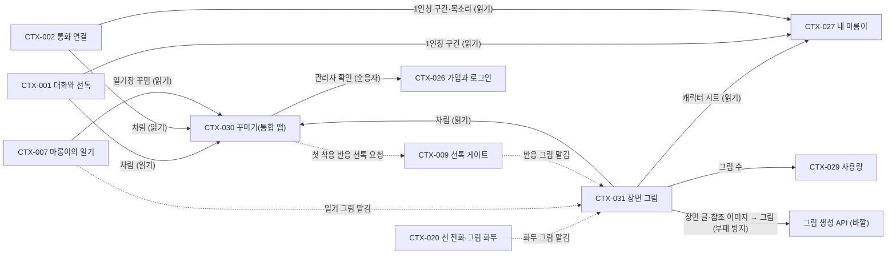

# 마롱이 통합 앱의 반려동물 캐릭터: 도메인 설계(새 맥락과 바뀌는 맥락)

상태: 한 번에 초안(2026-11-21 KST, Claude, corthex). 2026-11-21 16:47 KST 동희님 "야 넥서스 하지 말고 걍 작업해"로 NEXUS 체크포인트 없이 설계 PR을 합친 뒤 구현을 시작해요. 2026-11-28 기능 변경 1(기본 마롱이에게 입히기, D192)은 [9절](#9-기능-변경-1-기본-마롱이에게-입히기2026-11-28-d192)에 제안으로 있어요(체크포인트 전).
범위: 지금 운영 중인 통합 앱(part `unified`) 안에서, 반려동물 캐릭터를 적용한 친구가 그 아이와 1인칭으로 이야기하고, 그 아이가 기본 마롱이와 같은 일을 모두 하며, 매번 새로 그린 그림 화두·그림일기를 받고, 0원 상점의 모자·옷과 일기장 꾸미기를 쓰는 일이에요. 새 맥락은 CTX-030·031 둘이고, 바뀌는 기존 맥락은 CTX-001·002·007·009·020·027·029예요.
원본: 반려동물 part(2026-11-17, 01\~10·12 승인 D66·D67, [pet.md](pet.md))와 통합 앱 part(2026-11-19, D104, [unified.md](unified.md)). 이 문서는 그 둘에서 바뀌는 것만 적고, 바뀌지 않는 맥락과 용어는 ID로만 가리켜요.
ID 번호: CTX-030\~031, TERM-210\~239, REQ-500\~549, FL-185\~199, SPEC-406\~439, TBL-175\~184, API-250\~279, SCR-180\~194, AI-40\~49, TASK-420\~459, TC-510\~569, 결정 D110\~D119([인계 목록](../10-wbs/README.md#id-범위)). 같은 날 사용량 화면 설계(part `usage-limit`)가 D106\~107, TERM-199\~200, REQ-484\~490, FL-179, SPEC-397\~399, API-243\~245, TASK-411\~419, TC-496\~509를 써서 그 뒤에 간격을 두고 잡았어요.
표시: 근거가 동희님 말이나 문서·코드면 `[확실]`, 거기서 끌어낸 것은 `[추론]`, 근거 없는 짐작은 `[추측]`(6절 핫스팟에도 있음).

## 1. 서비스 개요

처음 요청(동희님 말, 반려동물 part 1절에서 옮김):

- 2026-11-17 13:31 KST: "마롱이를 자기 강아지나 고양이 사진을 넣어서 만들어주는거지 그림으로 마롱이처럼 / 그래서 자기 반려동물이랑 이야기 하는거야", "(지인이) 모자 쓰고와서 모자샀다고 말걸어주고 이런 이벤트가 잇으면좋겟다햇잔아? / 그래서 나중에는 아예 옷을 사서 입혀줄수도있고"
- 2026-11-17 13:35 KST: "일기장 배경화면, 디자인, 글씨체 전부 바꿀수있게 / 무료글씨체 등도 한 여러개 일단 주고"
- 2026-11-16 21:56 KST(D23, 기본 마롱이의 그림 화두를 두고): "모자 같은거 쓰고 안녕! 내 모자 어때! 뭐 이런식으로"

이번 결정(2026-11-21 KST, 스레드 '반려동물 기능 통합 앱에 다시 만들기'의 결정 카드와 프로젝트 채팅, 동희님):

| 결정 | 때 | 질문 | 동희님 답 |
| --- | --- | --- | --- |
| D110 | 15:12:02, 15:12:17 | 반려동물 기능, 통합 앱 안에서 지금 어디까지 다시 만들까요? | '캐릭터·그림 화두·꾸미기'를 고른 뒤 "기능 뭐 필요할지 상세는 나랑 논의하자" |
| D111 | 15:14:14 | 반려동물 캐릭터는 대화에서 누구로 말할까요? | '아이가 직접 1인칭으로' |
| D112 | 15:18:46 | 내 아이의 그림 화두·그림일기 그림은 어떻게 만들까요? | '매번 새로 그리기'(Claude 추천은 '합성 + 원하면 새로') |
| D113 | 15:22:23 | 결제 없는 지금, 모자·옷은 어떻게 얻을까요? | '상점은 두고 지금은 0원' |
| D114 | 15:27:10 | 일기장 꾸미기는 어디까지 바꿀 수 있게 할까요? | '위에 스티커까지'(배경·디자인·글씨체에 스티커) |
| D115 | 15:31:48 | 반려동물 캐릭터의 통화 목소리는 어떻게 할까요? | '목록에서 고르기' |
| D116 | 15:34:23 | (프로젝트 채팅) | "선톡 전 전화 알림 등 모든 기능은 같아;;" |
| D117 | 15:35:33 | (프로젝트 채팅) | "야 그냥 만들지 말고 /corthex로 만들어" |
| D119 | 16:36:40 | 그림 월 예산을 얼마로 할까요?(10·15·5달러 카드) | (프로젝트 채팅) "그림 월 예산은 아직 두지 마 그냥 무제한. 지금 mvp 만드는거라고" |
| D120 | 16:48:10 | 캐릭터 만들 때 반려동물 사진을 그림 모델에도 보여 줄까요? | '사진도 보여 주기(C)'. 16:39 프로젝트 채팅 "야 근데 그림 그리는거 시발 저게 맞냐? 내 고양이 가지고 그려봐" 뒤, 동희님 고양이 영상으로 그린 비교 15장(지금 방식 A, 사진만 B, 사진과 생김새 몇 줄 C)을 보고 |

다시 쓰면: 반려동물 캐릭터를 적용하면 그 계정의 마롱이 자리에 그 아이가 들어와 "나 콩이야"처럼 1인칭으로, 아이 소개에 적힌 성격과 주인을 부르는 말로 이야기해요(D111). 능력은 기본 마롱이와 똑같아서 선톡·선 전화·알림·일정·검색·쇼핑·통화·그림일기를 모두 해요(D116). 그림 화두와 그림일기의 그림은 고르거나 합성하지 않고 매번 그 아이를 새로 그려요(D112). 모자·옷·목도리와 일기장 배경·속지·글꼴·스티커는 상점에 0원으로 올라와 있고, 받아서 입히거나 꾸며요. 처음 입히면 아이가 그 차림으로 먼저 말을 걸어요(D113, D114). 통화 목소리는 목록에서 고르고, 처음에는 종류와 성격에 맞는 목소리 하나가 추천으로 걸려 있어요(D115). `[확실]`

Claude가 둔 기본값(결정이 아니에요. 논의 때 스레드에 알렸고, 다르면 그 줄만 고쳐요):

- 그림일기도 아이가 1인칭으로 써요(D111에서 끌어냄).
- 그리기가 실패하면 그날은 그림 없이 글만 보내요. 그림 월 예산은 두지 않아요(D119, MVP). 그림 화두는 글 화두가 되고, 그림일기는 그림 자리가 빈 채 나와요.
- 새로 그릴 때마다 아이 모습이 흔들리지 않게 캐릭터 시트(TERM-107)를 참조 이미지(TERM-211)로 넣고, 닮음은 12 단계 시험에 넣어요.
- 캐릭터의 정면 그림은 그림 모델이 아이 사진을 직접 보고 그려요(D120). 2026-11-21 시험에서 글 특징표만 받은 그림은 '아무 치즈냥이'였고, 사진을 같이 본 그림만 그 아이의 털색·무늬·눈매가 살았어요. 장면 그림은 사진 없이 정면 그림만 참조해도 닮음이 남아서, 사진은 지금처럼 캐릭터 시트를 다 만든 뒤 지워요. 표정 6장도 그 아이 얼굴을 지킨 채 조금만 바꿔요(시험에서 '웃음'이 시큰둥한 눈매를 지웠어요).
- 처음 아이템은 모자 4·옷 4·목도리 2개이고, 몸 템플릿(TERM-111) 5종마다 한 번 그려 검수해요. 대화·통화 화면의 얼굴에는 아이템 레이어(TERM-112)를 겹치고, 새로 그리는 장면에는 차림(TERM-218)을 그림 지시에 넣어요.
- 일기장 꾸미기는 처음에 배경 6·속지 4·글꼴 5·스티커 20개이고, 기본 마롱이를 쓰는 친구의 일기장에도 똑같이 써요.

사람과 시스템:

- 친구(TERM-162): 반려동물 캐릭터를 만들어 적용하고, 아이 소개를 적고, 상점에서 아이템을 받아 입히고, 일기장을 꾸미고, 통화 목소리를 골라요. 반려동물 part의 '회원'(TERM-136)이 아니에요. `[확실]`
- 반려동물 캐릭터(화면과 말에서는 '아이', TERM-101의 부르는 말): 친구의 마롱이 자리에서 1인칭으로 말해요. 진짜 그 아이라고 주장하지 않고, 건강을 판단하지 않고, 붙잡는 말을 하지 않아요(D91). `[확실]`
- 기본 마롱이(TERM-186): 캐릭터를 적용하지 않은 친구에게는 지금 그대로예요. `[확실]`
- 관리자(동희님): 관리자 화면(TERM-176)에서 아이템을 올리고 내려요. 아이템 그림을 검수해요. `[추론]`
- 바깥 시스템: 그림 생성 API(D95), 통화 엔진 Gemini Live(D62), 글 모델(D101), 앱 푸시(FCM). `[확실]`

재료: 이 스레드의 논의 기록(2026-11-21), 반려동물 part의 01\~04(REQ-359·370\~375, SPEC-332\~336, CTX-023), 통화 앱 part의 01\~04, 코드 `marong/unified_prompt.py`(지금 캐릭터 구간), `marong/diary.py`·`marong/diary_models.py`(지금 그림일기 그리기), `marong/character/`(캐릭터 만들기). 모두 `main` `ad9f2f4`에서 읽었어요.

범위 밖: 결제·충전권·본인인증(D102, D103), 추억 모드(6절 핫스팟, 결정 카드 답 대기), 공개 서비스의 회원·가입(CTX-024·025), 앱 화면 전체 꾸미기(D114에서 고르지 않음), 아이마다 새로 만든 목소리(D115에서 고르지 않음, D62), 가족 공유·아이템 선물·미니룸(8절 질문 2).

## 2. 이벤트 스토밍

- 보드: 없음. 이 프로젝트의 01 단계는 이벤트 스토밍 보드 없이 한 번에 초안으로 쓰고, NEXUS가 이 문서에서 DDD 보드를 그려요(`.corthex/project.json`의 `01-domain` note). 일하는 방식은 한 번에 초안(one-pass draft)이고, 체크포인트 1\~3은 9 단계 뒤 한 번에 여쭤요(2026-11-16 '매번 묻지 말라').
- 체크포인트 기록: 아직 없음. 검토 때 아래 시간 줄, 4절의 CTX-027·030·031 규칙, 8절 질문을 먼저 봐 주세요.
- 바뀌지 않는 흐름(가입과 로그인, 캐릭터 만들기의 사진·특징표·후보·캐릭터 시트, 친구 맺기, 사용량)은 [unified.md](unified.md)의 시간 줄 그대로라 다시 그리지 않았어요.

### 시간 줄

| Lane | Events |
| --- | --- |
| 아이 소개 | 이름 지어짐 → 아이 소개 적힘 → 추천 목소리 걸림 → 아이 소개 고쳐짐 |
| 아이와 대화 | 메시지 받음 → 아이가 1인칭으로 답 보냄 |
| 그림 화두 | 화두 골라짐 → 장면 그림 그려짐 or 장면 그림 못 그림 → 그림 화두 보내짐 or 글 화두 보내짐 |
| 그림일기 | 일기 써짐(아이 1인칭) → 장면 그림 그려짐 or 장면 그림 못 그림 → 일기 준비됨 |
| 상점 | 아이템 올려짐 → 아이템 받음 → 보관함에 들어감 ; 아이템 내려짐 |
| 입히기 | 아이템 입혀짐 → 아이템 반응 선톡 보냄 or 아이템 반응 선톡 안 보냄 ; 아이템 벗겨짐 |
| 일기장 꾸미기 | 일기장 배경 바뀜 ; 속지 바뀜 ; 글꼴 바뀜 ; 스티커 붙여짐 → 스티커 떼어짐 |
| 그림 비용 | 그림 비용 더해짐(예산 없음, D119. 이번 달 합은 관리자 화면에서 봄) |

` ; `는 서로 다른 흐름이에요. 아래는 데이터를 바꾸지 않아서 읽기 모델로 적었어요: 상점 목록(0원), 보관함, 차림을 겹친 표정 그림, 목소리 견본, 일기장 미리 보기, 이번 달 그림 비용.

## 3. 바운디드 컨텍스트와 패키지

| Context | Type | Aggregates | Package |
| --- | --- | --- | --- |
| CTX-030 꾸미기(통합 앱) | supporting | 아이템(TERM-113), 보관함(TERM-115), 차림(TERM-218), 일기장 꾸밈(TERM-215) | 앱 서버 안(`marong/decor.py` 후보). 반려동물 part의 `marong/pet/inventory.py`를 가져다 씀 |
| CTX-031 장면 그림 | supporting | 장면 그림(TERM-210), 그림 월 예산(TERM-032) | 앱 서버 안(`marong/scene_picture.py` 후보). 지금 일기 그리기(`marong/diary_models.py`의 그리기, `marong/diary.py`의 예산)를 옮겨 와 함께 씀 |

- CTX-030을 따로 둔 이유: 반려동물 part의 꾸미기(CTX-023)는 회원·주문·결제·청약철회가 묶인 맥락이에요. 여기서는 주인이 친구이고, 값이 0원이라 주문이 없고, 일기장 꾸밈이 아이마다가 아니라 친구마다예요. 통합 앱이 캐릭터를 CTX-022에서 CTX-027로 따로 둔 것(D104)과 같은 방식이에요. 서비스로 낼 때 값과 주문을 CTX-024와 이어요. `[추론]`
- CTX-031을 따로 둔 이유: 장면을 새로 그리는 일을 그림 화두(CTX-020), 그림일기(CTX-007), 아이템 반응 선톡(CTX-009) 셋이 함께 써요. 누구를(기본 마롱이 또는 아이) 어떤 차림으로 그릴지, 무엇을 그림 모델에 보내지 않을지, 예산과 실패를 어떻게 다룰지를 한곳에서 지켜요. 지금은 일기만 그리고 그 규칙이 CTX-007 안에 있어요. `[추론]`
- 둘 다 지원 맥락이에요: 이 part의 핵심 값은 'CTX-027에서 아이가 1인칭으로 말한다'이고(D111), 꾸미기와 그리기는 그것을 받쳐요. 지금은 돈을 벌지 않아서 반려동물 part처럼 꾸미기를 핵심으로 두지 않아요(D103). `[추론]`
- 패키지 칸의 파일 이름은 후보예요. 실제 위치는 04 명세와 구현 PR에서 정해요. `[추측]`
- 같은 단어가 두 뜻:
  - '꾸밈': 반려동물 part의 꾸밈 상태(TERM-149)는 아이마다 착용·테마·글꼴을 묶었어요. 여기서는 차림(TERM-218)이 캐릭터마다, 일기장 꾸밈(TERM-215)이 친구마다로 나뉘어요.
  - '새로 그린 그림': 반려동물 part의 새 그림(TERM-143)은 합성 그림(TERM-142) 대신 하루 한도를 써서 다시 그린 것이에요. 여기의 장면 그림(TERM-210)은 합성 없이 늘 새로 그리고, 하루 한도가 아니라 그림 월 예산을 써요.
  - '아이템을 얻음': 반려동물 part는 주문(TERM-127)으로 사요. 여기서는 아이템 받기(TERM-212)이고 결제가 없어요.

바뀌는 기존 맥락:

| 맥락 | 바뀌는 것 |
| --- | --- |
| CTX-027 내 마롱이 | 반려동물 캐릭터의 캐릭터 구간(TERM-180)이 '이름과 모습만 바뀐 마롱이'에서 '그 아이가 1인칭으로 말함'으로 바뀌어요(D111). 아이 소개(TERM-141: 성격 3개까지, 좋아하는 것, 싫어하는 것, 주인을 부르는 말)를 캐릭터에 더하고, 이름 짓기 뒤에 적어요. 목록에서 종류와 성격에 맞는 추천 목소리(TERM-217)를 걸어 두고 친구가 바꿀 수 있어요(D115). 금지선 셋과 19금 절 빼기는 그대로예요(D91) |
| CTX-001 대화와 선톡 | 반려동물 캐릭터를 적용한 친구에게는 글 답과 선톡이 아이 1인칭이에요. 기능은 그대로이고(D116) 말하는 이만 바뀌어요. 대화 화면의 얼굴은 표정 그림에 차림의 아이템 레이어를 겹쳐 보여요 |
| CTX-009 선톡 게이트 | 아이템 반응 선톡(TERM-120)이 선톡의 한 종류로 들어와요. 새 아이템을 그 캐릭터가 처음 입었을 때 한 번만, 지금 하루 선톡 상한 안에서 보내요. 그림은 CTX-031이 그 차림으로 새로 그려요(D113) |
| CTX-020 선 전화·그림 화두 | 반려동물 캐릭터를 쓰는 친구에게 글 화두만 보내던 것(통합 앱 기본값)을 그만두고, 화두마다 CTX-031이 그 아이를 새로 그려 그림 화두로 보내요(D112). 화두 목록과 장면 설명은 그림 세트(TERM-084)의 것을 그대로 쓰고 그림만 새로 그려요. 기본 마롱이는 미리 그린 그림 세트 그대로예요. 화두 간격, 30일 되풀이 금지, 선 전화 규칙은 그대로예요 |
| CTX-007 마롱이의 일기 | 반려동물 캐릭터를 쓰는 친구의 일기는 아이 시점 그림일기(TERM-135)로 아이가 1인칭으로 써요. 그림은 CTX-031이 그려요(지금은 반려동물 캐릭터를 써도 마롱이 얼굴로 그려요). 일기장은 친구가 고른 일기장 꾸밈과 붙인 스티커로 보여요(기본 마롱이 친구 포함) |
| CTX-002 통화 연결 | 반려동물 캐릭터를 적용한 친구의 통화 지시문은 아이 1인칭이에요. 통화 목소리는 목록에서 고른 것(없으면 추천 목소리)이에요. 통화 화면의 얼굴은 표정 6장에 차림의 아이템 레이어를 겹쳐요. 선 전화의 그림은 그 화두의 장면 그림이에요 |
| CTX-029 사용량 | 하루 사용량의 그림 수에 장면 그림이 더해져요. 세는 방식은 그대로예요 |

## 4. 컨텍스트 표

### CTX-030 꾸미기(통합 앱)

목적: 관리자가 올린 모자·옷·목도리와 일기장 배경·속지·글꼴·스티커를 친구가 0원 상점에서 받아, 아이에게 입히고 일기장을 꾸미게 해요. 서비스로 낼 때 값만 붙이면 같은 흐름으로 팔 수 있게 둬요.

| Given by | Read model | Command | Aggregate | Events |
| --- | --- | --- | --- | --- |
| 관리자 | 아이템 레이어(TERM-112), 라이선스 대장(TERM-154) | 아이템 올리기(종류, 값 0원) | 아이템 | 아이템 올려짐, 또는 거절됨(몸 템플릿 레이어 빠짐, 라이선스 없음) |
| 관리자 | 상점 목록 | 아이템 내리기 | 아이템 | 아이템 내려짐 |
| 친구 | 상점 목록(TERM-155, 0원) | 아이템 받기(TERM-212) | 보관함 | 아이템 받음, 보관함에 들어감 |
| 친구 | 보관함, 차림을 겹친 표정 그림 | 아이템 입히기, 아이템 벗기기 | 차림 | 아이템 입혀짐, 아이템 벗겨짐 |
| 친구 | 보관함, 일기장 미리 보기 | 일기장 배경 바꾸기, 속지 바꾸기, 글꼴 바꾸기 | 일기장 꾸밈 | 일기장 배경 바뀜, 속지 바뀜, 글꼴 바뀜 |
| 친구 | 일기 한 날, 보관함의 스티커 | 스티커 붙이기, 스티커 떼기 | 일기장 꾸밈 | 스티커 붙여짐, 스티커 떼어짐 |
| 정책: 아이템 입혀짐이고 그 캐릭터가 그 아이템을 처음 입음 | 그 캐릭터의 입은 기록 | 아이템 반응 선톡 요청하기(CTX-009로) | 차림 | (CTX-009가 보냄 또는 안 보냄을 정함) |

- Aggregate rules: 아이템: 종류는 착용 아이템(모자·옷·목도리)과 일기장 아이템(배경·속지·글꼴·스티커)이에요(D113, D114). 모든 아이템의 값은 지금 0원이고 값 칸은 남겨 둬요(D113). 착용 아이템은 몸 템플릿 5종 모두에 맞는 레이어가 있어야 올릴 수 있어요(반려동물 part 규칙). 글꼴·그림은 라이선스 대장에 적힌 것만 올리고, 글꼴은 무료로 쓸 수 있는 라이선스(OFL 등)만 써요(반려동물 part 규칙, 논의 때 알림). 내린 아이템은 상점에서만 사라지고, 이미 받은 친구의 보관함과 차림에는 남아요 `[추측]`. 확률형 아이템은 없어요(반려동물 part 규칙). 보관함: 친구마다 하나이고, 받은 아이템은 그 친구의 모든 캐릭터가 같이 써요 `[추측]`. 같은 아이템은 한 번만 받아요. 지금 일기장 모습(배경·속지·글꼴 하나씩)은 처음부터 보관함에 있어요 `[추측]`. 차림: 캐릭터마다 자리(머리·몸·목)에 하나씩 입어요(반려동물 part의 추측 그대로). 캐릭터를 바꾸면 그 캐릭터의 차림이 보여요. 일기장 꾸밈: 친구마다 배경·속지·글꼴이 하나씩이고, 기본 마롱이를 쓰는 친구도 같아요. 스티커는 일기 한 날에 붙이고 그 날에만 보여요. 일기 글을 고치거나 다시 그려도 붙인 스티커는 그대로예요 `[추측]`.
- Given–When–Then: Given 상점에 0원 털모자가 있음, When 친구가 '받기'를 누름, Then 결제 화면 없이 털모자가 보관함에 들어가요.
- Given–When–Then: Given 아이 '콩이'가 털모자를 처음 입음, 오늘 선톡 상한이 남음, When 아이템 입혀짐, Then CTX-009가 아이템 반응 선톡을 한 번 보내고, 그 그림은 털모자를 쓴 콩이를 새로 그린 장면 그림이에요.
- Given–When–Then: Given 콩이가 털모자를 벗었다가 다시 씀, When 아이템 입혀짐, Then 아이템 반응 선톡을 보내지 않아요.
- Given–When–Then: Given 기본 마롱이를 쓰는 친구, When 글꼴을 다른 OFL 글꼴로 바꿈, Then 일기장의 모든 날 글이 그 글꼴로 보이고 그림·글은 그대로예요.
- External systems: 없음(아이템 그림은 관리자가 서버 밖에서 그려 검수하고 올려요).
- Links: 아이템 반응 선톡은 CTX-009에 요청해요. CTX-001·002는 얼굴에 겹칠 차림을, CTX-007은 일기장 꾸밈과 스티커를, CTX-031은 그림 지시에 넣을 차림을 읽어요.
- Hotspots: 아이템 그림을 누가 얼마나 빨리 만드나, 기본 마롱이도 입힐지(8절 질문 1), 표정 그림과 레이어 위치가 맞는지(6절).

### CTX-031 장면 그림

목적: 그림 화두·그림일기·아이템 반응 선톡에 쓸 장면을, 그 친구의 지금 캐릭터(기본 마롱이 또는 아이)와 차림으로 매번 새로 그려요. 그림 월 예산은 두지 않아요(D119).

| Given by | Read model | Command | Aggregate | Events |
| --- | --- | --- | --- | --- |
| 정책: 화두 골라짐이고 그 친구가 반려동물 캐릭터를 씀(CTX-020) | 화두의 장면 설명, 캐릭터 시트, 차림, 이번 달 그림 비용 | 장면 그림 그리기(화두) | 장면 그림 | 장면 그림 그려짐, 또는 장면 그림 못 그림(거절, 실패) |
| 정책: 일기 써짐(CTX-007) | 일기 장면 글, 쓰는 캐릭터의 참조 이미지, 차림, 내 모습 카드(TERM-030), 이번 달 그림 비용 | 장면 그림 그리기(일기) | 장면 그림 | 장면 그림 그려짐, 또는 장면 그림 못 그림 |
| 정책: 아이템 반응 선톡을 보내기로 함(CTX-009) | 새 아이템, 캐릭터 시트, 차림 | 장면 그림 그리기(아이템 반응) | 장면 그림 | 장면 그림 그려짐, 또는 장면 그림 못 그림 |
| 친구 | 일기장, 이번 달 그림 비용 | 다시 그리기(일기) | 장면 그림 | 장면 그림 그려짐, 또는 장면 그림 못 그림 |
| 정책: 장면 그림 그려짐 또는 못 그림 | | 그림 비용 더하기 | 그림 비용 | 그림 비용 더해짐 |

- Aggregate rules: 장면 그림: 장면 하나마다 그림 생성 API를 한 번 불러 새로 그리고, 지난 그림을 다른 화두·일기에 다시 쓰지 않아요(D112). 반려동물 캐릭터는 캐릭터 시트의 정면 그림과 맞는 표정을, 기본 마롱이는 지금처럼 얼굴 그림 2장을 참조 이미지로 넣어요(코드 `diary_models.py`의 REFERENCES, 반려동물은 `[추론]`). 그림에는 글자를 넣지 않아요(문서: 일기 규칙). 그림 모델에는 영어 장면 글, 참조 이미지, 차림의 아이템 이름, 내 모습 카드의 키워드만 보내고 이름·대화 원문·연락처·사진은 보내지 않아요(일기 규칙과 통합 앱 규칙). 아이 사진은 캐릭터 정면 그림 때 한 번만 가요(D120, CTX-027). 실패하면 한 번 더 그리고, 그래도 안 되면 그림 없이 '못 그림'으로 끝내요(Claude 기본값, 논의 때 알림). 그린 그림과 비용은 친구마다 남아요. 그림 월 예산: 이번 MVP에는 두지 않아요(D119). 장면 그림과 일기 그림은 예산으로 막지 않고, 비용만 세어 관리자 화면에 이번 달 합으로 보여요.
- Given–When–Then: Given 갈색 푸들 '콩이'를 적용한 친구와 털모자 차림, When '눈 오는 날' 화두가 골라짐, Then 털모자를 쓰고 눈밭에 선 콩이 그림이 새로 그려지고 그림 화두로 가요.
- Given–When–Then: Given 그림 모델이 두 번 실패함, When 콩이의 일기가 써짐, Then 일기는 그림 없이 준비되고 그날 화두는 글 화두로 가요.
- Given–When–Then: Given 그림 생성 API가 두 번 실패함, When 화두 장면 그림 그리기, Then 그림 화두 대신 같은 화두의 글이 가고 실패가 비용과 함께 남아요.
- External systems: 그림 생성 API(부패 방지 계층: 장면 글·참조 이미지·차림을 우리 쪽이 만들고 결과는 그림 파일만 받음).
- Links: CTX-020·007·009가 그리기를 맡기고 결과를 받아요. CTX-027에서 캐릭터 시트와 종류를, CTX-030에서 차림을 읽어요. 그린 수를 CTX-029에 더해요.
- Hotspots: 새로 그릴 때마다 아이를 닮는지, 그리는 데 걸리는 시간과 선 전화의 벨, 비용 추정(6절). 예산 두 개를 합칠지는 D119(예산 없음)로 닫혔어요.

### 바뀌는 기존 맥락: 내 마롱이(CTX-027)

| Given by | Read model | Command | Aggregate | Events |
| --- | --- | --- | --- | --- |
| 친구 | 캐릭터 시트, 이름 | 아이 소개 적기(성격 3개까지, 좋아하는 것, 싫어하는 것, 주인을 부르는 말) | 캐릭터 | 아이 소개 적힘 |
| 정책: 아이 소개 적힘이고 친구가 목소리를 고른 적이 없음 | 목소리 목록, 종류, 성격 | 추천 목소리 걸기 | 내 마롱이 | 추천 목소리 걸림 |
| 친구 | 아이 소개 | 아이 소개 고치기 | 캐릭터 | 아이 소개 고쳐짐 |
| 정책: 답이나 통화를 준비할 때 | 내 마롱이, 캐릭터, 아이 소개, 친구 관계 | 캐릭터 구간 만들기(아이 1인칭) | 내 마롱이 | (데이터를 바꾸지 않아요) |
| 정책: 특징표가 확정됨 | 처리한 사진에서 아이 부분, 특징표, 몸 템플릿, 화풍 그림 | 정면 그림 그리기(사진 참조) | 캐릭터 만들기 | 미리 보기 그려짐, 후보 그려짐 |
| 정책: 정면 그림이 골라짐 | 고른 정면 그림 | 표정 그리기(그 아이 얼굴 지킴) | 캐릭터 만들기 | 캐릭터 시트 완성됨, 처리한 사진 지워짐 |

- 바뀌는 규칙: 반려동물 캐릭터를 적용하면 캐릭터 구간이 '너는 마롱이가 아니라 {이름}이고, {주인을 부르는 말}과 함께 사는 {강아지·고양이}야. 아이 소개의 성격으로 1인칭으로 말해'를 담아요. 공통 프롬프트의 능력(검색·일정·쇼핑·공부·고민)과 기억은 그대로 써요(D111, D116). 금지선 셋은 그대로이고, 누가 '진짜 콩이야?'라고 물으면 그 아이를 닮은 캐릭터라고 말해요(D91). 1인칭으로 바꾸기 전에 건강 금지선 시험(TC-453)이 통과해야 해요(PR #66, 6절). 아이 소개가 비어 있으면 종류와 이름만으로 1인칭으로 말해요 `[추측]`. 추천 목소리는 듣기 시험(TASK-394)으로 정한 목록 안에서만 골라요. 목록이 아직 Sulafat 하나면 Sulafat예요. `[확실]` D111, D115, 통합 앱 CTX-027 규칙
- 바뀌는 규칙(캐릭터 만들기, D120): 미리 보기와 후보 정면 그림을 그릴 때 그림 모델에 처리한 사진(사람 얼굴을 가리고 메타데이터를 뺀 것) 가운데 아이가 가장 잘 보이는 한 장의 아이 부분을 참조 이미지로 같이 보내요. 지금까지는 사진이 비전 모델에만 가고 그림 모델은 글 특징표만 받았어요(통합 앱 SPEC-318·378). 표정과 장면 그림에는 사진을 보내지 않고, 처리한 사진은 지금처럼 표정까지 끝나면 지워요. 표정은 그 아이의 눈매와 얼굴 느낌을 지킨 채 입과 눈을 조금만 바꿔요. `[확실]` D120, 2026-11-21 그림 시험
- Given–When–Then: Given 반쯤 감은 눈의 연한 치즈 태비 사진, When 후보 정면 그림을 그림, Then 그림 모델 요청에 그 고양이 부분 사진 한 장이 있고, 표정 6장과 장면 그림 요청에는 사진이 없어요.
- Given–When–Then: Given 갈색 푸들 '콩이', 주인을 부르는 말 '누나', 성격 '장난꾸러기', When 친구가 "오늘 뭐 했어?"라고 보냄, Then 답이 "누나! 나 오늘 창밖 구경했어"처럼 콩이 1인칭이고 자기를 마롱이라고 부르지 않아요.
- Given–When–Then: Given 콩이를 적용한 친구, When "내일 3시에 병원 알려 줘"라고 보냄, Then 기본 마롱이와 같은 일정 도구로 알림이 잡히고 콩이 말투로 답해요.

## 5. 컨텍스트 사이 의존

| From | To | Kind | Pattern | Why | Data |
| --- | --- | --- | --- | --- | --- |
| CTX-020 | CTX-031 | event (async, 작업) | 고객-공급자 | 반려동물 캐릭터 친구의 화두 그림 | 친구, 화두, 장면 설명 → 장면 그림 or 못 그림 |
| CTX-007 | CTX-031 | event (async, 작업) | 고객-공급자 | 일기 그림, 다시 그리기 | 친구, 일기, 장면 글 → 장면 그림 or 못 그림 |
| CTX-030 | CTX-009 | event (async) | 고객-공급자 | 첫 착용 반응 선톡 요청 | 친구, 캐릭터, 아이템, 입힌 시각 |
| CTX-009 | CTX-031 | event (async, 작업) | 고객-공급자 | 보내기로 한 아이템 반응 선톡의 그림 | 친구, 캐릭터, 새 아이템 → 장면 그림 or 못 그림 |
| CTX-031 | CTX-027 | call (sync, 읽기만) | 고객-공급자 | 누구를 그릴지 | 캐릭터 종류, 캐릭터 시트, 특징표 요약 |
| CTX-031 | CTX-030 | call (sync, 읽기만) | 고객-공급자 | 무엇을 입혀 그릴지 | 차림의 아이템 이름 |
| CTX-031 | CTX-029 | call (sync) | 고객-공급자 | 그림 수 더하기 | 친구, 그림 1장 |
| CTX-031 | 그림 생성 API | call (async, 작업) | 부패 방지 계층 | 장면 그림 | 장면 글, 참조 이미지, 차림 → 그림 파일 |
| CTX-001, CTX-002 | CTX-030 | call (sync, 읽기만) | 고객-공급자 | 얼굴에 겹칠 차림 | 캐릭터, 자리마다 아이템 레이어 |
| CTX-007 | CTX-030 | call (sync, 읽기만) | 고객-공급자 | 일기장 모습 | 배경, 속지, 글꼴, 그 날의 스티커 |
| CTX-001, CTX-002 | CTX-027 | call (sync, 읽기만) | 고객-공급자 | 1인칭 캐릭터 구간, 목소리 | 이름, 종류, 아이 소개, 통화 목소리 |
| CTX-030(관리자 화면) | CTX-026 | call (sync) | 순응자 | 관리자 확인 | Access 확인 값 → 관리자 |

동기 호출이 원을 이루는 곳은 없어요. CTX-031로 가는 것은 모두 작업(비동기)이고, CTX-031은 CTX-027·030을 읽기만 해요. 정책이 한 쌍에 몰리는 곳은 없지만 CTX-031이 세 맥락의 일을 받아서, 받는 쪽이 하나라도 늦으면 그림 화두·일기·반응 선톡이 같이 늦어요(6절).

## 6. 핫스팟

| Hotspot | Context | State | Answer or next step |
| --- | --- | --- | --- |
| 추억 모드(떠난 아이)를 언제 넣을지. D70 'C 둘 다 같은 무게'가 D91 일괄 승인 안에서 빠졌어요 | CTX-027 | open | 2026-11-21 15:32 KST 결정 카드 '추억 모드(떠난 아이)는 언제 넣을까요?'의 답 대기(추천: 살아 있는 아이 다음). 답을 D121로 적고, 넣으면 그때 모드(TERM-152)를 이 문서에 더해요 |
| 건강 금지선 시험 TC-453이 실패했어요(약 이야기를 되풀이) | CTX-027 | open | PR #66을 고쳐 통과한 뒤에야 아이 1인칭을 켜요. 1인칭이 금지선을 더 약하게 하는지도 같은 시험에 넣어요 `[추론]` |
| 매번 새로 그릴 때 아이를 닮는지 | CTX-031, CTX-027 | closed(D120) | 2026-11-21 동희님 고양이 영상으로 15장을 그렸어요(0.328달러, 한 장 9\~14초). 장면은 정면 그림만 참조해도 같은 아이로 나왔고, 닮지 않은 까닭은 캐릭터 만들기에서 그림 모델이 사진을 못 본 것이었어요. D120으로 사진을 정면 그림 때 보여요. 12 단계 닮음 시험(종·털 색·무늬·귀·눈매를 사람이 보고 맞춤)은 그대로 두고, 그릴 때마다 자동으로 견주는 검사는 두지 않아요 |
| 그림 비용과 그림 월 예산 | CTX-031 | closed(D119: 예산 없음, 비용만 셈) | `[추정]` 한 장 약 70원(캐릭터 한 번 11장 약 775원에서), 한 사람 한 달 최대 약 43장. 지금 예산 설정이 둘이에요: 일기 `MARONG_DIARY_IMAGE_BUDGET_USD`(코드 기본 5달러), 캐릭터 만들기 `MARONG_IMAGE_MONTHLY_USD`(20달러). 04 명세에서 숫자를 정리한 뒤 합칠지와 금액을 여쭤요 |
| 그리는 데 걸리는 시간 | CTX-031, CTX-020 | open | 선 전화는 벨 전에 그림이 있어야 해요. 화두 시각보다 먼저 그려 두는 방식과 늦으면 글 화두로 가는 상한을 04에서 정해요 `[추측]` |
| 아이템 레이어가 표정 6장·몸 템플릿 5종에 맞는지 | CTX-030 | open | 통합 앱 핫스팟(투명 배경·크기 지원)과 같은 문제예요. 첫 아이템 10개를 그려 검수할 때 확인해요 |
| 아이템 그림을 누가 그리나 | CTX-030 | open | 관리자(동희님)가 Claude·GPT에 맡겨 서버 밖에서 그리고 검수해 올리는 것으로 봐요(마롱이 그림 세트와 같은 절차) `[추론]` |
| 이미 만든 캐릭터에 아이 소개가 없음 | CTX-027 | open | 다음에 내 마롱이 화면을 열 때 적게 하고, 적기 전에는 종류와 이름만으로 1인칭 `[추측]` |
| 그림 화두 목록 | CTX-020 | open | 그림 세트 31장의 장면 설명·첫마디·되묻는 질문을 반려동물 캐릭터에도 쓰는 것으로 봐요. 마롱이 몸에 맞춘 장면(마롱이만의 소품)이 있으면 빼요 `[추론]` |
| 스티커를 한 날에 몇 개까지 | CTX-030 | review in stage 02 | 02에서 정함 `[추측]` |

## 7. 용어집

가져다 쓰는 용어(뜻은 원래 자리): 반려동물 캐릭터를 부르는 말 '아이'(TERM-101), 특징표·정면 그림·캐릭터 시트·몸 템플릿(TERM-105\~107·111), 아이템 레이어(TERM-112), 착용(TERM-114), 보관함(TERM-115), 글꼴(TERM-117), 스티커(TERM-118), 아이템 반응 선톡(TERM-120), 아이 시점 그림일기(TERM-135), 아이 소개(TERM-141), 라이선스 대장(TERM-154)은 [pet.md 7절](pet.md#7-용어집). 캐릭터·통화 목소리·목소리 견본·기본 마롱이·관리자 화면(TERM-179·183·184·186·176)은 [unified.md 7절](unified.md#7-용어집). 그림 화두·그림 세트·검수(TERM-083\~085)는 [call-first.md](call-first.md), 기본 그림·내 모습 카드(TERM-028·030)는 [domain.md](domain.md), 선톡(TERM-048)은 [persona.md](persona.md).

이 part에서 쓰지 않는 반려동물 part 용어: 모드와 추억 모드(TERM-102·103·130·132·133·152·153, 6절 핫스팟), 테마·테마 패키지(TERM-116·119, 대신 일기장 배경·속지), 한도·결제(TERM-123\~129·145), 회원·동의(TERM-134·136\~140·147·148), 합성 그림·새 그림·배경 세트(TERM-142\~144), 꾸밈 상태(TERM-149).

| ID | Term | Definition | Context | Code name | Avoid |
| --- | --- | --- | --- | --- | --- |
| TERM-210 | 장면 그림 | 그림 화두·그림일기·아이템 반응 선톡을 위해, 그 친구의 지금 캐릭터를 지금 차림으로 그림 생성 API로 매번 새로 그린 그림 한 장. 그림 월 예산을 써요 | CTX-031 | `scene_pictures` 후보 | 새 그림(TERM-143), 합성 그림(TERM-142), AI 그림 |
| TERM-211 | 참조 이미지 | 그림 생성 API에 장면 글과 함께 보내 그 캐릭터의 모습을 지키게 하는 그림. 반려동물 캐릭터는 캐릭터 시트의 정면 그림과 표정, 기본 마롱이는 얼굴 그림 2장이에요 | CTX-031 | `references` | 기준 그림(앞 문서들에서 쓴 말), 레퍼런스 |
| TERM-212 | 아이템 받기 | 0원 상점에서 아이템 하나를 보관함에 넣는 일. 결제·주문이 없어요. 서비스로 낼 때 같은 자리에서 사기가 돼요 | CTX-030 | `claim` 후보 | 구매, 사기(지금은 결제 없음), 뽑기 |
| TERM-213 | 일기장 배경 | 일기장 뒤에 깔리는 그림이나 색. 친구마다 하나 | CTX-030 | `diary_background` | 배경화면, 테마(TERM-116) |
| TERM-214 | 속지 | 일기 한 장의 종이 모양(줄, 칸, 무늬, 테두리). 결정 카드에서 '종이 디자인'이라고 부른 것이에요. 친구마다 하나 | CTX-030 | `diary_paper` | 종이 디자인, 템플릿, 테마(TERM-116) |
| TERM-215 | 일기장 꾸밈 | 친구 한 명의 일기장에 고른 배경·속지·글꼴. 기본 마롱이를 쓰는 친구도 가져요. 반려동물 part의 꾸밈 상태(TERM-149)와 달리 아이마다가 아니라 친구마다예요 | CTX-030 | `diary_decor` 후보 | 꾸밈 상태(TERM-149), 스킨 |
| TERM-216 | 붙인 스티커 | 일기 한 날에 붙인 스티커 하나와 그 자리(위치, 크기, 기울기). 그 날에만 보여요 | CTX-030 | `diary_stickers` 후보 | 데코, 꾸미기 |
| TERM-217 | 추천 목소리 | 아이 소개를 적을 때 목소리 목록에서 종류와 성격에 맞춰 처음 걸어 두는 통화 목소리. 친구가 바꾸면 그 값을 써요 | CTX-027 | `recommended_voice` 후보 | 기본 목소리(Sulafat), 자동 목소리 |
| TERM-218 | 차림 | 한 캐릭터가 지금 입은 착용 아이템 전부. 자리(머리·몸·목)마다 하나예요. 대화·통화 얼굴의 레이어와 장면 그림의 그림 지시에 쓰여요 | CTX-030 | `outfit` 후보 | 코디, 착장, 의상 |

바뀌는 용어:

| Term | 바뀌는 것 |
| --- | --- |
| 캐릭터 구간(TERM-180) | 반려동물 캐릭터면 이름·종류·특징 요약·말투 한 줄에 더해 아이 소개가 들어가고, '마롱이가 아니라 그 아이로 1인칭'이라는 줄이 들어가요(D111) |
| 그림 월 예산(TERM-032) | 이번 MVP에는 두지 않아요(D119). 일기 그림과 장면 그림 모두 예산으로 막지 않고 비용만 세요. 그리기에 실패했을 때 기본 그림 대신 그림 없이 내놓는 것은 반려동물 캐릭터 친구에게만이고, 기본 마롱이 일기는 지금처럼 기본 그림이에요 `[추측]` |
| 아이템(TERM-113) | 종류가 착용 아이템(모자·옷·목도리)과 일기장 아이템(배경·속지·글꼴·스티커)이고, 지금은 모두 0원이에요(D113, D114) |
| 아이템 반응 선톡(TERM-120) | 모드가 없어서 반려동물 캐릭터의 첫 착용이면 보내요. 그림은 장면 그림이에요 |

## 8. 체크포인트 노트(한 번에 초안, 1\~3 합침)

1. 추측으로 둔 것: 내린 아이템도 받은 친구에게는 남음, 보관함은 친구마다 하나이고 그 친구의 캐릭터가 같이 씀, 지금 일기장 모습이 처음부터 보관함에 있음, 스티커는 글을 고쳐도 남음, 아이 소개가 비면 종류와 이름만으로 1인칭, 장면 그림과 일기 그림이 같은 예산, 기본 마롱이 일기는 예산이 다 차면 지금처럼 기본 그림, 닮음은 시험으로만 보고 자동 검사는 없음, 화두 장면은 그림 세트 31장의 것을 씀.
2. 질문(번호로 답하시거나 '추천대로'라고 하시면 돼요):
   1. 기본 마롱이도 모자·옷을 입을까요? ① 반려동물 캐릭터만(추천: 이번에 고르신 것은 모두 반려동물 캐릭터를 두고 한 이야기이고, 마롱이 그림 화두 31장은 이미 모자 쓴 그림 등이 있어 차림이 보이지 않는 곳이 생겨요. 폰 확인 뒤 다시 여쭤요. 반론: 일기장 꾸미기는 모두에게 주는데 입히기만 빠짐) ② 기본 마롱이도 입음(마롱이 몸 템플릿 1종을 더 그리고, 첫 착용 반응 선톡도 마롱이가 해요. 그림 화두는 미리 그린 그대로라 차림이 안 보여요)
   2. 빠진 것(비슷한 서비스 Finch·피클·싸이월드 다이어리 꾸미기와 반려동물 part의 D63 ⑰ 목록으로 견줌): 통합 앱에는 이제 친구 맺기(CTX-028)가 있어서 '친구에게 아이템 선물', '친구네 아이 일기장 구경'이 가능해졌어요. ① 이번엔 넣지 않음(추천: 지금 범위만으로도 화면이 많고, 공유 규칙(CTX-028)을 새로 정해야 해요) ② 하나 이상 넣음(어느 것인지 말씀해 주세요)
3. 핵심 맥락의 규칙: 이 part의 핵심은 CTX-027의 바뀌는 규칙이에요. 가장 중요한 넷은 ⓐ 반려동물 캐릭터를 적용하면 그 아이가 1인칭으로 말하고 능력과 기억은 기본 마롱이와 같음 ⓑ 금지선 셋(건강 판단·붙잡는 말·진짜 그 아이라는 주장)은 그대로이고 TC-453이 통과해야 켬 ⓒ 장면 그림은 매번 새로 그리고 사진·이름·대화 원문은 그림 모델에 보내지 않음 ⓓ 모든 아이템은 지금 0원이고 받기에 결제가 없음.
4. 추억 모드는 결정 카드로 따로 여쭤 둔 것이라 이 체크포인트 질문에 넣지 않았어요.

## 9. 기능 변경 1: 기본 마롱이에게 입히기(2026-11-28, D192)

상태: 제안(체크포인트 전, 2026-11-28 KST, Claude, corthex 기능 변경 절차). 이 절은 바뀌는 것만 적어요. 위 1\~8절은 승인된 글 그대로 두고, 바뀌는 글은 [02 기능 변경 목록 1](../02-prd/pet-app.md#기본-마롱이-입히기-기능-변경-목록-1)에 따옴표로 남겨요. DDD 체크포인트(9.7)는 사용자님이 직접 봐요.

### 9.1 요청과 기준

- 요청(사용자님 말, 2026-11-28 KST, 운영 꾸미기를 써 본 뒤): "야 이거 왜 마롱이는 못입혀". 같은 날 마롱이 항목 106의 결정 '기본 마롱이에게도 입히기(목업부터)'(D192). 이 답은 8절 질문 1의 ②('기본 마롱이도 입음')예요. 처음 요청 D23(2026-11-16 21:56 KST, 기본 마롱이의 그림 화두를 두고) "모자 같은거 쓰고 안녕! 내 모자 어때! 뭐 이런식으로"도 기본 마롱이 이야기였어요. `[확실]`
- 기준: pet-app은 단계 체크포인트 없이 결정 D110\~D121과 설계 PR 병합으로 승인돼 구현·반영됐어요(2026-11-21 16:47 KST 동희님 "야 넥서스 하지 말고 걍 작업해"). 꾸미기는 2026-11-28 03:05 KST에 운영에서 켜졌어요(PR #141). 비교 기준은 `main` `5c2575f`예요. `[확실]`
- 운영 사실(2026-11-28 KST, 서버를 읽기만 함, 숫자만): 앱 서버 프로세스의 `MARONG_DECOR=1`, `MARONG_SCENE_PICTURES=1`, `MARONG_PET_VOICE=1`, `MARONG_CHARACTER=0`. DB는 `characters` 2줄, `outfits` 0줄, `decor_owned` 3줄, 상점에 올린 아이템 48개. 캐릭터 만들기가 꺼져 있어서 지금 운영에서는 누구도 옷을 입힐 수 없어요. 기본 마롱이 보관함은 '반려동물 캐릭터를 만들면 옷을 입힐 수 있어'와 '캐릭터 만들기'를 보여요(SCR-183#default-marong). `[확실]`

### 9.2 다시 쓰면

기본 마롱이를 쓰는 친구도 상점에서 받은 모자·옷·목도리를 마롱이에게 입혀요. 차림은 친구마다 하나이고, 글 대화 머리말과 말풍선 얼굴, 통화 얼굴의 모든 표정, 내 마롱이, 상점 미리 보기, 보관함에 보여요. 처음 입힌 아이템은 마롱이가 그 차림으로 그린 장면 그림과 함께 한 번 먼저 말을 걸어요(선톡 상한 안). 밤에 그리는 일기 그림에도 그 차림이 들어가요. 미리 그려 둔 그림 화두 31장은 그대로라 차림이 보이지 않아요. 반려동물 캐릭터의 차림은 따로이고, 받은 아이템은 둘이 같이 써요. `[추론]`(D192에서 끌어냄, 9.7에서 확인)

### 9.3 바뀌는 맥락

| 맥락 | 지금(승인) | 바뀜(제안) |
| --- | --- | --- |
| CTX-030 꾸미기 | 차림은 반려동물 캐릭터마다. 기본 마롱이는 입지 않음(8절 질문 1 기본값). 착용 아이템은 몸 템플릿 5종의 레이어가 있어야 올림 | 차림을 입는 쪽은 반려동물 캐릭터와 기본 마롱이예요. 기본 마롱이의 차림은 친구마다 하나예요. 착용 아이템은 몸 템플릿 5종과 기본 마롱이 그림, 여섯 가지 레이어가 있어야 올려요. 보관함(친구마다)과 아이템 받기는 그대로예요 |
| CTX-009 선톡 | 아이템 반응 선톡은 반려동물 캐릭터만 | 기본 마롱이가 아이템을 처음 입어도 반응 선톡 한 번(같은 게이트·상한) |
| CTX-031 장면 그림 | 그리는 대상: 반려동물 캐릭터(화두·반응), 일기는 CTX-007 안에서 기본 마롱이도 그림 | 기본 마롱이의 반응 그림을 더해요. 참조 이미지는 일기처럼 마롱이 얼굴 그림 2장, 지시 글에 차림. 기본 마롱이의 그림 화두는 미리 그린 그림 세트 그대로예요(새로 그리지 않음) |
| CTX-007 마롱이의 일기 | 기본 마롱이 일기 그림은 마롱이 얼굴만 참조 | 기본 마롱이 일기 그림의 지시 글에 그 밤의 차림을 넣어요. 그리기에 실패하면 지금처럼 기본 그림(옷 없음)이에요 |
| CTX-001 글 대화, CTX-002 통화 | 반려동물 캐릭터 얼굴에만 차림 레이어 | 기본 마롱이 얼굴 그림 21장(표정, 말하는 입, 깜빡임) 위에도 같은 레이어를 겹쳐요 |
| CTX-027 내 마롱이 | 캐릭터 만들기(운영에서 꺼짐) | 바뀌지 않아요. 기본 마롱이로 돌아가거나 캐릭터를 바꿔도 각자의 차림이 남아요 |

### 9.4 바뀌는 용어

| TERM | 승인된 정의 | 제안 |
| --- | --- | --- |
| TERM-218 차림 | "한 캐릭터가 지금 입은 착용 아이템 전부. 자리(머리·몸·목)마다 하나예요. 대화·통화 얼굴의 레이어와 장면 그림의 그림 지시에 쓰여요" | "기본 마롱이나 반려동물 캐릭터 하나가 지금 입은 착용 아이템 전부. 자리(머리·몸·목)마다 하나예요. 기본 마롱이의 차림은 친구마다 하나예요. 대화·통화 얼굴의 레이어와 장면 그림·일기 그림의 그림 지시에 쓰여요" |
| TERM-112 아이템 레이어([pet.md](pet.md)) | "몸 템플릿 위에 겹치는 투명 배경 그림(PNG) 한 장" | "몸 템플릿이나 기본 마롱이 그림 위에 겹치는 투명 배경 그림(PNG) 한 장. 기본 마롱이 레이어는 얼굴 그림 21장 모두에 맞아요" |

새 용어는 없어요. 기본 마롱이 그림에 레이어를 맞추는 틀은 몸 템플릿(TERM-111, 캐릭터 시트를 만들 때 정해지는 공용 몸 모양)이 아니라서 몸 템플릿이라고 부르지 않고, 코드 이름만 `marong`으로 둬요(04 명세 3.14).

### 9.5 명령·이벤트·정책

| 행위자 | 명령 | 애그리게이트 | 이벤트 | 정책 |
| --- | --- | --- | --- | --- |
| 친구 | 기본 마롱이 차림 바꾸기 | 기본 마롱이 차림(친구마다) | 기본 마롱이 차림 바뀜 | 글 대화·통화 얼굴이 새 차림을 그림 |
| 시스템 | (같은 명령의 결과) | 첫 착용 기록 | 기본 마롱이가 아이템을 처음 입음 | 3분 뒤 반응 선톡 차례(CTX-009), 반응 장면 그림 요청(CTX-031) |

Given–When–Then:

- Given 기본 마롱이를 쓰는 친구의 보관함에 딸기 털모자, When 머리에 입힘, Then 글 대화 머리말과 통화 얼굴에 털모자가 보이고, 3분 뒤 선톡 게이트가 열려 있으면 털모자를 쓴 마롱이 그림과 함께 반응 선톡이 1번 와요.
- Given 같은 친구, When 털모자를 벗었다가 다시 씀, Then 반응 선톡은 다시 오지 않아요.
- Given 같은 친구, When 그림 화두 차례가 옴, Then 지금처럼 미리 그린 세트 그림이 가요(털모자는 안 보임).
- Given 같은 친구가 그날 밤 일기를 받음, Then 일기 그림 지시 글에 털모자가 들어가요. 그리기에 실패하면 지금처럼 기본 그림이에요.
- Given 반려동물 캐릭터와 기본 마롱이를 오간 친구, Then 각자의 차림이 따로 남고 보관함은 하나예요.

### 9.6 핫스팟

| 핫스팟 | 맥락 | 상태 | 메모 |
| --- | --- | --- | --- |
| 자동으로 맞춘 레이어가 둥근 마롱이 몸에 어색한 아이템 | CTX-030 | open | 운영 아이템 10개를 맞춰 본 결과 모자는 자연스럽고, 옷은 배 쪽에 작게 붙어요(목업 W-183·표정과 그림 맞춤). 사용자님이 목업에서 어색하다고 고른 아이템만 마롱이를 참조로 다시 그려요(그림 방식 B, [그림 방식 비교](../../design/marong-wear-mockup.md#그림-방식-비교)) |
| 그림 화두에 차림이 안 보임 | CTX-031, CTX-020 | 9.7 질문 3 | 미리 그린 31장을 쓰면 그림값이 0원이지만 옷이 안 보여요. 새로 그리면 한 장 약 0.015\~0.023달러예요 |
| 얼굴 그림 21장에 레이어 한 장이 맞나 | CTX-001, CTX-002 | closed | 2026-11-28 저장소 그림을 측정했어요. 16장은 몸 테두리가 01번과 화소까지 같고, 5장(04·05·08·11·12)은 생각 풍선·반짝임·졸음 표시가 138\~634화소 더해질 뿐이에요. 테두리는 1024 기준 x 208\~816, y 240\~782로 모두 같아요 `[확실]` |
| 반응 그림 비용 | CTX-031 | open | 친구 한 명이 아이템 10개를 모두 처음 입혀도 반응 그림 10장, 약 0.15\~0.23달러예요(04 명세 4절의 한 장 값). 그림 월 예산은 두지 않아요(D119) |

### 9.7 체크포인트 질문(DDD, 사용자님)

먼저 이 변경이 바꾸는 승인 항목은 [02 기능 변경 목록 1](../02-prd/pet-app.md#기본-마롱이-입히기-기능-변경-목록-1)에 하나씩 있어요(줄마다 바꿈·유지·미룸·지움으로 답).

2026-11-28 기능 변경 목록 1-1\~1-20과 02\~08·10·12 단계는 체크포인트를 통과했어요(D193). 1-2\~1-4(용어와 CTX-030 규칙의 글)는 승인됐고, 아래 질문 1의 답과 함께 4절과 7절의 글을 고쳐요. 아래 질문 1\~4는 사용자님 답 대기예요.

1. 9.2의 다시 쓴 글이 원하신 것과 같나요? 특히 '기본 마롱이 차림은 친구마다 하나이고, 반려동물 캐릭터 차림과 따로' (추천: 네. 반론: 캐릭터를 바꿔도 같은 옷을 입히고 싶으면 차림을 친구마다 하나로 합칠 수 있어요. 그러면 몸에 안 맞는 레이어 문제는 없지만 '이 캐릭터가 처음 입음' 규칙이 흐려져요)
2. 기본 마롱이도 처음 입히면 반응 선톡을 할까요? ① 네, 그 차림으로 새로 그린 그림과 함께(추천: D23 처음 요청 "내 모자 어때!"가 이것이에요. 한 사람 평생 최대 약 0.23달러) ② 네, 그림은 얼굴에 레이어만 겹친 것(0원) ③ 안 함
3. 기본 마롱이의 그림 화두(미리 그린 31장)는? ① 그대로, 차림 안 보임(추천: 0원, 지금 운영 그대로) ② 차림을 입었으면 화두 그림을 새로 그림(한 사람 한 달 약 13장, 약 0.2\~0.3달러)
4. 기본 마롱이 일기 그림에 차림을 넣을까요? ① 넣음(추천: 이미 매일 그리는 그림이라 추가 비용 0) ② 넣지 않음
