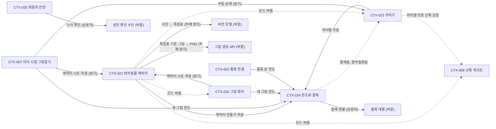

# 마롱이 반려동물 서비스: 도메인 설계(새 맥락과 바뀌는 맥락)

상태: 한 번에 초안(2026-11-17 14시대 KST, Claude, corthex 0.12.1). 체크포인트 1\~3은 아직이에요. 답을 기다리는 동안 8절의 추천안으로 02 단계부터 이어 가요.
범위: 마롱이를 남들도 쓰는 공개 서비스로 키울 때, 회원이 자기 강아지·고양이를 마롱이 화풍의 그림 캐릭터로 만들어 대화하고(무지개다리를 건넌 아이 포함), 하루 한도·충전권과 꾸미기 아이템으로 돈을 버는 일이에요. 새 맥락은 CTX-022\~025 넷이고, 바뀌는 기존 맥락은 3절 아래 표에 ID로만 적어요(전체 맥락 지도는 [domain.md](domain.md), 성향·선톡은 [persona.md](persona.md), 선 전화·그림 화두는 [call-first.md](call-first.md)).
ID 번호: CTX-022\~025, TERM-101\~160(02 단계에서 141\~160을 더함), REQ-330\~429(02 단계에서 400\~429를 더함), FL-150\~169, SPEC-310\~369, TBL-140\~169(05에서 160\~169를 더함), API-150\~219(06에서 170\~219를 더함), AI-30\~39, SCR-140\~169(07에서 150\~169를 더함), TASK-330\~379, TC-380\~429, 결정 D70\~89([인계 목록](../10-wbs/README.md#id-범위)).
표시: 근거가 동희님 말이나 문서·연구면 `[확실]`, 거기서 끌어낸 것은 `[추론]`, 근거 없는 짐작은 `[추측]`(6절 핫스팟에도 있음).

## 1. 서비스 개요

동희님 말(2026-11-17 13:31 KST, 스레드 '반려동물 서비스 사업화 논의하기' 첫 메시지. 지인과 나눈 대화 중 동희님 줄만, 지인 이름은 뺌):

- "마롱이를 자기 강아지나 고양이 사진을 넣어서 만들어주는거지 그림으로 마롱이처럼 / 그래서 자기 반려동물이랑 이야기 하는거야"
- "피클도 각자의 이름을 지을수잇잔아?"
- "(지인이) 모자 쓰고와서 모자샀다고 말걸어주고 이런 이벤트가 잇으면좋겟다햇잔아? / 그래서 나중에는 아예 옷을 사서 입혀줄수도있고"
- "비즈니스모델은 어플 '피클'처럼 한도 그날 한도 다 쓰면 충전하게끔 + 옷입히기 등등"

더한 말(2026-11-17 13:35 KST, 프로젝트 채팅): "일기장 배경화면, 디자인, 글씨체 전부 바꿀수있게 / 무료글씨체 등도 한 여러개 일단 주고. => 싸이월드 비즈니스모델 => 다이어리 꾸미기처럼 / 일기장 外에도 다른 컨텐츠들도, 컴포넌트 하나하나가 전부 돈"

다시 쓰면: 회원이 자기 강아지·고양이 사진을 올리면 마롱이 같은 손그림 캐릭터가 생기고, 회원이 이름을 지어 그 아이와 글로 이야기하고 통화해요. 무지개다리를 건넌 아이도 같은 방식으로 '놀러 와서' 이야기해요. 돈은 하루 한도를 다 쓰면 사는 충전권, 아이에게 입히는 모자·옷, 일기장 배경·디자인·글꼴 같은 꾸미기 아이템으로 벌어요. `[확실]`

결정과 기본값:

- D70(2026-11-17 14:03 KST, 같은 스레드 결정 카드 Q1, 동희님): **C '둘 다 같은 무게'**. 살아 있는 아이 모드와 추억 모드를 처음부터 함께 주력으로 둬요(연구 추천은 A였어요).
- D71(2026-11-17 14:37 KST, 프로젝트 채팅, 동희님): "/corthex:corthex 으로 설계하라고 해라". D61(14:40 KST): "야 /corthex:corthex 으로 지금 설계하는애들 한 군데서 설계 시켜". 그래서 이 문서는 설계 스레드 하나가 corthex 단계로 써요.
- D72(2026-11-17 16:33 KST, 설계 스레드 결정 카드 '반려동물 서비스 질문 7개를 추천대로 정할까요?'에서 '추천대로 모두 정하기', 이어 프로젝트 채팅 "추천 모두 승인", 동희님): 09 화면 방향 A(마롱이 앱 모양), 02 질문 A\~D 추천안, 아래 탭 셋, 05 표·06 API 얼리기. 이 문서 8절의 질문 1\~3은 앞의 남은 결정 카드(15\~17번)에 있어 아직이에요.
- Q2\~Q7은 동희님이 아직 답하지 않았고, 연구 스레드가 14:06 KST에 '따로 말씀이 없으면 추천안을 설계 기본값으로 쓴다'고 알렸어요. 아래 기본값은 결정이 아니에요. 동희님이 바꾸면 이 문서부터 고쳐요.
  - Q2 추억 모드: 캐릭터 만들기 1회 결제, 유지 무료. 결제벽·광고·아이템 푸시 없음. 작별 의식과 기록 내보내기. 장례·상조 제휴와 굿즈로 수익(제휴·굿즈는 1차 범위 밖, 8절 질문 3).
  - Q3 한도: 글 대화는 넉넉히(하루 약 100 메시지). 통화 시간·새 그림에 % 게이지, 새벽 초기화, 충전권. 다 써도 입력을 끊지 않고 아이가 '자러 가는' 연출. 월 구독도 함께.
  - Q4 꾸미기: 무료 글꼴·테마·스티커를 여러 개 기본 제공. 추가는 테마 패키지·낱개 정가. 확률형 아이템 없음. OFL 글꼴은 단독 판매 불가.
  - Q5 옷: 공용 몸 템플릿 4\~6종에 투명 아이템 레이어.
  - Q6: 반려동물 10\~20마리 닮음 시험과 가격 인터뷰는 12 단계 시험 계획에 넣어요(설계는 바로 시작).
  - Q7: 성인 전용.

사람과 시스템:

- 회원(반려인, 성인): 가입하고, 아이 사진을 올려 캐릭터를 만들고, 이름을 지어 대화·통화하고, 아이템을 사서 입히고 일기장을 꾸며요. 아이가 떠나면 직접 추억 모드로 바꾸고, 작별 의식이나 기록 내보내기를 해요. `[추론]`
- 반려동물 캐릭터(아이): 회원의 아이를 그린 캐릭터. 1인칭으로 말하고, 살아 있는 아이 모드에서는 먼저 말을 걸고(선톡·그림 화두), 추억 모드에서는 회원이 열 때만 이야기해요. `[추론]`
- 마롱이: 아이를 그려 주고 처음 데려와 주는 친구로 남아요. 주인공은 각자의 아이예요(연구 8.8). `[추론]`
- 운영자(동희님): 아이템을 만들어 올리고, 신고를 처리하고, 원가와 결제를 봐요. `[추론]`
- 바깥 시스템: 그림 생성 API(연구 6.1의 주 모델 gpt-image-2.5-flare, 예비 Seedream 5.5), 사진을 읽는 비전 모델, 글 모델(지금 DeepSeek), 통화 엔진(지금 Gemini Live), 결제 대행(구글 플레이 결제나 웹 결제, 6절), 앱 푸시(FCM). `[확실]` 연구 6절

재료: 연구 [report.md](https://app.notion.com/p/41bbf16cc3ec8148a7dcf24bbac461db)(프로젝트 파일 `marong-pet-biz-research-20261117/report.md`, 조사일 2026-11-17)의 5.2 설계 원칙 표, 6절 캐릭터 만드는 순서·원가, 7절 법·약관 할 일, 9절 Q1\~Q7. 지금 마롱이의 일기(CTX-007, A 그림일기장), 그림 화두(CTX-020, 그림 세트 31장), 선톡 게이트(CTX-009)가 이 서비스의 바탕이에요.

범위 밖(1차): 카톡·디스코드 마롱이(CTX-001), 지금 친구용 마롱이의 동작, 가족 공유, 친구에게 아이템 선물, 굿즈 주문, 장례·상조 제휴, 친구네 아이끼리 놀러 가기, 아이의 방(미니룸). 8절 질문 3에서 확인해요.

## 2. 이벤트 스토밍

- 보드: 없음. 01 단계의 사람 보기는 GitHub PR이에요(`.corthex/project.json`, 2026-11-12 결정). 일하는 방식은 한 번에 초안(one-pass draft)이에요. 동희님이 매번 묻지 말라고 해서(2026-11-16 13:03 KST) 체크포인트는 9 단계 뒤 한 번에 모아 여쭤요.
- 체크포인트 기록: 아직 없음. 검토 때 아래 시간 줄, 4절의 CTX-022·023 규칙, 8절 질문을 먼저 봐 주세요.

### 시간 줄

| Lane | Events |
| --- | --- |
| 가입 | 가입됨 or 가입 거절됨 → AI 고지 확인됨 → 국외 이전 동의함 |
| 캐릭터 만들기 | 사진 올려짐 → 사진 거절됨 or 특징표 만들어짐 → 특징표 고쳐짐 → 미리 보기 그림 만들어짐 → 캐릭터 만들기 결제됨 → 그림 후보 만들어짐 or 그림 만들기 실패 → 정면 그림 골라짐 → 캐릭터 시트 만들어짐 → 이름 지어짐 |
| 함께 지내기 | 메시지 받음 → 답 보냄 → 아이 시점 그림일기 써짐 |
| 통화 | 통화 시작됨 → 통화 한도 씀 → 통화 한도 다 씀 → 통화 끝남 |
| 꾸미기 | 아이템 결제됨 or 무료 아이템 받음 → 보관함에 들어감 → 아이템 입혀짐 → 아이템 반응 선톡 보냄 or 아이템 반응 선톡 안 보냄 |
| 일기장 꾸미기 | 일기장 테마 바뀜 → 글꼴 바뀜 → 스티커 붙여짐 or 스티커 떼어짐 |
| 한도 | 하루 한도 초기화됨 → 하루 한도 다 씀 → 충전권 결제됨 → 충전권 씀 |
| 구독 | 구독 시작됨 → 구독 갱신됨 or 구독 해지됨 → 구독 끝남 |
| 환불 | 청약철회됨 → 환불됨 |
| 추억 모드 | 추억 모드로 바뀜 → 작별 의식 마침 → 캐릭터 보관됨 |
| 기록 | 기록 내보내짐 |
| 안전 | 위기 신호 찾음 → 109 안내 보냄 |
| 신고와 탈퇴 | 신고 접수됨 → 신고 처리됨 ; 계정 지워짐 |

'신고와 탈퇴' 줄의 ` ; `는 서로 다른 흐름이에요. 아래는 데이터를 바꾸지 않아서 이벤트가 아니라 읽기 모델로 적었어요: 남은 하루 한도(%), 보관함 목록, 상점 목록, 아이의 모드, 오늘 쓴 메시지 수, 결제 화면의 원화 총액·청약철회 안내, 아이템이 몸 템플릿에 맞는지. 로그인도 이벤트가 아니에요.

## 3. 바운디드 컨텍스트와 패키지

| Context | Type | Aggregates | Package |
| --- | --- | --- | --- |
| CTX-022 반려동물 캐릭터 | core | 캐릭터 만들기(사진·특징표·후보 한 벌), 반려동물 캐릭터(이름·캐릭터 시트·몸 템플릿·모드) | `marong/pet/character.py` 후보 |
| CTX-023 꾸미기 | core | 아이템(상점의 상품 하나), 보관함(회원이 가진 아이템), 꾸밈 상태(아이별 착용·일기장 테마·글꼴, 일기 한 날의 스티커) | `marong/pet/decor.py` 후보 |
| CTX-024 한도와 결제 | supporting | 하루 한도(회원별 통화 시간·새 그림), 충전권, 구독, 주문(결제·청약철회·환불) | `marong/pet/billing.py` 후보 |
| CTX-025 회원과 안전 | supporting | 회원(가입·성인 확인·동의), 신고 | `marong/pet/member.py` 후보 |

- CTX-022를 핵심으로 둔 이유: '내 아이 같다'가 이 사업의 전부이고(연구 9절 Q6), 살아 있는 아이와 떠난 아이를 같은 캐릭터로 잇는 일(모드)은 경쟁 서비스에 없어요(연구 3.2, 8.1). `[추론]`
- CTX-023을 핵심으로 둔 이유: 동희님이 말한 돈의 대부분(옷, 일기장 배경·디자인·글꼴, 컴포넌트마다 돈)이 여기에 있고, '입은 차림으로 아이가 먼저 말을 거는' 반응은 마롱이 그림 화두의 바탕에서만 나와요. `[추론]`
- CTX-024·025를 지원 맥락으로 둔 이유: 결제·가입은 흔한 기능이지만, 추억 모드에서 충전 권유를 막고 한도를 다 써도 대화를 끊지 않는 규칙이 이 서비스만의 것이라 직접 만들어요. `[추론]`
- 같은 단어가 두 뜻: 지금 마롱이에서 사람은 '친구'(TERM-003, '사용자·회원'을 피함)이고, 이 서비스에서 사람은 '회원'(TERM-136)이에요. 지금 일기의 '기본 그림'(TERM-028, 그림을 못 그렸을 때 대신 보이는 그림)과 캐릭터의 '정면 그림'(TERM-106)도 달라요. 그래서 맥락을 나눴어요.

바뀌는 기존 맥락:

| 맥락 | 바뀌는 것 |
| --- | --- |
| CTX-005 접근 | 공개 서비스의 회원은 Cloudflare Access 대신 CTX-025 가입·로그인으로 들어와요. 지금 친구용 마롱이는 그대로 Access(8절 질문 1) |
| CTX-007 마롱이의 일기 | 쓰는 이가 마롱이에서 그 아이로 바뀐 '아이 시점 그림일기'(TERM-135). 그림은 합성 그림(TERM-142)이고, 회원이 하루 한도를 써서 새 그림(TERM-143)으로 다시 그릴 수 있어요(02 단계에서 정함). 일기장은 CTX-023의 꾸밈 상태로 보여요. 밖으로 나가는 카드에 워터마크(TERM-131) |
| CTX-009 선톡 게이트 | 추억 모드의 아이는 선톡·선 전화를 하지 않아요. 아이템 반응 선톡(TERM-120)은 살아 있는 아이 모드에서만, 기존 하루 상한 안에서 |
| CTX-020 선 전화·그림 화두 | 그림 화두 그림을 아이마다 그려야 해서(지금 31장은 모두가 공유), 배경 세트(TERM-144) 위에 캐릭터 시트 표정과 입은 아이템을 겹친 합성 그림(TERM-142)으로 만들어요. 그림 생성 비용이 들지 않아요 |
| CTX-002 통화 연결, CTX-006 통화 예산 | 통화 시간이 회원의 하루 한도를 써요. CTX-006 월 예산은 서비스 전체 원가 안전장치로 남아요. 아이마다 목소리는 통화 엔진 결론 뒤(6절) |
| CTX-008 친구 약속, CTX-011 친구 기억 | 기억과 약속의 주인이 (회원, 아이)예요. 추억 모드에서는 회원이 알려 준 것만 기억 항목이 되고, 아이가 지어낸 추억은 기억으로 쌓지 않아요 |
| CTX-012 위기와 민감 주제 | 애도 중 위기 신호(자책, 따라가고 싶다는 말)도 109 안내로. 치료·치유 효과를 말하지 않아요 |
| CTX-013 보내기 전 검사 | 추억 모드에서 죄책감·FOMO 작별 문구와 아이템 권유를 막고, 건강 판단('아파 보여요')을 막고, 'AI이고 진짜 그 아이가 아님' 고지를 정해진 때에 넣어요 |

## 4. 컨텍스트 표

### CTX-022 반려동물 캐릭터

목적: 회원이 올린 사진으로 그 아이를 닮은 마롱이 화풍 캐릭터를 만들고, 이름과 모드(살아 있는 아이·추억)를 지켜요.

| Given by | Read model | Command | Aggregate | Events |
| --- | --- | --- | --- | --- |
| 회원 | 사진 안내(정면 얼굴, 귀·무늬, 전신 3장) | 사진 올리기 | 캐릭터 만들기 | 사진 올려짐, 또는 사진 거절됨(형식·크기·아이가 안 보임) |
| 정책: 사진 올려짐 | 사진(EXIF 지운 것, 사람 얼굴 가린 것) | 특징표 만들기 | 캐릭터 만들기 | 특징표 만들어짐 |
| 회원 | 특징표(종·털 색·무늬 위치·귀 모양) | 특징표 고치기 | 캐릭터 만들기 | 특징표 고쳐짐 |
| 정책: 특징표 만들어짐 | 특징표 | 미리 보기 그림 만들기 | 캐릭터 만들기 | 미리 보기 그림 만들어짐 |
| 회원 | 미리 보기 그림, 원화 총액 | 캐릭터 만들기 결제하기(CTX-024 주문) | 캐릭터 만들기 | 캐릭터 만들기 결제됨 |
| 정책: 캐릭터 만들기 결제됨 | 특징표, 미리 보기 그림 | 그림 후보 만들기 | 캐릭터 만들기 | 그림 후보 만들어짐, 또는 그림 만들기 실패 |
| 회원 | 그림 후보 4장 | 정면 그림 고르기, 또는 후보 다시 만들기 | 캐릭터 만들기 | 정면 그림 골라짐, 또는 그림 후보 만들어짐 |
| 정책: 정면 그림 골라짐 | 정면 그림, 특징표 | 캐릭터 시트 만들기 | 반려동물 캐릭터 | 캐릭터 시트 만들어짐 |
| 회원 | 캐릭터 시트 | 이름 짓기 | 반려동물 캐릭터 | 이름 지어짐 |
| 회원 | 아이의 모드, 작별 안내 | 추억 모드로 바꾸기 | 반려동물 캐릭터 | 추억 모드로 바뀜 |
| 회원 | 작별 의식 고르기(마지막 편지, 그림 한 장) | 작별 의식 하기 | 반려동물 캐릭터 | 작별 의식 마침, 캐릭터 보관됨 |
| 회원 | 보관한 캐릭터 | 캐릭터 꺼내기 | 반려동물 캐릭터 | 캐릭터 꺼내짐 |
| 회원 | 그림·일기·대화 목록 | 기록 내보내기 | 반려동물 캐릭터 | 기록 내보내짐 |
| 회원, 정책: 계정 지워짐(CTX-025) | | 캐릭터 지우기 | 반려동물 캐릭터 | 캐릭터 지워짐 |

- Aggregate rules: 캐릭터 만들기: 사진은 서버로 보내기 전에 EXIF를 지우고, 사람 얼굴이 보이면 가려요(연구 7.2, 개인정보보호법). 그림 생성 API는 입력을 학습에 쓰지 않는 설정·약관이어야 해요(연구 6.1·7.2, Gemini 이미지 API·FLUX API를 뺀 이유). 그림은 사진풍이 아니라 마롱이 화풍의 손그림이에요(동희님 말 "그림으로 마롱이처럼"). 미리 보기 그림 1장은 결제 전에 무료로, 후보 4장과 캐릭터 시트는 결제 뒤에 그려요(추측: 원가 1회 약 ₩775라 결제 뒤에 그리고, 미리 보기로 닮음을 먼저 보여 줌. 8절 질문 2). 후보 다시 만들기는 결제 한 번에 2번까지예요(추측). 특징표와 그림을 대조하고, 마롱이 그림 세트의 눈 기울기 검사를 다시 써요(연구 6.1). 반려동물 캐릭터: 이름은 회원이 짓고 회원마다 달라요(동희님 말 '피클처럼 각자 이름'). 종은 개·고양이만이에요(동희님 말 '강아지나 고양이', 다른 종은 6절). 회원 한 명이 여러 마리를 만들 수 있고 마리마다 캐릭터 만들기를 결제해요(추측). 추억 모드로 바꾸는 일은 회원만 해요. 시스템이 대화에서 추측해 바꾸지 않아요(연구 8.1, 추론). 추억 모드에서는 상점·아이템 권유·광고·충전 권유가 보이지 않아요(Q2 기본값). 보관한 캐릭터는 먼저 말을 걸지 않고 일기·그림만 볼 수 있어요. 꺼내면 추억 모드로 돌아와요(케임브리지 연구 '작별·은퇴 절차', 추론). 캐릭터 시트(정면 그림·표정 6장)는 한 번 만들면 바뀌지 않고, 아이템·화두 그림은 모두 그 위에 겹치거나 그것을 기준으로 그려요(연구 6.2, 추론).
- Given–When–Then: Given 회원이 갈색 푸들 사진 3장을 올림, When 특징표 만들기, Then 종 '개', 털 색 '갈색', 귀 '늘어짐'이 적힌 특징표가 보이고 회원이 고칠 수 있어요.
- Given–When–Then: Given 사진에 사람 얼굴이 함께 찍힘, When 사진 올리기, Then 사람 얼굴을 가린 사진으로 특징표를 만들고 원본은 저장하지 않아요.
- Given–When–Then: Given 특징표와 미리 보기 그림 1장, When 회원이 결제하지 않고 나감, Then 후보 4장과 캐릭터 시트를 그리지 않아요(그림 비용 없음).
- Given–When–Then: Given 살아 있는 아이 모드의 '콩이', When 회원이 추억 모드로 바꾸기, Then 콩이의 선톡·선 전화가 멈추고 상점 진열이 콩이 화면에서 사라져요.
- Given–When–Then: Given 추억 모드의 콩이, When 회원이 작별 의식으로 '마지막 편지' 하기, Then 콩이의 편지 한 장이 일기장에 남고 콩이는 보관돼 먼저 말을 걸지 않아요.
- External systems: 비전 모델(부패 방지 계층: 특징표 칸으로만 받음), 그림 생성 API(부패 방지 계층: 화풍 지시문·특징표·기준 그림을 우리 쪽이 만들고 결과는 PNG만 받음).
- Links: 캐릭터 만들기 결제를 CTX-024에 맡기고 결과를 받아요. 모드가 바뀌면 CTX-009·020·023에 알려요. CTX-007·020은 그림을 그릴 때 캐릭터 시트를 읽어요.
- Hotspots: 결제 시점, 닮음(공개 벤치마크 없음), 사람 얼굴 가리기, 다른 종, 추억 모드에서 되돌리기(6절).

### CTX-023 꾸미기

목적: 아이에게 입히는 아이템과 일기장 테마·글꼴·스티커를 정가로 팔고, 회원이 고른 꾸밈을 보여 주고, 살아 있는 아이가 새 차림으로 먼저 말을 걸게 해요.

| Given by | Read model | Command | Aggregate | Events |
| --- | --- | --- | --- | --- |
| 운영자 | 아이템 그림(몸 템플릿마다 레이어), 라이선스 대장 | 아이템 올리기 | 아이템 | 아이템 올려짐 |
| 운영자 | 판매 중인 아이템 | 아이템 판매 끝내기 | 아이템 | 아이템 판매 끝남 |
| 회원 | 상점 목록, 원화 총액 | 아이템 사기(CTX-024 주문) | 보관함 | 아이템 결제됨 |
| 정책: 아이템 결제됨(CTX-024), 가입됨(무료 기본 아이템) | | 보관함에 넣기 | 보관함 | 보관함에 들어감 |
| 회원 | 보관함, 아이의 몸 템플릿 | 아이템 입히기, 아이템 벗기기 | 꾸밈 상태 | 아이템 입혀짐, 아이템 벗겨짐 |
| 회원 | 보관함의 일기장 테마·글꼴 | 일기장 테마 바꾸기, 글꼴 바꾸기 | 꾸밈 상태 | 일기장 테마 바뀜, 글꼴 바뀜 |
| 회원 | 보관함의 스티커, 일기 한 날 | 스티커 붙이기, 스티커 떼기 | 꾸밈 상태 | 스티커 붙여짐, 스티커 떼어짐 |
| 정책: 아이템 입혀짐, 그리고 살아 있는 아이 모드 | 아이의 모드, 오늘 선톡 수 | 아이템 반응 선톡 요청(CTX-009로) | 꾸밈 상태 | 아이템 반응 선톡 보냄, 또는 아이템 반응 선톡 안 보냄 |
| 정책: 청약철회됨(CTX-024) | | 보관함에서 빼기 | 보관함 | 보관함에서 빠짐 |

- Aggregate rules: 아이템: 모두 정가로 팔고 확률형 아이템은 없어요(연구 7.1, 게임물 등급분류·확률 공개 의무를 피하고 사행성 판단 요소를 없앰). 한정이라고 하면 판매 기간이 지나면 다시 팔지 않아요(연구 8.3, 의견). OFL 글꼴은 따로 팔지 않고 무료로 주거나 테마 패키지에 넣어요(연구 7.1, SIL OFL 1.1). 아이템은 모든 몸 템플릿에 맞는 레이어가 있어야 팔 수 있어요(추론: 어떤 아이에게는 입혀지지 않는 상품을 막음). 글꼴·음원·그림은 라이선스 대장에 적힌 것만 올려요(연구 7.2). 보관함: 가입하면 무료 기본 글꼴·테마·스티커 여러 개가 들어와요(동희님 말 "무료글씨체 등도 한 여러개 일단 주고"). 산 아이템은 만료되지 않아요(연구 7.2, Apple 3.1.1). 청약철회한 아이템은 보관함에서 빠지고 입혀져 있으면 벗겨져요(추론). 꾸밈 상태: 아이 한 마리는 자리(머리·몸·목)마다 아이템 하나씩 입어요(추측). 일기장 테마·글꼴은 아이마다 하나예요(02 단계에서 정함: 아이마다 일기장이 따로라서, 2026-11-17 새 제안). 아이템 반응 선톡은 살아 있는 아이 모드에서, 새 아이템을 처음 입혔을 때 한 번만, CTX-009의 하루 상한 안에서 보내요(동희님 말 '모자 쓰고와서 모자샀다고 말걸어주고', 추론). 추억 모드에서는 입은 모습이 회원이 열었을 때만 보여요(Q2 기본값).
- Given–When–Then: Given 살아 있는 아이 모드의 콩이와 오늘 선톡 0번, When 회원이 새로 산 털모자를 입히기, Then 콩이가 털모자를 쓴 그림과 함께 "나 모자 샀다!" 같은 선톡을 한 번 보내요.
- Given–When–Then: Given 추억 모드의 콩이, When 회원이 털모자를 입히기, Then 선톡은 없고 다음에 콩이 화면을 열면 털모자를 쓴 모습이 보여요.
- Given–When–Then: Given 회원이 무료 글꼴 '나눔손글씨'를 고름, When 일기장을 열기, Then 일기 글이 그 글꼴로 보이고 결제 화면은 나오지 않아요.
- Given–When–Then: Given 산 지 3일 된 쓰지 않은 테마 패키지, When 회원이 청약철회, Then 환불되고 테마가 보관함에서 빠지며 일기장은 기본 테마로 돌아가요.
- External systems: 없음(결제는 CTX-024가 맡음).
- Links: 결제는 CTX-024에 맡기고 '결제됨'을 받아요. 아이템 반응 선톡은 CTX-009 선톡 게이트로 보내요. CTX-007·020은 그림을 그릴 때 착용을, 일기장은 꾸밈 상태를 읽어요.
- Hotspots: 아이템을 누가 얼마나 빨리 만드나(혼자 만들면 공급이 느림), 자리 나누기, 테마를 아이마다 둘지(6절).

### CTX-024 한도와 결제

목적: 원가가 드는 통화 시간·새 그림에 하루 한도를 걸고, 캐릭터 만들기·아이템·충전권·구독을 결제하고, 청약철회·환불을 받아요. 한도를 다 써도 관계를 볼모로 잡지 않아요.

| Command | Events |
| --- | --- |
| 하루 한도 초기화하기(정책: 매일 04:00 KST) | 하루 한도 초기화됨 |
| 한도 쓰기(정책: 통화 1분, 새 그림 1장) | 한도 씀, 하루 한도 다 씀 |
| 결제하기(캐릭터 만들기, 아이템, 테마 패키지, 충전권) | 결제됨, 또는 결제 실패 |
| 충전권 쓰기 | 충전권 씀 |
| 구독 시작하기, 구독 해지하기 | 구독 시작됨, 구독 해지됨 |
| 구독 갱신하기(정책: 갱신일) | 구독 갱신됨, 또는 구독 끝남 |
| 청약철회하기 | 청약철회됨, 환불됨 |

- Aggregate rules: 하루 한도: 글 대화는 한도에 넣지 않아요(Q3 기본값, 연구 6.3 원가 하루 100 메시지에 월 약 ₩1,660). 하루 100 메시지에서 아이가 한 번 쉬자고 하고(휴식 권유), 300 메시지에서 다음 04시까지 잠드는 남용 상한만 둬요(02 단계에서 정함). 통화 시간·새 그림만 %로 보여 주고 남은 개수를 세게 하지 않아요(연구 4.1). 매일 04:00 KST에 초기화해요(연구 4.1 피클과 같고 마롱이 일기 하루 04시와 맞춤, 추론). 다 쓰면 입력창을 끄지 않고 아이가 졸려서 자러 가는 말로 통화를 마치고, 글 대화는 이어져요(Q3 기본값). 추억 모드의 아이와 이야기하다 한도를 다 쓰면 충전 권유 없이 '오늘은 여기까지'로 마쳐요(Q2 기본값에서 끌어냄, 6절). 충전권: 사면 바로 그날 한도를 절반이나 전부 채워요(연구 4.1 피클. 사 두고 나중에 쓰는 표를 두지 않아 쓰지 않은 유료 재화가 생기지 않음, 02 단계에서 정함). 주문: 결제 화면에 원화 총액, 7일 청약철회와 그 제한을 보여 줘요. 구독은 갱신과 가격 변경 30일 전에 동의를 받고, 해지는 가입만큼 쉬워야 해요(연구 7.2, 전자상거래법·다크패턴 규정). 쓰지 않은 유료 재화는 환불해요(연구 7.2).
- External systems: 결제 대행(순응자: 구글 플레이 결제나 웹 결제 회사의 규칙을 따름, 어느 쪽인지는 6절).
- Links: CTX-022·023이 주문을 맡기고 '결제됨'을 받아요. CTX-002 통화 연결이 통화 전에 남은 통화 한도를 읽고 통화 중 분을 써요. CTX-007·020이 새 그림을 그릴 때 한도를 써요.
- Hotspots: 결제 채널, 구독에 무엇을 넣을지, 충전권 가격(6절).

### CTX-025 회원과 안전

목적: 성인만 가입하게 하고, AI 고지·국외 이전·광고성 푸시 동의를 받고, 신고와 계정 삭제를 앱 안에서 받아요. 위기 신호는 기존 CTX-012가 맡아요.

| Command | Events |
| --- | --- |
| 가입하기(성인 확인 포함) | 가입됨, 또는 가입 거절됨 |
| AI 고지 확인하기 | AI 고지 확인됨 |
| 동의하기, 동의 철회하기(국외 이전, 광고성 푸시, 밤 광고성 푸시) | 국외 이전 동의함, 광고성 푸시 동의함, 동의 철회함 |
| 신고하기(대화·그림), 신고 처리하기(운영자) | 신고 접수됨, 신고 처리됨 |
| 계정 지우기 | 계정 지워짐 |

- Aggregate rules: 회원: 만 19세 이상만 가입해요(Q7 기본값 '성인 전용', 민법 성년. 연구의 18세는 외부 약관 기준이라 더 높은 쪽을 씀, 추론). AI 고지를 확인해야 첫 대화를 시작해요(AI 기본법). 해외 AI로 사진·대화를 보내기 전에 국외 이전 동의를 받아요(개인정보보호법). 광고성 푸시는 미리 동의를 받고 밤(21시\~8시)은 따로 받아요(정보통신망법). 계정 삭제는 앱 안에서 할 수 있어야 해요(Google Play 정책). 계정을 지우면 캐릭터·기억·그림이 모두 지워져요(추론). 신고: 대화 한 줄이나 그림 한 장마다 신고할 수 있어요(Google Play 정책).
- External systems: 성인 확인 수단(6절), 앱 푸시(FCM).
- Links: 모든 맥락이 회원을 확인할 때 읽어요(공개 서비스에서 CTX-005 대신). 계정이 지워지면 CTX-022가 캐릭터를 지워요.
- Hotspots: 성인 확인 방법, 동의 화면 순서(6절).

## 5. 컨텍스트 사이 의존

| From | To | Kind | Pattern | Why | Data |
| --- | --- | --- | --- | --- | --- |
| CTX-022 | 비전 모델 | call (sync) | 부패 방지 계층 | 특징표 만들기 | 사진(EXIF 지움, 사람 얼굴 가림) → 종·털 색·무늬·귀 |
| CTX-022 | 그림 생성 API | call (sync) | 부패 방지 계층 | 미리 보기·후보·캐릭터 시트 | 화풍 지시문, 특징표, 기준 그림 → PNG |
| CTX-022 | CTX-024 | call (sync) | 고객-공급자 | 캐릭터 만들기 결제 | 회원, 상품, 원화 총액 → 결제됨 or 결제 실패 |
| CTX-022 | CTX-009, CTX-020, CTX-023 | event (async) | 발행 언어 | 모드가 바뀌면 선톡·선 전화·상점 노출을 바꿈 | 아이, 모드 |
| CTX-023 | CTX-024 | call (sync) | 고객-공급자 | 아이템·테마 패키지 결제 | 회원, 아이템, 원화 총액 |
| CTX-024 | CTX-023 | event (async) | 발행 언어 | 결제·청약철회 결과로 보관함 바꾸기 | 주문, 아이템, 결제됨 or 청약철회됨 |
| CTX-023 | CTX-009 | event (async) | 고객-공급자 | 아이템 반응 선톡 요청(살아 있는 아이만) | 아이, 아이템, 입힌 시각 |
| CTX-007, CTX-020 | CTX-022, CTX-023 | call (sync, 읽기만) | | 그림 기준과 차림, 일기장 꾸밈 | 캐릭터 시트, 몸 템플릿, 착용, 테마·글꼴·스티커 |
| CTX-007, CTX-020 | CTX-024 | call (sync) | 고객-공급자 | 새 그림 한도 쓰기 | 회원, 그림 1장 |
| CTX-002 | CTX-024 | call (sync) | 고객-공급자 | 통화 전 남은 한도 읽기, 통화 중 분 쓰기 | 회원, 분 |
| CTX-024 | 결제 대행 | call (sync) | 순응자 | 결제·구독·환불 | 상품, 원화 총액, 영수증 |
| CTX-025 | 성인 확인 수단 | call (sync) | 순응자 | 가입 때 나이 확인 | 생년월일 or 확인 결과 |
| 모든 공개 서비스 맥락 | CTX-025 | call (sync) | 순응자 | 회원 확인 | 로그인 토큰 → 회원 |

동기 호출이 원을 이루는 곳은 없어요(CTX-024 → CTX-023은 비동기 이벤트). 모드 바뀜 이벤트가 CTX-022에서 세 맥락으로 나가요. 정책이 한 쌍에 몰리는 곳은 CTX-023 ↔ CTX-024(결제·청약철회)인데, 주문을 CTX-024 한 곳에 두고 보관함은 결과만 받게 나눴어요.

## 6. 핫스팟

| Hotspot | Context | State | Answer or next step |
| --- | --- | --- | --- |
| 공개 서비스를 지금 친구용 마롱이와 같은 서버·DB·로그인에 둘지, 따로 띄울지 | CTX-025, CTX-005 | open | 8절 질문 1. 추천: 같은 저장소의 엔진(대화·기억·선톡·그림·통화)은 같이 쓰고, 공개 서비스는 새 서버·새 DB·회원 로그인으로 따로 띄움 |
| 캐릭터 만들기 결제 시점 | CTX-022, CTX-024 | open | 8절 질문 2. 추천: 특징표와 미리 보기 1장은 무료, 후보 4장·캐릭터 시트는 결제 뒤 |
| 빠진 것: 가족 공유, 아이템 선물, 굿즈, 장례·상조 제휴, 미니룸 | 전체 | open | 8절 질문 3. 추천: 1차 범위 밖, 맥락만 비워 둠 |
| 결제 채널: 구글 플레이 결제(플레이 스토어 출시, 개발자 등록 25달러·본인 확인) or 웹 결제(PG 계약, 사업자 등록·통신판매업 신고) | CTX-024 | open | 02 단계에서 정함. 어느 쪽이든 결제 전에 사업자 등록·통신판매업 신고가 필요해요(연구 7.2). 동희님 준비물이라 실제 계정·결제는 동희님이 해요 |
| '내 아이 같다'를 측정하는 공개 벤치마크가 없어요 | CTX-022 | open | Q6 기본값대로 12 단계 시험 계획에 반려동물 10\~20마리 닮음 시험(그림 비용 약 12달러)과 가격 인터뷰를 넣어요 |
| 사람 얼굴이 함께 찍힌 사진: 거절할지 가릴지 | CTX-022 | open | 가리고 진행(추천). 아이가 가려지면 다시 올려 달라고 안내 `[추측]` |
| 개·고양이가 아닌 아이(토끼, 새 등) | CTX-022 | open | 1차는 개·고양이만(동희님 말). 다른 종은 닮음 시험 뒤 `[추측]` |
| 추억 모드로 잘못 바꿨을 때 되돌리기 | CTX-022 | open | 7일 안에는 살아 있는 아이 모드로 되돌릴 수 있게(추천) `[추측]` |
| 추억 모드에서 한도를 다 썼을 때 | CTX-024 | review in stage 02 | Q2 기본값(결제벽 없음)에서 끌어내 '충전 권유 없이 오늘은 여기까지'로 씀. 02에서 다시 봄 |
| 추억 모드에서 지어낸 추억이 진짜 기억처럼 쌓이는 위험(연구 5.1) | CTX-011 | review in stage 02 | 회원이 알려 준 것만 기억 항목으로(3절 바뀌는 맥락) |
| 성인 확인 방법: 휴대폰 본인인증(건당 비용) or 생년월일 입력 + 스토어 연령 등급 | CTX-025 | open | 02 단계에서 정함. 결제가 드는 쪽은 동희님 결정 |
| 아이템을 누가 얼마나 빨리 만드나(혼자 만들면 공급이 느림, 연구 9절 Q4 반론) | CTX-023 | open | 첫 출시 아이템 수는 02에서. 아이템 그림도 그림 생성 API로 만들고 검수(마롱이 그림 세트와 같은 절차) `[추론]` |
| 자리 나누기(머리·몸·목)와 일기장 테마를 아이마다 둘지 | CTX-023 | review in stage 02 | 4절 규칙의 추측대로 씀 |
| 구독에 무엇을 넣을지, 충전권 가격 | CTX-024 | open | 02에서 원가표(연구 6.3)로 정함. 연구의 피클 값(절반 ₩2,900, 전부 ₩5,800)과 제타패스(웹 ₩10,900)를 참고 |
| 아이마다 목소리 | CTX-002 | open | 통화 엔진 10턴 측정 결론 뒤. 지금 Gemini Live는 목소리를 바꿀 수 없어요(통화 엔진 스레드 11/17) |
| 통화 엔진 Gemini Live에 18세 이상 조항이 걸리는지 | CTX-002 | open | 연구 6.4 [미확인]. 02 전에 약관 확인 |
| 그림 모델 종료 일정(gpt-image-1.5 2026-12-01, gpt-image-2 2027-02-10) | CTX-022 | open | 06·11에서 모델을 설정으로 바꿀 수 있게 |
| 미국·EU 이용자(뉴욕·캘리포니아 법, EU AI Act) | CTX-025 | open | 1차는 한국 이용자만(추천). 해외 출시 때 다시 `[추측]` |

## 7. 용어집

| ID | Term | Definition | Context | Code name | Avoid |
| --- | --- | --- | --- | --- | --- |
| TERM-101 | 반려동물 캐릭터 | 회원의 강아지·고양이 사진으로 만든 마롱이 화풍의 손그림 캐릭터. 회원이 이름을 짓고 1인칭으로 말해요. 화면과 말에서는 '아이'라고 불러요 | CTX-022 | `PetCharacter` | 아바타, 펫봇, AI 펫 |
| TERM-102 | 살아 있는 아이 모드 | 지금 함께 사는 아이의 캐릭터 상태. 선톡·그림 화두·아이템 반응 선톡과 상점이 켜져요 | CTX-022 | `living` | 일반 모드 |
| TERM-103 | 추억 모드 | 무지개다리를 건넌 아이의 캐릭터 상태. 회원이 직접 바꾸고, 선톡·상점·광고·충전 권유가 꺼지고 회원이 열 때만 이야기해요 | CTX-022 | `memorial` | 추모 모드, 사후 모드 |
| TERM-104 | 무지개다리 | 반려동물의 죽음을 부드럽게 이르는 말. 화면과 아이의 말에서 '죽음' 대신 써요 | CTX-022 | | 사망, 폐사 |
| TERM-105 | 특징표 | 비전 모델이 사진에서 읽은 종·털 색·무늬 위치·귀 모양을 적은 표. 회원이 고쳐요 | CTX-022 | `traits` | 분석 결과 |
| TERM-106 | 정면 그림 | 회원이 그림 후보 중에서 고른 아이의 정면 그림. 캐릭터 시트의 기준이에요. 일기의 '기본 그림'(TERM-028)과 달라요 | CTX-022 | `front_drawing` | 기본 그림 |
| TERM-107 | 캐릭터 시트 | 정면 그림과 표정 6장을 한 장에 모은 것. 한 번 만들면 바뀌지 않고, 모든 아이템·화두·일기 그림의 기준이에요 | CTX-022 | `character_sheet` | 표정 세트 |
| TERM-108 | 그림 후보 | 결제 뒤 특징표로 그린 정면 그림 4장. 회원이 하나를 골라요 | CTX-022 | `candidates` | 시안 |
| TERM-109 | 미리 보기 그림 | 결제 전에 특징표로 그려 보여 주는 무료 그림 1장 | CTX-022 | `preview` | 샘플 |
| TERM-110 | 캐릭터 만들기 | 사진 올리기부터 이름 짓기까지 한 마리의 캐릭터를 만드는 과정. 마리마다 한 번 결제해요 | CTX-022 | `CharacterCreation` | 생성, 등록 |
| TERM-111 | 몸 템플릿 | 아이템 레이어를 맞추는 공용 몸 모양 4\~6종. 캐릭터 시트를 만들 때 하나가 정해져요 | CTX-022, CTX-023 | `body_template` | 체형 |
| TERM-112 | 아이템 레이어 | 몸 템플릿 위에 겹치는 투명 배경 그림(PNG) 한 장 | CTX-023 | `item_layer` | 스킨 |
| TERM-113 | 아이템 | 상점에서 파는 꾸미기 상품 하나. 착용 아이템(모자·옷·목걸이), 일기장 테마, 글꼴, 스티커 | CTX-023 | `Item` | 도토리, 재화 |
| TERM-114 | 착용 | 아이가 아이템을 입은 상태. 자리(머리·몸·목)마다 하나 | CTX-023 | `equipped` | 장착 |
| TERM-115 | 보관함 | 회원이 가진 아이템 목록. 무료 기본 아이템이 처음부터 들어 있어요 | CTX-023 | `inventory` | 가방, 인벤토리 |
| TERM-116 | 일기장 테마 | 일기장의 배경·디자인·종이 무늬를 묶은 꾸밈 | CTX-023 | `diary_theme` | 스킨 |
| TERM-117 | 글꼴 | 일기 글이 보이는 서체. 무료 기본 글꼴 여러 개를 주고, OFL 글꼴은 따로 팔지 않아요 | CTX-023 | `font` | 글씨체(동희님 말로는 같은 뜻) |
| TERM-118 | 스티커 | 일기 한 날에 붙이는 작은 그림 | CTX-023 | `sticker` | 데코 |
| TERM-119 | 테마 패키지 | 배경·스티커·프레임·글꼴을 묶어 정가로 파는 상품 | CTX-023 | `theme_pack` | 세트 |
| TERM-120 | 아이템 반응 선톡 | 살아 있는 아이가 새 아이템을 처음 입은 뒤 그 차림으로 먼저 거는 말("나 모자 샀다!"). CTX-009 선톡의 한 종류 | CTX-023, CTX-009 | `item_reaction` | 이벤트 |
| TERM-121 | 정가 판매 | 가격과 받을 것을 미리 보여 주고 파는 방식 | CTX-023 | | 뽑기 |
| TERM-122 | 확률형 아이템 | 무엇을 받을지 확률로 정해지는 유료 상품. 이 서비스는 팔지 않아요 | CTX-023 | | 랜덤박스, 가챠 |
| TERM-123 | 하루 한도 | 회원이 하루에 쓸 수 있는 통화 시간·새 그림의 양. 화면에는 % 게이지로만 보여요 | CTX-024 | `daily_quota` | 하트, 에너지 |
| TERM-124 | 한도 초기화 | 매일 04:00 KST에 하루 한도가 다시 차는 일 | CTX-024 | `quota_reset` | 리필 |
| TERM-125 | 충전권 | 그날의 하루 한도를 절반이나 전부 다시 채우는 유료 이용권. 그날만 유효해요 | CTX-024 | `recharge_ticket` | 티켓, 코인 |
| TERM-126 | 구독 | 달마다 결제해 하루 한도를 늘리는 이용권. 해지는 가입만큼 쉬워요 | CTX-024 | `subscription` | 멤버십, 정기권 |
| TERM-127 | 주문 | 결제 하나의 기록(상품, 원화 총액, 상태). 결제·청약철회·환불이 여기에 쌓여요 | CTX-024 | `Order` | 거래 |
| TERM-128 | 청약철회 | 전자상거래법의 구매 7일 안 취소. 결제 화면에 기간과 제한을 보여 줘요 | CTX-024 | `withdrawal` | 반품 |
| TERM-129 | 원화 총액 | 결제 화면에 보이는 부가세 포함 최종 금액 | CTX-024 | `total_krw` | 가격 |
| TERM-130 | 작별 의식 | 추억 모드에서 회원이 고르는 마무리(마지막 편지, 그림 한 장). 마치면 캐릭터가 보관돼요 | CTX-022 | `farewell` | 삭제, 이별 버튼 |
| TERM-131 | 워터마크 | 밖으로 나가는 그림에 다는 AI 생성 표시와 메타데이터(AI 기본법) | CTX-022, CTX-007 | `watermark` | 로고 |
| TERM-132 | 캐릭터 보관 | 캐릭터가 먼저 말을 걸지 않고 일기·그림만 볼 수 있는 상태. 꺼내면 추억 모드로 돌아와요 | CTX-022 | `archived` | 휴면, 삭제 |
| TERM-133 | 기록 내보내기 | 캐릭터 그림·일기·대화를 파일로 받는 일 | CTX-022 | `export` | 백업 |
| TERM-134 | AI 고지 | 'AI가 만든 캐릭터이고 진짜 그 아이가 아니에요'라는 알림. 가입 때, 통화 시작 때, 정해진 간격으로 | CTX-025, CTX-013 | `ai_notice` | 면책 문구 |
| TERM-135 | 아이 시점 그림일기 | 아이가 1인칭으로 쓰는 하루 한 장 그림일기. CTX-007 일기(TERM-021)의 쓰는 이를 아이로 바꾼 것 | CTX-007 | `pet_diary` | 펫 일기 |
| TERM-136 | 회원 | 공개 서비스에 가입한 성인 반려인. 지금 마롱이의 '친구'(TERM-003)와 다른 사람이고 다른 로그인이에요 | CTX-025 | `Member` | 친구, 고객 |
| TERM-137 | 성인 확인 | 가입 때 만 19세 이상인지 보는 일 | CTX-025 | `age_check` | 연령 인증 |
| TERM-138 | 국외 이전 동의 | 해외 AI 회사로 사진·대화를 보내는 데 대한 회원의 동의(개인정보보호법) | CTX-025 | `overseas_transfer_consent` | 약관 동의 |
| TERM-139 | 광고성 푸시 동의 | 상점·새 아이템 알림을 보내도 되는지에 대한 미리 받은 동의. 밤(21시\~8시)은 따로 받아요 | CTX-025 | `marketing_push_consent` | 알림 동의 |
| TERM-140 | 신고 | 회원이 대화 한 줄이나 그림 한 장을 운영자에게 알리는 일 | CTX-025 | `Report` | 문의 |
| TERM-141 | 아이 소개 | 회원이 적는 아이의 성격(3개까지), 좋아하는 것, 싫어하는 것, 회원을 부르는 말(예: 엄마, 형, 집사). 아이의 말투와 대화의 바탕이에요 | CTX-022 | `pet_profile` | 프로필, 설정 |
| TERM-142 | 합성 그림 | 배경 세트의 배경 위에 캐릭터 시트의 표정 한 장과 입은 아이템 레이어를 겹친 그림. 그림 생성 비용이 들지 않아요 | CTX-022, CTX-007, CTX-020 | `composite` | 조합 그림 |
| TERM-143 | 새 그림 | 그림 생성 API로 장면을 새로 그린 그림. 하루 한도를 써요 | CTX-007, CTX-024 | `generated_picture` | AI 그림 |
| TERM-144 | 배경 세트 | 합성 그림에 쓰는 공용 배경 그림 모음(집, 공원, 산책길, 눈 오는 날, 무지개다리 너머 꽃밭 등). 운영자가 만들어요 | CTX-022, CTX-020 | `background_set` | 배경 팩 |
| TERM-145 | 한도 단위 | 하루 한도를 세는 내부 단위. 무료 회원은 하루 100 단위이고, 통화 1분 30 단위, 새 그림 1장 40 단위를 써요. 화면에는 남은 비율(%)만 보여요 | CTX-024 | `quota_unit` | 점수, 에너지 |
| TERM-146 | 휴식 권유 | 그날 대화가 길어지면 아이가 한 번 쉬자고 하는 말 | CTX-022 | `rest_nudge` | 경고 |
| TERM-147 | 공개 서비스 | 가입한 회원이 쓰는 반려동물 서비스 전체. 지금 친구용 마롱이(Access 뒤)와 따로 띄워요 | CTX-025 | `pet_service` | 상용 버전 |
| TERM-148 | 본인인증 | 휴대폰 본인확인 서비스로 이름과 생년월일을 확인하는 일. 성인 확인(TERM-137)을 위해 첫 결제 전에 한 번 해요 | CTX-025 | `identity_verification` | 실명 인증 |

TERM-141\~148은 02 단계(2026-11-17)에서 요구사항을 쓰다 필요해져 더했어요. 149\~160은 남겨 둬요.

## 8. 체크포인트 노트(한 번에 초안, 1\~3 합침)

1. 추측으로 둔 것: 결제 전 미리 보기 1장 무료, 후보 다시 만들기 2번, 여러 마리 가능(마리마다 결제), 자리마다 아이템 하나, 일기장 테마는 회원마다 하나, 충전권은 그날만 유효, 추억 모드 7일 안 되돌리기, 사람 얼굴은 가리고 진행, 1차는 한국 이용자만.
2. 질문(번호와 추천안, "추천대로" 또는 바꿀 번호만 말하면 돼요):
   1. 서비스를 어디에 둘지: ① 같은 저장소의 엔진을 쓰되 공개 서비스는 새 서버·새 DB·회원 로그인으로 따로 띄움(추천: 친구 대화가 섞이지 않고, 결제·개인정보 의무가 공개 쪽에만 걸려요. 반론: 운영할 서버가 둘) ② 지금 마롱이 서버·DB에 회원을 더함(운영은 하나지만 Access 뒤 1인용 구조를 바꿔야 해요)
   2. 캐릭터 만들기 결제 시점: ① 특징표와 미리 보기 1장은 무료, 후보 4장·캐릭터 시트는 결제 뒤(추천: 결제 전에 닮았는지 보고, 그림 원가 대부분은 결제 뒤에 써요) ② 사진 올리기 전에 결제(원가 걱정은 없지만 닮을지 모르고 사야 해요)
   3. 빠진 것(비슷한 서비스 Still My Dog·ToThereOn·Karyad·별꾹·Finch와 연구 8절 아이디어로 견줌): 가족 공유, 아이템 선물, 굿즈, 장례·상조 제휴, 아이의 방(미니룸)이 없어요. ① 1차 범위 밖으로 두고 맥락만 비워 둠(추천: 1차는 캐릭터·대화·꾸미기·결제만으로도 커요) ② 하나 이상을 1차에 넣음(어느 것인지 말씀해 주세요)
3. 핵심 맥락의 규칙: 4절 CTX-022·023의 Aggregate rules예요. 가장 중요한 넷은 ⓐ 사진은 EXIF를 지우고 사람 얼굴을 가린 뒤에만 보냄 ⓑ 추억 모드는 회원만 켜고, 켜면 선톡·상점·충전 권유가 꺼짐 ⓒ 모든 아이템은 정가, 확률형 없음 ⓓ 아이템 반응 선톡은 살아 있는 아이에게만 한 번.
