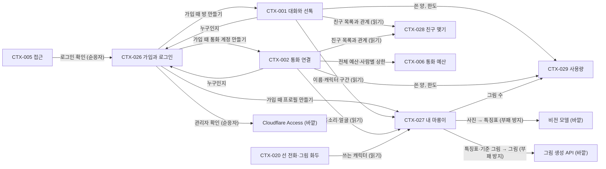

# 마롱이 통합 앱(MVP): 도메인 설계(새 맥락과 바뀌는 맥락)

상태: 한 번에 초안(2026-11-19 KST, Claude). 설계 제안 [unified-app.md](../unified-app.md)를 동희님이 2026-11-19 10:15 KST에 "승인"(D104)해서, 그 문서의 ID를 그대로 옮겼어요. 제안과 다른 곳은 8절에 적었어요.
범위: 안드로이드 앱과 웹(아이폰) 두 곳에서 쓰는 마롱이예요. 동희님이 보낸 초대 링크로 지인이 가입하고, 사람마다 자기 마롱이(이름·캐릭터·통화 목소리)를 가져요. 새 맥락은 CTX-026\~029 넷이고, 바뀌는 기존 맥락은 CTX-001·002·005·006이에요.
ID 번호: CTX-026\~029, TERM-173\~198, REQ-430\~483, FL-169\~178, SPEC-370\~396, TBL-164\~172, API-211\~242, SCR-163\~174, TASK-379\~410, TC-430\~495, 결정 D90\~D104([인계 목록](../10-wbs/README.md#id-범위)). D73\~D89는 비워 둬요.
표시: 근거가 동희님 말이나 문서·코드면 `[확실]`, 거기서 끌어낸 것은 `[추론]`, 근거 없는 짐작은 `[추측]`(6절 핫스팟에도 있음).

## 1. 서비스 개요

동희님 말(모두 2026-11-19 KST, 설계 논의 스레드. 전체 표는 [02 요구사항의 출처 표기](../02-prd/unified.md#출처-표기)):

- D90(01:04): "①로 정하기"
- D91(01:13): "B: 모두 승인"
- D92(01:13): "카톡/디코는 서비스 x. 이제 apk랑 웹(나는 아이폰이라 웹에서 해야해)에서만 할거야"
- D93(01:13): "전부 설계에 넣어"
- D94(01:13): "일단 현경이랑 나(웹) 그리고 누나(apk) 등 지인들이 사용할 수 있으면 돼", "나랑 현경이 + 회원가입하는사람(내 지인들. apk 혹은 웹으로)"
- D95(01:13): "그림 모델 이미 연구문서에 정했잔아"
- D96(01:13): "목소리 8개정도 놓고 선택할 수 있도록"
- D97(05:19): "초대링크로 ㄱㄱ"
- D98(10:02): "추천 승인"
- D99(10:02): "지금처럼 전부 남기고, 가입화면에서 알릴필요도 없어"
- D100(10:02): "전부 켜 좀. 그냥 좀 냅둬 지금 하는건. 서비스하면 그때가서 진짜로 시스템프롬프트 다시쓰던뭘하던하면되니까"
- D101(10:02): (지인의 글 답 모델 질문에) "2"
- D102(10:02): "비즈니스 모델을 '피클 에이전트' 처럼 하루에 일정한 양 만큼 대화를 얼마든지 할 수 있게 할거야. 그리고 그 이상은 티켓이나 뭐 이런걸 사야 되는걸로. (근데 지금은 기능만 만들어놓고 추천처럼 150달러로 해)"
- D103(10:02): "일단 MVP를 내는거지 지금 서비스를 내는게 아니잔아", "내 주위 사람들만 하고 다 안다고 이거 개발하는거 이거 같이 개발하는 사람들이라고"
- D104(10:15): "승인"

다시 쓰면: 마롱이를 안드로이드 앱과 웹에서만 써요(D92). 동희님이 관리자 화면에서 만든 초대 링크를 지인에게 직접 보내면, 지인은 그 링크로 가입하고 기기에 로그인이 유지돼요(D97). 사람마다 마롱이의 이름과 통화 목소리를 바꿀 수 있고(D96), 반려동물 사진으로 만든 강아지·고양이 캐릭터를 입혀 보고 적용할 수 있어요(D90, D91). 대화와 기억은 캐릭터를 바꿔도 그대로 이어져요. 가입한 사람끼리는 친구 코드로 친구를 맺어요(D93). 하루 사용량은 세기만 하고, 한도와 티켓은 자리만 만들어요(D102). `[확실]`

결정과 기본값:

- 범위는 MVP예요(D103). 쓰는 사람은 동희님 주위 사람들이고 같이 개발하는 사람들이에요. 그래서 고지·동의·본인 확인·결제·사람별 차단 장치는 만들지 않고, 지금 돌아가는 것(기록 시트, 프롬프트 한 벌, 무료 중계)은 그대로 둬요(D99, D100, D101).
- DB는 새로 짜지 않고 확장해요(D98). 캐릭터 데이터도 기존 `marong` DB에 `friend_id`로 둬요(D90).
- 앞선 결정 가운데 그대로 쓰는 것: 11/18 인계 문서의 "사람마다 자기 마롱이… 이름도 바꿀 수 있게", 웹 알림은 필요 없음, 통화 도구 대기 소리(1안), 통화에도 쇼핑 도구, 비동기를 기본으로. D62(Gemini Live 유지), D9(월 150달러와 80·100·120% 규칙), D65(APK 빌드·서명은 GPT).
- Claude가 둔 기본값(결정이 아니에요. 제안 19절): 그림 월 예산 20달러, 동시 통화 3, 보관하는 캐릭터 3개, 초대 링크 7일·로그인 90일·기기 추가 코드 10분, 친구 찾기는 친구 코드로, 반려동물 캐릭터를 쓰는 사람에게는 글 화두만. `[추측]`

사람과 시스템:

- 친구(TERM-162): 마롱이와 이야기하는 사람 한 명이에요. 이 설계에서 가입한 지인도 친구예요. 가입하고, 자기 마롱이의 이름·캐릭터·목소리를 정하고, 다른 친구와 친구를 맺어요. `[확실]`
- 관리자(동희님): 초대 링크를 만들어 직접 전하고, 회원 목록을 보고, 로그인을 끊고, 티켓을 넣어요. `[확실]`
- 마롱이: 사람마다 이름과 모습이 다를 수 있지만 능력(쇼핑·공부·검색·일정·고민)과 기억은 같아요(D91). `[확실]`
- 바깥 시스템: 비전 모델(사진 읽기, `claude-sonnet-5-5`), 그림 생성 API(`gpt-image-2.5-flare`)(D95), 통화 엔진(Gemini Live, D62), 글 모델(지금 경로 그대로, D101), 앱 푸시(FCM), Cloudflare Access(관리자 화면에만). `[확실]`

재료: 설계 제안 [unified-app.md](../unified-app.md), 표 정의 `marong/migrations/020_unified.sql`과 `marong/call/migrations/008_unified.sql`, 반려동물 part의 [도메인 설계](pet.md)(캐릭터 만들기 용어와 규칙), 2026-11-19 도구 선택 연구, Notion 11/18 인계 문서.

범위 밖: 결제와 티켓 판매, 추억 모드(떠난 아이), 마롱이끼리 직접 대화, 웹 푸시, iOS 앱, 구글 로그인, 일반 웹페이지 읽기 도구, 공개 가입. 카카오톡과 디스코드는 서비스하지 않아요(D92). 반려동물 part의 결제·구독·환불·상점·추억 모드·내보내기는 보류하고 문서는 남겨요.

## 2. 이벤트 스토밍

- 보드: 없음. 01 단계의 사람 보기는 GitHub PR이에요(`.corthex/project.json`, 2026-11-12 결정). 일하는 방식은 한 번에 초안(one-pass draft)이에요.
- 체크포인트 기록: 동희님 "승인"(2026-11-19 10:15 KST, D104). 8절에 적었어요.

### 시간 줄

| Lane | Events |
| --- | --- |
| 초대와 가입 | 초대 링크 만들어짐 → 초대 링크 쓰임 or 초대 링크 지남 → 가입됨 or 기존 계정 이어짐 → 기기 로그인됨 |
| 기기 | 기기 추가 코드 만들어짐 → 기기 로그인됨 or 코드 틀림 → 주소 막힘 ; 로그인 연장됨 → 로그인 끝남 or 로그인 끊김 |
| 내 마롱이 | 마롱이 이름 바뀜 ; 통화 목소리 바뀜 |
| 캐릭터 만들기 | 캐릭터 만들기 시작됨 → 사진 올려짐 → 특징표 만들어짐 → 특징표 고쳐짐 → 미리 보기 그림 만들어짐 → 그림 후보 만들어짐 → 정면 그림 골라짐 → 캐릭터 시트 만들어짐 → 이름 지어짐 |
| 입혀 보기와 적용 | 캐릭터 적용됨 → 기본 마롱이로 되돌려짐 or 다른 캐릭터 적용됨 ; 캐릭터 보관 끝남 |
| 친구 맺기 | 친구 요청 보내짐 → 친구 요청 수락됨 or 친구 요청 거절됨 → 가까운 사이 켜짐 or 꺼짐 → 친구 끊김 |
| 대화 | 메시지 받음 → 턴 계획 만들어짐 → 답 보냄 → 하루 사용량 더해짐 |
| 먼저 연락 | 먼저 하는 말 만들어짐 → 앱 알림 보내짐 or 방에 남겨짐 → 웹에서 읽힘 |
| 통화 | 통화 시작됨 or 통화 거절됨 → 도구 시작됨 → 도구 대기 소리 남 → 도구 끝남 → 통화 끝남 → 하루 사용량 더해짐 |
| 한도와 티켓 | 하루 한도 넘음 → 티켓 씀 or 한도로 막힘 ; 티켓 넣어짐 |

` ; `는 서로 다른 흐름이에요. 아래는 데이터를 바꾸지 않아서 읽기 모델로 적었어요: 입혀 본 모습, 목소리 견본, 내 친구 코드, 받은 요청·보낸 요청 목록, 오늘 사용량, 회원 목록, 초대 링크 목록(토큰 없음).

## 3. 바운디드 컨텍스트와 패키지

| Context | Type | Aggregates | Package |
| --- | --- | --- | --- |
| CTX-026 가입과 로그인 | supporting | 초대 링크(TERM-173), 기기 로그인(TERM-174), 기기 추가 코드(TERM-175) | 앱 서버 안(`marong/app_auth.py` 후보). 쿠키·Origin 확인은 `marong/pet/http.py`에서 가져옴 |
| CTX-027 내 마롱이(이름·캐릭터·목소리) | core | 내 마롱이(TERM-177), 캐릭터(TERM-179), 만들기 작업(TERM-185) | 앱 서버 안(`marong/character/` 후보). 계산 함수와 공급자 어댑터는 PR #47의 `marong/pet/`에서 가져옴 |
| CTX-028 친구 맺기 | supporting | 친구 사이(`marong.friendships`), 친구 요청(TERM-188) | 앱 서버 안(`marong/app_friends.py` 후보) |
| CTX-029 사용량 | supporting | 하루 사용량(TERM-190), 티켓(TERM-192) | 앱 서버와 통화 서버가 같이 쓰는 함수(`marong/usage.py` 후보) |

- CTX-027을 핵심으로 둔 이유: "사람마다 자기 마롱이"가 이 MVP에서 새로 생기는 값이고(11/18 인계, D91, D96), 이름·캐릭터·목소리를 바꿔도 대화와 기억이 이어진다는 규칙이 여기에 있어요. `[추론]`
- CTX-026·028·029를 지원 맥락으로 둔 이유: 가입, 친구 맺기, 사용량 세기는 흔한 기능이고, MVP 수준(D103)으로 가장 가볍게 만들어요. `[추론]`
- 패키지 칸의 파일 이름은 후보예요. 구현은 GPT가 하고, 실제 위치는 04 명세와 구현 PR에서 정해요. `[추측]`
- 같은 단어가 두 뜻:
  - '친구'(TERM-162)는 마롱이와 이야기하는 사람 한 명이에요. CTX-028의 '친구 맺기'는 그런 사람 둘 사이의 관계(`marong.friendships`)를 만드는 일이에요.
  - '캐릭터'(TERM-179)는 한 사람이 자기 마롱이에 입히는 모습 하나예요. 반려동물 part의 '반려동물 캐릭터'(TERM-101)와 만드는 순서는 같지만, 주인이 회원이 아니라 친구(`friend_id`)이고 결제와 모드가 없어요.
  - '티켓'(TERM-192)은 잔액 숫자뿐이에요. 반려동물 part의 '충전권'(TERM-125)처럼 파는 상품이 아니에요. '하루 사용량'(TERM-190)은 센 값이고, '하루 한도'(TERM-123)는 반려동물 part의 막는 값이에요.

바뀌는 기존 맥락:

| 맥락 | 바뀌는 것 |
| --- | --- |
| CTX-001 대화와 선톡([domain.md](domain.md)의 이름은 '카톡 대화(기존)') | 글 대화 서버가 디스코드 봇 프로세스에서 나와 앱 서버(TERM-194)가 돼요. 1:1 방이 방 주인(TERM-193)을 갖고, 대화·기억 읽기는 주인 조건으로 걸러요. 보내기 경로는 '앱 알림 → 방에 남김' 둘뿐이고 디스코드 분기는 없어져요. 먼저 말 걸기 설정과 상태는 `contact_settings`(TBL-168)로 옮겨요. 글 답에 턴 계획(TERM-195), 동시에 읽는 사전 조회(TERM-196), 답 하나의 상한이 생겨요 |
| CTX-002 통화 연결 | 통화 목소리(TERM-183)를 사람마다 골라요. 동시 통화는 한 사람에 하나, 서버 전체는 설정값(기본 3)까지예요. 도구 대기 소리(TERM-197)와 쇼핑 페이지 읽기 도구가 생기고, 통화 지시문에 되묻기·화제 잇기 규칙을 더해요. 통화 화면의 얼굴은 적용한 캐릭터의 표정 그림이에요 |
| CTX-005 접근 | 로그인이 Cloudflare Access 허용 이메일에서 CTX-026의 초대 링크와 기기 로그인으로 바뀌어요. Access는 관리자 화면(TERM-176)에만 남아요 |
| CTX-006 통화 예산 | 전체 월 150달러와 80·100·120% 규칙은 그대로예요(D9). 한 사람당 월 상한을 설정값으로 둘 수 있어요(D102). 통화 초는 CTX-029의 하루 사용량에도 더해져요 |

## 4. 컨텍스트 표

### CTX-026 가입과 로그인

목적: 동희님이 보낸 초대 링크 하나로 지인이 가입하고, 그 기기에 로그인이 유지되게 해요.

| Given by | Read model | Command | Aggregate | Events |
| --- | --- | --- | --- | --- |
| 관리자 | 회원 목록, 초대 링크 목록 | 초대 링크 만들기(종류, 메모) | 초대 링크 | 초대 링크 만들어짐 |
| 지인 | 초대 링크 상태(열림·쓰임·지남) | 가입하기(이름) | 초대 링크, 기기 로그인 | 초대 링크 쓰임, 가입됨, 기기 로그인됨 |
| 기존 계정의 주인 | 초대 링크 상태 | 기존 계정 잇기(`link`), 다시 로그인하기(`relogin`) | 초대 링크, 기기 로그인 | 초대 링크 쓰임, 기존 계정 이어짐, 기기 로그인됨 |
| 친구 | 내 마롱이 화면의 기기 추가 | 기기 추가 코드 만들기 | 기기 추가 코드 | 기기 추가 코드 만들어짐 |
| 친구(다른 기기) | 로그인 화면 | 코드로 로그인하기 | 기기 추가 코드, 기기 로그인 | 기기 로그인됨, 또는 코드 틀림, 주소 막힘 |
| 정책: 로그인된 요청이 올 때 | 기기 로그인 | 로그인 연장하기 | 기기 로그인 | 로그인 연장됨 |
| 친구 | | 로그아웃하기 | 기기 로그인 | 로그인 끊김 |
| 관리자 | 회원 목록 | 로그인 끊기(그 사람의 모든 기기) | 기기 로그인 | 로그인 끊김 |

- Aggregate rules: 초대 링크는 한 사람용이고 한 번 쓰면 끝나며, 만든 지 7일이 지나면 못 써요. `link`와 `relogin`은 만들 때 정한 친구 행에만 이어져요. 이메일이 같다고 자동으로 잇지 않아요. 서버는 초대 링크·로그인 토큰·기기 추가 코드의 해시만 저장해요. 기기 로그인은 쓸 때마다 연장되고 90일 동안 안 쓰면 끝나요. 기기 추가 코드는 10분 동안 한 번만 쓰고, 틀린 코드가 10분에 5번이면 그 주소를 10분 막아요. 가입 때 친구 행·프로필·먼저 말 걸기 설정·방·통화 계정을 한 트랜잭션으로 만들어요(SPEC-373). `[확실]` 제안 5절
- Given–When–Then: Given 동희님이 `join` 링크를 만들어 전함, When 지인이 링크를 열어 이름 '보리 누나'를 넣음, Then 친구 행과 '마롱이'라는 이름의 프로필과 방이 생기고 그 브라우저가 로그인돼요.
- Given–When–Then: Given 이미 한 번 쓴 초대 링크, When 다른 사람이 그 링크를 엶, Then 가입 화면이 '이미 쓴 링크'를 보이고 아무것도 만들지 않아요.
- Given–When–Then: Given 로그인된 웹에서 만든 기기 추가 코드, When 11분 뒤 앱의 로그인 화면에 넣음, Then 로그인되지 않고 코드를 다시 만들라고 안내해요.
- External systems: Cloudflare Access(관리자 화면만. 순응자: Access가 준 확인 값을 그대로 믿어요).

### CTX-027 내 마롱이(이름·캐릭터·목소리)

목적: 사람마다 마롱이의 이름·모습·통화 목소리를 정하고, 바꿔도 대화와 기억이 이어지게 해요.

| Given by | Read model | Command | Aggregate | Events |
| --- | --- | --- | --- | --- |
| 친구 | 내 마롱이(TERM-177) | 마롱이 이름 바꾸기 | 내 마롱이 | 마롱이 이름 바뀜 |
| 친구 | 목소리 목록, 목소리 견본(TERM-184) | 통화 목소리 고르기 | 내 마롱이 | 통화 목소리 바뀜 |
| 친구 | 보관한 캐릭터 목록(3개까지), 그림 예산 | 캐릭터 만들기 시작하기(강아지·고양이) | 캐릭터 | 캐릭터 만들기 시작됨, 또는 거절됨(3개 넘음, 그림 예산 다 씀) |
| 친구 | | 사진 올리기(1\~3장) | 캐릭터, 만들기 작업 | 사진 올려짐, 만들기 작업 시작됨 |
| 정책: 사진 올려짐 | 사진(EXIF 지움, 사람 얼굴 가림) | 특징표 만들기 | 만들기 작업 | 특징표 만들어짐, 또는 만들기 작업 실패 |
| 친구 | 특징표(TERM-105), 몸 템플릿(TERM-111) | 특징표 고치기, 몸 템플릿 고르기 | 캐릭터 | 특징표 고쳐짐 |
| 친구 | 특징표 | 미리 보기 그림 만들기 | 만들기 작업 | 미리 보기 그림(TERM-109) 만들어짐 |
| 친구 | 미리 보기 그림, 남은 다시 만들기 횟수 | 그림 후보 만들기, 또는 다시 만들기 | 만들기 작업 | 그림 후보(TERM-108) 만들어짐 |
| 친구 | 그림 후보 4장 | 정면 그림 고르기 | 캐릭터, 만들기 작업 | 정면 그림(TERM-106) 골라짐, 캐릭터 시트(TERM-107) 만들어짐 |
| 친구 | 캐릭터 시트 | 이름 짓기 | 캐릭터 | 이름 지어짐(캐릭터 준비됨) |
| 친구 | 입혀 본 모습(TERM-181) | 적용하기, 또는 나중에 | 내 마롱이 | 캐릭터 적용됨 |
| 친구 | 보관한 캐릭터 목록 | 기본 마롱이로 되돌리기, 다른 캐릭터 적용하기 | 내 마롱이 | 기본 마롱이로 되돌려짐, 다른 캐릭터 적용됨 |
| 친구 | 보관한 캐릭터 목록 | 캐릭터 보관 끝내기 | 캐릭터 | 캐릭터 보관 끝남(쓰던 것이면 기본 마롱이로) |
| 정책: 답이나 통화를 준비할 때 | 내 마롱이, 캐릭터, 친구 관계 | 캐릭터 구간(TERM-180) 만들기 | 내 마롱이 | (데이터를 바꾸지 않아요) |

- Aggregate rules: 마롱이 이름은 1\~12자이고 기본은 '마롱이'예요. 이름은 프롬프트의 캐릭터 구간, 화면 머리말, 알림 본문, 통화 호출어에 쓰이고, 알림 채널 이름과 앱 이름은 그대로예요. 프롬프트는 공통 부분 뒤에 캐릭터 구간을 붙여 만들어요. 쓰는 캐릭터가 반려동물이면 19금 절을 빼고, 그 밖의 계정은 지금 프롬프트 그대로예요(D91, D100). 반려동물 캐릭터는 건강을 판단하거나, 붙잡는 말을 하거나, 진짜 그 아이라고 주장하지 않아요(D91). 캐릭터는 한 사람이 3개까지 보관하고 쓰는 것은 하나예요. 적용하기 전에는 대화·통화·알림에 아무 영향이 없어요. 적용해도 대화와 기억은 그대로 이어져요. 캐릭터 만들기의 순서와 사진 규칙은 반려동물 명세 SPEC-316\~325 그대로이고, 결제 단계와 추억 모드만 없어요. 그림 월 예산이 80%에 닿으면 관리자에게 알리고 100%면 새 만들기를 거절해요. 통화 목소리는 통화를 시작할 때 정해지고 통화 중에는 안 바뀌어요. 목록에 없는 값이면 기본(Sulafat)을 써요. `[확실]` 제안 6·7·11절
- Given–When–Then: Given 이름이 '마롱이'인 친구, When 이름을 '콩떡'으로 바꿈, Then 다음 답의 프롬프트와 글 대화 화면 머리말과 알림 본문이 '콩떡'을 쓰고, 지난 대화와 기억은 그대로예요.
- Given–When–Then: Given 준비된 강아지 캐릭터 '보리', When 입혀 보기만 하고 '나중에'를 고름, Then 글 대화와 통화는 기본 마롱이 그대로이고 '보리'는 보관돼요.
- Given–When–Then: Given '보리'를 적용한 친구, When 글 답을 만듦, Then 프롬프트에 19금 절이 없고 캐릭터 구간에 이름 '보리', 종류 '강아지', 금지선이 들어가요.
- Given–When–Then: Given 이번 달 그림 비용 합이 예산과 같음, When 새 캐릭터 만들기를 시작함, Then 거절하고(`image_budget`) 이미 만든 캐릭터는 그대로 쓸 수 있어요.
- External systems: 비전 모델(부패 방지 계층: 특징표 칸으로만 받음), 그림 생성 API(부패 방지 계층: 화풍 지시문·특징표·기준 그림을 우리 쪽이 만들고 결과는 그림 파일만 받음. 사진은 보내지 않음).

### CTX-028 친구 맺기

목적: 가입한 사람끼리 친구 코드로 요청하고 수락해서 '아는 사이'가 되고, 그 관계를 대화와 통화의 맥락에 넣어요.

| Given by | Read model | Command | Aggregate | Events |
| --- | --- | --- | --- | --- |
| 친구 | 내 친구 코드(TERM-187) | (코드를 직접 전함) | | |
| 친구 | 친구 화면 | 친구 요청 보내기(상대의 코드) | 친구 사이 | 친구 요청 보내짐, 또는 거절됨(코드 없음, 자기 코드, 이미 친구, 이미 요청함, 하루 10번 넘음) |
| 상대 친구 | 받은 요청 목록 | 수락하기, 거절하기 | 친구 사이 | 친구 요청 수락됨, 또는 친구 요청 거절됨 |
| 친구 | 친구 목록(이름, 가까운 사이 여부, 내가 켠 값) | 가까운 사이 켜기·끄기 | 친구 사이 | 가까운 사이 켜짐, 또는 꺼짐 |
| 친구 | 친구 목록 | 친구 끊기 | 친구 사이 | 친구 끊김 |
| 친구 | 내 마롱이 화면의 공유 설정 | 공유 켜기·끄기 | 친구(`friends.share`) | 공유 설정 바뀜 |
| 정책: 답이나 통화를 준비할 때 | 친구 목록과 관계 | 관계를 맥락에 넣기 | 친구 사이 | (데이터를 바꾸지 않아요) |

- Aggregate rules: 친구 사이의 상태는 요청 중(`pending`)·수락됨(`accepted`)·거절됨(`declined`)·끊김(`ended`)이에요. 같은 두 사람 사이에 요청은 하나예요. 요청은 상대가 수락해야 이어져요. '가까운 사이'는 두 사람이 각자 켠 값(TERM-189)이 모두 켜져 있을 때만 적용돼요. 공유 층의 내용 규칙은 지금 그대로예요(가벼운 층, 가까운 사이 근황 층, 통화 내용은 공유 안 함, 위기·몸·식단 얘기는 넘어가지 않음). 회원 목록은 보여 주지 않고 친구 코드로만 찾아요. 관리자 명령(`admin friendship`·`share`)은 남고, 동희님과 현경님의 지금 관계는 수락됨으로 옮겨져요. `[확실]` 제안 9절
- Given–When–Then: Given 친구 가와 나가 수락된 사이이고 가만 '가까운 사이'를 켬, When 나의 마롱이가 가의 근황을 읽으려 함, Then 가벼운 층만 읽고 근황 층은 읽지 않아요.
- Given–When–Then: Given 수락된 친구가 둘 있는 사람, When 통화를 시작함, Then 통화 맥락에 그 두 사람의 이름과 관계가 들어가고 마롱이가 그 친구들을 아는 사람으로 말해요.
- External systems: 없음.

### CTX-029 사용량

목적: 사람마다 하루에 쓴 양을 세고, 설정값이 있을 때만 한도로 막고, 티켓 잔액의 자리를 둬요.

| Given by | Read model | Command | Aggregate | Events |
| --- | --- | --- | --- | --- |
| 정책: 글 답·통화·그림·검색·쇼핑 읽기가 끝날 때 | | 하루 사용량 더하기 | 하루 사용량 | 하루 사용량 더해짐 |
| 정책: 글 보내기와 통화 시작 전에(한도 설정값이 있을 때만) | 오늘 사용 단위(TERM-191), 티켓 잔액 | 한도 확인하기 | 하루 사용량, 티켓 | 통과함, 티켓 씀, 또는 한도로 막힘 |
| 친구 | 오늘 사용량 | | | |
| 관리자 | 회원 목록의 오늘 사용량·티켓 | 티켓 넣기(1\~1000) | 티켓 | 티켓 넣어짐 |

- Aggregate rules: 하루는 새벽 4시(한국 시각)에 바뀌어요. 세는 것은 글 답 수, 통화 초, 그림 수, 검색 수, 쇼핑 읽기 수와 그 환산 합(사용 단위)이에요. 하루 한도는 설정값 `MARONG_DAILY_UNITS`가 있을 때만 적용하고, 기본은 비어 있어서 세기만 해요. 한도가 켜져 있고 하루 양을 넘으면 티켓에서 빼고, 티켓이 0이면 막아요(`daily_limit`). 티켓은 관리자만 넣어요. 판매와 결제는 없어요(D102). 전체 합계 한도(글 검색 40, 쇼핑 읽기 100, 통화 검색 60, 먼저 말 걸기 60)는 지금대로 둬요. 단위 환산의 출발값(통화 1분 30, 그림 1장 40)은 `[추측]`이에요. `[확실]` 제안 13절
- Given–When–Then: Given 한도 설정값이 비어 있음, When 한 사람이 하루에 글 답 300개를 받음, Then 막지 않고 그날 행의 글 답 수만 300이 돼요.
- Given–When–Then: Given 한도 설정값이 있고 오늘 단위가 한도를 넘었고 티켓이 0, When 글을 보냄, Then 보내기를 거절하고(`daily_limit`) 새벽 4시 뒤에 다시 돼요.
- External systems: 없음.

## 5. 컨텍스트 사이 의존

| From | To | Kind | Pattern | Why | Data |
| --- | --- | --- | --- | --- | --- |
| CTX-005 | CTX-026 | call (sync) | 순응자 | 앱 서버와 통화 서버가 같은 로그인을 확인 | 로그인 쿠키 → 친구 |
| CTX-001, CTX-002, CTX-027, CTX-028, CTX-029 | CTX-026 | call (sync) | 순응자 | 요청한 사람이 누구인지 | 로그인 쿠키 → 친구 |
| CTX-026 | CTX-027, CTX-001, CTX-002 | call (sync, 한 트랜잭션) | 고객-공급자 | 가입 때 프로필·방·통화 계정 만들기 | 친구, 이름 |
| CTX-001 | CTX-027 | call (sync, 읽기만) | 고객-공급자 | 프롬프트의 캐릭터 구간, 머리말·알림의 이름 | 마롱이 이름, 캐릭터 종류·특징 요약·말투 |
| CTX-002 | CTX-027 | call (sync, 읽기만) | 고객-공급자 | 통화 목소리, 호출어, 통화 화면의 얼굴 | 통화 목소리, 마롱이 이름, 표정 그림 |
| CTX-001, CTX-002 | CTX-028 | call (sync, 읽기만) | 고객-공급자 | 친구 목록과 관계를 맥락에 | 이름, 관계, 가까운 사이 여부 |
| CTX-001, CTX-002, CTX-027 | CTX-029 | call (sync) | 고객-공급자 | 쓴 양 더하기, 시작 전 한도 확인 | 친구, 종류, 양 |
| CTX-002 | CTX-006 | call (sync) | 고객-공급자 | 통화 전 전체 예산과 사람별 상한 확인 | 친구, 이번 달 합 |
| CTX-027 | 비전 모델 | call (async, 만들기 작업) | 부패 방지 계층 | 특징표 만들기 | 사진(EXIF 지움, 사람 얼굴 가림) → 종·털 색·무늬·귀 |
| CTX-027 | 그림 생성 API | call (async, 만들기 작업) | 부패 방지 계층 | 미리 보기·후보·캐릭터 시트 | 화풍 지시문, 특징표, 기준 그림 → 그림 파일 |
| CTX-020 | CTX-027 | call (sync, 읽기만) | 고객-공급자 | 화두를 고를 때 쓰는 캐릭터를 읽음. 반려동물 캐릭터면 그림 화두 대신 글 화두만 | 친구, 쓰는 캐릭터의 종류 |
| CTX-026(관리자 화면) | Cloudflare Access | call (sync) | 순응자 | 관리자 확인 | Access 확인 값 → 관리자 |

동기 호출이 원을 이루는 곳은 없어요. CTX-026은 가입할 때만 CTX-027·001·002의 행을 만들고, 그 뒤에는 다른 맥락이 CTX-026을 읽기만 해요. 새로 만드는 서버 경로와 작업은 비동기로 만들고(11/18 인계), 표의 'sync'는 한 요청 안에서 답을 기다린다는 뜻이에요.

## 6. 핫스팟

제안 20절의 '확인하지 못한 것'을 그대로 옮겼어요. 모두 구현이나 실기기 확인 때 닫아요.

| Hotspot | Context | State | Answer or next step |
| --- | --- | --- | --- |
| 아이폰 사파리에서 로그인 쿠키가 유지되는 기간 | CTX-026 | open | 실기기 확인(제안 16절)에서 봐요. 짧으면 `relogin` 링크와 기기 추가 코드로 다시 들어와요 `[추측]` |
| 지금 배포된 앱의 versionCode. `main`의 빌드 설정은 5(0.2.2)이고 인계 기록은 7보다 커야 한다고 해요 | CTX-021 | open | 빌드 전에 서버의 릴리스 파일로 확인해요 |
| `gpt-image-2.5-flare`의 투명 배경과 크기 지원, 템플릿 5종과 닮음 기준 값 | CTX-027 | open | 모두 반려동물 명세의 `[추측]`이에요. 닮음 시험(약 12달러)은 아직 하지 않았어요 |
| 지금 Live 모델에서 사람별 목소리 지정이 통화마다 되는지 | CTX-002, CTX-027 | open | 코드는 목소리 이름을 상수로 넘기고 있어서 될 것으로 봐요 `[추론]`. 실제로 바꿔 본 기록이 없어서 구현 첫 단계에서 확인해요 |
| 목소리 8개의 목록 | CTX-027 | open | 한국어로 들어 본 기록이 Sulafat뿐이에요. 듣기 시험(SCR-119) 뒤에 목록을 정하고, 그 전에는 Sulafat 하나만 보여요 |
| 운영 서버 봇 파일 4개가 `main`과 다른 까닭 | CTX-001 | open | 적용 전에 출처를 확인해요(제안 15절) |
| 앱의 글 대화 창(별도 창)에서 사진 고르기가 동작하는지 | CTX-027 | open | 실기기 확인. 안 되면 캐릭터 만들기는 앱의 본 화면이나 웹에서 열어요 `[추측]` |
| 사람이 늘 때 먼저 막히는 곳(DB 연결 4개, 5초마다 물어보는 글 대화 화면) | CTX-001 | open | 코드에서 읽은 `[추론]`이에요. 지인 몇 명 규모에서는 그대로 둬요 |
| 사용 단위 환산값(통화 1분 30, 그림 1장 40) | CTX-029 | open | `[추측]`. 한도 설정값을 켜기 전에 쌓인 사용량으로 다시 정해요 |
| 도구 호출을 기다리지 않는 통화(2안) | CTX-002 | open | 이번에는 넣지 않아요. 대기 소리를 먼저 넣고, 지금 Live 모델이 그 방식을 받는지 확인한 뒤 정해요 |

## 7. 용어집

캐릭터 만들기의 용어는 반려동물 part의 것을 그대로 써요: 특징표(TERM-105), 정면 그림(TERM-106), 캐릭터 시트(TERM-107), 그림 후보(TERM-108), 미리 보기 그림(TERM-109), 캐릭터 만들기(TERM-110), 몸 템플릿(TERM-111). 뜻은 [pet.md 7절](pet.md#7-용어집)에 있고, 이 MVP에서는 그 뜻에서 '결제'와 '회원'만 빼고 읽어요(미리 보기 뒤에 바로 그림 후보, 주인은 친구).

| ID | Term | Definition | Context | Code name | Avoid |
| --- | --- | --- | --- | --- | --- |
| TERM-173 | 초대 링크 | 관리자가 관리자 화면에서 만드는 한 사람용 주소. 종류는 가입(`join`), 기존 계정 연결(`link`), 다시 로그인(`relogin`) 셋이에요. 한 번 쓰면 끝나고 7일이 지나면 못 써요 | CTX-026 | `marong.invites`(TBL-164) | 초대 코드, 초대장, 가입 코드 |
| TERM-174 | 기기 로그인 | 초대 링크나 기기 추가 코드로 로그인한 기기(브라우저나 앱) 하나의 로그인 상태. 쓸 때마다 연장되고 90일 동안 안 쓰면 끝나요. 서버에는 토큰의 해시만 있어요 | CTX-026 | `marong.app_sessions`(TBL-165), 쿠키 `marong_session` | 자동 로그인, 계정 로그인 |
| TERM-175 | 기기 추가 코드 | 로그인된 기기에서 만들어 다른 기기에 넣는 6자리 코드. 10분 동안 한 번만 써요 | CTX-026 | `marong.device_codes`(TBL-166) | 인증번호, 친구 코드 |
| TERM-176 | 관리자 화면 | 동희님만 쓰는 관리 페이지(`/chat/admin/` 아래 화면 그룹): 개요(SCR-169), 회원(SCR-200·201), 초대 링크(SCR-202), 앱 버전(SCR-203), 비용(SCR-204), 아이템(SCR-186). 모두 Cloudflare Access와 관리자 확인 뒤에 있어요. D136 1-1로 바뀜(2026-11-23, 전에는 한 화면 SCR-169) | CTX-026 | `/chat/admin/` | 어드민, 백오피스 |
| TERM-177 | 내 마롱이(프로필) | 사람마다 가진 마롱이 설정 한 벌. 마롱이 이름, 쓰는 캐릭터, 통화 목소리, 친구 코드, 티켓 잔액이 들어 있어요. 가입하거나 기존 계정을 이을 때 만들어져요 | CTX-027 | `marong.friend_profiles`(TBL-167) | 계정 설정, 회원 정보 |
| TERM-178 | 마롱이 이름 | 그 사람이 자기 마롱이를 부르는 이름. 1\~12자이고 기본은 '마롱이'예요. 프롬프트, 화면 머리말, 알림 본문, 통화 호출어에 쓰여요 | CTX-027 | `bot_name` | 닉네임, 별명 |
| TERM-179 | 캐릭터 | 한 사람이 반려동물 사진으로 만든 강아지·고양이 모습 하나. 3개까지 보관하고 쓰는 것은 하나예요. 반려동물 part의 반려동물 캐릭터(TERM-101)와 달리 주인이 친구이고 결제와 모드가 없어요 | CTX-027 | `marong.characters`(TBL-169) | 아바타, 스킨, 펫 |
| TERM-180 | 캐릭터 구간 | 공통 프롬프트 뒤에 붙이는 사람별 부분. 이름, 종류(기본·강아지·고양이), 특징 요약, 말투 한 줄, 금지선, 친구 관계 한 줄이 들어가요 | CTX-027, CTX-001 | `character_section` 후보(SPEC-377) | 개인 프롬프트, 페르소나 |
| TERM-181 | 입혀 보기 | 적용하기 전에 글 대화 화면과 통화 화면에 캐릭터를 입힌 모습을 보는 일. 정해 둔 예시 문장을 쓰고 아무것도 저장하지 않아요 | CTX-027 | `try`(API-227) | 체험, 미리 보기(미리 보기 그림 TERM-109와 헷갈림) |
| TERM-182 | 적용 | 준비된 캐릭터를 그 계정의 마롱이로 쓰기 시작하는 일. 이름·모습·말투가 바뀌고 대화와 기억은 이어져요 | CTX-027 | `friend_profiles.character_id` | 장착, 활성화 |
| TERM-183 | 통화 목소리 | 그 사람의 통화에서 마롱이가 내는 목소리. 설정값 목록에서 고르고 기본은 Sulafat예요. 통화를 시작할 때 정해져요 | CTX-027, CTX-002 | `friend_profiles.voice`, `MARONG_CALL_VOICES` | 음성, 보이스 |
| TERM-184 | 목소리 견본 | 고르기 전에 들어 보는, 미리 만든 짧은 소리 파일. 목소리마다 하나예요 | CTX-027 | `sampleUrl`(API-218) | 샘플, 미리 듣기 파일 |
| TERM-185 | 만들기 작업 | 캐릭터 만들기에서 오래 걸리는 단계(특징표, 미리 보기, 후보, 캐릭터 시트) 하나를 요청 밖에서 돌리는 작업. 화면은 상태를 다시 물어요 | CTX-027 | `marong.character_jobs`(TBL-171) | 잡, 큐 |
| TERM-186 | 기본 마롱이 | 캐릭터를 적용하지 않았을 때의 지금 마롱이 모습(표정 그림 21장, 그림 화두 31장) | CTX-027 | `character_id`가 비어 있음 | 오리지널, 원래 캐릭터 |
| TERM-187 | 친구 코드 | 사람마다 하나씩 가진 6자 코드. 상대에게 직접 알려 주면 상대가 그 코드로 친구 요청을 보내요 | CTX-028 | `friend_profiles.friend_code` | 초대 코드, 아이디 |
| TERM-188 | 친구 요청 | 상대의 친구 코드를 넣어 보낸, 아직 답을 받지 못한 요청. 상대가 수락하거나 거절해요 | CTX-028 | `friendships.state = 'pending'` | 팔로우, 친구 추가 |
| TERM-189 | 가까운 사이 바람(각자 켠 값) | 친구 사이에서 한 사람이 '가까운 사이'를 켠 값. 두 사람이 모두 켰을 때만 가까운 사이가 적용돼요 | CTX-028 | `friendships.close_a`, `close_b`(적용 값은 `close`) | 절친, 베프 |
| TERM-190 | 하루 사용량 | 한 사람이 하루(새벽 4시 기준)에 쓴 글 답 수, 통화 초, 그림 수, 검색 수, 쇼핑 읽기 수. 센 값이고, 반려동물 part의 하루 한도(TERM-123)와 달라요 | CTX-029 | `marong.usage_daily`(TBL-172) | 쿼터, 할당량 |
| TERM-191 | 사용 단위 | 글 답·통화·그림을 한 수로 환산한 값. 하루 한도를 걸 때 이 값으로 비교해요 | CTX-029 | `units`, `MARONG_DAILY_UNITS` | 포인트, 크레딧 |
| TERM-192 | 티켓 | 하루 한도를 넘은 사용에서 빠지는 잔액 숫자. 관리자만 넣어요. 판매와 결제는 없어요 | CTX-029 | `friend_profiles.tickets` | 충전권(TERM-125), 캐시 |
| TERM-193 | 방 주인 | 1:1 방을 가진 친구. 대화·요약·메모·임베딩 읽기는 주인 조건으로 걸러요. 채널 방은 주인이 없어요 | CTX-001 | `rooms.owner_friend_id` | 방장 |
| TERM-194 | 앱 서버 | 디스코드 클라이언트 없이 뜨는 서버. 글 대화, 가입과 로그인, 캐릭터, 친구, 작업 루프를 맡아요. 모든 페이지와 API가 `/chat/` 아래에 있어요 | CTX-001, CTX-026 | SPEC-376의 진입점 | 봇 서버, 백엔드 |
| TERM-195 | 턴 계획 | 글 답의 맥락을 준비하기 전에 이번 말이 무엇을 묻는지 가볍게 판단한 기록. 의도, 사전 조회 범위, 이유, 확신도가 들어가요 | CTX-001 | `MARONG_TURN_PLAN`(`off`·`shadow`·`prefetch`) | 라우터, 의도 분류기 |
| TERM-196 | 사전 조회 | 모델을 부르기 전에 일정, 구글 캘린더, 최근 대화, 기억 검색을 읽어 맥락에 넣는 일 | CTX-001 | `prefetch` | 프리로드, 선조회 |
| TERM-197 | 도구 대기 소리 | 통화에서 도구가 돌거나 모델이 생각하는 동안 결과가 올 때까지 나는 효과음. 마롱이 목소리와 겹치지 않아요 | CTX-002 | `MARONG_CALL_WAIT_SOUND` | 통화 연결음, 대기 멘트 |
| TERM-198 | 작업 루프 | 앱 서버에서 주기마다 도는 일. 먼저 말 걸기, 일정 알림, 구글 캘린더 동기화, 기억 정리예요 | CTX-001 | `MARONG_LOOPS_HOME`(`bot`·`app`) | 크론, 배치 |

## 8. 체크포인트 노트(한 번에 초안, 1\~3 합침)

1. 체크포인트: 동희님이 설계 제안 [unified-app.md](../unified-app.md)를 2026-11-19 10:15 KST 설계 논의 스레드에서 "승인"이라고 답했어요(D104). 이 문서는 그 제안의 4\~13절을 01 단계 모양으로 옮긴 것이고, 새로 정한 방향은 없어요.
2. 제안과 다른 곳(계약 문서를 쓰면서 고친 것): 마이그레이션 번호는 020이에요(019는 성향 part가 씀). 모든 페이지와 API는 `/chat/` 아래에 있어요. 캐릭터 만들기 화면은 반려동물 part의 SCR-142\~146을 고치지 않고 새 번호 SCR-170\~174로 써요. 친구 사이의 상태에 거절됨·끊김이 더해지고, 가까운 사이는 각자 켠 값 둘로 저장해요. 프로필 행은 미리 채우지 않고 가입하거나 기존 계정을 이을 때 만들어요.
3. 추측으로 둔 것: 1절의 기본값(그림 월 예산 20달러, 동시 통화 3, 캐릭터 3개, 7일·90일·10분, 친구 코드, 글 화두만), 3절의 패키지 후보, 사용 단위 환산값. 다르게 원하시면 그 줄만 말씀해 주세요.
4. 핵심 맥락의 규칙: 4절 CTX-027의 Aggregate rules예요. 가장 중요한 넷은 ⓐ 적용하기 전에는 대화에 아무 영향이 없고, 적용해도 대화와 기억은 이어짐 ⓑ 반려동물 캐릭터일 때만 19금 절을 빼고 그 밖의 계정은 지금 프롬프트 그대로 ⓒ 반려동물 캐릭터는 건강 판단·붙잡는 말·진짜 그 아이라는 주장을 하지 않음 ⓓ 사진은 EXIF를 지우고 사람 얼굴을 가린 뒤에만 비전 모델로 보내고 그림 모델에는 보내지 않음.
5. 열린 질문: 없어요. 6절 핫스팟은 구현과 실기기 확인에서 닫는 사실 확인이에요.
