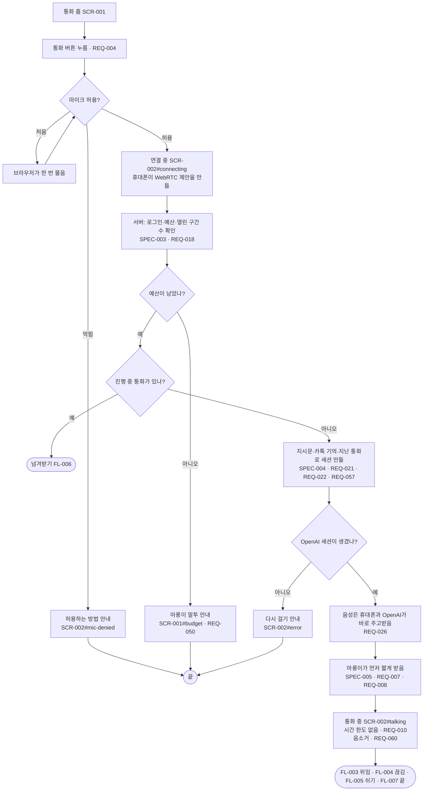

# FL-002 마롱이에게 전화 걸기

Serves: REQ-004, REQ-007, REQ-008, REQ-009, REQ-010, REQ-018, REQ-021, REQ-022, REQ-023, REQ-024, REQ-026, REQ-049, REQ-050, REQ-057, REQ-060, REQ-061, REQ-062, REQ-063, REQ-064, REQ-065
Screens: SCR-001, SCR-002

마롱이는 성인의 어른스러운 여성 목소리로 말해요(D16, REQ-065). 목소리는 서버 설정(기본 `noeul`)이고 통화 중에는 바뀌지 않아요(REQ-024). 통화 화면에는 통화 시간을 보여 주지 않아요(요구사항 '범위 동결 전 빠진 것 찾기').

통화 중 마롱이 얼굴(REQ-061~064, SPEC-029·030): 거는 동안은 기본 얼굴이 눈을 깜빡여요. 현경님이 말하면 듣는 얼굴, 말이 끝나고 마롱이가 말하기 전에는 생각하는 얼굴이에요. 마롱이가 말하면 동희님이 고른 GPT talk 움직임으로 입이 움직이고(말하면서도 눈을 깜빡여요), 문장마다 고른 느낌(웃음·신남·걱정 등)이 있으면 그 얼굴로 바뀌어 말이 끝나고 2.5초 동안 남아요. 그림이나 느낌을 못 얻어도 통화는 그대로예요.
