# FL-003 통화 중에 기억 찾기·기억해 두기·잊어 주기

Serves: REQ-027, REQ-028, REQ-029, REQ-030, REQ-031, REQ-032, REQ-033, REQ-056, REQ-059
Screens: SCR-002(화면은 그대로, 마롱이 목소리로만 답함)

```mermaid
flowchart TD
  A["현경님: 저번에 내가 말한 카페 어디였지?"] --> B["gpt-live-1이 위임을 만듦<br/>session.delegation.created"]
  B --> C["서버: 최근 자막으로 요청을 다시 만듦<br/>SPEC-012"]
  C --> D["분류 모델은 자막만 봄<br/>REQ-032"]
  D -->|"6초 넘김·실패"| N["기억이 잘 안 난다고 솔직하게<br/>REQ-031 · REQ-027"]
  D --> E{"무슨 일?"}
  E -->|"기억 찾기"| F["코드가 카톡·통화 기록 검색<br/>SPEC-013"]
  F --> F1{"찾았나?"}
  F1 -->|예| F2["답 만들기 모델, 쓰기 없음<br/>근거 id를 코드가 확인"] --> R["결과를 음성 모델에 전함<br/>commentary.append"]
  F1 -->|아니오| N
  E -->|"기억해 두기"| G{"인용이 방금 자막에 있고<br/>번호·길이 규칙 통과?"}
  G -->|아니오| N2["저장 못 했다고 솔직하게<br/>번호는 저장 안 함 · REQ-059"]
  G -->|예| G1{"그사이 현경님이 더 말했나?"}
  G1 -->|예| G2["저장하지 않고<br/>다 듣고 다시 맡기게 함"]
  G1 -->|아니오| G3["통화 기억 저장, 멱등 키<br/>SPEC-014"] --> R2["저장 뒤에만 '기억해 뒀어'<br/>REQ-028"]
  E -->|"잊어 주기"| H{"맞는 통화 기억이 몇 개?"}
  H -->|"1~3개"| H1["지움<br/>SPEC-015 · REQ-029"] --> R3["응, 잊을게"]
  H -->|"0개"| H0["그런 기억은 없다고"] --> Z
  H -->|"4개 넘음"| H4["어떤 건지 조금 더 물어봄"] --> Z
  E -->|"지금 시각"| T["한국 시각을 전함<br/>SPEC-016 · REQ-030"]
  E -->|"바깥 정보·그 밖"| O["못 찾아본다고 솔직하게<br/>REQ-033"]
  R --> Z(["통화 계속"])
  N --> Z
  N2 --> Z
  G2 --> Z
  R2 --> Z
  R3 --> Z
  T --> Z
  O --> Z
```

위임을 기다리는 동안에도 통화는 이어져요. 1.2초 안에 결과가 없으면 마롱이가 "음, 잠깐만"처럼 짧게 받아요(OpenAI 자동 응답, `acknowledgement_delay_ms`).
