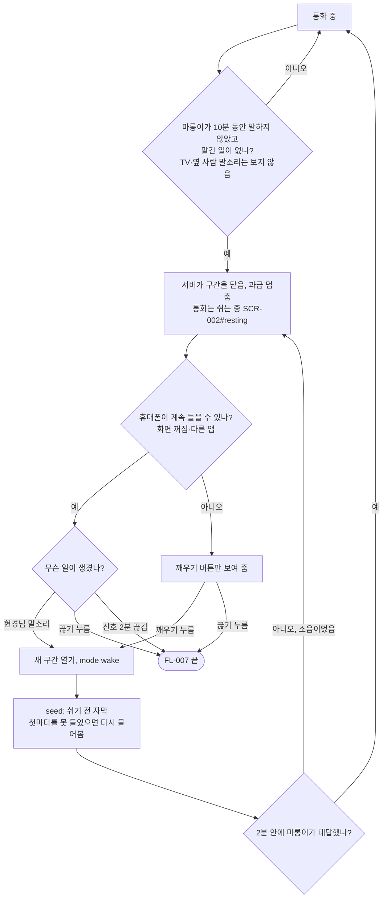

# FL-005 조용할 때 쉬고 다시 이어 받기

Serves: REQ-019, REQ-020, REQ-061
Screens: SCR-002
상태: active. D8: 동희님 2026-11-12 12:36 KST 결정 카드에서 '쉬었다가 말하면 이어받기'를 골랐어요(처음 제안 '30분 조용하면 끊기'는 쓰지 않아요).

쉬기 판단: 현경님 쪽 소리와 자막은 TV·음악·옆 사람 말소리까지 섞여서 보지 않아요. 마롱이는 그런 소리에 대꾸하지 않으니(통화 지시문 '조용할 때'), 마롱이가 10분 동안 말하지 않았으면 대화가 없는 거예요(SPEC-008). 화면이 꺼지거나 다른 앱일 때 말소리로 깨울 수 있는지는 10단계 전에 갤럭시에서 봐요(기능 명세 7.1).

얼굴: 쉬기 시작하면 3초 동안 졸린 얼굴(11), 그 뒤 잠든 얼굴(12)이 천천히 숨쉬어요. 깨우는 동안은 졸린 얼굴이에요(REQ-061, SPEC-029).

비용: 쉬는 동안은 OpenAI 구간이 없어서 과금되지 않아요. 깨울 때마다 새 구간이 열려요(초기화 15초 과금은 세션이 돌기 시작하면 돌려받는다고 OpenAI 문서에 있음).
