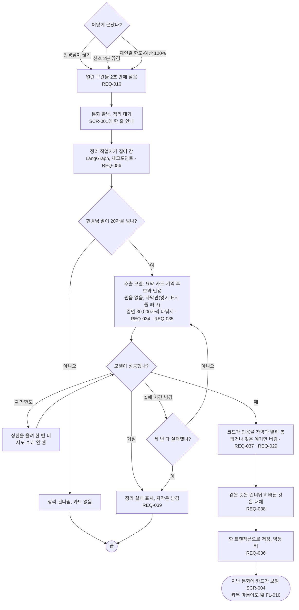

# FL-007 통화 끝내기와 기억 정리

Serves: REQ-011, REQ-016, REQ-020, REQ-029, REQ-034, REQ-035, REQ-036, REQ-037, REQ-038, REQ-039, REQ-056
Screens: SCR-001, SCR-002, SCR-004

마롱이(모델)에게는 통화를 끝내는 길이 없어요(REQ-011). 통화는 아래 세 가지로만 끝나요.

