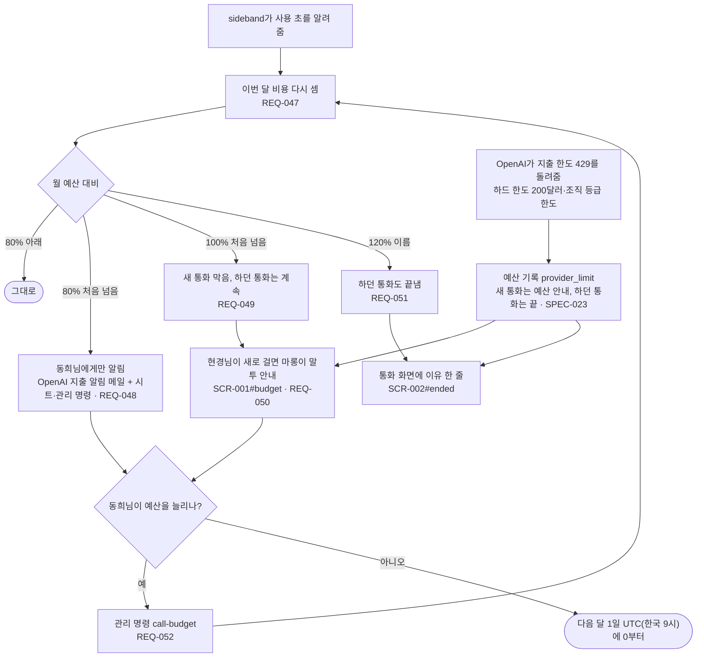

# FL-009 월 예산

Serves: REQ-047, REQ-048, REQ-049, REQ-050, REQ-051, REQ-052, REQ-061
Screens: SCR-001, SCR-002

OpenAI 쪽 하드 한도는 서버의 120%(180달러)보다 높은 200달러로 둬서, 보통은 서버의 예산 안내가 먼저 걸려요. 그래도 OpenAI가 먼저 막으면(조직 등급 한도, 반영 지연) '전화를 못 받아' 대신 같은 예산 안내로 이어요(SPEC-003, SPEC-007, SPEC-023).

예산 때문에 막힌 통화 홈과, 120%로 끝난 통화 화면의 마롱이 얼굴은 슬픈 얼굴(06)이에요(REQ-061, SPEC-029).
