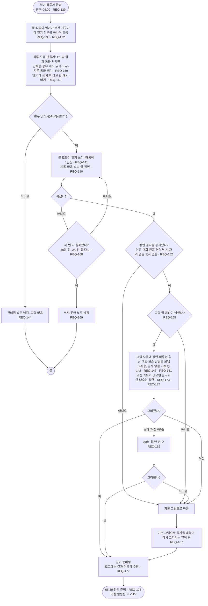

# FL-114 밤에 일기 쓰기와 그리기

Serves: REQ-138, REQ-139, REQ-140, REQ-141, REQ-142, REQ-143, REQ-144, REQ-159, REQ-160, REQ-161, REQ-162, REQ-165, REQ-166, REQ-167, REQ-168, REQ-169, REQ-172, REQ-173, REQ-174, REQ-175, REQ-177
Screens: 없음(밤 작업. 친구는 다음 날 일기장에서 봐요, FL-115)

일기가 켜진 친구마다 일기 하루가 끝난 뒤 한 번 돌아요. 글은 마롱이 1인칭이에요(D22). 아침 알림은 [FL-115](FL-115-diary-morning.md)예요.

