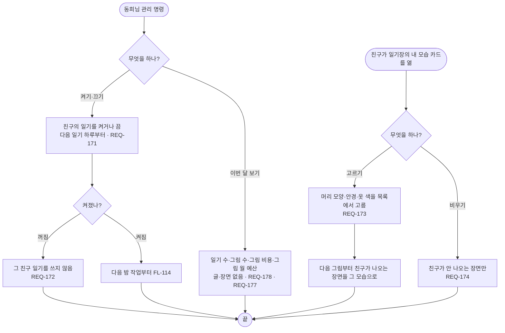

# FL-119 일기 켜기·끄기와 내 모습 카드

Serves: REQ-171, REQ-172, REQ-173, REQ-174, REQ-177, REQ-178
Screens: SCR-113, SCR-118(켜기·끄기와 이번 달 보기는 동희님 관리 명령이라 화면 없음)

켜고 끄기는 동희님만 해요(README '설정은 관리자(동희)만 정해요'). 처음에는 모두 꺼져 있어요.

