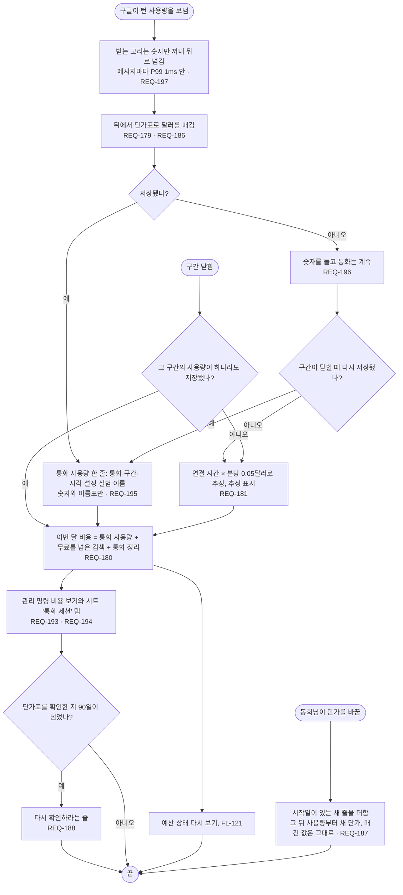

# FL-120 통화 사용량 기록과 이번 달 비용

Serves: REQ-179, REQ-180, REQ-181, REQ-186, REQ-187, REQ-188, REQ-193, REQ-194, REQ-195, REQ-196, REQ-197
Screens: 없음(관리 명령과 시트 '통화 세션' 탭)

지금 통화(Gemini 길: 웹 통화 서버, 디스코드 음성 중계) 모두 같은 흐름이에요. 구글은 턴마다 문맥 전체를 다시 과금해서, 시간이 아니라 턴의 토큰으로 세요.

