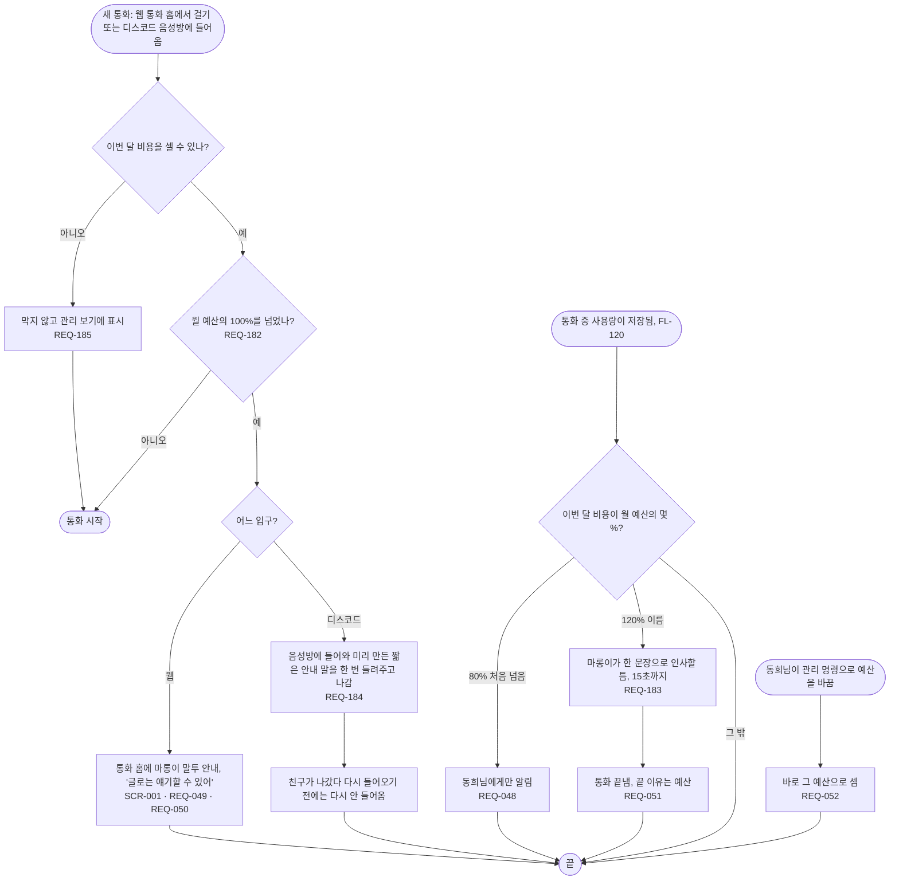

# FL-121 지금 통화의 예산 확인과 막기

Serves: REQ-048, REQ-049, REQ-050, REQ-051, REQ-052, REQ-182, REQ-183, REQ-184, REQ-185
Screens: SCR-001

처음 예산 흐름 [FL-009](FL-009-budget.md)를 Gemini 길(웹 `/live`, 디스코드 음성방)에 다시 거는 흐름이에요. 금액과 80·100·120%는 D6·D9 그대로예요.

구글 지출 상한 예산은 서버 120%(180달러)보다 높게(예: 200달러) 동희님이 콘솔에서 걸어요. 서버가 돈을 못 세는 동안에도 구글이 막아 줘요(REQ-185).
