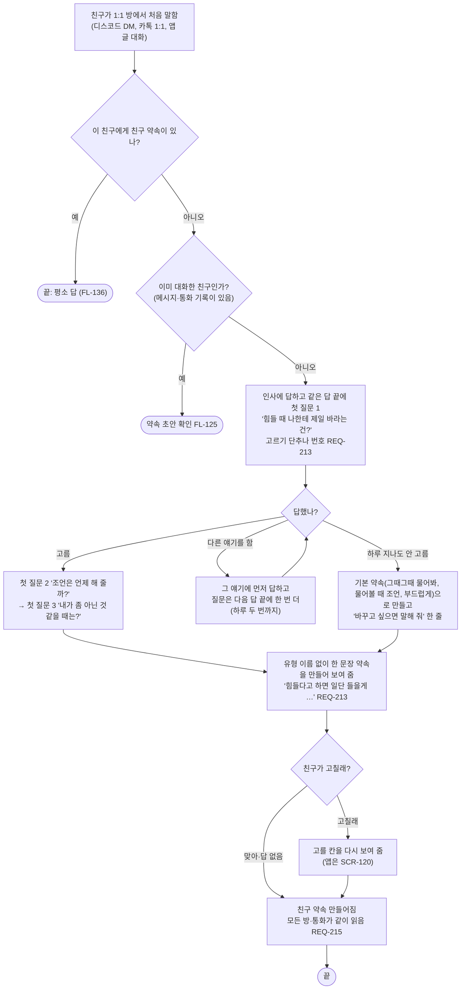

# FL-124 새 친구가 친구 약속을 만들기

Serves: REQ-213, REQ-215, REQ-221, REQ-233
Screens: 디스코드 DM·카톡 1:1·앱 글 대화의 첫 질문 카드(SCR-123), 앱 친구 약속 화면(SCR-120)
Context: CTX-008(바뀌는 기존 맥락 CTX-001)

- 질문 문구와 고를 칸은 01 도메인 TERM-041·042. 질문은 한 답에 하나씩만 붙이고, 친구가 하던 얘기를 끊지 않아요.
- 단체방에서 처음 말한 친구에게는 묻지 않아요. 1:1에서 처음 말할 때 물어요(REQ-221: 1:1에만).
- 질문이 붙은 답도 보내기 전 검사를 지나요(REQ-233). 질문 두 개 이상 검사는 첫 질문 카드에는 걸지 않아요(카드 하나가 질문 하나).
