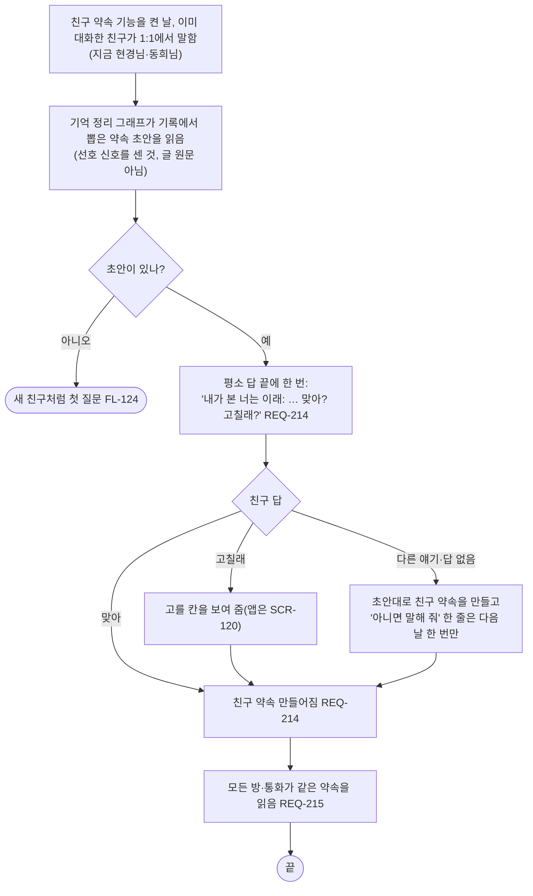

# FL-125 이미 대화한 친구가 약속 초안을 확인하기

Serves: REQ-214, REQ-215
Screens: 디스코드 DM·카톡 1:1·앱 글 대화의 약속 초안 카드(SCR-123), 앱 친구 약속 화면(SCR-120)
Context: CTX-008, CTX-011

- 초안은 '내가 본 너'이지 '너는 이런 사람'이 아니에요(TERM-040 Avoid). 근거가 된 대화 글은 보여 주지 않아요.
- 묻는 것은 한 번이고, 답이 없어도 다시 조르지 않아요(동희님 '묻지 말고 진행' 규칙과 같은 방향).
