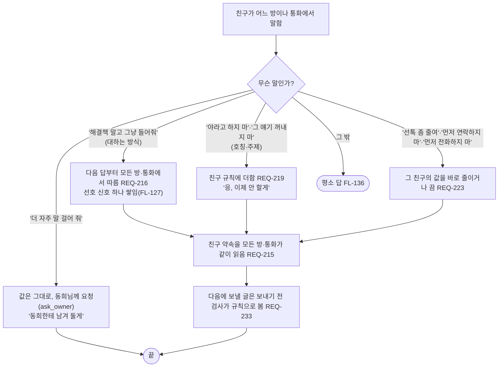

# FL-126 친구가 말로 대하는 방식·규칙을 고치기

Serves: REQ-215, REQ-216, REQ-219, REQ-223, REQ-233
Screens: 없음(대화). 앱은 SCR-120에서 같은 값을 봄
Context: CTX-008, CTX-013

- 끄기·켜기를 알아채는 정해진 말은 지금 DM의 `proactive_preference`(ON·OFF 목록)를 넓혀 써요. 모델이 알아챈 경우는 도구로 받아요(04 단계).
- REQ-223은 2차 논의에서 확인할 추론이에요(02 겹침 절).
