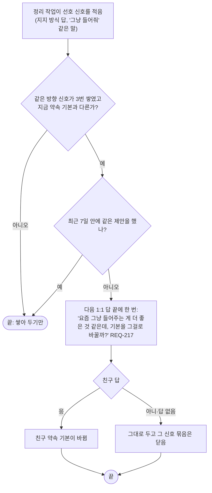

# FL-127 쌓인 선호 신호로 약속 바꾸기를 제안하기

Serves: REQ-217
Screens: 대화 안 제안 카드(SCR-123), 앱 친구 약속 화면(SCR-120)
Context: CTX-011 → CTX-008

- 반응(좋아요·이모지) 수는 신호로 세지 않아요(TERM-047, 논의 3.1(5)).
- 힘든 얘기 한가운데에서는 제안을 붙이지 않고 다음 평소 대화에서 해요(추론).
