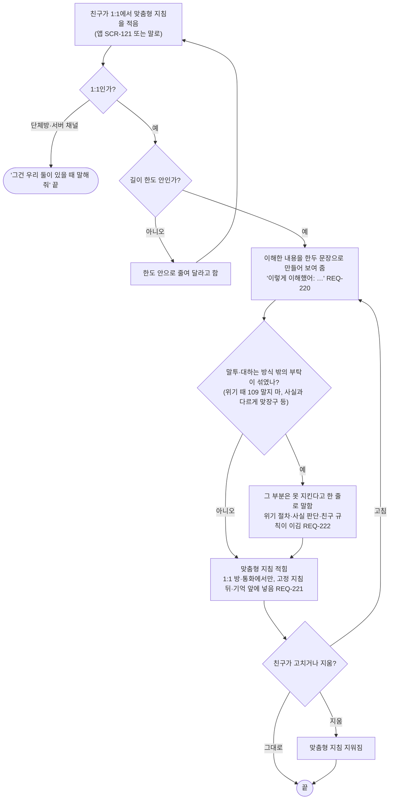

# FL-128 맞춤형 지침 적기

Serves: REQ-220, REQ-221, REQ-222
Screens: 앱 맞춤형 지침 화면(SCR-121), 디스코드 DM·카톡 1:1에서는 말로("마롱아, 앞으로 이렇게 대해 줘: …")
Context: CTX-008

- 확인을 다시 묻지 않아요. 이해한 내용을 보여 준 뒤 친구가 아무 말이 없어도 적힌 대로 써요(01 도메인 CTX-008 규칙).
- 꼭 지킬 것(선톡 횟수·밤 시간·금지 호칭·싫은 주제)이 지침 글에 있으면 친구 규칙이나 선톡 값으로 옮겨 코드가 지키게 하고, 그렇게 했다고 이해한 내용에 적어요(D25 셋째).
