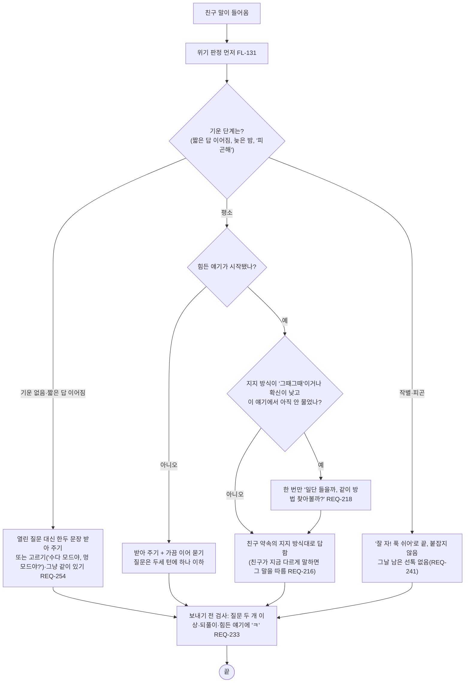

# FL-129 힘든 얘기와 지친 친구에게서 이야기 끌어내기

Serves: REQ-218, REQ-216, REQ-254, REQ-241, REQ-233
Screens: 없음(대화)
Context: CTX-001, CTX-008

- 기운 단계의 숫자(짧은 답의 길이와 횟수, 늦은 밤의 시각)는 04 단계에서 정해요(01 도메인 TERM-077, 추측).
- 마롱이 일상 한 줄 뒤 공 넘기기는 받아 준 다음에, 한 줄로만 해요(논의 3.2(5)).
