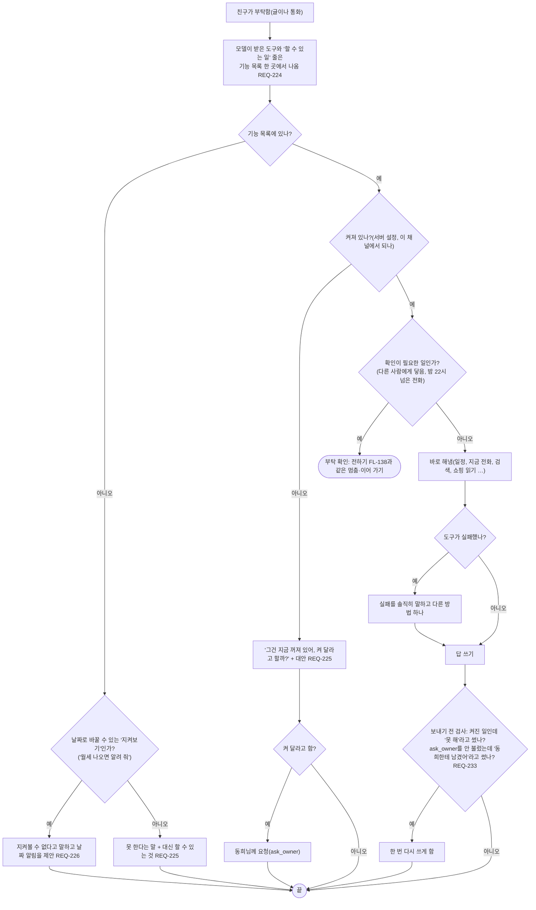

# FL-130 친구가 부탁하기

Serves: REQ-224, REQ-225, REQ-226, REQ-233
Screens: 없음(대화). 확인은 대화 안 확인 카드(SCR-123)
Context: CTX-010(바뀌는 기존 맥락 CTX-001·CTX-003)

- 지금 있는 일(일정 `schedule_*`, 지금 전화·약속 전화, 구글 캘린더 읽기, 쇼핑 페이지 읽기, 웹 검색, 이름 알려 주기, 동희님께 남기기, 통화의 기억 찾기·시각·끊기·구글 검색)이 모두 기능 목록에 있어요(01 도메인 CTX-010).
- 몸·식단 부탁은 같이 보되 CTX-012의 선 안에서예요(FL-132).
