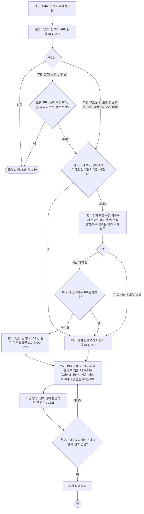

# FL-131 아주 힘든 말에 글과 통화가 같은 절차로 대응하기

Serves: REQ-227, REQ-228, REQ-229, REQ-230, REQ-232, REQ-222
Screens: 없음(대화·통화)
Context: CTX-012(바뀌는 기존 맥락 CTX-001·CTX-002)

- 글(모든 방)과 통화가 같은 위기 상태를 읽고 써요. 통화 중 판정 결과를 음성 모델에 알리는 방법은 01 도메인 6절 핫스팟이에요.
- 맞춤형 지침에 "109 말하지 마"가 있어도 이 절차가 이겨요(REQ-222).
- 평소 고민·힘든 얘기에는 109·상담·병원을 꺼내지 않는 '친구 먼저' 원칙은 그대로예요(동희님 2026-11-15).
