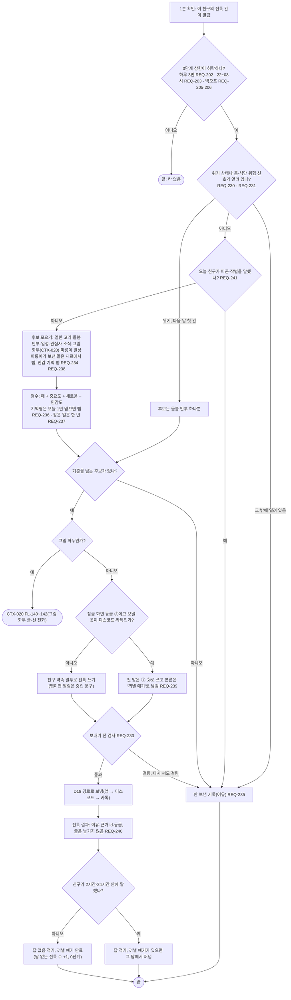

# FL-133 선톡 칸에서 보내거나 안 보내기

Serves: REQ-202, REQ-203, REQ-205, REQ-206, REQ-230, REQ-231, REQ-234, REQ-235, REQ-236, REQ-237, REQ-238, REQ-239, REQ-240, REQ-241, REQ-242, REQ-233
Screens: 없음(서버). 보낸 선톡은 디스코드 DM·카톡·앱 글 대화와 앱 알림
Context: CTX-009(CTX-011·008·012·013·020을 읽고 CTX-001로 보냄)

- 선톡 그래프로 바꾸기 전 3일 이상 그림자 모드로 이 흐름을 돌려 보내지는 않고 결정만 적어 지금 선톡과 견줘요(REQ-242).
- 0단계 백오프(1·2·4일)와 CTX-020의 간격 늘리기(4·7·14일)를 합치는 일은 04 단계 선톡 게이트 명세에서 해요(02 겹침 절).
