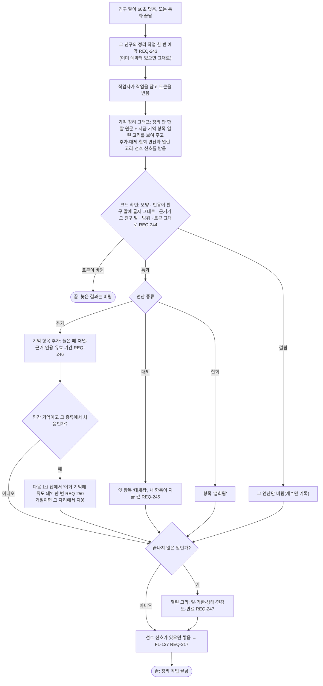

# FL-134 친구 말에서 친구 기억을 정리하기

Serves: REQ-243, REQ-244, REQ-245, REQ-246, REQ-247, REQ-250, REQ-217
Screens: 없음(배경 작업). 민감 기억 허락은 대화 안 확인 카드(SCR-123)
Context: CTX-011

- 정리 결과에는 글이 아니라 개수와 id만 로그에 남겨요(0단계 명세 1절 3번과 같은 규칙).
- 3단계 동안 지금 방별 메모·공유 메모도 그대로 돌고, 친구 기억은 그림자 모드로 견줘요(02 겹침 절).
