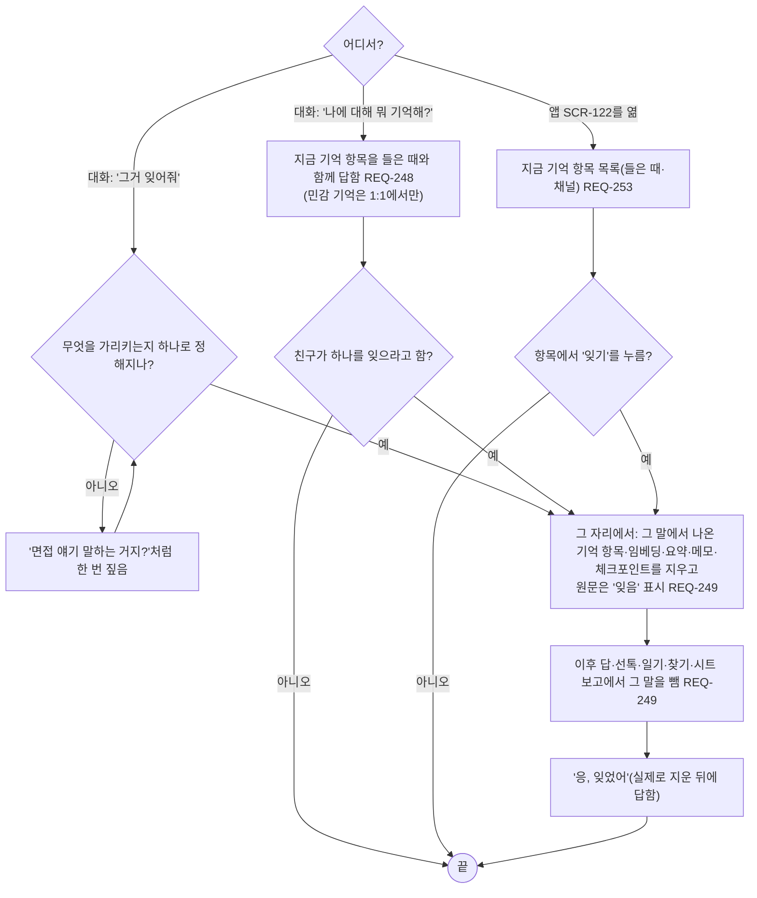

# FL-135 친구가 기억을 보고 잊게 하기

Serves: REQ-248, REQ-249, REQ-253
Screens: 앱 '마롱이가 기억하는 나'(SCR-122), 대화
Context: CTX-011(바뀌는 기존 맥락 CTX-007 일기)

- 원문 메시지를 봇이 지우지 못하는 지금 권한 규칙은 그대로예요(도메인 8절 질문 2의 추천안). 진짜 지우기는 동희님 관리 명령이에요.
- 통화 지시문의 '저장·삭제 작업을 수행했다고 말하지 마'는 이 흐름과 맞지 않아 04 단계에서 같이 고쳐요.
