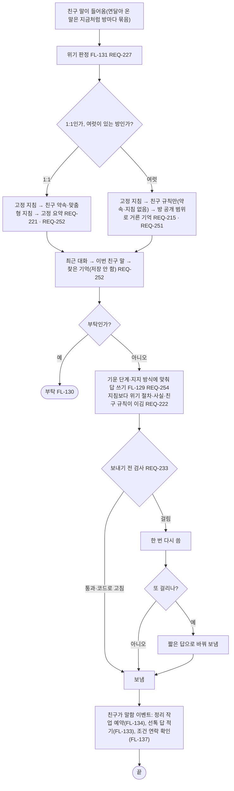

# FL-136 친구 말에 답하기(대화 턴)

Serves: REQ-215, REQ-221, REQ-222, REQ-227, REQ-233, REQ-251, REQ-252, REQ-254
Screens: 디스코드 DM·서버 채널, 카톡 1:1·단체방, 앱 글 대화
Context: CTX-001(CTX-008·010·011·012·013을 부름)

- 4단계에서 이 흐름이 대화 턴 그래프가 되고, 부탁 확인에서 멈췄다 이어 가요(FL-138). 스레드는 친구 단위예요.
