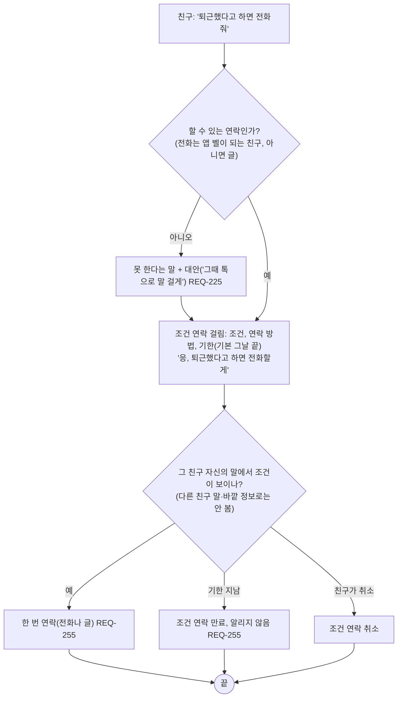

# FL-137 조건이 오면 연락하기

Serves: REQ-255, REQ-225
Screens: 없음(대화). 연락은 글이나 앱 전화(벨)
Context: CTX-010(바뀌는 기존 맥락 CTX-001, 앱 벨)

- 조건 연락은 선톡이 아니라 부탁이라 0단계 하루 3번에 세지 않아요. 밤 22\~08시면 친구가 시각을 콕 집어 말한 경우만 보내요(추론, 04 단계에서 정함).
