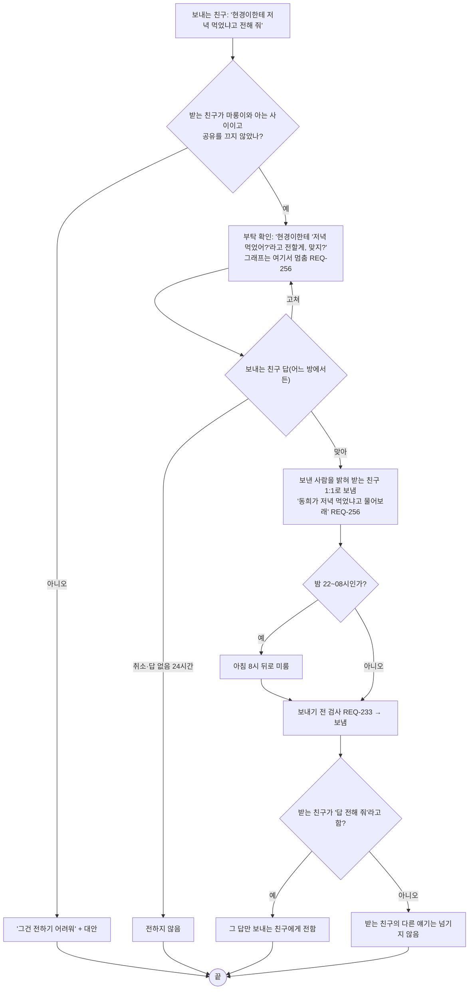

# FL-138 다른 친구에게 말 전하기

Serves: REQ-256, REQ-233
Screens: 대화 안 확인 카드(SCR-123)
Context: CTX-010

- 확인 앞에서 한 일(받는 친구 찾기)은 두 번 해도 같은 결과예요(그래프가 이어 갈 때 노드가 다시 돌아서).
- 전할 말은 보낼 표에 남기고 보내기 루프가 보내요(동기 호출 원 끊기, 01 도메인 5절).
