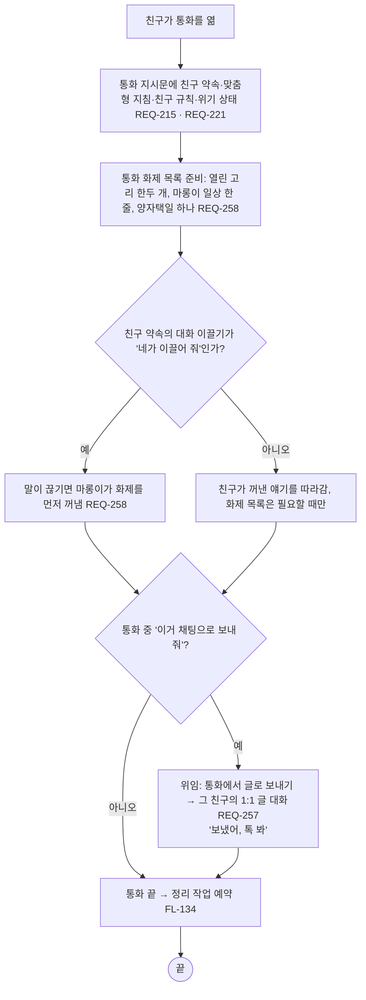

# FL-139 통화에서 화제를 꺼내고 글로 보내기

Serves: REQ-258, REQ-257, REQ-215, REQ-221
Screens: 앱·웹 통화 화면(바뀌지 않음), 앱 글 대화·디스코드 DM
Context: CTX-002·CTX-003(CTX-008·010·011을 읽음)

- 열린 고리가 민감하면 통화 화제 목록에도 넣지 않아요(REQ-238과 같은 규칙, 추론).
