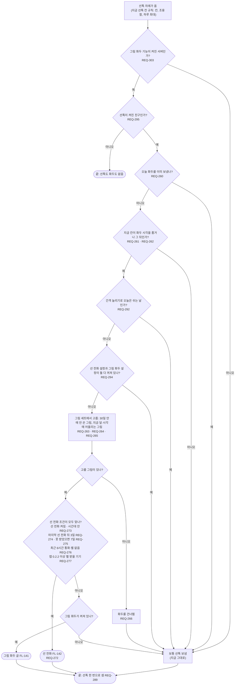

# FL-140 마롱이가 오늘의 화두를 고르기

Serves: REQ-260, REQ-261, REQ-262, REQ-263, REQ-264, REQ-265, REQ-266, REQ-272, REQ-273, REQ-274, REQ-275, REQ-276, REQ-277, REQ-289, REQ-292, REQ-294, REQ-295, REQ-303
Context: CTX-020(바뀌는 기존 맥락 CTX-001의 선톡 칸)

- 선톡 차례는 지금 선톡 규칙(칸 나누기, 친구가 조용한지, 칸 안에서 무작위 때)이 그대로 정해요. 화두는 그 차례 하나를 대신 써서 먼저 연락 횟수가 늘지 않아요(REQ-289).
- 그림 화두가 꺼져 있어도 선 전화가 켜져 있으면 선 전화는 걸 수 있어요. 이때 통화 화면에 그림은 띄우지 않아요(01 단계 4절).
- 화두를 고른 뒤 보내기에 실패해도 그날 화두는 쓴 것으로 셈해요(같은 날 두 번 보내지 않게, REQ-260).
