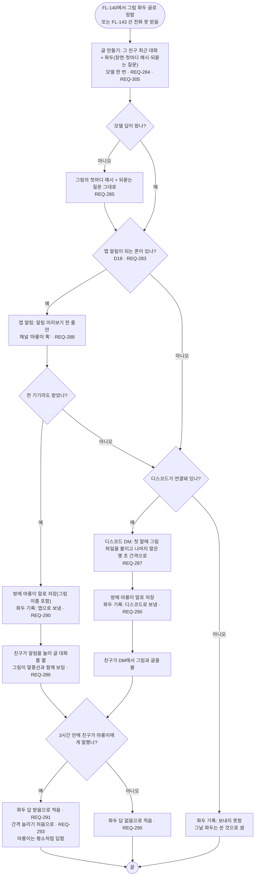

# FL-141 그림 화두 글을 받고 답하기

Serves: REQ-283, REQ-284, REQ-285, REQ-286, REQ-287, REQ-288, REQ-290, REQ-291, REQ-293, REQ-305
Context: CTX-020, CTX-001

- 그림 화두 글도 지금 선톡처럼 짧은 말 2\~3개예요. 앱 알림에는 글 대신 그림의 알림 미리보기 한 줄만 가서 잠금 화면에 개인적인 말이 보이지 않아요(REQ-288).
- 글 대화 기록에는 마롱이 말과 그림이 함께 남아, 나중에 다시 열어도 그림이 보여요.
