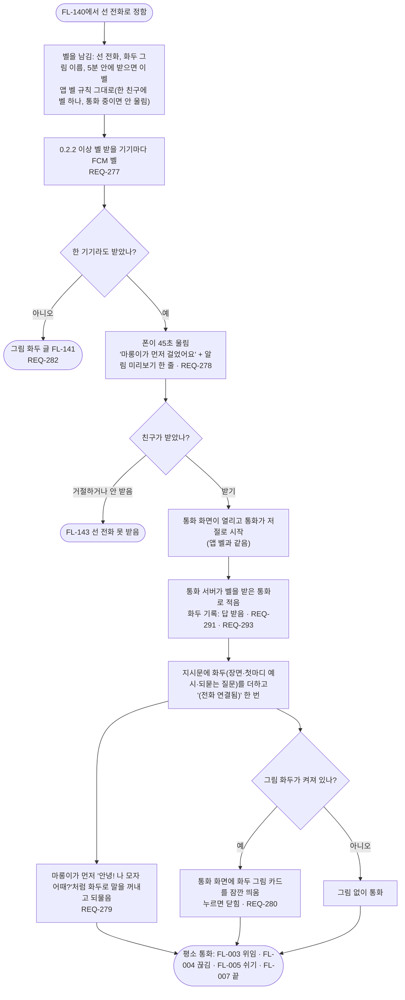

# FL-142 마롱이의 선 전화를 받기

Serves: REQ-272, REQ-277, REQ-278, REQ-279, REQ-280, REQ-291, REQ-293
Screens: 벨 화면 SCR-110·전화 알림 SCR-111([app-ring.md](../app-ring.md)), 통화 중 SCR-002(앱에서는 통화 창 SCR-101 안)
Context: CTX-020, CTX-002

- 받은 뒤의 통화는 평소 통화와 같아요. 친구가 끊어 달라고 하면 인사하고 끊어요(지금 규칙).
- 다시 연결돼도 '(전화 연결됨)'과 그림 카드는 다시 나오지 않아요(앱 벨의 '새로 받음' 규칙과 같음).
