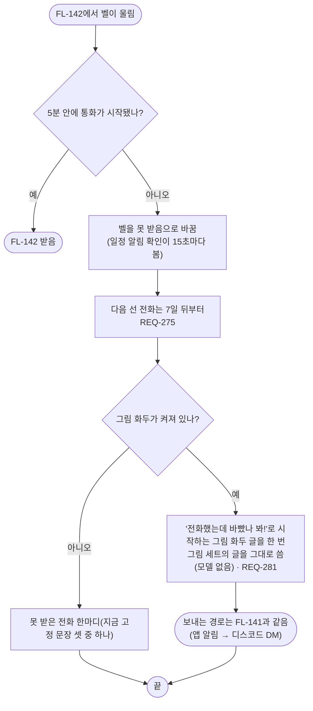

# FL-143 선 전화를 못 받았을 때

Serves: REQ-275, REQ-281, REQ-282
Screens: 전화 알림 SCR-111(닫힘), 앱 알림 SCR-108, 글 대화 SCR-107·SCR-112([app-chat.md](../app-chat.md)), 디스코드 DM(바깥)
Context: CTX-020

- 거절 버튼은 서버에 알리지 않아서 5분 뒤 못 받음과 같아요(앱 벨 규칙).
- 못 받은 선 전화의 그림 화두 글도 그날 화두 하나로 셈해서, 같은 날 화두가 또 가지 않아요(REQ-260).
