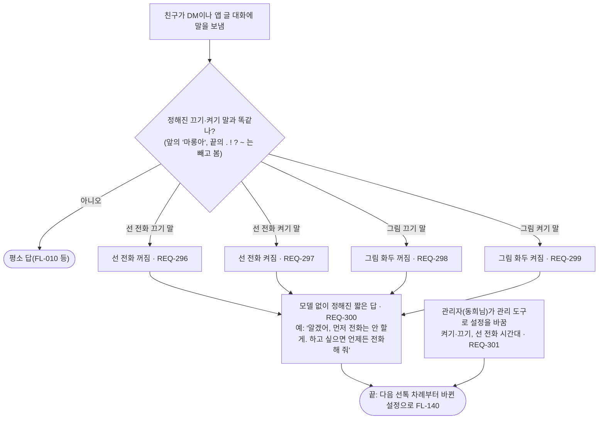

# FL-144 선 전화와 그림 화두를 끄고 켜기

Serves: REQ-294, REQ-295, REQ-296, REQ-297, REQ-298, REQ-299, REQ-300, REQ-301, REQ-302
Screens: 글 대화 SCR-107·SCR-112([app-chat.md](../app-chat.md)), 디스코드 DM(바깥). 관리 도구는 동희님 터미널
Context: CTX-020, CTX-001

- 선톡 끄기('선톡 끄기' 등 지금 말)를 하면 선 전화와 그림 화두도 함께 멈춰요(REQ-295). 선 전화 설정과 그림 화두 설정은 그대로 남아 있다가 선톡을 다시 켜면 이어져요.
- 처음에는 둘 다 켜져 있어요(REQ-294, 확인 질문 3). 선 전화 시간대를 말로 바꾸는 것은 이번 버전에서 빼고 관리 도구로만 해요(REQ-302 deferred).
