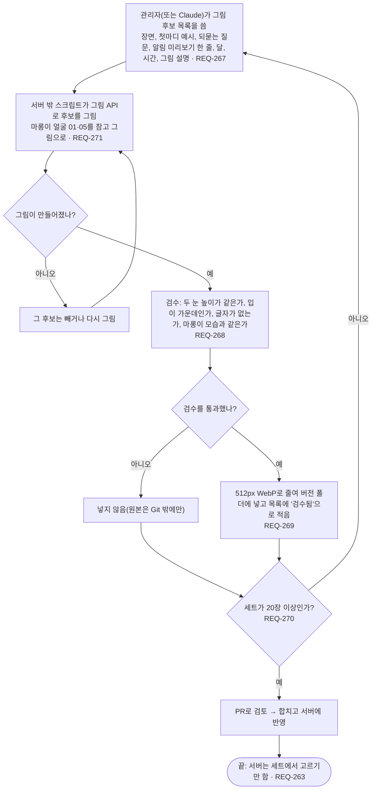

# FL-145 그림 세트에 그림을 더하기(관리자)

Serves: REQ-263, REQ-267, REQ-268, REQ-269, REQ-270, REQ-271
Context: CTX-020

- 이미 내보낸 그림 이름은 바꾸지 않아요. 고치려면 새 이름으로 더하고 옛 그림은 목록에서 '뺌'으로 적어요(얼굴 그림 `face/v1`과 같은 규칙).
- 원본 그림(1024px PNG)과 검수 기록은 프로젝트 공유 폴더에 두고 Git에는 줄인 WebP와 목록만 둬요(D14).
