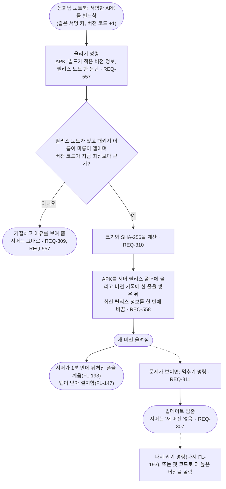

# FL-146 새 버전 올리기와 멈추기(관리자)

Serves: REQ-306, REQ-307, REQ-309, REQ-310, REQ-311, REQ-312, REQ-557, REQ-558
Screens: 없음(노트북 명령 줄)
Context: CTX-021

2026-11-22 기능 변경(D127): 올릴 때 릴리스 노트를 꼭 받고, 올린 릴리스를 버전 기록에 쌓아요. 새 릴리스가 최신이 되면 서버가 뒤처진 폰을 깨워요(FL-193, D122·D124). 바뀐 칸은 B·C·E와 F 뒤예요.

- 올리기 전에 에뮬레이터에서 새 APK를 한 번 깔아 봐요(01 단계 6절: 낮은 버전으로 되돌릴 수 없어서). 2026-11-22부터는 실제 삼성 폰 시험(12 단계 TC-614\~616)도 게시 조건이에요.
- 서버 로그에는 버전과 결과만 남아요(REQ-312). 릴리스 노트는 버전 기록에만 있고 앱과 친구에게는 가지 않아요(REQ-554).
