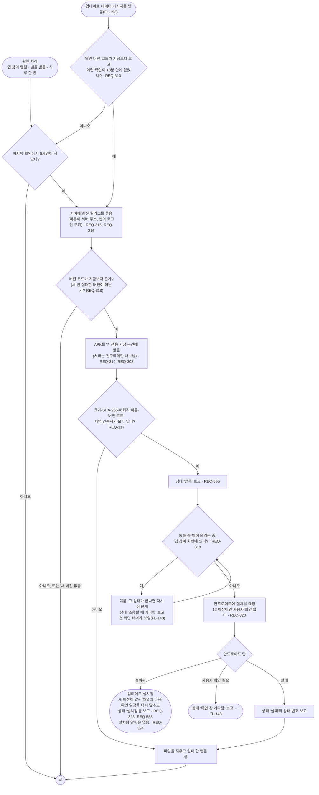

# FL-147 앱이 새 버전을 받아 설치하기

Serves: REQ-308, REQ-313, REQ-314, REQ-315, REQ-316, REQ-317, REQ-318, REQ-319, REQ-320, REQ-322, REQ-323, REQ-324, REQ-555
Screens: 없음(앱이 화면 없이 함). 확인이 필요하면 FL-148, 받아 둔 버전은 첫 화면 배너(FL-148)
Context: CTX-021

2026-11-22 기능 변경: 업데이트 데이터 메시지가 높은 버전을 알리면 6시간 규칙 없이 확인해요(A2, D123). 상태가 바뀌는 곳마다 서버에 업데이트 상태를 보고해요(점선 S, FL-194, D125).

- 로그인, 알림·벨 설정, 푸시 등록은 업데이트 설치 뒤에도 그대로예요(REQ-322).
- Access 로그인이 끝난 폰은 릴리스를 받지 못해서 실패로만 셈하고, 앱을 열어 다시 로그인하면 그 뒤 확인에서 받아요(01 단계 6절). 상태 보고도 로그인이 없으면 가지 않아요(FL-194).
- '벨을 받음'은 데이터만 든 푸시예요. 선톡처럼 알림이 든 푸시는 앱이 백그라운드면 확인을 깨우지 않아요(사실, 도메인 4절 '왜 바꾸나'). 승인된 글 '푸시를 받음'을 이렇게 좁혀 적었어요.
- 받아 둔 파일이 있는데 설치 작업이 늦는 고장(TC-222)은 버그 수정 PR #100(BUG-112, Orca 마롱이 항목 4)이 고쳐요.
