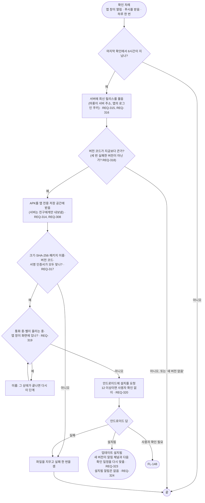

# FL-147 앱이 새 버전을 받아 설치하기

Serves: REQ-308, REQ-313, REQ-314, REQ-315, REQ-316, REQ-317, REQ-318, REQ-319, REQ-320, REQ-322, REQ-323, REQ-324
Screens: 없음(앱이 화면 없이 함). 확인이 필요하면 FL-148
Context: CTX-021

- 로그인, 알림·벨 설정, 푸시 등록은 업데이트 설치 뒤에도 그대로예요(REQ-322).
- Access 로그인이 끝난 폰은 릴리스를 받지 못해서 실패로만 셈하고, 앱을 열어 다시 로그인하면 그 뒤 확인에서 받아요(01 단계 6절).
