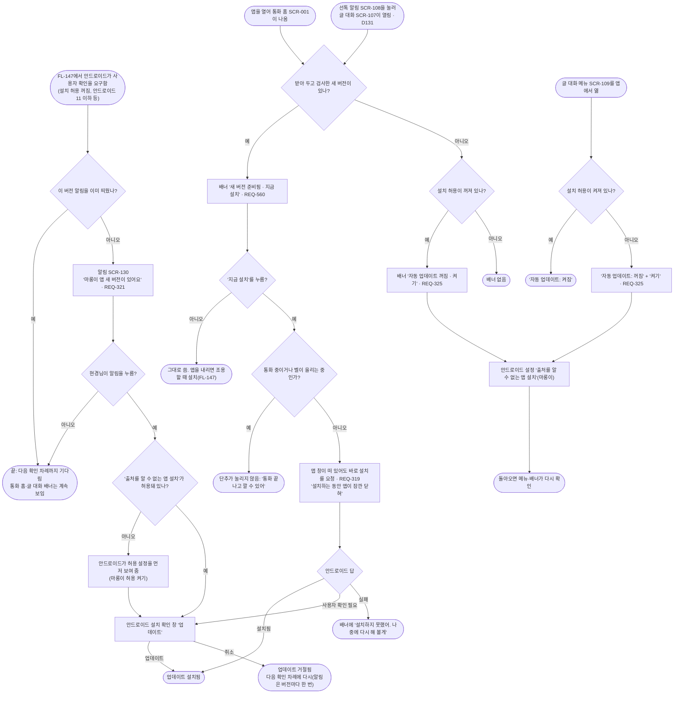

# FL-148 사용자 확인, 지금 설치, 처음 허용

Serves: REQ-319, REQ-321, REQ-325, REQ-326, REQ-560, REQ-561
Screens: 업데이트 알림 SCR-130, 통화 홈 SCR-001과 글 대화 SCR-107의 업데이트 배너, 글 대화 메뉴 SCR-109([app-chat.md](../app-chat.md)), 안드로이드 설정과 설치 확인 창(바깥)
Context: CTX-021

2026-11-22 기능 변경: 앱에서 연 통화 홈(SCR-001)과 글 대화(SCR-107)에 같은 업데이트 배너가 생겨요(글 대화는 D131). 선톡 알림을 누르면 글 대화가 바로 열려서 거기서도 보여요. 받아 둔 새 버전이 있으면 '지금 설치'(D128·D129), 자동 업데이트가 꺼져 있으면 '자동 업데이트 켜기'(D130). 알림과 메뉴 줄은 그대로예요.

- 브라우저에서 연 글 대화·글 대화 메뉴와 통화 홈에는 줄도 배너도 없어요(REQ-326, REQ-561). 0.3.2 이하 앱에도 배너가 없어요.
- 배너는 두 화면 모두 같은 앱 연결(`window.__marongApp`)로 상태를 읽어요. 앱의 두 창(통화 창, 글 대화 창)에 같은 페이지 스크립트가 들어가서, 상태와 '지금 설치'가 어느 화면에서나 같아요(SPEC-439, SPEC-443).
- 거절한 버전은 다음 확인 차례에 다시 설치를 요청하지만, 알림은 같은 버전에 한 번만 띄워요. 배너는 받아 둔 파일이 있는 동안 늘 보여요(REQ-321).
- 문구는 08 화면 상태([app-update.md](../08-screens/app-update.md))가 원본이에요.
