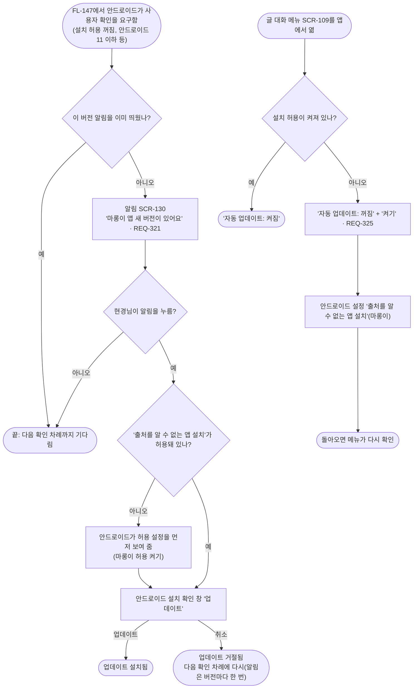

# FL-148 사용자 확인이 필요할 때와 처음 허용

Serves: REQ-321, REQ-325, REQ-326
Screens: 업데이트 알림 SCR-130, 글 대화 메뉴 SCR-109([app-chat.md](../app-chat.md)), 안드로이드 설정과 설치 확인 창(바깥)
Context: CTX-021

- 브라우저에서 연 글 대화 메뉴에는 이 줄이 없어요(REQ-326).
- 거절한 버전은 다음 확인 차례(6시간 뒤)에 다시 설치를 요청하지만, 알림은 같은 버전에 한 번만 띄워요. 메뉴의 '켜기'로 허용하면 그 뒤로는 묻지 않아요.
