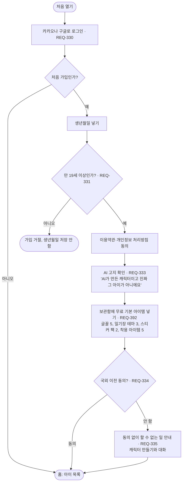

# FL-150 가입하고 동의하기

Serves: REQ-330, REQ-331, REQ-333, REQ-334, REQ-335, REQ-336, REQ-337, REQ-392, REQ-428
Screens: 07 단계 뒤에 SCR를 채워요
Context: CTX-025

- 국외 이전 동의는 설정에서 언제든 철회해요(REQ-336). 철회하면 새 대화와 새 그림이 멈추고, 이미 만든 캐릭터와 일기는 볼 수 있어요.
- 화면과 아이의 말은 한국어, 값은 원화예요(REQ-428).
- 1차에는 광고성 푸시를 두지 않아서 가입 때 광고성 푸시 동의를 받지 않아요(REQ-337). 두게 되면 이 흐름에 선택 동의 두 개(낮, 밤)를 더해요.
